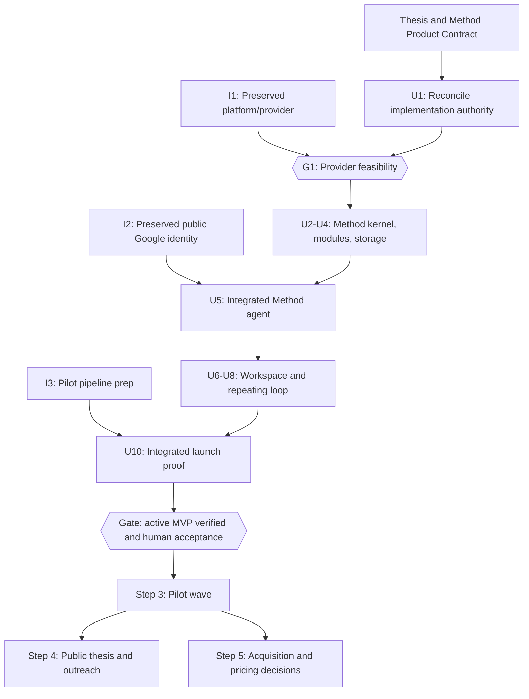
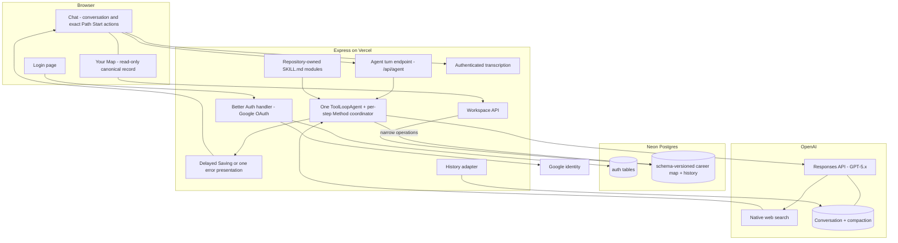
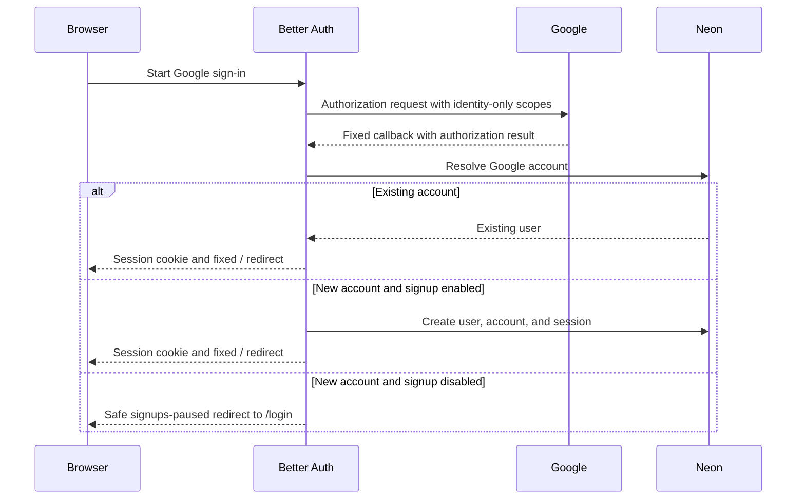
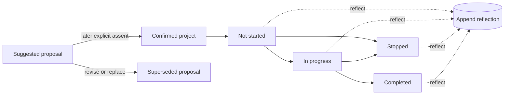
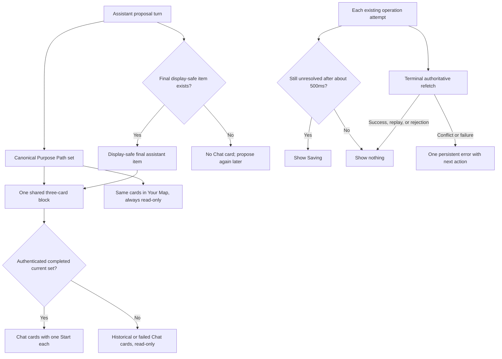

# Revelio Revamp (Claude) - Plan

> **MVP scope amendment (2026-10-13):** The coordinator-approved [repeating-learning plan](2026-10-13-1220-feat-repeating-learning-mvp-plan.md) reconciles current delivery in place. Method F1–F3 and AE1–AE9/AE13–AE14 are active; Method F4–F5, AE10–AE12, R34–R40, the former Method KTD9 peer prerequisite and U9 are deferred references. Five modules are active: Foundation, Paths, Design, Guide and Interpret. Focus commitment remains within the repeating loop. Preserve every ID, landed history and historical record; deferred specifications never become deployment or resume gates. At this amendment, U7 founder acceptance was pending as a human release/incorporation gate and isolated U8 implementation was authorized without claiming that acceptance. The U7 human gate is now accepted on 2026-10-30, as recorded below. This prose amendment authorizes no paid runs, live-account turns, deployment or account actions. Historical dates and full-tail choices below are retained as history, not renewed delivery deadlines. See [deferred features](../method/deferred-features.md).

## Legacy retirement amendment — 2026-11-02 (founder-directed)

The founder approved retiring the obsolete experience: “no one needs the old legacy experience.” This supersedes every conflicting requirement below to preserve anonymous `/legacy`, its APIs/provider behavior, or its paid browser-journey gate. Historical receipts and dated checkpoints keep their original meaning.

- `/legacy`, `/results` and `/action-plan` return to the current login/entry. The questionnaire, generated results and action-plan workflow is no longer offered.
- Retire the public assessment, questionnaire/save, analyze/stream, action-plan/stream, session read/start-over, legacy transcription and legacy analytics API namespaces before body parsing or storage/provider work, for every HTTP method and matching mount alias. Known retired APIs return stable JSON 410, not SPA HTML.
- Preserve all existing legacy records/tables, schema, provider conversations, auth accounts and credentials. This is route retirement, not data deletion or migration. Unmounted modules and their compatibility fixtures may remain.
- API/error logging records safe metadata only; no bearer-bearing request paths, response/transcript/answer prefixes or raw AI error payloads. Keep protected Method/auth/audio behavior, public signup, current access policy, operator reporting and existing Method safeguards unchanged.
- Verification now proves retirement and zero legacy work, retained data, safe logs and unaffected authenticated Method behavior. Paid legacy E2E is disabled even with its former opt-in. Current check selection is in the verification runbook/matrix.
- This decision authorizes implementation/local verification and review of the scoped remediation. Deployment, push/merge, remote settings, schema and credential changes remain separately gated. Dependency upgrades are outside this batch.

## Release-scope amendment — 2026-10-31 (founder-directed)

This amendment supersedes conflicting I3/U10 prerequisites and checklist wording below; retained dated accounts describe their original checkpoints, not current release blockers.

- Participant invitation/contact/data-review notice preparation is deferred until identifying and contacting early-access participants. Explain founder and assisting-AI conversation review in that outreach; no new notice flow or per-review ceremony is required now.
- Additional whole-account/cross-store erasure tooling, runbook completion and operational dry runs are deferred until a deletion request arises. They are not prerequisites for MVP release. Existing deletion mechanisms, private-output handling, security protections and their regression tests remain intact; this deferral neither removes them nor claims complete erasure has been verified.
- The founder removed the manual screen-reader/spoken-navigation release requirement, including U10's former attended check. Retain existing semantic, keyboard/focus, live-region/status, accessibility-tree, contrast and responsive checks. Do not mark the removed check as passed or restore it through older text.
- Preserve requirement/unit IDs and historical records. I3's deferred preparation no longer blocks U10. This amendment authorizes documentation reconciliation only, not deployment, account actions or expanded testing.

## Current verification entrypoint — 2026-10-31

Use [Verify Nami](../runbooks/nami-verification.md) and its [scenario/active-ID matrix](../runbooks/nami-verification-scenarios.md) for current check selection and evidence. These supersede obsolete generic E2E/sample-cap wording below only for the verification kit: `npm run test:e2e` is opt-in paid `/legacy` coverage, not Method/auth coverage, and the formerly cited `tests/explore.spec.ts` does not exist. Method browser proof uses the actual UI with canonical state/reload alongside the existing deterministic suites. Deliberately selected real provider/model tests are allowed; preserve first failure, diagnose before retry, observe progress/available usage and stop/notify runaway or unexpected cost. Do not add arbitrary tight call caps or a budget system. Existing security/runtime limits and separate deployment/configuration/write-scope authorization remain.

## Current acceptance status — 2026-10-30

**U7 founder acceptance: accepted.** The founder explicitly said, “id say we are ok to accept u7 then.” This closes the attended qualitative/actual-app founder U7 gate on the current integrated V6 Paths, V4 voice, Shared, Design, Guide and Interpret behavior, the retained actual QA and owner judgments, and the bounded terminal-binding assessment in `033f8d7` / `63d7ab2`. See [the acceptance and bounded reliability evidence](../dogfood/2026-10-30-binding-admission-grace.md#founder-u7-acceptance--2026-10-30) and [the dogfood tracker](../dogfood/findings.md#current-founder-acceptance--2026-10-30). No further personal-session continuation is required for this acceptance.

**U8:** operational implementation and the evidenced repeating loop are present; separate release verification remains. U7 acceptance does not check off unverified U8/U10 or infrastructure gates. I3 pilot disclosure and cross-store erasure, metrics definition/tracking, the remaining release checks and deployment acceptance are separate work. The request to expand metrics, pilot erasure and release next is recorded as next work, without authorizing new implementation or a planning chat in this update.

The acceptance is a product/Method gate decision. It does not accept or start the founder's saved project, repair past learning or the original Failed turn, establish full MVP/U10 or erasure compliance, mark metrics done, or authorize model/account actions, push, PR, deployment or heartbeat. DF-03 remains observation-only, DF-15's in-app Google navigation cause remains unknown, UI-01 source pills remain unimplemented, and the original DF-18 trigger remains unreconstructed with its documented bounded residual risk. These retained limits do not automatically reopen the accepted U7 gate. Dated pending-gate notes below describe their original checkpoints and are superseded only for U7 acceptance.

## Goal Capsule

- **Objective:** Implement the repeating-learning MVP within Steps 1–2; the original 2026-09-15 gate is historical: preserve the settled product shell, identity, provider, deployment, and legacy behavior; rebuild the default product around the repeating Revelio learning loop; and prepare the pilot pipeline. Steps 3–5 stay sequenced gates, to be enriched on pilot evidence.
- **Authority hierarchy:** This plan is the implementation authority. `docs/thesis.md` is the Method authority. The tracked Product Contract at `docs/plans/2026-08-29-1133-feat-revelio-method-plan.md` must be present at that exact path and expose every retained Method R1–R48/F1–F5/AE1–AE14/KTD1–KTD12 ID, explicitly classifying active delivery and deferred detail under R2; it translates the thesis and founder-settled Method decisions into normative behavior and is incorporated here by reference. This plan owns sequencing and the preserved infrastructure contract. The explicit R9 commitment-state interpretation, R20 English-pilot canonical-copy rule, R21 limit on custom quota policy, the 2026-09-03 MVP research simplification, and the 2026-09-05 conversation-first presentation amendment reconcile cross-contract differences. The latest amendment makes Chat the only acting surface, makes Your Map read-only, replaces user-facing Why language with Your North Star, removes lexical authorization, restricts assistant Markdown, and reduces persistence feedback to delayed Saving plus one error presentation. It reopens only the affected U5–U7 acceptance atop landed baseline `20f08cd`; I3 remains preserved; U8 is reconciled below for the repeating-learning MVP. Otherwise the thesis wins on Method philosophy, the Method Product Contract wins on product behavior, and this plan wins on implementation sequencing.
- **Execution profile:** Solo founder at 10–15 hours/week plus coding agents. The timebox governs optional polish, not silent contract erosion: preserve the settled safeguards; the original 2026-09-15 gate is historical and creates no renewed deadline. Removing or weakening any bound Method R/F/AE, unit verification, or Definition of Done item requires an explicit plan amendment.
- **Stop conditions:** Stop and surface — do not guess — if (a) the amended Sol loop cannot preserve automatic choice, native contextual search with ordinary provider citations, strict writes, lease, stream, abort, idempotency, Conversation, per-step Method refresh, result ordering, and compaction together, (b) the AI SDK v7 upgrade breaks the legacy assessment flow beyond the fallback in I1, or (c) a new production dependency beyond those named in this plan seems needed (repo rule: ask first). Isolated research, a preliminary classifier, a no-write routing tool, or any research-to-write authority layer is not an MVP fallback.
- **Tail ownership:** The founder owns gate dates, Method sign-off through the thesis and live transcripts, and pilot operations (I3, Revamp AE3–AE4). Code units are agent-executable.

---

## Product Contract

Reconciled 2026-08-29 and amended in place through 2026-09-05. The Revamp R/F/AE IDs keep their delivery, platform, access, rollout, and legacy-product meaning. The latest amendment updates R4, R8, R17, R18, R20, F1, and F2 and adds R22–R26 and AE12–AE17 without renumbering prior IDs. Method behavior is governed by the Product Contract in `docs/plans/2026-08-29-1133-feat-revelio-method-plan.md`, subject to the named amendments in the Authority hierarchy; references in this plan are qualified as **Method R…**, **Method F…**, **Method AE…**, and **Method KTD…** so they cannot be confused with this plan's Revamp IDs. The Method contract is bound rather than copied here, and `docs/thesis.md` remains its philosophical authority. Any old active-plan unit names inside the bound Method artifact are pre-reconciliation mapping labels only; the Implementation Units in this active plan are the sole live unit IDs and sequencing. This amendment reopens affected acceptance in U5, U6, and U7, creates no new implementation unit, and preserves every U-ID and landed commit.

This reconciliation replaces the earlier ikigai statement, direction path, experiment, generic confirmation, and continue/switch/new assumptions with Your North Star, Purpose Paths, Path Projects, What You Learned, user-owned Next Moves, continued learning after focus commitment, path changes, Foundation reconsideration and preserved pause/resume. It preserves public Google identity, OpenAI Conversations and compaction, one active turn, the React/Vite + Express + Neon + Vercel stack, request-level provider safeguards, and the anonymous `/legacy` product.

### Summary

Revamp Revelio from a one-shot report generator into an adaptive exploration companion that carries repeated learning across sessions: form a provisional North Star, choose among three Purpose Paths, learn through Path Projects, decide the Next Move, and continue learning after focusing provisionally on a path. The settled infrastructure and parallel pilot pipeline support that Method rather than redefining it.

### Problem Frame

Revelio was built a year ago around a one-shot flow: an 8-question questionnaire produces three purpose paths and a static action plan, exported as a report. The product has had zero real users; acquisition was attempted once, with a single unanswered LinkedIn message. The December 2025 research is desk research and synthetic-persona testing (docs/research/2025-12-26-synthetic-user-feedback.md); no demand evidence exists in either direction.

The founder — himself a member of the target audience — does not believe the current product is good enough to sell. It fails his bar in three ways: outputs are static and cannot be iterated in dialogue; experiment design is generic, with no grounding in current real-world information; and the adaptive companion that guides exploration over time — judged the real, uncracked value — does not exist. The current system prompt also assumes the user "already know[s] but ha[sn't] articulated" their purpose (server/ai/prompts.ts:174), while the accumulated research concludes that decisive self-knowledge is generated by acting, not recovered by reflection.

The rethink exists but is unstructured: a 39-thread braindump spanning thesis, product form, method design, pricing, outreach, and go-to-market. The binding constraints are a solo founder at 10–15 hours/week beside a day job, and a moat thesis — a codified evidence-based method plus demonstrable results from a tight feedback loop — that cannot materialize without users.

### Key Decisions

- **Rebuild before pilots** (session-settled: user-directed — chosen over pilot-first manual validation: the current product fails the founder's own belief bar, and he will not sell what he does not believe in). Governs R3–R9.
- **Deadline gate over user-count gate** (session-settled: user-directed — chosen over gating on acquired users: the deadline is within the founder's control). Governs R3.
- **Input gates ride alongside the deadline** (session-settled: user-approved — pipeline gates bind on actions in the founder's control, countering the risk that the build absorbs the year). Governs R10.
- **Beachhead: career explorers like the founder** (session-settled: user-directed — chosen over students-now and over a criteria sprint: honest dogfooding, no gatekeepers, fastest feedback loop). Governs R6, R10, R16.
- **The thesis is the Method authority** (session-settled: user-directed — the completed `docs/thesis.md` states the philosophy the rebuild embodies; the Method Product Contract translates it into testable behavior without authoring a second thesis). Governs R1–R2 and all Method R1–R48.
- **Agent experience over web-app flow** (session-settled: user-directed — chosen over improving static generation: dialogue, iterable outputs, and persistent memory are both the 2026 baseline and the personalization mechanism). Governs R4–R5, R7.
- **Plan shape: two-track build month, thesis as asset** (session-settled: user-approved — chosen over a sequential relay and over a full public-essay program: no dead weeks after the build, without becoming a content project). Governs R10–R11, R14.
- **AI-drafted research is input, not decision** (session-settled: user-directed — the 2026-08-11 direction doc's conclusions hold only where the founder re-affirmed them in this plan). Pure framing; no governed Rs.
- **Adaptive, coverage-guided Foundation over a fixed questionnaire** (session-settled: user-directed — ask one short question per turn, reuse rich answers, and probe only until the evidence supports a North Star suggestion). Governs R8 and Method R5–R12.
- **English-only pilot copy without Method language switching** (session-settled: user-directed 2026-09-26 — the new product and Method use English canonical copy. The model may naturally answer a non-English message; Revelio adds no Method-level language-mirroring, switch, or fixed-translation requirement). Governs R20.
- **Three Purpose Paths, picked without interference** (session-settled: user-directed — the agent proposes three distinct, equally weighted ways to serve the confirmed North Star; the explorer discusses, combines, modifies, or replaces them and explicitly chooses one. The agent recommends only when asked). Governs R9 and Method R13–R17.
- **Chat is where the explorer acts; Your Map is where they look.** (session-settled: user-directed — chosen over controls in both surfaces: decisions belong beside the conversation and the map is the durable read-only record.) Governs R17, R22.
- **The founder-selected Purpose Path cards are reused, not redesigned.** (session-settled: user-directed — one component preserves the five-band comparison and equal visual weight in Chat and Your Map.) Governs R22.
- **User-facing Foundation language is “Your North Star.”** (session-settled: user-directed — chosen over exposing internal Why vocabulary: the term communicates a provisional direction without a broad data or operation rename.) Governs R4, R8, R20, R25.
- **The main agent judges confirmation intent.** (session-settled: user-directed — chosen over positive phrase and path-alias lists: the existing context-rich agent already interprets the message in its language, while deterministic target and sequencing guards protect state.) Governs R18, R26.
- **Assistant Markdown is a small inert subset.** (session-settled: user-directed — chosen over either raw paragraphs or general Markdown/HTML: prose needs structure without adding model-authored links, images, or active content.) Governs R23.
- **Persistence feedback is delayed Saving plus one error presentation.** (session-settled: user-directed — chosen over five visible statuses: success is silent and non-confirmation is conversational.) Governs R24.
- **A revised North Star names its downstream impact before reconfirmation.** (session-settled: user-directed — the explorer must understand what confirmation invalidates and acknowledge it in a later turn.) Governs R25.
- **One first Path Project; three later choices** (session-settled: user-directed — onboarding gets one thoughtfully designed project for collaborative refinement; after a learning loop, explore-further produces three equal project options and the explorer chooses one). Governs R9 and Method R18–R25, R48.
- **The explorer owns the Next Move** (session-settled: user-directed — evidence informs but never predicts the choice; no fixed project count, duration, score, or recommendation decides whether to explore further or commit provisionally). Governs R9 and Method R26–R33.
- **Public access behind Google identity** (session-settled: user-approved — chosen over invite-only magic links: a manual access gate adds acquisition and email-infrastructure work without current usage or abuse evidence; session-derived ownership, request-size bounds, one-turn concurrency, user interruption, billing alerts, and kill switches cover the observed pilot risk without limiting normal use). Governs R19, R21, AE6, AE10, AE11.
- **Contextual research belongs to the main agent loop** (session-settled: user-directed — chosen over isolated, de-identified, separately modeled research: useful Method research needs the full Conversation and focused Career Map context without a lossy public taxonomy). Governs R6, R17–R18 and Method R14, R17, R24, R35–R40, R46.
- **One intelligent loop owns conversation and state-change decisions** (session-settled: user-directed — chosen over preliminary routing/authorization model calls and an internal no-write tool: the agent should choose natural reply, search, or a stage tool and continue from authoritative results). Governs R4–R6, R17–R18 and Method R41, R44–R46.
- **Five active state-selected Method modules preserve the existing architecture.** U3 owns Foundation, Paths and Design; U8 adds Guide and Interpret. Find Relevant Peers and Enter Through Side Doors are deferred references. Governs active R4, R8–R9 and the incorporated Method contract.

### How This Work Fits Together

<!-- ce-section: work-relationships -->

This plan owns the revamp's sequencing, scope, and gates and incorporates the Method Product Contract by reference. Steps 3–5 get their own enrichment when they start; their breakdown below is the current understanding, not a committed roadmap.

- Step 1 — Thesis and Method authority. `docs/thesis.md` is complete; U1 reconciles this implementation authority with the Method Product Contract.
- Step 2, infrastructure track — Platform preparation and identity (I1, I2) preserve the settled shell, public Google access, provider, and `/legacy` contracts.
- Step 2, Method track — G1 and U2–U8/U10 implement repeated learning; U9 is wholly deferred.
- Step 2, pipeline track — I3's private candidate list and invitation proceed independently and share the R3 gate date; erasure-runbook finalization and its dry run wait for I2, U4, and U5.
- Step 3 — Pilot wave. Depends on both Step 2 tracks. Not unitized here.
- Step 4 — Public thesis and outreach. Depends on Step 3 evidence. Not unitized here.
- Step 5 — Commercialization decisions. Depends on Step 3; draws on the first-customer research in docs/research/. Not unitized here.



### Actors

- A1. Founder — solo builder-operator at 10–15 hours/week; also a member of the beachhead and the product's reference user.
- A2. Pilot explorer — a person whose next work direction is genuinely unresolved; recruited directly without gatekeepers; uses the agent and runs real Path Projects between sessions. Employment status is context, never an eligibility gate.
- A3. The Revelio agent — the rebuilt product: conversational, memory-bearing, guiding the Method lifecycle and learning loop.
- A4. Field contacts — the Stanford Life Design network and Bill Gurley; Step 4 outreach targets, approached with prototype and pilot evidence in hand.

### Requirements

**Step 1 — thesis and Method authority**

- R1. `docs/thesis.md` is the founder-approved Method authority. Pilot evidence may revise it later; implementation does not author a replacement thesis.
- R2. The tracked Method Product Contract must be present at `docs/plans/2026-08-29-1133-feat-revelio-method-plan.md`, preserving R1–R48, F1–F5, AE1–AE14 and KTD1–KTD12. Binding active delivery is F1–F3 and AE1–AE9/AE13–AE14; R34–R40, F4–F5, AE10–AE12, the former KTD9 guard and U9 retain explicitly deferred detail. This plan owns implementation sequencing; the approved 2026-10-13 amendment reconciles scope without renumbering history.

**Step 2, build track — agent rebuild (timeboxed)**

- R3. The original 2026-09-15 rebuild deadline is historical. Current completion means the active repeating-learning MVP and preserved release safeguards pass; no replacement deadline or date/count trigger for deferred features is introduced. Scope changes require an explicit amendment, as approved on 2026-10-13.
- R4. The rebuilt product is an agent the user converses with: North Star, Paths, Projects, practical guidance, reflection and Next Moves can be questioned and refined across repeated sessions. Focus commitment continues the loop; formal Peers, proof and Side Doors are deferred.
- R5. The agent has persistent memory across sessions: it retains the canonical Method state and lineage defined by Method R41–R46, and its next turn derives from that state. Stable server-derived identity owns the map; conversation and product memory remain separate stores.
- R6. Research and Path Project support are personalized and grounded under Method R14, R17, R19–R25 and R46 (R34–R40 remain deferred detail). Current-world research is ordinary contextual conversation inside the main Sol `ToolLoopAgent`, with automatic native web search, the full server-owned OpenAI Conversation, the active repository module, and focused Career Map context. Provider citations remain visible in bounded conversation/history transport, but research never authorizes or becomes part of canonical Career Map state and never performs an external action for the explorer.
- R7. Input is a text box with an optional microphone button reusing the existing speech-to-text capability, image paste and a direct file picker for PNG/JPEG/WebP, PDF and Word (.doc/.docx), limited to 3 MB total per message. Attachments provide turn context; existing text history retains labels rather than app-owned originals or previews. Text remains the primary output. Attachment scope and acceptance are defined in `docs/plans/2026-10-24-1612-feat-chat-attachments-mvp-plan.md`.
- R8. The entry experience forms the Foundation and a provisional North Star exactly as Method R5–R12 specify: one short question per turn, minimum sufficient coverage, doing evidence before consumption evidence, explicit confirmation before paths, and practical constraints kept outside the North Star itself.
- R9. The companion supports active Method F1–F3: three equal unranked Paths; one collaboratively refined first project; practical guidance; reflection at any work status; a user-owned Next Move; exactly three later project options, including after a path change. Explicit provisional commitment records a wish to focus, requires no formal peer exposure, and preserves further guidance, projects, reflection, other paths, new possibilities and Foundation reconsideration. Pausing preserves progress; canonical state determines resume. Historical pending-peer/proof/route records remain readable without deferred routing or a dead end.

**Step 2, pipeline track — pilot pipeline**

- R10. Before 2026-09-15, a named list of at least 5 pilot candidates matching A2 and a drafted pilot invitation exist (defaults; the founder may recalibrate numbers without re-scoping).
- R11. Pilot outreach is interest-led: the founder contacts suitable candidates as interest or a credible opportunity appears, without a fixed send deadline, canary schedule, or batch requirement.

**Step 3 — pilot wave**

- R12. A pilot counts as successful when the explorer completes one full learning loop through a user-owned Next Move (active Method F1–F3, including repeated use and continued learning after focus commitment). The settled default target remains 5 completed loops by 2026-10-31. Separately, the founder reviews the first five completed or deliberately abandoned pilot sessions before expanding access so abandonment evidence can improve the Method without counting as completion. A session is deliberately abandoned only when its explorer or the founder records that decision explicitly; elapsed time, inactivity, or a timer never infer it. That review uses a privacy-safe founder artifact with an opaque session id, the explicit decision and actor, and minimum necessary status/operation metadata—not private reflection or transcript content.
- R13. Each pilot's canonical evidence is preserved with provenance and lineage — Foundation evidence, path and project revisions, reflection sessions, Next Moves and focus commitment, plus existing peer/proof/Side Door/outcome history only where already present — so later learning can inform the thesis and product without rewriting the basis of earlier decisions.

**Step 4 — public thesis and outreach**

**2026-10-31 optional reading amendment:** The founder approved publishing the existing “How To Figure Out What To Work On” essay as a public Our Vision page before early access, linked from the landing and signed-in app headers. This is optional background reading, using only the authorized essay section and the Nami name. The later pilot-informed public one-pager and outreach remain separately sequenced below; `docs/thesis.md` remains Method authority. The bounded public-entry work is defined in `docs/plans/2026-10-31-1300-feat-nami-public-entry-plan.md`.

- R14. The current thesis is matured with pilot evidence into a public one-pager without changing its Method authority implicitly.
- R15. Outreach to A4 begins only after a working prototype and at least one pilot story exist; the public thesis is the outreach vehicle.

**Step 5 — commercialization decisions**

- R16. After the pilot wave, an acquisition-and-pricing decision phase runs on pilot evidence plus the first-customer research (docs/research/first_10_customers_transcript.txt, docs/research/first_users_transcript.txt, docs/research/startup_school_first_customers_transcript.txt); the beachhead-expansion question (students, parents, schools) is decided there, not before.

**Cross-cutting product behavior (added at this enrichment)**

- R17. The explorer acts in Chat and inspects canonical Method state in the read-only Your Map tab. Deterministic components render the Foundation, Purpose Paths, the active Path Project, What You Learned, Next Move, and read-only historical deferred records where present under Method R41–R43; no later-stage workflow is required; Suggested/Confirmed agreement remains separate from work, reflection, selection, and Method evidence status.
- R18. Canonical changes are never recovered by parsing prose. One `ToolLoopAgent` chooses among natural conversation, native research, and the current stage's narrow validated operations; the current explorer message or the exact authenticated Chat card action supplies intent, while deterministic state, target, revision, presentation, lease, abort, reducer, and idempotency guards protect the write. Retrieved material cannot authorize state or an external action, and every operation result refreshes authoritative state before dependent narration.
- R19. The rebuilt product lives at the canonical `/` route: signed-in visitors use the chat-and-map workspace there, while signed-out visitors are sent to `/login`. The agent accepts any Google account while the founder-controlled signup switch is enabled; disabling signup blocks new accounts without preventing existing users from signing in. The legacy questionnaire starts at `/legacy` and remains anonymous; its existing results, action-plan, API, and data behavior stay intact.
- R20. The new `/` product, `/login` UI, and pilot Method copy are English-only; the legacy questionnaire retains its existing en/es UI. Use the approved English project and reflection drafts: amended Method R22 natural acceptance, flexible R26 reflection and preserved R29 decision guidance. Retired fixed boilerplate is not required. Do not add Method-level language-mirroring or switch rules, fixed translations, or non-English copy gates; the model may respond naturally to a non-English message without a product guarantee.
- R21. Normal signed-in use has no fixed daily action allowance and no Revelio-specific numeric loop-stop or tool-call quota policy. The Sol `ToolLoopAgent` uses the pinned AI SDK's standard loop behavior, while canonical state may change the available tools and active Method module on each step. Provider safety stays request-level and operational: bounded text/audio inputs, one active turn per user, a visible Stop control, the ability to interrupt a streaming reply by sending a new message, a billing alert, and the `AGENT_ENABLED` emergency switch. Missing or false `AGENT_ENABLED` fails closed before an agent turn or direct Purpose Path Start in Chat can acquire a lease, load or write map/history/turn state, or call a provider; authenticated read-only history and map access remain available. An interruption cancels provider and tool work before the next message starts. The anonymous legacy routes keep their existing behavior until observed abuse justifies a targeted control.

**2026-09-05 conversation-first amendment**

- R22. A completed Purpose Path proposal appears once in its presenting Chat turn as the founder-selected three-card comparison, preceded by one concise English pilot framing and no duplicated field prose. The same shared five-band cards render in Your Map without actions. Only the exact current, non-superseded Suggested set whose presenting turn belongs to the authenticated explorer and is terminally completed exposes one `Start this path` button per Chat card. Historical, superseded, active, and failed/cancelled-presentation sets are read-only, and Start stays disabled while any turn or direct operation is unresolved and until terminal refetch revalidates eligibility. A failed or cancelled turn with a final display-safe assistant item may retain its block read-only; if it has no such item, no block renders and a later call to the existing proposal operation creates a fresh presentation. The card block breaks out from the 38rem prose measure toward the prototype's 82rem shell, uses the actual comparison-container width to switch between three equal subgrid columns at about 1000px and a Path 1/2/3 stack below it, and preserves equal visual weight in both layouts.
- R23. Assistant prose renders only paragraphs, H2–H4 headings, bold, italics, and ordered or unordered lists through React components. Raw HTML, model-authored links, images, code, tables, blockquotes, and unsupported syntax stay inert or literal. Only the existing sanitized HTTPS citation data may create a link. Live and hydrated citations are normalized against the complete final visible assistant message, not an individual provider text part; a citation appears adjacent to its claim only after its turn and rendered-item identity, URL, whole-message hash, exact whole-message range, and one unambiguous supported visible-text mapping validate. Otherwise it is omitted. Prompt and renderer support ship together, and streaming plus hydrated history use the same fail-closed rules.
- R24. The composer owns persistence feedback. `Saving…` appears only when an operation remains unresolved for about 500ms; committed and replayed success clear it silently. Pre-write failure says “Something went wrong. Try again.” and offers the same action again; conflict says “Your map changed — take another look.” and refetches the latest state. Both use one persistent error component. Internal rejection remains available to the agent and transport, clears Saving silently, and never renders as `Rejected`; the agent may explain the rejected action conversationally. Stale direct Start behaves as conflict and semantic non-confirmation stays conversational. Cancellation before a write clears Saving without a success claim, cancellation after a commit reflects the refetched saved state, and commit-then-reply failure preserves the write while the same error component explains that the map was updated and offers to continue the reply. If terminal refetch cannot establish whether the write committed, that component says it could not confirm the save and requires a refresh before retry. An unresolved error created while Your Map is active marks Chat with an accessible unseen dot; opening Chat clears the dot but not the error. The existing Stop behavior is preserved unchanged.
- R25. All user-facing and normative pilot Method copy calls the provisional Foundation `Your North Star`. Existing `why` schema fields, operation IDs, module names, database representation, and migration history remain unchanged. When a suggested revision would supersede a confirmed North Star with dependent artifacts, Revelio names the exact affected artifact classes before confirmation; only a later explorer turn that explicitly acknowledges that disclosed impact may confirm it. While that Suggested revision is pending, existing legal-transition guards reject dependent writes. Confirmation re-derives the closure from the exact suggested revision under the existing expected-map-revision compare-and-swap; an intervening state change rejects as stale and requires a fresh proposal and disclosure. Initial confirmation and revisions with no dependents keep the normal later-turn rule.
- R26. The main `ToolLoopAgent` judges current-message confirmation, selection, revision, replacement, and combination intent in any language without positive phrase lists, ordinal wrappers, path-name aliases, or a second classifier. A bare ordinal may select its exact current path. Hedges, quotations, questions, conditionals, ambiguity, generic assent among multiple targets, and multi-target choices produce clarification rather than mutation. The server continues to enforce exact current non-superseded target membership, cardinality, prior-turn presentation, legal transition, provenance, lease, abort, idempotency, and the one-operation ordering boundary without trying to reinterpret natural language.

### Key Flows

- F1. Method lifecycle conversation (the core product behavior)
  - **Trigger:** A pilot explorer (A2) opens Revelio for the first time or returns with canonical Method state.
  - **Steps:** The server derives the active checkpoint → loads the matching repository-owned Method module, lower-priority focused briefing, native web search, and request-scoped superset of narrow tools → one `ToolLoopAgent` automatically chooses natural text, research, or an active stage tool → the reducer applies or rejects any operation → Chat shows only R24's delayed Saving or persistent error → the loop reloads authoritative state and refreshes the next module, briefing, and active tools before continuing. The active user journey and branch semantics are Method F1–F3; F4–F5 are deferred references.
  - **Outcome:** The explorer leaves each session with a clear current decision or useful next action, while the map preserves what was learned and why later choices were made.
  - **Covers:** R4–R9, R17–R18; active Method requirements and F1–F3; deferred IDs remain references.
- F2. Foundation and first Path Project (entry into F1)
  - **Trigger:** A Google-authenticated explorer signs in for the first time; no Method state exists for them.
  - **Steps:** `/` presents a deterministic welcome without calling a model → adaptive Foundation coverage produces a Suggested North Star → the explorer refines and confirms it → three equal Purpose Paths render inline in Chat and the explorer chooses one there → one first Path Project is collaboratively refined and accepted naturally under amended Method R22 after completed prior-turn delivery.
  - **Outcome:** Confirmed North Star, selected Purpose Path, and accepted first Path Project with evidence and provenance in the career map.
  - **Covers:** R4–R9, R17–R18; Method F1–F2 and Method AE1–AE6.
- F3. Google sign-in and return
  - **Trigger:** A visitor opens the canonical `/` entry.
  - **Steps:** The client resolves session state without showing the wrong surface → a signed-in visitor uses the product at `/`; a signed-out visitor enters `/login` and chooses Google sign-in → Google returns to the fixed Better Auth callback → Better Auth resolves or creates the account according to the signup switch → the client returns to `/`, now showing the product. A returning Google account resolves to the same Better Auth user and career map; sign-out ends the current session.
  - **Outcome:** One stable, server-derived user identity owns every new-product request; provider tokens never enter agent context.
  - **Covers:** R5, R19.

### Acceptance Examples

- Active Method AE1–AE9/AE13–AE14 replace the former behavior-level Revamp examples; AE10–AE12 retain deferred detail without release obligations. Method units cite those IDs directly; this plan does not maintain paraphrased duplicates.
- **2026-09-03 amendment to Method AE13 implementation:** A natural question enters exactly one Sol `ToolLoopAgent`, makes no preliminary classifier or authorization-model call, uses no internal no-write tool, shows no save status, and changes no canonical state. A result-dependent turn may call native search or a strict stage tool before the dependent claim; committed/replayed/conflicted/rejected results refresh state before natural continuation, while the UI alone renders the mechanical result. Direct assent in the explorer's language may select an exact prior target; questioning, quoted, negative, conditional, multi-target, same-turn, or stale assent cannot, and retrieved material supplies no authority.
- **2026-09-03 MVP research acceptance:** Search-only answers use the same stored Conversation and focused context, retain ordinary clickable provider citations in bounded history, emit no persistence status, and create no Career Map or history mutation. Search plus an independently authorized stage operation may occur in the same agent response without a research-resolution retry. Only the exact current explorer message or authenticated explicit UI action supplies write authority; same-turn self-confirmation, stale/generic/negative/conditional/quoted/multi-target assent, a search result, or hostile retrieved instructions cannot. Missing citations, search failure, and insufficient results stay conversational uncertainty and create no research record, confirmed decision, user-authored evidence, external action, or padded exact-three set.
- **2026-09-03 U6 MVP accessibility amendment (founder-authorized):** U6 acceptance does not require a complete manual spoken-navigation pass. U6 still requires automated semantic coverage, keyboard and focus verification, live-region/status checks, accessibility-tree inspection, and rendered desktop/phone inspection. This narrow waiver does not apply to U10: U10 retains its manual screen-reader release check. No Method behavior, data-safety requirement, or U7–U10 implementation scope changes.
- **2026-09-04 U6 first-run and shell amendment (founder-directed):** The Chat / Your Map tablist governs every breakpoint; the two-column desktop split is retired because the side-by-side workspace reads as cluttered. The tabs keep their roving-tabindex, arrow-key, `aria-selected`, and draft-preservation behavior. The redundant "Conversation" panel banner and visible duplicate "Your Map" heading are removed. First-run copy remains one Revelio-authored opening message with the canonical Method R6 opener, and the empty-map copy explains that only confirmed state lands there. The composer remains one bordered field with inline microphone and Send/Stop controls, the warm single-ground visual system, and 17px Manrope prose on a 28px line in a 38rem reading measure. Transcript follow behavior still respects manual scroll position and reduced motion. The 2026-09-05 amendment preserves this shell while moving all actions to Chat, making Your Map read-only, breaking only the card block beyond the prose measure, and replacing the prior status/Markdown contract with R22–R24.
- **2026-09-20 attended U7 dogfood amendment (founder-directed):** Foundation remains adaptive and minimum-sufficient; no hard question cap is added. The ten-year prompt asks what meaningful change the explorer would be proud to have contributed to. The agent proposes the North Star in the first turn that canonical coverage becomes sufficient, introduces the concept in one sentence, never exposes `provisional` as a user-facing label, and always leaves one clear next-turn affordance unless the explorer explicitly pauses. Voice matches the explorer's conversational register through specific recognition rather than generic praise. At that checkpoint the attended U7 gate remained open until the amended journey passed; founder acceptance is now recorded on 2026-10-30 above.
- **2026-09-30 attended U7 display amendment (founder-directed):** Keep Foundation answers and practical constraints in canonical state, but show only the heading and statement in Your Map's North Star card. The Map's Current focus panel shows its stage without internal decision or review subtitles. During dictation, a short “Recording…” indication may remain; normal Stop/Cancel and send-block instructions are not visible, while accessible control names, screen-reader guidance, and actionable errors and recording-limit warnings remain. This narrows Method R43's prior inspection wording without changing the Method state or interaction guards.
- AE12. **Covers R17, R22.** Given one completed path proposal, when Chat hydrates or finishes its terminal refetch, then one three-card block appears at the final display-safe assistant item for that authenticated explorer's durable turn, preceded by one concise offer. An in-flight set has no block or enabled Start. A superseded or failed/cancelled-presentation block with a display host remains at its original turn without Start; a failed/cancelled turn without a display host renders no block, and a later successful proposal using the existing operation creates the next actionable block.
- AE13. **Covers R18, R26.** Given the current pending decision has an exact completed prior presentation, when the explorer says “Yes, that's it exactly,” `Ja, genau so.`, `Sim, é isso mesmo.`, `Да, именно это.`, or selects path `1` in context, then the main agent may call the exact operation without a phrase or alias match. A hedge, quote, question, conditional, generic assent among three paths, ambiguous target, or multi-target choice produces clarification and no write.
- AE14. **Covers R25.** Given a confirmed North Star has dependent path, project, reflection, Next Move, peer, commitment, proof, Side Door, or route records, when Revelio proposes a revision, then it names exactly the affected artifact classes. Confirmation fails closed in the proposal turn and succeeds only after a later explorer message explicitly acknowledges the disclosed impact; dependent writes cannot intervene, the server re-derives the closure under the same expected revision, and a stale revision requires fresh disclosure. If the presentation turn fails, the existing revision operation must present a fresh Suggested revision before confirmation. A revision with no dependents names no impact classes and follows the ordinary later-turn confirmation rule.
- AE15. **Covers R23.** Given assistant text contains allowed Markdown and a valid citation over one literal visible text segment, when it streams and later reloads, then both views render the same safe structure and adjacent sanitized citation. Raw HTML, model links, images, JavaScript/data URLs, unsupported constructs, turn or rendered-item identity mismatch, whole-message hash mismatch, malformed whole-message ranges, duplicate or split claims, and syntax-crossing spans render inert content and no unsafe or ambiguous citation anchor.
- AE16. **Covers R24.** Given an operation resolves before 500ms, no Saving or success label appears. A slower success shows Saving and then silence; replay behaves the same. Pre-write failure and conflict persist with their specified next action. Pre-write cancellation clears Saving without a save claim. Post-commit cancellation and commit-then-reply failure preserve the refetched write. Internal rejection clears Saving and never renders as `Rejected`; the conversational reply may explain it. An unresolved error that lands while Your Map is active marks Chat until Chat is opened, while the error remains until its recovery action succeeds.
- AE17. **Covers R22.** Given the Purpose Path block has about 1000px of actual inline space, its three cards share one five-row subgrid and every band aligns. Given less space, cards stack in Path 1/2/3 order with identical content, labels, colors, borders, action placement, and no visual ranking. The decision depends on the block width, not the viewport alone.
- AE3. **Covers R3, R10, R11.** Given the rebuild lands and the pipeline gate is checked, then at least 5 named candidates and a drafted invitation already exist; the founder contacts suitable candidates as interest or a credible opportunity appears, without a seven-day or canary deadline.
- AE4. **Covers R15.** Given the rebuild is done but no pilot has completed a loop, when the founder is tempted to contact Stanford or Gurley, then outreach waits — the gate is prototype plus at least one pilot story, not the prototype alone.
- AE6. **Covers R5, R19.** Given signup is enabled and a new visitor completes Google sign-in, then one Better Auth user, account, and session are created and the product loads at `/`; signing in later with the same Google account resolves to that same user and career map.
- AE10. **Covers R19.** Given new signups are disabled, when an unseen Google account completes OAuth it is denied with safe retry copy, while an existing Revelio account using Google can still sign in.
- AE11. **Covers R21.** Given a signed-in explorer continues a long conversation on the same day, then no arbitrary daily allowance blocks normal use and the Sol `ToolLoopAgent` follows the pinned AI SDK defaults. Oversized input, a simultaneous second turn, or the emergency switch still fails safely. When a reply appears stuck, Stop cancels it, and submitting "You seem stuck" while it streams cancels that reply before sending the new message.

### Success Criteria

- Founder-belief bar: at the R3 gate, the founder — as a member of the beachhead — would personally pay for and keep using the rebuilt product.
- Adaptive-value signal: pilots' return sessions produce information that visibly changes or strengthens their next decision — the test of the companion hypothesis against a one-time report.
- Year outcome: by end of 2026, real users have completed loops and the R16 decisions are made on evidence rather than conjecture.

### Scope Boundaries

**Deferred for later**

- Formal Peers, proof inventories and all Side Doors variants and release gates; see [deferred features](../method/deferred-features.md).

- Beachhead expansion (students, parents, schools) and any B2B motion — a Step 5 decision made on evidence.
- Pricing and payment: pilots run free; willingness-to-pay is a Step 5 question. No payment code exists today and none is built in the rebuild.
- Proactive reminders, timers, guilt-inducing check-ins, and re-engagement email. Multi-loop journeys are in scope when the explorer chooses them; automatic cadence is not.
- Invite allowlists, magic-link email, passwords, and additional social providers — Google identity is the only sign-in method in this build.
- A controlled custom domain and Google OAuth brand/production verification — required before broad commercial launch, but not for this pilot because the External Google project stays in Testing and requests only identity scopes.
- A production eval platform. Verification uses deterministic invariant tests plus versioned golden transcripts and the Method contract's qualitative rubric; no new eval-framework dependency is added before pilot evidence shows it is needed.
- A public essay program beyond the single one-pager.
- Migrating auth to Neon Managed Better Auth if/when it reaches GA with a documented first-class Express path (see KTD8).
- A Spanish product UI; retiring the old app's en/es machinery happens when the old app itself is retired.
- A general version-history UI for the career map (history and lineage are stored from day one; focused basis-review and repair-required states are in scope, a full history browser is not).
- Pilot-ops reporting (e.g., a stall report over active Path Projects) — a Step 3 concern once pilots exist; no timer or proactive reminder belongs in the Method build.
- A generic transcript-attachment registry, notification system, recovery-operation family, hand-rolled Markdown engine, intent classifier, compatibility layer, or new database/API lifecycle. The amendment may add one shared Purpose Path card component and one local SafeMessage helper; a broader production abstraction count requires a new plan review.

**Outside this product's identity**

- MCP, CLI, or plugin form factors — the agent lives in Revelio's own product, usable by non-developers; agent-infrastructure surfaces would narrow the beachhead to developers.
- A comprehensive "career operating system" — the MVP delivers repeated project learning; formal Peers, proof and all Side Doors delivery are deferred.
- Prestige-optimized recommendations or unsolicited rankings — the explorer owns consequential choices, and the agent recommends only when explicitly asked.
- Dual acting surfaces, model-authored runtime interfaces, audit/provenance UI, and broad internal `why` renaming — these contradict the founder-directed conversation-first MVP rather than belonging to a later unit.

### Dependencies / Assumptions

- Assumption: the founder is representative enough of the beachhead for dogfooding to be a valid quality signal; pilot evidence is the check on this.
- Assumption: 10–15 hours/week holds through the fall; the timebox and default targets are sized to it.
- Assumption: the founder-approved `docs/thesis.md` is sufficient Method authority for implementation; pilot evidence, not another pre-build research phase, is the next planned challenge to it.
- Assumption: pilots run without payment; incentives, if any, are decided during pipeline prep.
- Dependency: the existing speech-to-text capability (docs/plans/2026-04-19-001-feat-speech-to-text-plan.md) for R7.
- Dependency: an OpenAI API account with billing (KTD3, KTD4), a Google Cloud OAuth web client configured for the exact local and production callbacks, and Vercel secrets. These are founder-provisioned in Stage 0; no OpenAI hard spend limit is required for this pilot.

### Outstanding Questions

The origin's three deferred-to-planning questions are resolved in the Planning Contract: agent runtime and architecture (KTD1–KTD7 plus Method KTD1–KTD12), model selection and modular prompt approach (KTD3, G1, U3), and reuse-vs-replace (KTD1). Sol remains selected for the MVP. Remaining questions, all deferred (non-blocking):

- Compaction threshold tuning (KTD4) — begin with the provider behavior proved in G1 and adjust from real turn sizes during dogfooding without weakening the safe-boundary rule.
- Pilot incentives — decided during I3, not a build input.

### Sources / Research

- The founder's braindump (39 threads, outside the repo at ~/Andres/Revelio.md) — organized into this plan; see the Appendix disposition map.
- `docs/thesis.md` — philosophical and Method authority.
- `docs/plans/2026-08-29-1133-feat-revelio-method-plan.md` — bound Method Product Contract, technical reconciliation, and governing Method R/F/AE/KTD IDs.
- `docs/research/2026-08-28-side-doors-career-entry.md` — Side Doors method and entry-route research.
- docs/research/2026-08-11-what-to-work-on-research.md and docs/research/2026-08-11-what-to-work-on-product-direction.md — AI-drafted synthesis and direction; inputs only, per Key Decisions.
- docs/research/2026-08-25-vocation-competitor-dossier.md — point-in-time commercial competitor research; sharpens the differentiation around representative-work evidence without changing pilot scope or treating competitor pricing as willingness-to-pay evidence.
- docs/research/2025-12-24-user-research.md and docs/research/2025-12-26-synthetic-user-feedback.md — desk research and synthetic personas; no real-user evidence exists anywhere.
- docs/research/2026-04-11-private-schools-product-direction.md and docs/research/2026-05-03-runnymede-and-parents-product-direction.md — prior directions; neither was executed.
- First-customer transcripts for Step 5: docs/research/first_10_customers_transcript.txt, docs/research/first_users_transcript.txt, docs/research/startup_school_first_customers_transcript.txt.
- Alpha School one-pager model: https://alpha.school/blog/inside-alphas-olympic-level-project-for-high-schoolers/ — spiky point of view, "best in the world" vision framing, and the why-now argument.
- Code anchors: server/ai/prompts.ts:174 (the "already know" assumption the rebuild removes); shared/streaming-schemas.ts (no hypothesis, evidence, or confidence representation); client/src/components/questionnaire/questions.ts (8 free-text questions); no payment code anywhere; no user accounts (shared/schema.ts, sessionId-keyed).
- Planning research sources are cited inline on the KTDs they justify.
- OpenAI web search, Conversations, compaction, function-calling, and agent-safety documentation at https://developers.openai.com/api/docs/guides/tools-web-search, https://developers.openai.com/api/docs/guides/conversation-state, https://developers.openai.com/api/docs/guides/compaction, https://developers.openai.com/api/docs/guides/function-calling, and https://developers.openai.com/api/docs/guides/agent-builder-safety — native search/citation shape, stored Conversation behavior, compaction, strict tools, and untrusted-data priority; re-verified 2026-09-02.
- Pinned AI SDK/OpenAI provider sources and docs at https://github.com/vercel/ai/tree/ai%407.0.66/packages/ai, https://github.com/vercel/ai/tree/%40ai-sdk%2Fopenai%404.0.42/packages/openai, https://ai-sdk.dev/docs/agents/loop-control, and https://ai-sdk.dev/providers/ai-sdk-providers/openai — `ToolLoopAgent`, `prepareStep`, `activeTools`, automatic choice, provider-executed search metadata, UI source parts, and exact version contracts; re-verified 2026-09-02.
- Auth sources verified 2026-08-17: Better Auth Express, Google provider, PostgreSQL adapter, rate-limit, and test-utils documentation at https://better-auth.com/docs; Google Auth Platform audience rules at https://support.google.com/cloud/answer/15549945; Vercel request-header behavior at https://vercel.com/docs/headers/request-headers.

---

## Planning Contract

The architecture was researched from first principles per the origin's planning question, with candidates verified against live documentation in August 2026. Facts below marked "verified" were checked against current docs or source; anything time-sensitive should be re-checked briefly at build time.

Consolidated 2026-08-14 (user-directed): a thin layer of reliability protections merged in from the parallel codex plan (docs/plans/2026-08-14-codex-1824-feat-revelio-agent-rebuild-plan.md) — live provider spike, retry idempotency, version-checked writes, compaction guard, markdown/citation rendering policy, agent kill switches, staged outreach, reviewed production migration, erasure runbook, Node 24 pin, and the native PostgreSQL auth adapter. The write model stays conversational write-through with the Suggested/Confirmed boundary and no general approval-card surface; R22's exact Purpose Path Start action is the sole current exception. The 2026-08-17 auth amendment replaces the former invite and email mechanics in place.

Reconciled 2026-08-29: KTD1–KTD4 and KTD7–KTD10 remain settled and authoritative. KTD5 and KTD6 are amended below to host the Method kernel and its operations. Method KTD1–KTD12 in the bound Method Product Contract govern the domain model, module loader, research provenance, deterministic presentation, and per-step refresh without changing this plan's provider, identity, concurrency, deployment, or legacy ownership.

Amended 2026-08-31 (user-approved): KTD8 gives Better Auth its own direct/unpooled `BETTER_AUTH_DATABASE_URL` while the application's existing `DATABASE_URL` remains pooled. A disposable Neon branch proved that Neon pooled endpoints reject the `search_path` startup option required for the isolated `auth` schema; the direct endpoint preserves the settled schema-isolation design without moving application queries off the pool.

Amended 2026-09-02 (user-directed): the already implemented G1/U5 slice is reopened in place. Contextual research moves into the main `ToolLoopAgent`; preliminary routing and semantic-authorization model calls and the internal no-write tool are removed; deterministic operation status moves to the UI; and the then-seven repository-owned modules kept their original ownership (historical; 2026-10-13 supersedes active delivery with five modules and deferred U9). The amendment changes KTD3–KTD6 and dependent checks below, supersedes only the conflicting Method-plan technical clauses named in the Authority hierarchy, and adds no unit or KTD ID.

Amended 2026-09-03 (user-directed): the MVP keeps contextual search as ordinary conversation but removes the unshipped research-evidence authority layer. Provider citations remain bounded Conversation/history presentation only. Canonical saves depend solely on the current explorer message or explicit UI action plus KTD6 and KTD7's deterministic guards. Evidence handles, claim/source associations, research attempts, research-resolution retry state, the evidence-driven one-Response fallback, and their schema/migration/compatibility/provider-harness machinery are removed without adding a unit or KTD ID. Method Foundation and reflection evidence, action provenance, lineage, canonical operation history, and the then-seven modules remained unchanged (historical; current MVP has five active modules and deferred U9).

Amended 2026-09-05 (user-directed): U5–U7 are reopened atop `20f08cd` only for the conversation-first presentation contract. Chat owns action, Your Map becomes read-only, the founder-selected path cards render from canonical state in both placements, assistant prose uses a restricted Markdown subset, the main agent replaces lexical authorization, user-facing Method copy says Your North Star, and visible persistence feedback becomes delayed Saving plus one persistent error style. The implementation must prefer deletion and existing provenance, operations, receipts, and components. It adds no classifier, route, database migration, operation family, attachment registry, notification framework, or broad internal rename.

Amended 2026-09-26 (user-directed): Replace the sole Revelio model, `gpt-5.6-sol`, with `gpt-6-sol` before attended founder dogfooding. Keep the Responses provider, low reasoning effort, native search, strict tool loop, Conversation handling, and Method contracts unchanged. Earlier G1 verification on `gpt-5.6-sol` remains historical evidence, not a claim of provider verification on the new model. Recheck focused deterministic tests and the bounded live Method evaluation on `gpt-6-sol` before the human test.

Amended 2026-09-30 (user-directed): Upgrade the sole Revelio application model to `gpt-6.1-sol` for local U7 founder dogfooding. Preserve the Responses provider, low reasoning effort, native search, stored Conversation and compaction, strict operation/result ordering, and Method contracts. The 2026-09-26 `gpt-6-sol` decision and its evidence remain historical. This bounded model change adds no classifier, fallback model, or prompt redesign.

### Key Technical Decisions

- KTD1. **Platform-retaining rebuild.** Keep the React/Vite client, Express server, Neon Postgres, and Vercel hosting; delete only the dead report-generation files enumerated in I1, preserve the working legacy questionnaire per KTD9, and build the agent inside the shell. (session-settled: user-approved — chosen over a greenfield Next.js rebuild or the vercel/chatbot template: the template was verified to ship four artifact subsystems, next-auth beta, and an AI-Gateway default that would all need gutting; the shell is not what failed, and nothing in this rebuild needs Next.js.) Governs the origin's reuse-vs-replace question.
- KTD2. **Agent runtime: Vercel AI SDK agent loop on v7.** Use the SDK's agent abstraction (`ToolLoopAgent`) with custom tools, streamed to the existing Express response via the SDK's UI-message stream helpers; the client uses `useChat` from `@ai-sdk/react`. Platform-prep commit `15841f8` moved the repository to `ai` v7 and matching `@ai-sdk/*` v4 packages; I1 now verifies and preserves that landed baseline. (session-settled: user-approved — chosen from a first-principles field over: OpenAI Agents SDK for JS (loop is fine but the streaming-UI and React story is thinner); Eve (a hosted-agent platform, wrong shape for an in-product companion); Mastra and LangGraph (workflow-framework weight this single-loop product does not need); a thin hand-rolled `openai` SDK loop (re-implements streaming, tool orchestration, and client wiring the SDK already owns). The incumbent won on merits, not on migration cost, which the founder ruled out as a deciding factor.) The latest v6 remains the recorded emergency fallback only if a newly discovered v7 regression makes the preserved legacy chain infeasible; exercising it requires an explicit plan amendment rather than treating the landed upgrade as pending. Repository-owned Method `SKILL.md` modules are loaded by the application per Method KTD3; this does not move skill execution to OpenAI-hosted Skills.
- KTD3. **Model: OpenAI `gpt-6.1-sol` via the `@ai-sdk/openai` Responses provider, with native non-preview web search in the main loop.** One `ToolLoopAgent` predeclares the request-scoped superset of strict Method tools plus `openai.tools.webSearch()`, uses `toolChoice: "auto"`, disables parallel custom-tool calls, and selects the stage-relevant subset through `activeTools` after every authoritative refresh. Native search and an independently authorized custom operation may occur in the same SDK loop without an evidence-specific retry. The main agent receives the full Conversation and focused Career Map and decides whether and how to search. The server does not isolate, de-identify, categorize, redact, rewrite, or separately persist search context or queries, and adds no research-specific model call, pre-search authorization gate, hardcoded research menu, or raw provider-result include used only for grounding. (session-settled: user-directed — chosen over isolated, de-identified research and a separate model call: Method research needs the whole conversational and canonical context without a lossy public taxonomy.) The existing model decision remains user-directed over Gemini because its verified tool-composition limits would force two-pass workarounds for R6. Sol is the sole Revelio model for the MVP; a subsequent model change requires an explicit plan amendment. Sources: OpenAI web-search and function-calling documentation and the pinned provider source.
- KTD4. **Conversation transcript lives in OpenAI Conversations, with server-side compaction and lower-priority dynamic context.** Each user gets one OpenAI conversation object; turns pass its id through first-class `@ai-sdk/openai` Responses provider options (`conversation`, `store: true`), so the one agent loop sees the full transcript. Stable Method base policy and the selected repository-owned module are refreshed as request-scoped developer instructions. User-derived Career Map briefing content is separately delimited and supplied as lower-priority, provenance-marked request input; neither map data nor retrieved content is interpolated into developer instructions, and durable item/turn provenance—not text-prefix filtering—keeps internal context out of displayed history. Apply provider compaction only on step 0 of a new turn, after the prior loop completes, and never while hosted-search or custom-tool output is pending; the exact compacted content remains provider-controlled. U5's authenticated history adapter walks provider pages newest-first only until it fills a bounded display page or reaches exhaustion, returns an opaque server cursor for older display-safe user/assistant text and ordinary provider citations, and excludes internal context, system/developer, compaction, reasoning, raw search, and tool items. Its browser-safe projection exposes the authenticated durable turn anchor and the server-selected final display item for that turn so U6 can attach one canonical Purpose Path set without parsing prose or guessing across up to eight assistant items. A path proposal committed in a failed/cancelled presentation turn renders only when that turn has a final display-safe assistant item and is read-only; if no item exists, no block renders, and the existing proposal operation creates a new Suggested presentation on a later successful turn. Live and hydrated citation spans and hashes are calculated against the complete final visible assistant message and remain bound to that exact turn and display item. Initial load and terminal refetch fetch only that newest display page; older pages load on explicit demand without changing the Conversation sent to the main agent. Erasure is separate, exhaustive, resumable work: it records progress, retries provider pagination, deletes every Conversation item—including internal Career Map context, hosted-search calls/results, and citation items—and deletes the Conversation only after every item succeeds. (session-settled: user-directed — chosen over placing dynamic personal data at developer priority: the main loop needs full context, while untrusted user/map/retrieved data must not gain policy authority.) The prior user-directed choice of OpenAI-side transcript storage and compaction over BYO transcript persistence remains unchanged. Sources: OpenAI Conversations, compaction, web-search, and agent-safety documentation and the pinned provider source.
- KTD5. **Product memory is one schema-versioned Method career-map document per user in Neon Postgres.** The `career_maps` JSONB document remains the durable product memory, composed from the established Method domain schemas. Canonical records preserve explorer-action provenance, Method Foundation and reflection evidence, basis revisions, decision lineage, presentations, and append-only operation history; changing a basis marks the dependent closure for review. Refactor the existing file-local `invalidateFromWhy` traversal in place so it returns both the invalidated records consumed by confirmation and their unique artifact classes consumed by the revise-tool result. There is one traversal, no second exported helper, and no second invalidation model, stored preview, schema version, or migration. Pending-revision legal transitions and the existing expected-revision compare-and-swap prevent the disclosed closure from becoming stale; confirmation re-derives it or rejects a changed basis. Storage validates the complete map on load and before commit; unsupported or invalid state fails closed into repair-required. A focused projection is compiled for the active checkpoint and supplied to the loop under KTD4's lower-priority boundary. Provider search results, citations, source associations, handles, support grades, and research attempts never enter the map, briefing, reducer, tool input, or Neon storage. Conversation memory and product memory remain separate stores. (session-settled: user-directed — chosen over a durable research ledger: ordinary citations are sufficient for contextual MVP research and the explorer's later action, not retrieved material, authorizes canonical state.) Implements R5, R6, R13, R17, R18, R25 and Method R11, R16, R23, R33, R35–R40, R41–R46; incorporates non-conflicting Method KTD1, KTD2, KTD7, and KTD8.
- KTD6. **One intelligent agent loop owns semantic intent; deterministic code owns state safety.** Remove the positive phrase, language, verb/subject, ordinal-wrapper, path-alias, and edit-target mention gates from natural-language operations. The main `ToolLoopAgent` decides whether the current message confirms, selects, revises, replaces, combines, questions, or declines. No second classifier or broader phrase list is allowed. The server validates exact current non-superseded target membership and cardinality, completed prior presentation, legal transition, authenticated current-message provenance, revision, lease, abort, idempotency, and one-operation ordering. A bare ordinal can therefore select its exact current path, while ambiguous or generic assent among several targets leads the agent to clarify. The authenticated direct-operation surface is limited to the two existing Purpose Path Start cases in Chat; it additionally verifies that the presenting turn belongs to that user and is terminally completed. Your Map has no actions or prompt-prefill controls. Search-only conversation cannot write, and retrieved content never supplies intent. A custom-tool step still discards pre-result prose, reloads authoritative state after every internal result class, and continues naturally. Internal committed, replayed, conflict, rejected, and failed outcomes remain intact, but the browser renders only R24's delayed Saving and one error presentation. Every in-memory operation attempt in a turn is reconciled independently by its existing correlation ID against canonical operation history and exact turn identity; committed/replayed and rejected attempts clear silently, while conflict/failure/unknown map to R24. No durable attempt list, generic status state machine, or lifecycle protocol is added. (session-settled: user-directed — chosen over lexical authorization and dual acting surfaces: the context-rich agent should understand the explorer, while small deterministic guards protect canonical state.) This preserves KTD7 and implements R17–R18, R22–R26, and Method KTD4–KTD6 and KTD12 as amended here.
- KTD7. **Turn durability and concurrency contract.** Tool execution errors are returned into the loop as tool results (the agent sees the failure and can retry or tell the user), never thrown across the stream. One turn per user at a time, enforced with a per-user lease in Postgres: the lease carries an expiry above the platform's 300-second function cap, is released in a finally path after completion, error, or user cancellation, and a stale lease is reclaimed by the next turn — a crashed turn can never lock a user out. Every canonical write and turn/operation terminal transition revalidates the exact current unexpired user + turn + lease fence and abort state in its owner-locked transaction immediately before commit; a reclaimed or cancelled worker cannot resume, mutate state, or emit a later terminal status even when no successor write changed the map revision. Retries are idempotent at two levels: the client sends a generated message id with each turn, so a network retry attaches to the existing turn record instead of starting a new one; and each applied map write records its tool-call id in the change history with a per-map uniqueness guard, so a duplicated tool result cannot apply twice. Attaching never re-streams or re-invokes the model: a retried message id whose turn is still in flight gets the in-progress response (409 with turn status), and one whose turn already completed gets a small completed marker directing the client to refetch history and Your Map. A concurrent turn gets HTTP 409 and the client shows "one conversation at a time." A user interruption is sequential rather than concurrent: the client aborts the current fetch, Express bridges the closed request into an `AbortSignal` for the agent and tools, the turn is marked cancelled and its lease is released, then any queued new message is submitted with its own id. Tool writes committed before cancellation remain authoritative and deduplicated; an in-flight database transaction is atomic; the partial assistant reply is visibly marked "Stopped" and is never treated as a conclusion by itself. Stream resumption remains off because the AI SDK documents it as incompatible with manual abort; history and Your Map are refetched after cancellation. The two direct Purpose Path Start operations in Chat count as turns for locking: they take the same per-user lease and version check, get 409 while an agent turn is in flight, and their buttons are disabled while a reply streams. Your Map exposes no action. No generic PATCH, DELETE, or raw-document mutation route exists. The client refetches history and Your Map after every completed or cancelled turn so R17's view never goes stale against tool writes.
- KTD8. **Auth: direct Better Auth 1.6.29 with Google OAuth on Express.** Install and pin Better Auth in I2, configure only the Google provider, and use its documented PostgreSQL adapter with a dedicated `pg.Pool` against a direct/unpooled `BETTER_AUTH_DATABASE_URL`; keep the application's existing `DATABASE_URL` pooled. Promote the repo's existing `pg` devDependency to production instead of using the incompatible Better Auth Drizzle adapter, whose 1.6.29 peer range requires `drizzle-orm ^0.45.2` while this repo uses `^0.39.1`. Better Auth owns an `auth` PostgreSQL schema through a pool-level search path on its direct connection, while Drizzle remains explicitly scoped to `public` through the pooled application connection; this isolates migrations without a fragile table-name exclusion list. Mount the Express v4 handler before both body parsers in `server/app.ts`, and derive protected-route sessions from request headers. The Google project stays External and in Testing for the pilot, requests only Google's identity scopes (`openid`, `userinfo.email`, and `userinfo.profile`; Better Auth emits the equivalent authorization names `openid email profile`), and uses fixed callbacks at `http://localhost:5173/api/auth/callback/google` and `https://revelio-me.vercel.app/api/auth/callback/google`; Google's current Sign in with Google exception lets any Google account use that identity-only Testing client without a test-user allowlist, warning, or seven-day expiry. Preview deployments are signed-out smoke surfaces because Google does not support wildcard callbacks. `AUTH_SIGNUPS_ENABLED` fails closed when absent or invalid and maps to provider-level signup disabling: new accounts stop, existing accounts still sign in. Account linking stays disabled while Google is the sole provider, `account.encryptOAuthTokens: true` encrypts stored OAuth tokens, and provider tokens never enter client payloads, logs, or agent context. Better Auth's IP rate limiter uses database storage; production trusts only Vercel's overwritten `x-forwarded-for`, while development and tests use the socket address instead of a client-supplied forwarded chain. It protects `/api/auth/*`; KTD10 owns the separate request-level provider safeguards. Session cookies retain HttpOnly, Secure-in-production, and SameSite=Lax defaults, and CSRF, origin, and OAuth state checks stay enabled. Better Auth CLI migration SQL is generated with the matching 1.6.29 CLI, reviewed on a disposable Neon branch, and applied separately from Drizzle. A pooled URL supplied as `BETTER_AUTH_DATABASE_URL` fails closed: Neon pooled endpoints do not support the startup `options` parameter used for `search_path`, so local and production provisioning must supply the matching direct endpoint. (session-settled: user-approved — chosen over invite-only magic links: no observed usage or abuse justifies the extra access, email, scanner, and allowlist machinery; chosen over Neon Managed Better Auth: it remains Beta and does not provide a documented first-class Express server path. A future migration remains plausible because both use Better Auth concepts.) Sources: https://better-auth.com/docs/integrations/express, https://better-auth.com/docs/authentication/google, https://better-auth.com/docs/adapters/postgresql, https://better-auth.com/docs/concepts/rate-limit, https://support.google.com/cloud/answer/15549945, https://neon.com/docs/connect/connection-errors, https://neon.com/docs/connect/connection-pooling — Better Auth and Google facts verified 2026-08-17; Neon connection split verified 2026-08-31.
- KTD9. **The rebuilt product lives at `/`; the anonymous app is preserved at `/legacy`.** `/` renders the authenticated chat-and-map workspace or sends a signed-out visitor to `/login`; there is no separate `/explore` product route. The existing questionnaire flow starts at `/legacy`; its current results and action-plan routes, tables (`assessment_sessions`, `purpose_paths`), anonymous identity model, APIs, and provider behavior continue per R19. Old assessment data is retained; no migration of it into career maps.
- KTD10. **Provider safety uses SDK defaults plus user interruption, not a Revelio usage policy.** Signed-in explorers can use the agent normally without user- or IP-based daily counters, a custom numeric loop-stop, or a custom tool-call quota. U5 leaves the pinned AI SDK's standard `ToolLoopAgent` behavior unchanged instead of retaining the evidence-driven one-Response outer loop or adding a custom numeric condition; canonical state may still determine the active module and per-step tool availability. Disabling parallel execution is an ordering invariant, not a usage quota: at most one canonical operation is accepted before authoritative refresh, while hosted search remains ordinary provider behavior. Automatic choice remains available on every eligible step. The loop ends when the model gives a final answer, the SDK default is reached, the user interrupts, a real error occurs, or the platform request ends. The provider routes enforce bounded text and audio inputs before provider work, reuse KTD7's one-active-turn and cancellation contract, emit privacy-safe operational logs, and honor the fail-closed `AGENT_ENABLED` switch before an agent turn or direct Purpose Path Start in Chat can touch lease, map, history, turn, or provider state; authenticated read-only history and map access remain available while disabled. The founder watches the OpenAI billing alert during the pilot. The anonymous legacy provider routes remain unchanged until observed abuse justifies a targeted control. (session-settled: user-directed — chosen for simplicity over speculative persistent quotas, custom loop rules, or a fallback matrix: there is no observed usage or abuse, and the pinned SDK already supplies a reasonable default.) Implements R21. Sources: https://ai-sdk.dev/docs/agents/loop-control, https://ai-sdk.dev/docs/advanced/stopping-streams — verified 2026-09-02.

### High-Level Technical Design

Component topology:



Google sign-in (directional; Better Auth owns OAuth state and callback validation):



One agent turn (directional; the selected provider implementation must prove the ordering in G1):

```mermaid
sequenceDiagram
  participant C as Client
  participant S as Express
  participant DB as Neon
  participant O as OpenAI
  C->>S: POST /api/agent (message)
  S->>S: require session (Better Auth)
  S->>DB: acquire per-user turn lease (409 if held, stale lease reclaimed)
  S->>DB: load and validate career map
  S->>S: derive module, lower-priority briefing, and active tools
  S->>O: one loop: auto choice + full Conversation
  alt Natural answer needs no result
    O-->>S: tool-free step
    S-->>C: release natural text at step boundary
  else Current-world research needed
    O->>O: one or more ordered native search/open/find actions
    O-->>S: ordinary answer plus provider citations
    S-->>C: display cited conversation without persistence status
  else Canonical operation needed
    O-->>S: one strict stage operation before dependent prose
    S-->>C: Internal operation attempt; show Saving only after delay
    S->>DB: validate reducer guards and apply or reject atomically
    DB-->>S: committed, replayed, conflict, or rejected
    S-->>C: internal committed, replayed, conflict, rejected, or failed result
    S->>DB: reload authoritative state
    S->>S: re-derive module, briefing, and active tools
    S-->>O: authoritative result for natural continuation
    O-->>S: meaning and next-step narration
    S-->>C: terminal refetch reconciles silent success or one error presentation
  end
  S->>DB: release lease (finally, even on error)
  C->>S: refetch history and workspace
```

Path Project state is orthogonal rather than one serialized lifecycle (Method KTD7):

- **Proposal agreement:** Suggested → Confirmed, Superseded, or Parked.
- **Work status after confirmation:** Not started → In progress, Stopped, or Completed; scope revision does not imply a fit verdict.
- **Reflection:** append-only What You Learned sessions may open while work is Not started, In progress, Stopped, or Completed and never overwrite the work or agreement status.



Purpose Paths have their own lifecycle: a valid set always contains exactly three equal Suggested options; an explicit selection activates one and parks two atomically. North Star, path, project, learning, peer, commitment, proof, and Side Door records retain basis revisions so later changes invalidate dependent conclusions for review without deleting evidence. The active lifecycle is Method R10–R33/R41–R48 and KTD2/KTD5–KTD8. Existing peer/proof/route records retain historical lineage and invalidation only; R34–R40/KTD9 are deferred references, never routing gates.

Conversation-first path presentation (directional; product rules remain on R22–R24):



### Stage 0 — Founder provisioning

Stage 0 prepares external services without changing application code. Before I1 and G1, confirm OpenAI billing, configure a billing alert, and make `OPENAI_API_KEY` available locally; no hard spend limit is required. Install and authenticate the Neon CLI now; create the disposable database branch when I2 generates the auth schema. Provision the direct/unpooled Neon endpoint as `BETTER_AUTH_DATABASE_URL` for Better Auth locally and in production, while leaving the application's existing `DATABASE_URL` on the pooled endpoint. Before I2, create a Google OAuth web client with an External + Testing audience, identity-only scopes, and the local callback at `http://localhost:5173/api/auth/callback/google`. Before U10, add the production callback at `https://revelio-me.vercel.app/api/auth/callback/google` and prepare the production Vercel secrets. Better Auth itself is not a Stage 0 install: I2 pins the dependency, implements it, and reviews its migration in one unit. A controlled domain and Google's production brand verification remain a later, non-blocking milestone.

### Sequencing

The original delivery sequence was U1 + I1 → G1 → U2 → U3/U4 → U5 → U6 → U7 → U8 → U9 → U10, with I2 as U5's hard prerequisite and I3's erasure drill waiting for I2, U4, and U5. That history remains useful, but current U10 follows U7/U8 plus I3 infrastructure gates; U9 is wholly deferred. It is not an instruction to replay the already integrated U2–U5 foundation.

The 2026-09-03 MVP research amendment and subsequent U5/U6/U7 work are landed at baseline `20f08cd`. The 2026-09-05 conversation-first amendment preserves those commits and reopens only the affected acceptance in U5, U6, and U7. Implementation proceeds U5 contract and guard simplification → U6 shared presentation and operation feedback → U7 module behavior and integrated qualitative proof. The U6 surface swap is atomic: Chat Start becomes available in the same change that removes every Map action. U8 operational implementation and its evidenced loop are now present. Founder U7 acceptance is recorded on 2026-10-30; separate deterministic/rendered and release/incorporation verification requirements retain their own evidence gates. I3 is outside this amendment and remains independently pending. No landed unit is replayed or squashed, and no new delivery unit is created. Because the amendment adds no migration, route, or operation family, rollback is code-only: revert its U5–U7 commits together to the landed baseline behavior, with no data down-migration and no partial rollback that restores dual action surfaces or mixed status/attachment contracts.

---

## Implementation Units

Method-unit summaries below incorporate the same-ID unit contracts in `docs/plans/2026-08-29-1133-feat-revelio-method-plan.md` by reference, including their complete approach, edge cases, test matrices, and verification. The active plan adds the preserved infrastructure prerequisites and deployment tail. Qualified Method IDs are normative; unqualified R/AE/KTD IDs remain Revamp IDs.

| ID | Title | Amendment status at `20f08cd` | Key files | Depends on |
|---|---|---|---|---|
| I1 | Platform preparation and legacy-safe provider upgrade | Landed; unchanged verification dependency | `package.json`, `server/env.ts` | — |
| I2 | Identity and public Google sign-in | Landed; unchanged | auth server/client files, `client/src/App.tsx` | I1 |
| I3 | Pilot pipeline and erasure artifacts | Not started; outside this amendment | `docs/pilots/` | — for invitation; I2, U4, U5 for erasure drill |
| U1 | Reconcile the active revamp authority | Landed; 2026-09-05 authority documents amended in place | active plan, Method contract, thesis | — |
| G1 | Verify the simplified Sol provider boundary | Landed; preserved | agent/citation tests | U1, I1 |
| U2 | Build the Method kernel | Landed; preserved | `shared/career-map/` | U1, G1 |
| U3 | Load and evaluate the first Method modules | Landed; preserved exactly | `server/ai/method/`, evaluation script | U2, G1 |
| U4 | Persist and brief the full career map | Landed; preserved, with only a pure invalidation-impact helper in U5 if needed | storage, shared schema, briefing | U2, G1 |
| U5 | Integrate one-loop conversation, contextual research, and stage tools | Landed; reopened for semantic intent, minimal turn anchoring, and truthful receipt reconciliation | agent, tools, history, route | U3, U4, I2, G1 |
| U6 | Prototype and build deterministic Method presentation | Landed; reopened for inline shared cards, read-only Map, restricted Markdown, and two-state feedback | explore components/page, styles, evidence | U5 |
| U7 | Ship Foundation through first Path Project | Founder accepted 2026-10-30 on the current integrated behavior and retained evidence; attended human gate closed | first three modules, briefing, evals | U5, U6 |
| U8 | Deliver the repeating learning loop | Operational implementation and evidenced loop present; separate release verification remains | guidance and reflection modules | U7 |
| U9 | Deferred formal Peers, proof and Side Doors | Wholly deferred; no MVP gate | Retained detailed specifications | None for MVP |
| U10 | Verify repeating-learning MVP and release safeguards | Release verification pending; subject to 2026-10-31 release-scope amendment | e2e, evaluation, Vercel config | U7, U8; I3 deferred preparation is not a blocker |

### I1. Platform preparation and legacy-safe provider upgrade

- **Goal:** Verify and preserve the landed React/Vite, Express, Neon, Vercel, AI SDK v7, OpenAI Responses/Conversations, and anonymous legacy baseline while completing only its remaining configuration and preview evidence. Serves Revamp R3, R19–R21 and KTD1–KTD4, KTD9, KTD10.
- **Method requirements:** Method R41, R44–R46 only for provider and module compatibility; no Method behavior is implemented here.
- **Files:** Landed in `15841f8`: `package.json`; `package-lock.json`; `.nvmrc`; `server/env.ts`; `.env.example`; deletion of `server/ai/wrapper.ts`, `server/ai/schemas.ts`, `server/ai/types.ts`, `client/src/lib/gemini.ts`, and `server/cache.ts`; removal of unused `express-session`, `passport`, `passport-local`, `connect-pg-simple`, `memorystore`, and their unused `@types` packages. `AGENT_ENABLED` is already wired in `server/env.ts` and `.env.example` at the amended baseline. The historical provider spike is removed by the G1 amendment because it has no remaining release-gate caller; no other I1 code edit is planned.
- **Approach:** Treat platform-prep commit `15841f8` as the current baseline, not pending work: `engines.node` is `24.x`; `.nvmrc` exists; `ai` is v7 with matching `@ai-sdk/*` v4 packages; Zod is `^3.25.76` and remains on v3 because `zod-validation-error@3` peers on v3 and `server/env.ts` uses the removed `error.errors` API; Groq transcription and the legacy Google provider remain; and only the enumerated dead code/dependencies were removed. Verify that baseline under Node 24 and confirm `process.version` on a Vercel preview. Preserve latest v6 only as KTD2's explicit emergency fallback for the legacy chain. Existing optional `OPENAI_API_KEY`, `GOOGLE_CLIENT_ID`, `GOOGLE_CLIENT_SECRET`, `BETTER_AUTH_SECRET`, `BETTER_AUTH_URL`, and `AUTH_SIGNUPS_ENABLED` values keep safe defaults so unprovisioned agent/auth services cannot take down `/legacy`; add `AGENT_ENABLED` with the same fail-closed property. I2 and U5 fail fast at their call sites when required credentials are empty, and both switches fail closed. Secrets live only in encrypted Vercel environment variables and never in the repo or logs.
- **Test scenarios:** The existing Vitest, build, and legacy Playwright journey pass; the legacy questionnaire still streams end to end from `/legacy`.
- **Verification:** `npm run check`, `npm test`, `npm run test:e2e`, and `npm run build` preserve the landed platform and legacy behavior; a Vercel preview confirms Node 24 when I1's deployment evidence is completed.

### I2. Identity and public Google sign-in

- **Goal:** Preserve stable public Google identity, the fail-closed signup switch, server-derived ownership, and the canonical-route split. Serves Revamp R5, R19 and Revamp AE6, AE10 per KTD8 and KTD9.
- **Method requirements:** Method R41 for ownership of canonical state; otherwise this is a platform prerequisite.
- **Files:** `package.json`; Better Auth schema SQL; `server/auth.ts`; `server/auth-middleware.ts`; `server/app.ts`; `server/env.ts`; `.env.example`; `drizzle.config.ts`; `client/src/lib/auth-client.ts`; `client/src/pages/login.tsx`; `client/src/App.tsx`; focused auth tests.
- **Approach:** Preserve the original identity contract with the approved connection amendment: pin Better Auth 1.6.29; use Google as the only provider and a dedicated PostgreSQL adapter in the `auth` schema; give that adapter its own direct/unpooled `BETTER_AUTH_DATABASE_URL` and leave application/Drizzle access on the pooled `DATABASE_URL`; mount the handler before body parsers; derive protected identity only from the server session; keep identity-only scopes and the exact local/production callbacks; fail `AUTH_SIGNUPS_ENABLED` closed for new accounts while allowing existing users; encrypt OAuth tokens; keep provider tokens out of client payloads, logs, and agent context; retain Better Auth CSRF, origin, state, cookie, and database-rate-limit protections. `/` is the authenticated product, `/login` is the signed-out entry, and the anonymous existing journey starts at `/legacy` with no migration into Method maps.
- **Test scenarios:** Preserve the original auth matrix: new/repeat Google sign-in, scope set, encrypted tokens, trusted address source, OAuth failure paths, signup disabled behavior, session cookie/logout/401, mount order, canonical routing, and anonymous legacy routes.
- **Verification:** `npm run check`, `npm test`; prove that auth migration and runtime traffic use the direct `BETTER_AUTH_DATABASE_URL`, application access remains on the pooled `DATABASE_URL`, and the auth-schema search path never leaks into `public`; manual local Google smoke with an account outside the Cloud project falsifies the identity-only External + Testing assumption before U5. U10 still owns the stable production callback smoke.

### I3. Pilot pipeline and erasure artifacts

**Current status (2026-10-31):** Invitation/notice work waits for participant outreach; additional whole-account erasure preparation waits for a deletion request. The original scope below is retained for reference and is not a current MVP release gate. See the release-scope amendment above.

- **Goal:** Preserve the interest-led pilot pipeline and founder-run cross-store erasure contract. Serves Revamp R10–R11, Revamp AE3, and KTD4, KTD8.
- **Method requirements:** Method R41–R47 for the canonical records and sources the runbook must remove; no Method behavior is implemented here.
- **Dependencies:** Candidate-list and invitation drafting have none. Finalizing and dry-running the cross-store erasure runbook depends on I2, U4, and U5.
- **Files:** `docs/pilots/invitation.md`; `docs/pilots/erasure.md`; the private named-candidate list remains outside git.
- **Approach:** Keep at least five candidate names outside the repository, draft one invitation pointing only to the canonical `/` product, and follow interest rather than a canary calendar. Before account creation, the invitation gives a short pilot data-handling notice: personal Method answers and the Career Map are stored in Neon; the Conversation is stored and processed by OpenAI; current-world research occurs in that same context-rich OpenAI loop; citations are shown; and the explorer can request complete cross-store erasure through the reply-to contact already used for the pilot. This is an account-level pilot disclosure, not per-search consent, filtering, query transformation, or an additional model call. The erasure runbook names that request/contact intake, revokes sessions, and removes Better Auth identity/provider records, the map and canonical history, drafts, turns, leases, idempotency records, Conversation mapping, erasure state, and every paginated OpenAI Conversation item—including internal focused-context, hosted-search, citation, and tool-result items—before the Conversation itself. Partial cross-store failure remains pending until all stores confirm deletion.
- **Verification:** Revamp AE3 gate check on 2026-09-15; founder review confirms that the invitation contains the notice and usable erasure reply-to contact; and a dry run of the erasure checklist against non-production fixtures reaches a recorded complete state after any injected partial failure.

### U1. Reconcile the active revamp authority

- **Goal:** Keep one active implementation authority for the Method and record the 2026-09-05 conversation-first amendment without disturbing settled infrastructure, landed history, or unit identity.
- **Governing Method:** active Method R1–R33/R41–R48, F1–F3, AE1–AE9/AE13–AE14; retain deferred IDs as references.
- **Files:** `docs/plans/2026-08-14-claude-feat-revelio-revamp-plan.md`; `docs/plans/2026-08-29-1133-feat-revelio-method-plan.md`; `docs/thesis.md`.
- **Approach:** Preserve the original reconciliation and bind `docs/thesis.md` plus the tracked Method Product Contract instead of duplicating either. Reconcile the latest user-facing and normative term to Your North Star, add the narrow thesis clarification, and amend existing R/F/AE/KTD/U text for R22–R26 without renumbering prior IDs. Record `20f08cd` as the landed U5/U6/U7 baseline, reopen only affected acceptance, retain U8 operational implementation and its separate release verification, with attended U7 founder acceptance recorded on 2026-10-30, and leave I3 outside this amendment.
- **Test scenarios:** None — this unit changes planning authority, not runtime behavior.
- **Verification:** A role-based document review confirms that the tracked Method Product Contract is present at the exact bound path and exposes every retained Method R/F/AE/KTD ID and explicitly classifies active delivery and deferred detail; no live ambiguity remains among that contract, the thesis, and this plan; every changed active unit cites its governing requirements; and there is no U11, renumbered U-ID, replayed landed unit, or module-ownership drift.

### G1. Verify the simplified Sol provider boundary

- **Goal:** Verify the provider-facing behavior changed by the 2026-09-03 MVP amendment without reopening model selection or retaining an evidence-specific provider gate.
- **Governing Method:** Method R41, R44–R46; Method KTD3, KTD4, KTD12 as reconciled by KTD3–KTD6 and KTD10 here.
- **Files:** `server/ai/agent.ts`; `server/ai/agent.test.ts`; `server/ai/research.ts`; `server/ai/research.test.ts`; `server/ai/history.ts`; `server/ai/history.test.ts`; `scripts/openai-provider-g1-amended.mjs` (delete); `scripts/openai-provider-spike.mjs` (delete); `package.json`; `docs/evidence/revelio-provider-boundary.md` remains historical and superseded.
- **Execution note:** Prove the boundary with deterministic agent and citation/history fixtures before changing implementation.
- **Approach:** Keep `gpt-6.1-sol`, one native `ToolLoopAgent`, `toolChoice: "auto"`, native non-preview `web_search`, `parallelToolCalls: false`, a predeclared request-scoped Method-tool superset narrowed through refreshed `activeTools`, the same stored Conversation and focused Career Map context, stable base/module instructions, lower-priority dynamic input, and step-zero-only compaction. Remove the evidence-driven one-Response outer loop, fallback assertion, candidate-model matrix, raw provider-result/body includes used only for grounding, same-Response evidence gate, and provider-harness package command. Ordinary provider citation annotations remain bounded display/history transport. Search plus an independently authorized strict operation may occur in the same SDK loop, and every custom-tool result continues naturally from authoritative state.
- **Test scenarios:** Deterministic fixtures cover natural no-tool conversation; search-only cited conversation with no persistence status or map/history mutation; search plus authorized and unauthorized stage operations; hostile retrieved instructions; search outage and citation-free output as ordinary uncertainty with no Neon record or forced retry; committed, replayed, conflicted, rejected, tool-error, cancelled, and commit-then-reply-failure continuations; citation sanitization and bounded reload; module/tool/briefing refresh; Conversation ownership/de-duplication; and safe compaction. A provider smoke is optional only if deterministic verification cannot cover a changed boundary; it uses Sol once and is never retried.
- **Stop condition:** Stop the amendment before U5 only if deterministic verification and, when genuinely necessary, the single optional Sol smoke cannot preserve automatic choice, native contextual search, ordinary citations, strict writes, correlated operation-result transport, authoritative continuation, lease, abort, idempotency, Conversation ownership/de-duplication, per-step module/tool refresh, and safe compaction. Do not restore isolated research, an evidence ledger, a preliminary classifier, a no-write tool, a fallback matrix, or research-derived write authority.
- **Verification:** Focused agent, research-display, and history tests pass. No multi-model matrix or mandatory provider smoke remains, and `gpt-6.1-sol` is the sole configured Revelio model.

### U2. Build the Method kernel

- **Goal:** Define browser-safe canonical state, narrow operations, reducer guards, lineage, and the derived checkpoint selector before database or model integration.
- **Governing Method:** Active Method R10–R18, R23, R26–R33, R41–R48; F1–F3; AE4, AE7, AE9, AE13–AE14; KTD1, KTD2, KTD5–KTD8. Deferred records retain compatibility validation.
- **Files:** `shared/career-map/*.ts`; reducer and selector tests.
- **Approach:** Compose the map from domain schemas; implement atomic operations and full-map validation; preserve basis revisions, provenance, idempotency, exact-three sets, and transitive invalidation; derive the active module and pending decision rather than storing a linear stage. Implement test-first. The full Method U2 contract is incorporated by reference.
- **Test scenarios:** Cover active exact-three path/project sets plus historical Side Door compatibility validation, user selection, project numbering, reflections independent of completion, Next Move branches, commitment without peer dependence, legacy deferred-state recovery, lineage invalidation, idempotent replay, stale/illegal transitions, and selector totality with model-based state-machine tests.
- **Verification:** All Method kernel tests pass without database or model; exported schemas remain browser- and server-safe.

### U3. Load and evaluate the first Method modules

- **Goal:** Replace the monolithic prompt with a validated loader and prove Form the Foundation, Create Purpose Paths, and Design a Path Project before product integration.
- **Governing Method:** Method R1–R22, R41, R44–R46; Method F1–F2; Method AE1–AE6; Method KTD3, KTD4, KTD12. Also implements Revamp R20's English-pilot copy contract.
- **Files:** `server/ai/method/base-instructions.ts`; registry and loader; the first three `SKILL.md` bundles; loader tests; `scripts/eval-revelio-method.mjs`; `package.json`.
- **Approach:** Load exactly one registered repository-owned module from canonical state; keep voice, anti-prestige, untrusted-data, brevity, and write-before-summarize invariants in the small base instructions; evaluate scripted conversations against Sol with an in-memory reducer; record model, module, and content versions. Do not expose filesystem discovery or OpenAI-hosted Skills to the model. The MVP amendment does not reopen this architecture: U3 still registers and packages exactly Form the Foundation, Create Purpose Paths, and Design a Path Project; U8 adds Guide and Interpret; U9 remains deferred.
- **Test scenarios:** Cover adaptive minimum-sufficient Foundation, doing-before-consumption fallback, ten-year meaning only when missing, confirmed North Star before paths, three equal distinct paths, revision/replacement/combination without ranking, one first project, wanted outcome including work for someone else, with informed unrelated choices respected, and natural prior-turn acceptance under amended Method R22. English pilot fixtures use the exact canonical copy; no language-switch or fixed-translation fixture is required.
- **Verification:** Loader and production-bundle smoke tests pass; three live Foundation-to-first-project samples satisfy every hard invariant and at least two satisfy the qualitative rubric without retries.

### U4. Persist and brief the full career map

- **Goal:** Store Method state with atomic history, idempotency, ownership, repair handling, and focused briefing without a research ledger.
- **Governing Method:** Active Method R11, R17, R23, R26–R33, R41, R45–R46; F1–F3; AE7, AE13; KTD1, KTD5, KTD7–KTD8/KTD10; deferred records retain storage, validation and erasure compatibility only. Also implements the durable schema/storage half of Revamp KTD7.
- **Files:** `shared/career-map/common.ts`; `shared/career-map/paths.ts`; `shared/career-map/projects.ts`; `shared/career-map/peers.ts`; `shared/career-map/side-doors.ts`; `shared/career-map/research.test.ts` (delete); `shared/schema.ts`; `server/storage.ts`; `server/storage.career-map.test.ts`; `server/storage.migration.test.ts`; `server/storage.performance.test.ts`; `server/ai/briefing.ts`; `server/ai/briefing.test.ts`; `migrations/0001_typical_boom_boom.sql`; `migrations/0002_smiling_random.sql` (delete); `migrations/meta/0001_snapshot.json`; `migrations/meta/0002_snapshot.json` (delete); `migrations/meta/_journal.json`.
- **Execution note:** Amend test-first on a complete disposable local schema; preserve canonical operation safety while deleting adjacent research-only machinery.
- **Approach:** Keep the one-document Career Map, append-only canonical operation history, separate schema version and row revision, drafts, turns, leases, Conversation mapping, erasure state, full-document validation, repair-required behavior, focused briefing, compare-and-swap, unique operation identity, owner/current-turn provenance, completed-prior-presentation guards, reducer legality, abort fencing, and exact replay. Remove canonical research-source fields and variants, research limits, evidence handles, claim bindings, source associations, research attempts, storage APIs/errors/repair reasons/audit counters/fault stages, briefing source projection, and all research-only compatibility readers. Because this branch is local, unpushed, and unshipped, remove the research-attempt table from migration `0001`, delete evidence-only migration `0002`, repair the `0001` snapshot and migration journal coherently, and add no compensating drop migration or expand/contract path. Preserve the historical schema-2 baseline and frozen strict version-2 reader. The 2026-10-13 MVP uses `CAREER_MAP_SCHEMA_VERSION = 3`: valid version-2 reads normalize purely without persistence; the first explicit authorized mutation writes version 3 with its normal single revision and receipt. Preserve canonical `career_map_history`, Foundation/reflection evidence, explorer action provenance, analytics reconciliation, and the real `0000` predecessor migration; this JSON compatibility change adds no SQL migration.
- **Test scenarios:** A fresh complete schema contains maps, history, drafts, turns, leases, Conversation mapping, and erasure state but neither removed research table; migration metadata is coherent and the real `0000` predecessor preserves its data. A normal unsourced operation validates, reduces, commits map plus one history row atomically, and rolls back at the map-before-history fault boundary. Same-payload replay, different-payload identity reuse, stale revision, illegal transition, cross-user access, invalid-row repair, dependent invalidation, lease expiry/reclaim, cancellation before and after commit, old-worker resume, duplicate races, full erasure, realistic map performance, and focused briefing retain their existing outcomes. No raw retrieved content, provider response, citation metadata, or research manifest reaches Postgres, logs, tools, the map, or the briefing.
- **Verification:** Focused storage, migration, briefing, lease, idempotency, integration, audit, erasure, and performance tests pass on the designated disposable local schema; migration generation reports no delta after metadata repair; `npm run check` passes.

### U5. Integrate one-loop conversation, contextual research, and stage tools

- **Goal:** Simplify the landed U5 authority and transport boundary so the main agent judges language while existing deterministic state and receipt contracts remain truthful.
- **Governing Method:** Method R11, R13–R18, R41–R46; Method F1–F2; Method AE3–AE6, AE13; Method KTD2, KTD4–KTD6, KTD8, KTD12 as reconciled by Revamp R18, R22, R24–R26 and KTD4–KTD6.
- **Files:** `server/ai/tools.ts`; `server/ai/tools.test.ts`; `server/ai/history.ts`; `server/ai/history.test.ts`; `server/ai/agent.ts`; `server/ai/agent.test.ts`; `server/routes/agent.ts`; `server/routes/agent.test.ts`; `server/storage.ts`; `server/storage.career-map.test.ts`; `shared/streaming-schemas.ts`; `shared/streaming-schemas.test.ts`; `shared/career-map/reducer.ts`; `shared/career-map/reducer.test.ts`.
- **Execution note:** Start with failing tests for unrestricted multilingual semantic tool calls, exact turn attachment, destructive-revision disclosure, and lost-terminal-event reconciliation. Delete obsolete lexical authorization before adding any helper.
- **Approach:**
  1. Remove positive phrase, language, action/subject, ordinal-wrapper, path-alias, and edit-target mention parsing from `server/ai/tools.ts`. Let the existing main agent map the current message to an exact operation and target; keep only KTD6's deterministic state and provenance checks. Do not add a classifier or new veto vocabulary.
  2. Narrow the authenticated direct-operation allowlist to the existing `select-purpose-path` and `confirm-purpose-path-revision` Start cases. Reuse their exact set/path/revision/presentation payload and route. Before dispatch, verify that the presenting turn belongs to the authenticated user and is terminally completed; add no endpoint or operation name.
  3. Extend normalized history only with the authenticated durable turn anchor and server-computed final display item needed by R22. Join that projection to canonical `pathSets`; do not add a generic attachment part, registry, or streamed-card protocol. If a failed/cancelled presentation has that display item, its set is read-only; without an item, attach nothing. A later call to the existing proposal operation supersedes it with a fresh presentable set. Normalize both live and hydrated citation hashes and ranges against the complete final visible assistant message, and retain the turn plus display-item identity that U6 validates before rendering a link.
  4. Refactor the existing file-local `invalidateFromWhy` traversal in place to return both its invalidated records and their unique artifact classes. Supply the classes in the revise-tool result and require the main agent to disclose them. While the Suggested revision is pending, reject dependent writes through existing legal transitions; on confirmation re-derive under the exact expected map revision so an intervening mutation fails stale. Add no second helper or traversal, preview state, new operation, schema version, or migration.
  5. Keep internal operation result classes and the result barrier. Reuse each existing correlation ID and exact turn identity to reconcile every in-memory operation attempt independently against canonical operation history after terminal refetch. Do not persist an attempt list or add a status protocol or operation lifecycle framework.
- **Test scenarios:**
  - Covers AE13. English, German, Portuguese, and Russian direct assent reaches the exact confirmation tool without a phrase list; bare `1` selects the exact current first path.
  - Covers AE13. A hedge, quoted assent, question, conditional, generic assent among three paths, ambiguous target, or multi-target request produces no tool call in scripted agent fixtures.
  - Wrong, stale, superseded, same-turn, wrong-revision, wrong-presentation, unauthenticated, aborted, duplicate, and illegal-state calls fail through existing deterministic guards regardless of model judgment.
  - A path edit may name its exact IDs without the server finding aliases in prose; invalid membership or cardinality still rejects.
  - Covers AE12. Up to eight assistant items map to one durable turn, and exactly the server-selected final display item receives the path-set anchor across newest and older pages. Forged cross-user, missing, failed, cancelled, or non-terminal presentation targets never expose Start.
  - A path proposal committed before reply failure reloads read-only only when a final display-safe assistant item exists; without one it renders no card. A later existing proposal operation supersedes it and produces one eligible completed presentation without a recovery operation.
  - Covers AE14. The invalidation result exactly matches the reducer's post-confirmation artifact classes from zero-dependent, shallow, and deepest-state fixtures. The same-turn confirmation, failed presentation, dependent write while pending, and intervening expected-revision change reject; a later exact acknowledged call commits.
  - Covers AE15. A citation over a later provider text part is rebased to the whole final visible message in both live and hydrated paths. A valid hash/range copied from a different turn or display item is omitted.
  - Covers AE16. Multiple sequential operation attempts in one turn reconcile independently. Committed, replayed, conflicted, rejected, failed, cancelled-before-write, cancelled-after-commit, commit-then-reply-failure, and missing-terminal-event cases expose enough existing receipt/turn truth for U6 without false success or false failure.
  - Route tests preserve strict JSON, exact origin, `X-Revelio-Request: 1`, one lease, abort fencing, idempotency, bounded history, payload-free logs, and `AGENT_ENABLED` ordering.
- **Verification:** Focused tool, agent, history, schema, route, reducer, and storage tests prove semantic intent without lexical authorization, exact current-target safety, one narrow transcript anchor, matched invalidation-class derivation, and receipt reconciliation. The production diff contains no classifier, migration, new route, new operation family, attachment registry, or generic lifecycle module.

### U6. Prototype and build deterministic Method presentation

- **Goal:** Amend the landed workspace so action stays in Chat, the founder-selected cards compare canonical paths in both placements, prose is safely structured, and persistence feedback tells the truth with two visible states.
- **Governing Method:** Method R13–R18, R41–R43, R45–R47; Method AE3–AE5, AE13; Method KTD4, KTD6, KTD11, KTD12. Also implements Revamp R7, R17, R22–R24 and the UI half of R20, R25.
- **Files:** `client/src/pages/explore.tsx`; `client/src/pages/explore.test.tsx`; `client/src/components/explore/method-map.tsx`; `client/src/components/explore/method-map.test.tsx`; one shared Purpose Path card component and test under `client/src/components/explore/`; `client/src/components/explore/safe-message.tsx`; `client/src/components/explore/safe-message.test.tsx`; delete `client/src/components/explore/operation-status.tsx` and `client/src/components/explore/operation-status.test.tsx`; prune generic visible-status attempt logic from `client/src/components/explore/explore-state.ts` and its test while preserving stream assembly; `client/src/components/explore/interaction-ownership.ts`; `client/src/components/explore/interaction-ownership.test.ts`; `client/src/index.css`; `docs/prototypes/revelio-purpose-paths/README.md`; `docs/evidence/2026-09-03-u6-method-presentation-matrices.md` remains historical; `docs/evidence/2026-09-05-u6-conversation-first-amendment.md` records the changed contract.
- **Execution note:** Land the Chat Start path and removal of every Map action atomically. Reuse the existing card markup, exact receipt correlations, and page-local composer state. Delete the generic five-status list/reducer instead of adapting it; more than one small shared card extraction and one local SafeMessage helper triggers simplification review.
- **Approach:**
  1. Extract the existing five-band Purpose Path card once. Preserve the selected prototype's numbering, labels, colors, border, order, subgrid, and equal weight. Chat passes one Start action only for U5's exact eligible current set; Your Map passes no action.
  2. Remove every content action, `ConversationButton`, operation/prefill callback, busy fieldset, disabled-action reason, and post-action focus destination from `MethodMap`. Keep inspection-only disclosure and canonical status text. Remove the empty-map action; the tab navigation outside the map remains.
  3. Keep assistant prose at 38rem and let only the attached comparison block break toward 82rem. Use CSS based on the comparison container's inline size, not viewport JavaScript: at about 1000px render three equal columns with the existing five-row subgrid; below it stack all fields in Path 1/2/3 order with equal treatment.
  4. Render R23 inside `SafeMessage` with installed `react-markdown` and a fixed React allowlist. A small local AST/source-position adapter may place existing sanitized citation anchors only when the citation's turn and display-item identity, whole-message hash, exact claim and range, and one literal visible text segment agree. Unsupported syntax uses inert source text; no raw HTML or model-authored outbound element is allowed.
  5. Attach one U5-projected canonical card block after the one concise assistant offer at the final display item for its turn. Do not show cards during streaming. Completed current sets may act only after authenticated terminal-turn validation; superseded, active, and failed/cancelled presentations with a display host stay in place read-only, while failed/cancelled turns without a host show no block. Deduplicate by exact set revision across paginated history. Disable Start while a turn or direct operation is unresolved and keep it disabled until terminal refetch confirms the set is still eligible.
  6. Delete `OperationStatusList` and its five-status styling/test, and prune the generic visible-status attempt reducer. Track only the minimal page-local facts needed for the active composer: per-correlation start time, unresolved state, and one current persistent error. Reconcile every in-memory attempt independently against canonical operation history and exact turn identity after the existing history/map refetch. Delay visible Saving by about 500ms; committed/replayed and rejected attempts clear it silently. Map stale direct Start to the conflict message. Render failed, conflict, commit-then-reply-failure, and unknown-after-refetch through one persistent error component with the scenario's next action. Opening Chat clears only the unseen dot; the error clears only when its recovery succeeds. Preserve the current Stop control and typing/send guards unchanged.
- **Test scenarios:**
  - Covers AE12. One proposal turn with up to eight assistant items receives one card block after its final prose; streaming shows none; newest and older history pages neither duplicate nor move it. A failed/cancelled turn without a final display item receives no block.
  - Current Suggested cards expose exactly three accessible Start buttons only after terminal completion. Superseded, active, failed/cancelled-presentation, in-flight, unresolved-operation, and Map cards expose zero enabled actions. Start remains disabled until refetch revalidates eligibility. Rewrite, Replace, Combine, Ask, confirmation, project, and later-stage Map buttons/prefills are absent.
  - Covers AE17. Rendered card containers just below and at the breakpoint prove one-column versus three-column behavior, Path 1/2/3 order, five aligned subgrid bands, equal widths, identical field content, and no rank, highlight, preselection, or wrapper-broken subgrid.
  - Allowed Markdown streams and reloads as the same paragraphs, H2–H4 headings, emphasis, and lists. Unsupported constructs render inert text with no network-capable element.
  - Covers AE15. Valid adjacent citations keep sanitized HTTPS URLs, `rel="noopener noreferrer"`, `referrerPolicy="no-referrer"`, and accessible source labels. Turn/display-item mismatch, whole-message hash mismatch, malformed or syntax-only range, duplicate claim, cross-node emphasis, split claim, model link/image/HTML, SVG, data/JavaScript URL, iframe, and event-handler fixtures create no unsafe or ambiguous anchor. Live multipart and hydrated output attach the same source to the same visible claim.
  - Covers AE16. Fast success/replay shows nothing; slow success shows then clears Saving; failure and conflict persist with the settled action; internal rejection clears Saving with no label; cancellation before and after commit, commit-then-reply-failure, multiple sequential attempts, late/out-of-order events, and failed terminal refetch never assert false save state or leave stuck Saving.
  - An error created while Your Map is active adds an accessible Chat dot. Opening Chat clears the dot but leaves the error; successful retry/refetch clears the error. An error while Chat is active adds no unseen dot.
  - Keyboard Start returns focus to the Chat status/composer rather than a hidden Map heading. Chat/Your Map tabs, transcript follow behavior, draft preservation, microphone, and current Stop behavior remain unchanged.
- **Verification:** Focused component/state tests, accessibility-tree inspection, keyboard/focus/live-region checks, and rendered comparison-width checks pass. The new dated U6 evidence records exact Chat/Map action counts, card placement, Markdown/citation safety, status/cancellation truth, and responsive subgrid behavior. U6 still does not require the waived complete spoken-navigation pass; U10 retains it.

### U7. Ship Foundation through the first Path Project

- **Goal:** Amend the landed first-three-module journey so explorers can form Your North Star, compare and start paths in Chat, and move to one first Path Project without lexical refusals or duplicated path prose.
- **Governing Method:** Method R1–R23, R41–R46; Method F1–F2; Method AE1–AE6, AE13; Method KTD1–KTD6, KTD11, KTD12. Also verifies Revamp R20, R22, R25–R26 and AE12–AE14 through integrated transcripts.
- **Files:** `server/ai/method/base-instructions.ts`; `server/ai/method/skills/form-foundation/SKILL.md`; `server/ai/method/skills/create-purpose-paths/SKILL.md`; `server/ai/method/skills/design-path-project/SKILL.md`; `server/ai/method/loader.test.ts`; `server/ai/briefing.ts`; `server/ai/briefing.test.ts`; `server/ai/agent.test.ts`; `server/ai/tools.test.ts`; `scripts/eval-revelio-method.mjs`; related golden fixtures.
- **Execution note:** Update normative prompts and deterministic fixtures together, then run the bounded Sol behavior gate. Do not add a semantic classifier, prompt mode, or general localization layer.
- **Approach:**
  1. Replace user-facing and agent-facing pilot Method vocabulary with Your North Star. Keep all `why` identifiers, operation names, schemas, module names, and stored records unchanged.
  2. Add the developer instruction that assistant final prose may use only R23's small Markdown subset, and refresh it through the existing per-step developer-message path. Keep cards application-owned.
  3. Change Create Purpose Paths from the historical 350-word duplicate to one concise English pilot framing before the attached cards. The approved path content is Name, How it serves the North Star, What you need to learn, First project, and Why it may fit. The final visible section has four unlabeled one-sentence bullets for interest, meaningful contribution, relevant ability, and current constraints, using three evidence values plus practicalFit; no invitation appears after the cards. The introduction is first-offer only; revisions use a natural concise acknowledgment.
  4. Require Form the Foundation to use U5's exact invalidation-impact list when presenting a revised North Star. It names only affected artifact classes and asks for a later explicit acknowledgment. A failed presentation is recovered by proposing the revision again through the existing operation.
  5. Preserve one first Path Project and Method R22 framing. Let the main agent judge confirmation, selection, revision, replacement, combination, and first-project acceptance from the current message in its language; deterministic tests remain the invariant gate.
  6. Apply the attended U7 dogfood amendment: persist exact explorer-authored evidence, propose at the first minimum-sufficient turn, use the lower-pressure ten-year wording, introduce Your North Star in one sentence without a `provisional` label, and keep one clear next-turn affordance with specific recognition instead of generic praise.
- **Test scenarios:**
  - Method AE1–AE6 and AE13 still pass from incomplete Foundation through first-project acceptance after reload and compaction.
  - Every pilot product or normative fixture says Your North Star. Internal `why` schemas, operations, persisted fixtures, and migration history remain stable.
  - A proposed path turn contains one concise offer, no repeated seven-field prose, one attached card set, and no footer invitation.
  - Covers Revamp AE13. The bounded behavior matrix includes direct English, German, Portuguese, and Russian assent; bare ordinal selection; hedge; quote; question; conditional; generic assent among three paths; ambiguity; and multi-target choice. The main Sol agent calls the correct existing tool or asks one natural clarifying question without another model call.
  - Covers Revamp AE14. A zero-dependent revision follows the ordinary later-turn rule without impact classes. A deepest-state revision names the exact affected classes, refuses same-turn confirmation and dependent writes while pending, accepts a later explicit acknowledgment, rejects an intervening expected-revision change, and re-presents through the existing revision operation after a failed proposal turn.
  - Revision, replacement, and combination preserve three equal paths and historical read-only cards. Recommendation still requires an explicit request. First-project rejection retains one proposal and the same number.
  - Current-world claims may use native search and ordinary citations, but retrieved material cannot authorize North Star confirmation, path selection, or project acceptance.
  - A Foundation trace records the first sufficient turn and fails when `propose-why` occurs later. Incomplete replies end with one next missing-area question unless the explorer pauses; the first suggestion uses the canonical one-sentence introduction and a refine-or-confirm invitation without a `provisional` label.
- **Verification:** Deterministic tests pass first. Three bounded live Sol samples per changed core behavior record model, module, operation, target, and resulting revision; every hard intent, safety, terminology, and concise-reply rule passes, and at least two of three meet the qualitative rubric without retry. The attended founder U7 qualitative/actual-app gate is accepted on 2026-10-30 on the current integrated behavior and retained evidence. U8 operational implementation and its evidenced loop are present; separate release/incorporation checks remain and are not marked passed by this acceptance.

### U8. Deliver the repeating learning loop

- **Goal:** Make practical guidance, flexible reflection, user-owned Next Move and repeated projects operational; focus commitment preserves the loop and never opens a deferred tail.
- **Governing Method:** Active Method R18–R33, R41–R48; F2–F3; AE5–AE9/AE13–AE14; KTD2–KTD8/KTD10–KTD12. Historical peer/proof/route records retain compatibility only.
- **Dependencies:** Landed U7 state and guards. Operational implementation and the evidenced repeating loop are present. The attended U7/actual-app founder gate was accepted on 2026-10-30; separate U8 release verification remains. No paid or live-account work is authorized by the 2026-10-13 amendment.
- **Files:** Guide and Interpret SKILL.md bundles; registry/loader, canonical shared state/operations/selector, tools/briefing, agent and Chat/Map components with focused tests. Design preserves the approved draft decisions with the bounded conversational-state amendment; preserve five-band Paths and existing presentation guards.
- **Approach:** Register Guide and Interpret, bringing active modules to five. Resume current work and exact pending decisions from canonical state; support revisions, reflection at any work status and independent work/closure/continue facts. Preserve immutable evidence supporting prior choices. One first project precedes a completed loop; every later project decision offers exactly three equal options, even after selecting another path. For assent, accept only the exact proposal delivered in a completed prior turn. Method R22 separately permits an identifiable current-project firsthand work report to establish proceeding now and save reported activity/status without invented prior consent or presentation. Practical help is available before agreement. Exact-latest-update corrections preserve history and valid learning without silently reversing dependent choices. Respect informed unrelated projects without manufactured alignment or automatic old-path conclusions. Commitment records a wish to focus without peer exposure; guidance, reflection, further projects, path changes, new possibilities and Foundation reconsideration remain reachable. Pauses preserve content and pending decisions; inactivity creates no work report or choice. Recover historical pending-peer/committed/proof/route states through active modules while retaining lineage and erasure coverage. Ordinary research and learning from people remain same-loop, untrusted and human-controlled; users do the evidence-producing core work.
- **Test scenarios:** First loop and repeated second/third projects; exact-three choices after path change; commitment with no peer record followed by guidance/reflection/more projects; unfinished/stopped work; honest unrelated work; current-project reflection priority over older evidence; proposal/reflection/revision/selection pause and reload; Foundation impact acknowledgment and active-basis review; legacy deferred states without a dead end; stale/same-turn/wrong-owner/cancelled writes; authoritative per-result refresh and immutable prior evidence. Search-only guidance retains citations without mutation; hostile research cannot create user evidence.
- **Verification:** Model-free reducer/selector/storage/tool/UI and registry/loader/production checks prove loop integrity, exact cardinality, natural prior-turn acceptance, provenance, independent statuses, historical compatibility and five active bundles. Prose-only U1 uses coherence/byte audits without runtime tests; later model-quality and actual-app founder review remain human gates, not permission for paid samples.

### U9. Deferred formal Peers, proof and Side Doors

**Status:** Wholly deferred; no MVP implementation, registration, verification or deployment dependency. The original intended tail below is retained solely as detailed historical/deferred specification. Its former seven-bundle gates and commitment trigger are superseded, not current obligations. Formal Peers detail remains in Method R34–R35/F4/AE10/KTD9. See [deferred features](../method/deferred-features.md).

- **Goal:** Let an early explorer who commits provisionally confirm proof, compare three researched entry routes, select one, prepare a contribution, and interpret route outcomes without an elaborate dedicated workflow.
- **Governing Method:** Method R33–R40, R41–R47; Method F5; Method AE11–AE13; Method KTD5, KTD8–KTD12.
- **Files:** Enter Through Side Doors `SKILL.md` under `server/ai/method/skills/`; `server/ai/method/registry.ts`; `server/ai/method/loader.test.ts`; briefing; tools; lightweight later-stage renderer; shared, route, agent, and component tests.
- **Approach:** Draft proof only from canonical work/evidence and require confirmation before route research; keep Enter Through Side Doors as the seventh established repository-owned module; research current routes conversationally and create a Suggested route set only when the explorer's current message authorizes that exact proposal and three credible routes are available. Preserve equal weight and user selection, keep external actions human-controlled, and record route evidence separately from Path evidence. No research attempt or source association is persisted.
- **Test scenarios:** Method AE11–AE13; unsupported proof remains absent; fewer than three credible routes creates no padded set or durable research record; missing citations and hostile retrieved instructions cannot create or select routes; an exact current-message request may create the Suggested set but later explicit selection remains required; proof revision marks routes for review; drafts remain unsent; reload resumes every commitment/proof/route checkpoint while ordinary cited research stays in conversation history.
- **Verification:** The lightweight commitment transcript and deterministic state renderer cover proof through route evidence with cited provenance and no external-action capability; registry/loader/production-bundle checks prove exactly all seven established modules are present after U9.

### U10. Verify the repeating-learning MVP and release safeguards

- **Goal:** Demonstrate the R3 gate in production: first and repeated learning loops, continued learning after focus commitment, path/Foundation changes, preserved pause/resume and historical-state compatibility, resumption and cancellation safety, public Google identity, and unchanged anonymous `/legacy` behavior.
- **Governing Method:** active Method R1–R33/R41–R48, F1–F3, AE1–AE9/AE13–AE14; retain deferred IDs as references; preserves Revamp R19–R21 and Revamp AE6, AE10, AE11.
- **Files:** `client/src/pages/explore.test.tsx`; existing browser tooling; `tests/journey.spec.ts` (opt-in legacy only); `scripts/eval-nami-method.mjs`; `package.json`; `vercel.json`; release evidence.
- **Approach:** Keep deterministic reducer/storage/route/UI tests as the invariant gate and live transcripts as the behavioral gate. Maintain a roll-up classifying every retained Method R/F/AE ID as active or deferred and naming checks for active requirements only. Exercise the first loop and repeated learning after focus commitment, three options after path change, new possibilities, Foundation revision, pause/resume and legacy deferred-state recovery without deleting history. Re-prove the simplified one-loop topology, automatic search/tool choice, ordinary citations after bounded reload and older-page fetch, every authoritative result class, minimal composer-owned persistence feedback, cancellation, safe compaction, and existing erasure regression coverage. Additional whole-account operational erasure preparation remains deferred under the 2026-10-31 amendment. Re-run responsive workspace, production bundle loading for five active modules, Better Auth, provider switches, and `/legacy` regression. Keep the existing non-production auth-test boundary, reviewed Drizzle/Better Auth migrations, integrity/fault/repair drills, final-schema erasure audit, production switches, deployment order, founder loop, and interest-led outreach contract. No research persistence/compatibility path, canary timer, daily allowance, classifier, no-write tool, or isolated research fallback is introduced.
- **Test scenarios:** Method U10's complete deterministic and live journeys, with the requirement-to-check roll-up covering every active Method R/F/AE, with deferred IDs explicitly classified; natural, research-only, custom-tool-only, and search-then-Suggested-write turns; internal committed, replayed, conflicted, rejected, failed, and cancelled outcomes; the repeated fresh/stale/mixed/follow-up/multilingual/outage tool-first matrix; hostile search and Markdown content; bounded newest-history and older cursor pages with exact card attachment; reload/compaction at every checkpoint; deepest-state North Star revision and explicit impact acknowledgment; failure after commit with silent saved reconciliation plus actionable reply failure; explicit privacy-safe abandonment; rendered card-container breakpoints; production packaging for exactly five active modules; fail-closed auth/agent switches; stable Google callback; mic input; English pilot Method copy; and unchanged en/es legacy journey. Authenticated Method POSTs from a sibling Vercel origin, with a missing/invalid/mismatched `Origin`, a missing/invalid `X-Revelio-Request` header, a credentialed CORS preflight, or a non-JSON media type fail before lease/provider/write state changes. A dedicated Playwright case submits a second message while a reply streams and proves provider/search/tool cancellation, preservation of any committed write, a Stopped partial reply, lease release, one new message id, and authoritative history/map refetch before the second turn.
- **Verification:** `npm run check`, guarded `npm run test:all -- --run`, the current scenario matrix's real browser proof, `npm run build`, reviewed migrations, retained accessibility checks under the 2026-10-31 amendment, founder-reviewed golden journeys, and production smoke against the founder-belief bar.

---

## Verification Contract

The 2026-10-13 execution used synthetic offline verification only. Historical paid transcript sample counts below retain the future quality rubric and confer no authority to run them. The separate U7 actual-app founder gate was accepted on 2026-10-30; this does not pass other release checks.

| Gate | Command or evidence | Applies to | Done signal |
|---|---|---|---|
| Authority coherence | Role-based document review | U1 | The tracked Method Product Contract is present at the exact bound path and exposes every retained Method R/F/AE/KTD ID and explicitly classifies active delivery and deferred detail; the thesis, contract, and active plan contain no unresolved live instruction; the 2026-09-05 conversation-first amendment has narrow precedence; all U-IDs remain stable, five modules are active, and U9/specifications are deferred; and every changed unit names its Method coverage. |
| Platform and type safety | `npm run check` | I1, I2, U2–U8/U10 | Existing platform code plus shared schemas, operations, tools, UI messages, and components compile without errors. |
| Deterministic unit/integration tests | `npm test` | I1, I2, U2–U8/U10 | Legacy, auth, reducer, selector, loader, registry, storage, briefing, semantic tool-call fixtures, exact target/order/receipt guards, bounded cursor history/turn anchors/citations, strict origin/header/media-type routing, safe Markdown, agent, route, and component scenarios pass; hard invariants do not depend on a live model. |
| 2026-09-03 amendment stop | Focused agent/tool/research-display/history/route/storage/migration tests; `npm run check`; one full `npm test -- --run` with `NODE_ENV=test`, `U4_STORAGE_TEST_DATABASE=1`, and `U4_STORAGE_TEST_DATABASE_URL` pointing to a complete designated disposable local schema; available legacy server regressions | G1, U4, U5 | Every focused and full deterministic check is green, legacy assessment/session/app/auth behavior remains green, migration metadata is coherent, and the worktree is clean after path-limited commits. Do not run another multi-model matrix. Run at most one unretried Sol smoke only when deterministic verification cannot cover a changed boundary. |
| 2026-09-05 amendment stop | Focused U5/U6/U7 tests, rendered comparison-width checks, `npm run check`, `npm test`, `npm run eval:method`, and `npm run build` | U5–U7 | R22–R26 and AE12–AE17 retain their verification requirements; the attended founder U7 gate was accepted on 2026-10-30. U8 operational implementation and its evidenced loop are present, with separate release verification remaining. No database migration, route, operation family, classifier, generic attachment/status framework, or broad internal rename appears in the diff. |
| Method golden transcripts | `npm run eval:method` | U3, U7, U8 | Three bounded Sol samples per changed core behavior record provider/model/module versions; hard rules pass every run and at least two meet the qualitative rubric without retries. The amendment matrix covers multilingual direct assent, bare ordinal selection, hedge, quote, question, conditional, ambiguity, multi-target choice, destructive impact acknowledgment, concise path offer, and no persistence-status narration. |
| Simplified provider boundary | Focused deterministic agent, research-display, and history tests; at most one unretried Sol smoke when a changed boundary cannot be covered deterministically | G1, U5 | One Sol `ToolLoopAgent` preserves automatic no-tool/search/custom-tool choice, native contextual search in the stored Conversation, lower-priority focused context, ordinary citations, authoritative continuation after every result class, correlated operation-result receipts, bounded history cursors, cancellation, idempotency, safe step-zero compaction, de-duplication, and exhaustive Conversation cleanup. No multi-model matrix, fallback assertion, preliminary/separate model call, or research-to-write authority remains. |
| Browser journey | [Current scenario matrix](../runbooks/nami-verification-scenarios.md); paid legacy E2E only when selected | I1, U10 | First and repeated learning-loop, focus/path/Foundation changes, historical compatibility, responsive workspace, auth, and unchanged anonymous legacy journeys pass. |
| Production build | `npm run build` | I1, U3, U6, U8, U10 | Client/server bundles build; legacy still packages; three Method bundles load at U3 and five active bundles load at U8 and U10; no U9 bundle is required. |
| Vercel function package | `npm run verify:vercel-production` and the [packaging runbook](../runbooks/vercel-function-packaging.md) | U10 | The production-target function imports under plain Node 24 outside the checkout, loads the five active Method bundles, answers a signed-out API request, and the complete prebuilt output contains no private replay/context paths or direct matches for selected configured secret values before an authorized upload. |
| Career-map shape benchmark | `server/storage.performance.test.ts` with recorded bounds | U4 | Realistic long-lived fixtures stay inside declared serialized-size, validation-time, transaction-latency, and concurrent-write bounds, or the durable design is reviewed before pilot writes. |
| Data integrity | Reviewed Drizzle SQL and complete disposable local schema | U4, U10 | Fresh schema and the real `0000` predecessor fixture pass with coherent journal/snapshot metadata and without the removed research tables; map/history commits stay atomic under the current lease fence; zero invalid/orphaned canonical records, exact-once fault injection, repair-required handling, and erasure failure/retry are proven; existing deletion/erasure regression tests remain active; additional whole-account operational audit/runbook/dry run is deferred until a deletion request. |
| Auth schema | `npx auth@1.6.29` SQL generation, review, and disposable-branch apply through direct `BETTER_AUTH_DATABASE_URL` | I2, U10 | Better Auth remains isolated in the `auth` schema, application traffic remains on pooled `DATABASE_URL`, and the stable callbacks, signup switch, session ownership, and token protections work. |
| Purpose Paths presentation | Founder-selected prototype contract plus rendered Chat/Map evidence | U6 | The existing five-band component renders once in both placements; Chat alone exposes current Start actions; actual container width selects aligned three-column subgrid or equal one-column stack. |
| Workspace UX/accessibility | Component assertions, accessibility-tree inspection, rendered keyboard/focus/status/width checks and e2e | U6, U10 | Exact card attachment and action counts, read-only Map, restricted Markdown/citation safety, delayed Saving, silent success, one persistent error visual, cancellation truth, unseen Chat dot, focus, announcements, draft preservation, and responsive equal weight match R22–R24. The manual screen-reader release requirement was removed by the founder on 2026-10-31; it is not a passed check. |
| Pilot operations | Deferred under 2026-10-31 founder steering | I3 | Invitation/notice is handled with participant outreach; additional whole-account erasure preparation is handled if a deletion request arises. Neither is a current MVP release gate; existing protections remain. |
| Production release | Reviewed migrations, requirement-to-check roll-up, and founder smoke | U10 | Google sign-in, switches, one complete founder Method loop, `/legacy`, the deployed Vercel function, and check/evidence coverage for every active Method R/F/AE, with deferred IDs explicitly classified pass before outreach. |

Golden transcripts assess decisions and state writes rather than generic phrasing. Amended Method R22 uses natural prior-turn acceptance; R26/R29 use flexible reflection and the exact approved Interpret decision guidance, with linked-path English questions where applicable. Retired boilerplate is not a pass/fail requirement. Each passing sample records the active module, exposed tools, operation, resulting map revision, provider/model/module versions, and concise reply shape. Any state, confirmation, privacy, external-action, safety, canonical-copy, permanent-calling, destiny, fit-score, prestige-ranking, unsolicited-recommendation, or agent-performed evidence-producing core-work violation fails immediately; tone, one-question brevity, and semantic distinctness use the Method contract's two-of-three qualitative threshold. Deterministic tests remain the release gate for invariants, ordering, resumption, conflicts, and failure paths.

---

## Definition of Done

- Baseline `20f08cd` and its landed U5/U6/U7 history remain intact. The attended founder U7 qualitative/actual-app acceptance gate is satisfied by the explicit 2026-10-30 decision above. This records that human acceptance without marking every separate deterministic, U8/U10 or infrastructure release check passed. U8 operational implementation and its evidenced loop are present; I3 preparation is deferred to its outreach/deletion-request triggers under the 2026-10-31 amendment and does not block MVP release. No existing unit is replayed, squashed, or renumbered.
- `docs/thesis.md` remains the founder-approved Method authority; the tracked Method Product Contract remains the normative source for active Method R1–R33/R41–R48, F1–F3, AE1–AE9/AE13–AE14; retain deferred IDs as references, and Method KTD1–KTD12 as reconciled by this plan. All three authorities use Your North Star consistently for user-facing and normative meaning while preserving internal `why` identifiers and the five-active-module architecture with retained deferred specifications.
- Every active Method requirement, flow and acceptance example is covered; deferred IDs are classified without deployment gates. Active coverage is provided by a named deterministic, transcript, prototype, or end-to-end check, while Revamp AE3, AE4, AE6, AE10–AE17 retain their process, platform, and amendment gates.
- A new explorer can confirm Your North Star, compare and revise three equal Purpose Paths, start one from its Chat card, accept one first Path Project, reflect at any work status, and make a user-owned Next Move; Your Map contains no action or prompt-prefill control.
- Explore-further presents three equal follow-on Path Projects and activates only the explorer's explicit choice; focus commitment requires no peer exposure and preserves guidance, reflection, further projects and direction changes.
- Focused users can continue learning, switch paths, reconsider Foundation or pause without losing progress; historical peer/proof/route records remain readable and erasable without creating a deferred-stage obligation.
- One `ToolLoopAgent` handles natural chat, native contextual search, semantic confirmation intent, and strict stage operations with automatic choice; no preliminary routing/authorization model call, phrase/language/alias authorization gate, second classifier, internal no-write tool, separate research-model call, public research taxonomy, hardcoded category/dimension menu, or one-search-per-turn policy remains. Natural chat is never parsed to recover canonical state.
- Every result-dependent conclusion follows native search or a validated, versioned, auditable operation. Pre-result prose is not displayed. Committed, replayed, conflicted, rejected, and tool-error results refresh the map, derived Method module, lower-priority briefing, and active tools before natural continuation; cancelled work preserves exact-once canonical truth.
- The deterministic workspace renders validated state with one shared Purpose Path card component: Chat attaches each canonical set only to an existing display item in its authenticated presenting turn and offers Start only after that exact current turn completes and terminal refetch confirms eligibility; Your Map and historical or failed/cancelled-presentation cards are read-only. The 38rem prose measure and about-82rem card shell preserve the selected five-row subgrid at sufficient container width and an equal one-column stack below it. Assistant Markdown is limited to R23, and only whole-message- and identity-validated sanitized citations create links. The composer shows delayed Saving or one persistent actionable error visual, never Saved or Rejected; rejected and successful attempts clear silently, while every attempt, cancellation, and commit-then-reply failure reconciles independently against durable truth. U6 includes an accessibility-tree inspection but retains the founder-authorized spoken-navigation waiver; U10's manual screen-reader release check remains required.
- Native research runs in the main stored Conversation with the full focused Career Map context and stage-relevant tools; the main agent alone decides whether and how to search, with no server isolation, redaction, de-identification, categorization, query rewrite, pre-search authorization gate, evidence ledger, handle, source association, or durable research attempt. Retrieved material is untrusted and cannot authorize a canonical write, consequential decision, explorer-authored evidence, or external action. Failed, conflicting, or insufficient research remains conversational uncertainty and creates no Neon record or padded entity.
- Production logs and ordinary retained evaluation artifacts remain payload-free. For the founder-authorized local U7 replay and prompt experiments only, retain conversation content, relevant map snapshots, generated replies/cards, exact instruction versions, and review feedback privately outside Git. Exclude credentials and secrets; retention does not authorize publication or committing personal content.
- Every map passes full-document validation; every logical operation has at most one matching history result; map/history mutation is atomic under the current lease fence; and fresh-schema, real-`0000` predecessor, repair, fault, and cross-store erasure failure/retry drills pass before pilot Method writes. The application schema contains no research-attempt or evidence-association table. Interactive history loads remain bounded while provider erasure pagination—including hosted-search, citation, and internal-context Conversation items—is exhaustive, resumable, and completion-audited.
- Authenticated agent and workspace-operation POSTs require strict JSON, an exact configured same-origin match, and `X-Revelio-Request: 1` before lease, map, or provider work, with no credentialed CORS path; sibling-origin, missing/malformed header or origin, malformed-media, and stale-session requests leave all durable/provider state unchanged.
- `/` serves the public-Google-authenticated Method experience; `/legacy` preserves its existing anonymous UX, schemas, prompts, provider behavior, APIs, and data with no migration into Method maps.
- Normal signed-in use has no daily allowance, custom numeric loop-stop, or tool-call quota and retains request bounds, one active turn, user interruption, billing alert, `AGENT_ENABLED`, and `AUTH_SIGNUPS_ENABLED`; canonical state may still alter per-step tool availability. The Sol `ToolLoopAgent` retains the pinned AI SDK defaults.
- `npm run check`, `npm test`, `npm run eval:method`, `npm run test:e2e`, and `npm run build` pass under the thresholds above; reviewed production migrations, the U10 requirement-to-check roll-up for every active Method R/F/AE, with deferred IDs explicitly classified, and founder smoke succeed.
- Cleanup is complete: I1's dead code is gone, and no generic Method upsert bypass, dual acting surface, runtime-generated visualization path, broad internal `why` rename, phrase/alias authorization layer, preliminary or semantic classifier, generic attachment registry, notification/status framework, recovery operation family, new route or migration, internal no-write conversation tool, isolated research provider, evidence ledger, compatibility reader, fallback matrix, orphaned transition, dual Method code path, abandoned provider experiment, or dead prototype code remains. `gpt-6.1-sol` is the sole configured Revelio model.

---

## Risks & Dependencies

- **AI SDK v7 upgrade ripples into the legacy flow.** Mitigated by I1's explicit fallback to latest v6; both majors carry what this plan needs.
- **Provider-options drift (Conversations, search, compaction, per-step refresh).** These surfaces move; focused deterministic fixtures own the MVP boundary and a single unretried Sol smoke is allowed only when a changed boundary cannot otherwise be covered. If the Sol route cannot preserve KTD3–KTD6 and Method KTD12 together, stop before amended U5 work; do not revive the rejected architecture or a fallback matrix.
- **Markdown can break raw-offset citation placement.** `SafeMessage` keeps the complete final visible assistant message as the trust base, verifies turn/display-item identity plus its whole-message hash and claim range before parsing, and links only one unambiguous literal visible-text segment from the small allowlist. Formatting-crossing, duplicate, split, cross-item, or malformed claims fail closed. Live and reloaded fixtures must match, and citation failure never affects the save boundary.
- **Automatic tool choice is nondeterministic.** Fresh or result-dependent claims may call search or abstain/clarify; deterministic tests protect the hard boundary that research cannot authorize a write. Later Method golden transcripts assess useful tool choice and ordinary citations without a multi-model matrix, exact-source gate, or provider-dependent release blocker.
- **Provider history grows independently of visible chat.** Initial load and terminal refetch stop after a bounded newest display page and older content uses opaque cursors; they never traverse the full Conversation just to repaint the workspace. Exhaustive provider pagination is reserved for the resumable erasure path, whose progress and terminal deletion receipt are tested against realistic item/page counts and platform-duration bounds.
- **The result barrier trades first-token latency for truth ordering.** A tool-capable step is buffered until the boundary; tool-free text may arrive as a burst, while pre-tool prose from a tool-using step is discarded. Restoring a classifier or releasing unverified state claims is not an allowed latency optimization.
- **Compaction expectation.** The provider controls which prior content is retained verbatim or represented through a compaction item; no behavior assumes item categories. U7–U10 test the invariant that validated canonical state and the current focused briefing outrank stale transcript content after safe-boundary compaction.
- **Vendor coupling on the transcript.** The conversation history is readable only via OpenAI's API. Accepted deliberately (KTD4); the career map — the durable asset — stays in Neon, and R13's pilot evidence lives there, not in the transcript.
- **Auth mount-order regression.** Any future middleware reshuffle in server/app.ts that moves `express.json()` above the auth handler silently breaks sign-in; I2 adds a comment at the mount site naming the constraint.
- **Google OAuth configuration and production status.** The pilot can use External + Testing with only Google's identity scopes, but adding scopes or moving the consent screen to In production changes the policy path. I2 asserts the outgoing scope set. Before a later public-production/brand-verification milestone, acquire a controlled domain and publish the required homepage and privacy policy; that is not a Stage 0 pilot blocker.
- **OAuth callback drift and previews.** Google callbacks are exact: local is port 5173 (the complementary lab uses 5174) and production is the stable `revelio-me.vercel.app` URL. Wildcard Vercel previews are unsupported, so U10 treats them as signed-out smoke surfaces rather than partially configured auth environments.
- **Public-signup abuse and provider cost.** Removing the invite gate increases theoretical reach, but no observed usage or abuse justifies a persistent quota or custom loop policy during the pilot. The Sol route retains the pinned AI SDK's standard loop behavior. KTD10 bounds individual text/audio requests, KTD7 permits one active turn per user and supports cancellation, the founder watches the billing alert, and `AGENT_ENABLED` plus `AUTH_SIGNUPS_ENABLED` provide reversible stops. Add a targeted control only if real usage shows a specific abuse pattern; no daily allowance or hard OpenAI spend limit is required now.
- **Better Auth churn.** It was acquired by Vercel in July 2026; the library is active and self-hosting is unaffected, but pin the version and read release notes before upgrading during the build window.
- **Semantic judgment can over-read ambiguous language.** Coverage sufficiency, distinct paths, project quality, reflection interpretation, and explicit assent remain judgments of the one main loop. Scripted ambiguity fixtures and bounded Sol transcripts test when it clarifies, while exact-target, prior-turn, state, provenance, and transaction guards bound the blast radius without reinstating natural-language regex authority or a second model call.
- **Same-turn transitions can use stale Method context.** KTD6 and Method KTD12 require a canonical reload and module/tool/briefing re-derivation after every result; G1 and U5 prove the provider route before downstream behavior relies on it.
- **Strict schemas can force invented content.** Operations stay narrow, obsolete research-source fields reject, unsupported fields remain absent, and failed/insufficient research never pads an exact-three set. Full-map validation and repair-required prevent invalid state from reaching the model.
- **North Star revision can invalidate deep work.** KTD5 derives the exact affected artifact classes from the same file-local reducer traversal and the agent names them before a later acknowledged confirmation. Pending-revision legal transitions block dependent writes, and expected-revision compare-and-swap makes intervening state stale before confirmation re-derives the closure. A failed proposal turn must use the existing revision operation to present a fresh Suggested revision; no stored preview or separate recovery lifecycle is introduced.
- **Inline cards can become stale or visually unequal.** Server-owned authenticated terminal-turn placement plus current canonical eligibility prevents historical or forged Start actions. Failed/cancelled turns with no final display item render no block. Rendered checks at the card container boundary protect the five-row subgrid and equal stack without JavaScript measurement.
- **A lost terminal event can produce false failure after commit.** U5 exposes only each existing correlation and exact turn identity needed for U6's terminal refetch. The client reconciles every in-memory attempt independently and does not convert unresolved Saving to Failed until durable truth is known; it adds no durable attempt list or general operation state machine.
- **Method modules can disappear from a serverless bundle.** The fixed registry validates startup and production packaging; U3 proves the first three bundles, U8/U10 prove five active modules; deferred-state readability remains supported.
- **Contextual research deliberately widens the provider context boundary.** Pilots share personal reflection; KTD4's `store: true` retains the full Conversation, and the complete focused Career Map context reaches the same OpenAI loop that may search. This is the settled design: the main agent decides whether and how to search, and the server does not strip, transform, categorize, or gate the query/context first. Stable policy/module instructions remain separate from lower-priority user/map/retrieved data; production logs and ordinary evals remain payload-free, with the explicit private founder U7 replay exception below; corrected canonical state outranks stale transcript content; and I3 erases Better Auth data, Neon maps/history/drafts/turn/lease/Conversation/erasure state, every OpenAI internal-context/search/citation/tool item, and the Conversation, with partial failure tracked to completion.
- **Indirect prompt injection has a larger blast radius in one context-rich loop.** Stage-specific strict tools, current-message/UI authority, exact target/revision/presentation, reducer, current-user/lease/abort/idempotency guards, and absent external-action tools deterministically protect canonical writes and external actions; retrieved commands cannot satisfy those guards. Stable instructions tell the model to ignore retrieved commands, and G1/U5/U10 hostile-result traces fail if unrelated Conversation or Career Map sentinels appear in prose, search queries, or tool arguments. No mitigation may introduce a second context, query transformation, category menu, pre-search filter, extra model call, or research-evidence gate.
- **Pilot observability.** With ~5 users there is no monitoring stack; the ops surface is Vercel function logs (stall reporting is deferred to Step 3 — Scope Boundaries). U5 logs turn failures with an opaque request/turn correlation token, route, status, duration, provider, revision, and error class; Google identity, stable user id, prompts, map/source values, and response payloads remain absent.

---

## Appendix

Braindump disposition map — where each theme cluster landed:

| Braindump cluster | Disposition |
|---|---|
| Thesis, mission, story, "teach a class" command | `docs/thesis.md` (Revamp R1–R2); matured publicly in Step 4 (R14) |
| Agent form, voice, conversational extraction, web search | R4–R7; MCP/CLI forms excluded (Scope Boundaries) |
| Method design: question count, fascination, energy, distinct paths, anti-prestige, Your North Star | Bound Method R1–R17; repository modules in U3 and U7 |
| Model upgrade ("gpt 5.5 or 5.6") | KTD3 |
| Path Projects, guidance, "a project's goal is learning," What You Learned | Method R18–R33; U7–U8; proactive cadence deferred |
| Formal Peers | Deferred Method R34–R35; see deferred-feature overview. Focus commitment remains in active U8 without exposure prerequisite. |
| Proof and Side Doors | Deferred Method R36–R40 and U9; see deferred-feature overview. |
| Pricing placement and level | Step 5 (R16); deferred boundary |
| First customers: individuals vs schools, feedback loop | Beachhead decision (Key Decisions) plus Step 5 (R16) |
| Outreach: Stanford, Gurley, friend-or-foe timing | R15 gate |
| Craft: skills, structured outputs, deterministic visuals, evals | Method R41–R47; U2–U6; deterministic tests plus golden transcripts in the Verification Contract |


## Bounded U7 founder replay — 2026-10-02

### Goal and contract

Prove one isolated replay of an actual founder exchange before voice or path iteration. The historical reply/cards are the comparison baseline; generate only one candidate initially. The founder reviews the working setup before experiments or an interface. This amendment supplements U7 without reopening production card contracts.

### Decisions and starting context

- Replay KTD1 (session-settled: user-directed): use production `createMethodAgent`, current `gpt-6.1-sol` at low effort, native search, production tools and refresh behavior, replacing only storage and optional instruction sources. Do not inject coordinator/implementation assistant prompts into tested context.
- Replay KTD2 (session-settled: user-directed): store private cases/results and editable instruction copies outside Git. Freeze exact instructions and content digests per run. No framework dependencies, judges, optimization loop, browser, auth, transaction or latency experiment.
- First checkpoint: the third actual Foundation turn, after the founder described tools others used and before Revelio asked about practical constraints. The recoverable provider prefix ends before this turn; baseline is the terminal display reply. Reconstruct revision 6 from the first six retained evidence values/history receipts and check its compiled briefing against the historical internal context. No constraints, later AI-behavior interests, North Star or paths may enter this input. Preserve historical prefix item content/order, including tool outputs and internal context.
- Historical provider hidden reasoning and historical request settings may be unrecoverable; inventory omissions explicitly. Current application settings are used, not asserted to reproduce the historical model. A valid briefing match proves this focused canonical context, not every historical implementation detail.

### Directional design

Read-only source capture → private checkpoint and historical baseline → frozen editable base/module copies → fresh provider Conversation + in-memory storage → production agent → private result and verification report → founder review. Production never imports the replay harness. Provider writes are restricted to newly created replay Conversation IDs; runtime has no database connection. Source capture is a separate read-only operation.

### Implementation units

**Replay U1 — Isolated engine and instruction substitution.** Add `scripts/replay-revelio.ts` and a narrow optional base-instruction injection in `server/ai/agent.ts`; default application behavior remains unchanged. Load copied module bundles through the existing loader. In-memory storage uses the shared reducer and actual production tool interface, checks replay owner/turn/abort context, and retains operation receipts. Tests prove a committed operation only changes cloned state, rejected/replayed operations retain production outcomes, cancellation prevents mutation, and application-default instructions remain identical. Dependencies: Replay KTD1–2.

**Replay U2 — Demonstrate the founder checkpoint.** Prepare the private revision-6 checkpoint, prior terminal-turn records, exact current message and provider prefix, with a provenance/omission manifest and historical reply. Freeze current instructions initially; no voice/path improvement attempt. Run once through the production stream/display barrier, retain visible reply, raw provider-visible reply, final map, operations, settings and instruction digests. Compare briefing to retained historical context, inspect active tools and state refresh after each result, verify copied source files and live map/history/Conversation remain unchanged. Provider seeding must fail explicitly if an item cannot be preserved, rather than silently shortening context. Dependencies: Replay U1, Replay KTD1–2.

### Verification and Definition of Done

Focused agent/tools/loader and replay tests plus TypeScript check pass. One actual isolated candidate exists with its baseline, exact instruction snapshot and report; missing historical data/settings are listed. No account/map/source Conversation writes occur, no personal content enters Git, and no live app restart or production card change occurs. Report to coordinator with paths and stop for founder review. Voice then paths then combined testing remain gated; synthetic cases start only after founder accepts the original case.

### Setup verification receipt

Replay U1 and Replay U2 completed locally on 2026-10-02. The same unchanged-instruction checkpoint ran twice: an initial smoke and a verification rerun after harness metadata and type-check fixes; there was no fresh baseline or instruction experiment. The final run preserved all 41 prefix items, used four prepared steps, and committed three evidence additions only to its cloned map (revision 6 → 9). A separate read-only check confirmed the original live map, 13 turns, 24 history rows and 197 provider items remained identical. Focused checks passed 111 tests, with two existing packaging skips, project TypeScript and a separate script TypeScript check. Five local plan reviewers found no actionable findings; no cross-model review or formal code-review receipt is claimed. Generic usage is in `docs/dogfood/replay.md`; personal evidence and comparisons remain private outside Git. Founder review is the next gate.

### Authorized first voice comparisons — 2026-10-02

The founder approved proceeding past the setup gate into one candidate comparison round, keeping historical replies as baseline and current application GPT-6.1 Sol LOW effort. No fresh baseline/model-ablation run is required. The consolidated candidate incorporates the latest voice-chat corrections: user terminology, ordinary words/simple sentences, no unobserved canned-opening ban and no sentence-rhythm prescription. Private editable base/module copies and per-checkpoint action contracts hold the substantive question/action steady. The first North Star uses the founder's fixed introduction, standalone bold saved statement and confirmation question; natural later-revision presentation retains the product's confirmation/impact rules.

Four actual-conversation checkpoints completed: ordinary transition, detailed answer, first North Star presentation, and a later North Star reconsideration. Each reconstructed map matches its retained focused briefing exactly; provider prefixes preserve content/order. No actual replacement North Star presentation exists in the retained source, so reconsideration is explicitly not evidence for that presentation. The first-presentation candidate records more evidence/constraints than the historical turn; this behavior variation is flagged rather than counted as a voice improvement. The detailed-answer candidate still opens with a recap. All candidate outputs, preceding context, exact instructions/digests and fidelity caveats remain in a private review packet outside Git. Original map/turn/history/provider integrity remains unchanged after the round. No production prompt/card changes or interface work occurred. Founder phrase-level review is the next gate; no further prompt iteration, paths or synthetic work proceeds on assumed approval.

### Founder-supplied voice v2 — 2026-10-02

The founder found most v1 issues solved but the personality still bland and supplied a replacement voice prompt. V2 uses that prompt verbatim with the same four checkpoints, shared expression boundary, action contracts and North Star presentation module. Four isolated candidate runs completed at application GPT-6.1 Sol LOW; no fresh baseline or model ablation. The private packet compares historical/v1/v2 replies and includes exact frozen instructions. Recap-first wording persists in the ordinary and detailed replies; the reconsideration opening is more direct. Actions/questions remain preserved, with the previously disclosed canonical recording variations retained rather than classified as voice improvements. Source integrity and exact checkpoint inputs/prefixes/settings remain verified. Founder review gates further iteration; no production instructions or interface changed.

### Founder-supplied voice v3 — 2026-10-02

V3 uses the founder's next prompt verbatim on the same four isolated checkpoints, with shared presentation/action contracts unchanged. All four candidates completed at application GPT-6.1 Sol LOW, with exact checkpoint/prefix fidelity, unchanged live source integrity and no fresh baseline/ablation. Private review compares historical/v1/v2/v3. V3 remains restrained: ordinary includes a recap and unnecessary contrast, detailed interprets personal-project motivation, and reconsideration returns to wording that suggests the existing goal is missing something. First North Star visible wording is identical to v2. Canonical first-presentation recording differs in classification as well as from historical counts: four constraints and one evidence item precede the proposal. This is disclosed as behavior variation, not a voice improvement. No automatic further iteration or production change; founder review remains the next gate.

### Founder-supplied voice v4 — 2026-10-02

V4 uses the founder's next prompt verbatim on the same four isolated checkpoints with shared action/presentation contracts unchanged. All four completed at GPT-6.1 Sol LOW with preserved inputs/prefixes and unchanged source integrity. The private packet compares historical/v3/v4 and links earlier rounds. Ordinary and reconsideration openings drop the prior recap/assumption; detailed retains a brief recap but removes the motivational interpretation. Required North Star presentation remains intact. Canonical recording still varies from history: six writes, with good-health/family text back in reality-boundary evidence rather than a health constraint. Founder review is the next gate. The founder withdrew routine coordinator reporting; no coordinator message was sent for this round. No production prompt, interface or live app changes occurred.

## Bounded local iteration interface — 2026-10-03

Founder-selected V4 is the accepted voice, exactly as supplied and frozen in this chat's v4 artifacts. Later reference-thread wording experiments do not amend it. Build a usable local page directly with ce-work, without a prototype/option-selection stage, before path experiments. This amendment authorizes the interface and technical verification, not speculative path optimization or synthetic journeys.

**Interface KTD1 (session-settled: user-approved):** use the existing production-agent replay and current application GPT-6.1 Sol LOW. Bind a separate loopback port, keep all personal inputs/results/candidates/feedback outside Git, preserve the source account and Conversation, never restart the production app. No alternative model selection, automatic repeats, grading, framework dependency, authentication platform or publishing.

**Interface KTD2 (session-settled: user-directed):** exact candidate voice and skill text is visible/editable through the same private artifacts agents use. Show shared product rules and experiment controls separately. Save immutable candidate versions and per-run snapshots; duplicate/name hypotheses and run only explicitly selected candidate/checkpoint pairs with bounded parallelism. Feedback attaches to exact results/versions and autosaves with visible status. Keep existing generated voice results accessible without a migration project.

**Interface KTD3 (session-settled: user-directed):** paths use accepted V4 across hypotheses and do not carry voice-only fixed-question/action controls. Recover actual path checkpoints and historical cards honestly. Candidates may ask or offer paths under their guidance. Continuation uses the saved map, prior turns and full available provider items of its isolated parent. It cannot overwrite source state, its parent, another candidate or a sibling branch. Hidden reasoning remains unavailable; no trace content is invented.

**Interface U1 — Engine and private experiment service.** Inspect and extend the demonstrated engine for fresh isolated continuation; preserve CLI default behavior. Capture available generated provider items and terminal display identity needed by the production operation guards. Implement private candidate version storage, bounded selected batches, persistent jobs/results/feedback and same-origin loopback API. Include isolation, immutable version provenance, sibling separation and continuation checks. No live DB connection.

**Interface U2 — Recover inputs and direct review page.** Reconstruct selected actual path checkpoints from prior evidence/constraints, Why/path-set states, receipts and focus, require exact historical focused-briefing agreement, and expose available preceding chat/tool context plus historical path cards. Provide consistent checkpoint navigation, readable historical/candidate chat and cards, editable candidate voice/modules, explicit diff/shared-rule panels, selected batch controls, job/error status, feedback and isolated reply/continue. Prefer a quiet editorial workspace that emphasizes the outputs; JSON and repeated context sit behind expandable details.

**Verification/Done:** meaningful focused checks cover candidate/branch isolation, version snapshots, bounded execution, persistence and continuation. Existing agent/tool/loader/replay checks and type checks pass. Browser verification exercises review/edit/duplicate/diff/batch/reload/feedback/continuation at desktop and mobile; model transport fixtures may prove plumbing without optimizing path content. Demonstrate real production-agent execution using the already accepted voice checkpoint and its continuation if needed, with explicit test scope. Read-only source equality check remains separate evidence. Leave a usable local URL and simple how-to, report to coordinator as currently authorized, stop ready for founder path testing. No commit/push/PR/merge/deploy/reset/cleanup.


## Founder-approved Paths V1 preparation and review — 2026-10-03

This amendment supersedes earlier seven-field/card-band requirements and historical-output comparison requirements for Paths. It governs Method R14/R42 and the affected U6/U7/interface acceptance.

- New Purpose Paths omit “What could become possible.” The card shows Name, How it serves the North Star, What you need to learn, First project, and Why it may fit. Use four unlabeled one-sentence bullets in Why it may fit, ordered by interest, meaningful contribution, relevant ability or experience, and current constraints. Store the first three in evidence and the fourth in practicalFit. The shared card keeps equal weight, exact current selection eligibility and five aligned bands including its action footer.
- Existing captured maps remain readable. Retain historical optional possibility values without displaying an obsolete band, preserve unchanged siblings exactly, and preserve IDs, revisions, lineage and canonical operation guards. Do not fabricate content to satisfy a removed field.
- The path onboarding introduction appears only on the first completed path presentation. Later replacements, revisions, combinations, and fresh sets after North Star changes use the active skill's natural concise acknowledgment. Canonical card delivery remains contingent on authoritative committed state and a complete display-safe turn; initial-introduction copy and card-delivery eligibility are separate concerns.
- Paths V1 is the exact shorter create-purpose-paths proposal in U7 path quality and card decisions, with only the disclosed registry-frontmatter adaptation. Accepted V4 voice is fixed. Apply the approved contract changes through the existing production agent, tools, reducer, briefing and deterministic card renderer; no alternative agent or invented required data.
- Paths review starts with V1 at one actual recovered conversation moment. The founder inspects its result, records specific failures in free text, and can request agent edits into V2/V3 before comparing candidate versions. Historical replies/cards are retained as input context or archives, not generated or displayed as a mandatory Paths baseline. Preserve original conversation, state and private artifacts.
- This preparation ends when V1 is faithfully runnable and the local interface is ready for founder review. No path-quality run, automatic optimization, new candidate wording, automated judge, score, or synthetic case is authorized by this preparation. Focused deterministic verification suffices where it proves the boundary.

Verification covers new cards without possibility, backward validation of captured maps, exact legacy-sibling preservation, first-only introduction versus revision acknowledgment with canonical-card delivery, completion/truncation guards, merged card labels/bands, candidate provenance, fixed V4, explicit run controls, and desktop/mobile review. Port 5001 and source/account state stay untouched.


### Founder clarification of Why it may fit — 2026-10-03

Paths V2 applies the founder’s feedback to this section only: four one-sentence bullet points adapted from the legacy interest, meaning and ability structure, with pay replaced by fit with current constraints. No framework or dimension labels, Evidence/Feasibility subheadings, invented enjoyment or ability, or ungrounded claims about societal needs. Historical V1 output and candidate snapshots remain available for comparison. Existing saved values are never padded or rewritten to manufacture four bullets.


### 2026-10-11: approved V6 production adoption checkpoint

The founder approved adopting Paths V6 and accepted voice V4 after the retained HIGH creative and travel comparisons, with the health LOW pass retained. Experiment Step 3 integrates these instructions into the actual app, preserving newer approved Shared and Foundation audit work. Every provider request derives effort from the refreshed canonical checkpoint: `create-purpose-paths` uses HIGH; other modules use LOW, including same-turn transitions. The model remains `gpt-6.1-sol`. Replay-only fixed effort overrides are not user request controls.

Step 3 integration is implemented; its verification and local delivery receipt is `docs/dogfood/2026-10-11-u7-v6-integration.md`. At this dated checkpoint, Step 4 attended actual-app dogfood was pending: sign-in, path choice, first-project refinement/acceptance and reload checks were the proposed next sequence. This was an experiment adoption checkpoint, not U7 acceptance or pilot-phase completion. The later 2026-10-30 explicit U7 acceptance supersedes this pending-gate status and does not infer acceptance/start of the founder's saved project; U8 is now operational with separate release verification remaining. No additional paid synthetic matrix was run.


## Repeating-learning implementation receipt — 2026-10-13

This dated receipt records isolated implementation evidence; it does not replace the preceding reviewed integration, replay, interface or founder-review history. See [the detailed MVP evidence](../evidence/2026-10-13-repeating-learning-mvp.md) for commands, coverage and outstanding gates.

Local commits `bb5984c`, `09976fa`, `63b85e9` and `ed7a945` reconcile authority, add compatible version-3 repeating state and active checkpoints, adopt five operational modules, and align learning-first Chat/Map presentation. Runtime versions are Foundation 1.1.13, Paths 1.1.7, Design 1.3.0, Guide 1.0.0, Interpret 1.0.0 and shared base 1.1.9. All three adopted skill bodies match the reconciled drafts exactly; protected Interpret decision guidance retains SHA256 `3497faaf9dda0c7dd4af23a589d8f73147d99580cf8fd48e6c3a374ca2bbf8d7`.

Final Node24 checks pass: typecheck; 53 test files with 843 passed and two production-only skips; build plus 18 production module checks; offline preflight with zero provider calls. U6 verifies three-project continuation, reload checkpoints, historical review recovery, compaction and complete Method-data erasure/performance evidence. Actual local formal review is complete (`20261013-135731-c178e631`); all three validated findings are corrected and regression-tested. See the evidence receipt for scope and remaining human gates.

Local implementation completion is separate from release completion. At this 2026-10-13 receipt, attended U7 and actual-app founder dogfood, authenticated Method browser/mobile checks, manual screen-reader verification, separately authorized paid-model evaluation, I3 real-account/BetterAuth identity-erasure runbook, incorporation and deployment were pending. The 2026-10-30 explicit founder decision closes U7 acceptance; each other gate retains its own evidence and is not marked passed by that decision. Synthetic Method-data erasure does not delete or prove deletion of BetterAuth accounts. Existing approved main 5173/lab 5174 serving processes and unrelated integration WIP remain untouched.
