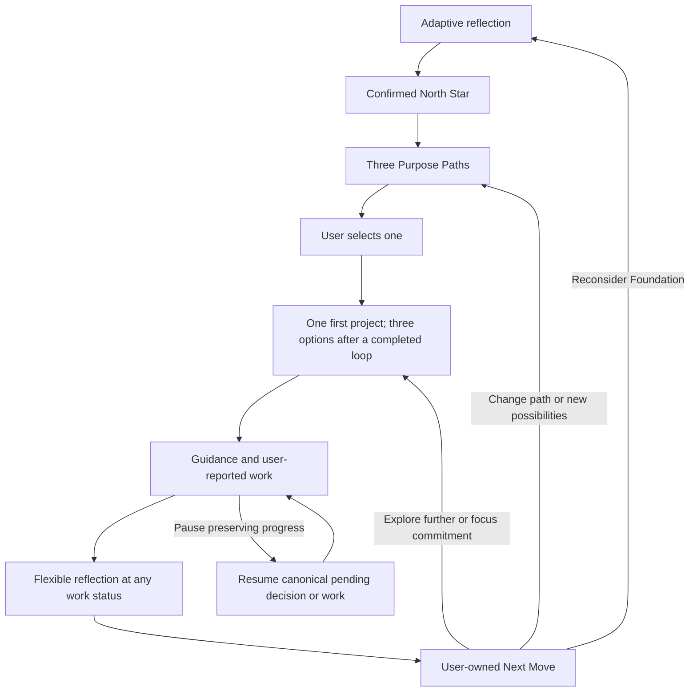
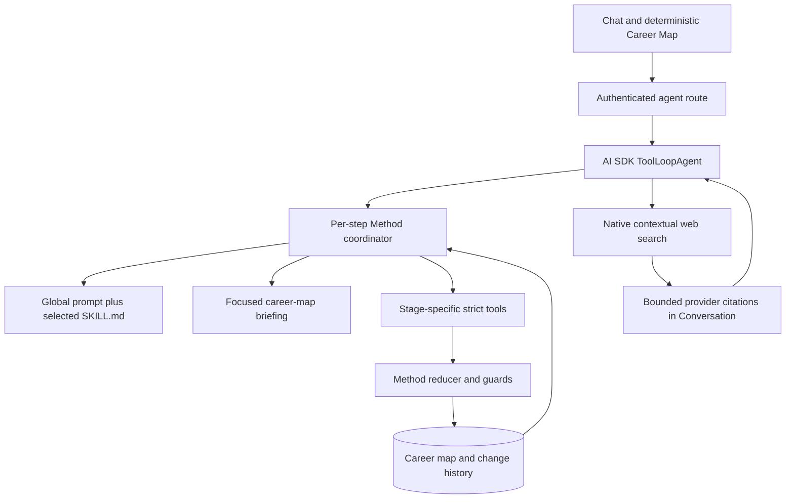
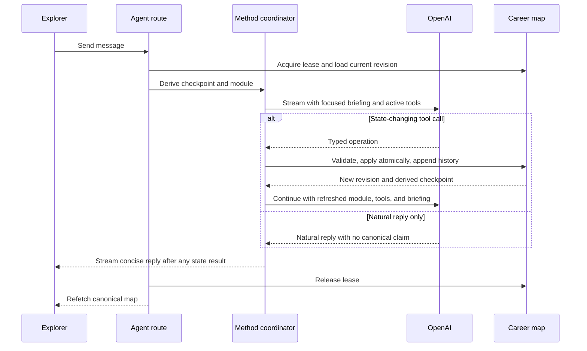
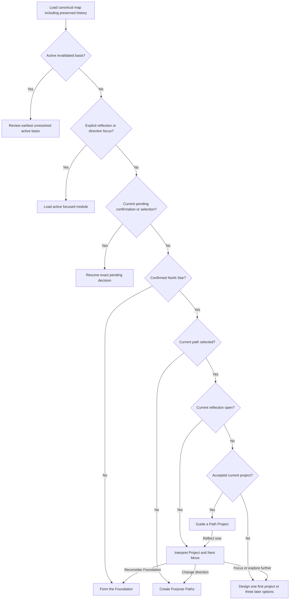
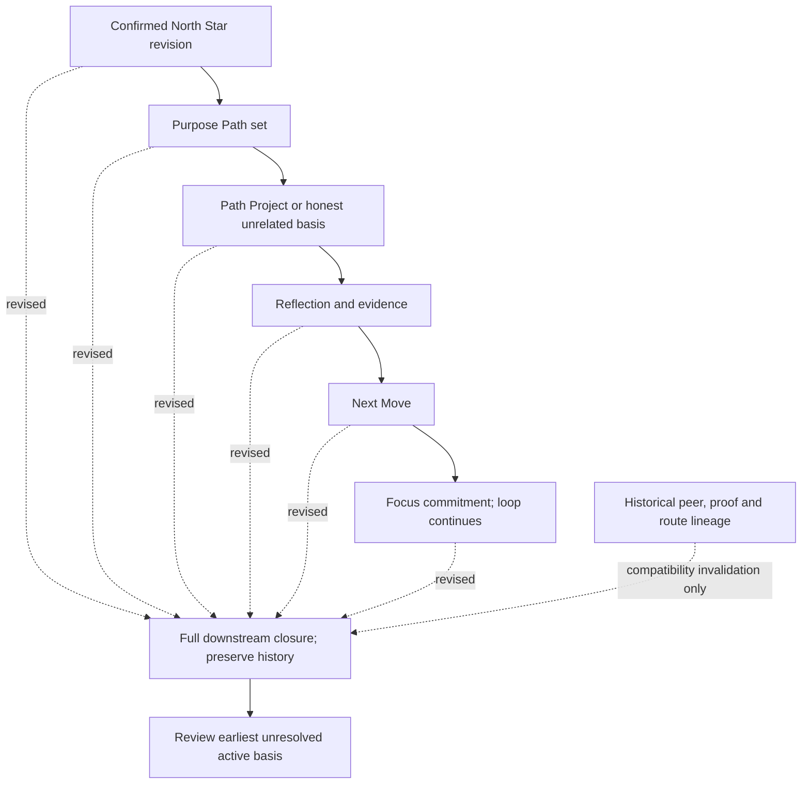

# Revelio Method - Plan

> **Implementation amendment (2026-09-05):** `docs/plans/2026-08-14-claude-feat-revelio-revamp-plan.md` remains the single implementation authority. This incorporated Method contract now uses Your North Star for user-facing and normative meaning, makes Chat the acting surface and Your Map read-only, replaces lexical authorization with main-agent judgment plus deterministic guards, limits Markdown and citation rendering, and reduces visible persistence feedback to delayed Saving plus one error presentation. Existing internal `why` identifiers, operation names, schemas, database representation, every Method R/F/AE/KTD ID and every U-ID remain stable; the historical seven-module ownership is superseded by five active modules and two deferred references. The active plan's 2026-09-03 research amendment still supersedes conflicting isolated-research mechanics. Baseline `20f08cd` is landed; only affected U5–U7 acceptance is reopened. The historical attended-U7-before-U8 sequencing is superseded for authorized isolated implementation; attended U7 remains pending before release/incorporation.

> **MVP scope amendment (2026-10-13):** The coordinator-approved [repeating-learning plan](2026-10-13-1220-feat-repeating-learning-mvp-plan.md) reconciles current delivery in place. Method F1–F3 and AE1–AE9/AE13–AE14 are active; Method F4–F5, AE10–AE12, R34–R40, the former Method KTD9 peer prerequisite and U9 are deferred references. Five modules are active: Foundation, Paths, Design, Guide and Interpret. Focus commitment remains within the repeating loop. Preserve every ID, landed history and historical record; deferred specifications never become deployment or resume gates. U7 founder acceptance remains pending as a human release/incorporation gate. The coordinator’s current brief authorizes isolated U8 operational implementation now; it does not claim attended U7 or actual-app acceptance has passed. This prose amendment authorizes no paid runs, live-account turns, deployment or account actions. Historical dates and full-tail choices below are retained as history, not renewed delivery deadlines. See [deferred features](../method/deferred-features.md).

## Release-verification amendment — 2026-10-31

The active revamp plan's 2026-10-31 founder amendment supersedes conflicting release prerequisites below. Founder U7 acceptance was accepted 2026-10-30, not reopened here. Invitation/contact/review notice preparation waits for participant outreach; additional whole-account erasure tooling/runbook/operational dry run waits for a deletion request. Neither blocks MVP release. Existing security, deletion, privacy and cancellation regression coverage remains active. The manual screenreader/spoken-navigation release requirement is removed, not passed; semantic, keyboard/focus, status/live-region, tree, contrast and responsive checks remain.

[Verify Nami](../runbooks/nami-verification.md) and its [active-ID/scenario matrix](../runbooks/nami-verification-scenarios.md) govern current verification selection. The paid legacy Playwright journey is not Method/auth proof; use actual scoped UI actions, canonical state and reload, plus existing deterministic suites. Deliberate real provider/model testing is required where needed, with purpose/progress/available usage and existing runaway guards; no new arbitrary tight call/spending cap. This amendment preserves all IDs and dated historical evidence and does not authorize deployment or remote configuration changes.

## Goal Capsule

- **Objective:** Give career explorers a personalized, repeatable way to turn reflection into firsthand evidence, use that evidence to choose what to explore next, and continue learning after a provisional choice to focus on a path. Formal career-entry workflows remain longer-term ambitions.
- **Product authority:** `docs/thesis.md` remains the method authority. This Product Contract translates it and the founder-settled decisions into testable active behavior and retained deferred specifications. Until its Definition of Done is met, `docs/plans/2026-08-14-claude-feat-revelio-revamp-plan.md` remains the implementation authority and must be reconciled with this contract during planning.
- **Open blockers:** None before planning. The Purpose Paths presentation remains a non-blocking prototype question.

---

## Product Contract

### Summary

Revelio will implement a repeating learning MVP as an adaptive, stateful companion: form a provisional North Star, compare three ways to serve it, learn through real projects, and choose what to change or focus on while continuing the loop. The implementation extends the active revamp architecture with a Method kernel, repository-owned modules, typed state operations, deterministic presentation, and behavioral verification while preserving the legacy product.

Product Contract preservation note: all existing R/A/F/AE IDs remain; the 2026-10-13 amendment scopes active delivery and explicitly labels deferred detail; R48 and AE14 capture the later session-settled decision that follow-on project selection differs from the single-proposal onboarding experience.

### Problem Frame

Most career guidance tries to infer the right answer from reflection, existing skills, or current job categories. The thesis argues that decisive self-knowledge is often created by doing: reflection suggests possibilities, while real projects reveal fascination, energy, willingness to continue, environmental fit, and the difference between liking an identity and liking the work.

The existing product stops after a questionnaire, three paths, and a static action plan. It cannot help the explorer run a tight feedback loop, interpret ambiguous evidence, revise a direction, or turn accumulated work into an entry route. The MVP guides repeated learning and direction changes; the broader entry-route ambition is deferred. It never pretends to discover a permanent calling.

### Key Decisions

- **Action creates self-knowledge.** (session-settled: user-approved — chosen over treating the answer as hidden inside the explorer: reflection alone cannot supply the evidence needed to choose.) Governs R1, R2, R20-R26.
- **“Your North Star” is the provisional foundation.** (session-settled: user-directed — chosen over either a fixed ikigai analysis or exposing internal Why vocabulary: every path must be a different way to serve a direction the explorer recognizes, without making it a fixed identity.) Governs R5-R11.
- **The interview is adaptive and coverage-guided.** (session-settled: user-approved — chosen over a fixed questionnaire or a fixed question count: ask as little as possible and probe only when the evidence is insufficient.) Governs R5-R10.
- **The explorer owns consequential choices.** (session-settled: user-directed — chosen over agent ranking or unsolicited recommendations: Revelio may clarify and revise options but recommends only when asked.) Governs R15, R16, R18, R29-R31, R38.
- **The first Path Project is singular; later project choices are comparative.** (session-settled: user-directed — chosen over either three onboarding projects or one proposal forever: onboarding gets one thoughtful proposal, while a later “explore further” decision gets three options and an explicit choice.) Governs R18-R20, R31, R48.
- **Projects combine ambition with a low-stakes first version.** (session-settled: user-approved — chosen over either timid exercises or demanding first commitments: the destination should excite while the first move remains believable.) Governs R19-R22.
- **Evidence, not a quota, decides the Next Move.** (session-settled: user-directed — chosen over fixed project counts, durations, or confidence scores: different explorers need different amounts and kinds of evidence.) Governs R26-R33.
- **Current job definitions do not bound future paths.** (session-settled: user-directed — chosen over forcing each path to reproduce an existing job's “actual practice” or drudgery: real outcome-oriented projects reveal the relevant experience without excluding work that does not exist yet.) Governs R13, R17, R19.
- **Skills are application-managed method modules.** (session-settled: user-approved — chosen over one massive prompt or OpenAI-hosted shell skills: Revelio needs repository-owned guidance selected by career-map state.) Governs R44-R46.
- **The product owns presentation.** (session-settled: user-approved — chosen over runtime-generated visual interfaces: the AI supplies meaning and structured state while deterministic components supply the visual language.) Governs R41-R43.
- **Chat owns action and Your Map is read-only.** (session-settled: user-directed — chosen over controls in both surfaces: decisions stay beside the conversation and the map remains a durable record.) Governs R42, R43, R45.
- **The main agent judges confirmation language.** (session-settled: user-directed — chosen over phrase and path-alias lists: model judgment serves all languages while deterministic state guards preserve the interaction boundary.) Governs R45, R46.
- **Deferred historical choice: Side Doors present three routes and activate one.** (session-settled: user-directed — chosen over one route after commitment: this later stage can support comparison without adding onboarding burden.) Governs R37-R40.
- **The complete method outruns the first implementation emphasis.** (session-settled: user-approved — chosen over either truncating the method at one loop or building elaborate late-stage surfaces before evidence: the wider lifecycle retains deferred specifications, while the MVP delivers repeated learning loops without a formal peer or career-entry tail.) Governs R47.

<!-- ce-section: work-relationships -->
### How This Work Fits Together

This plan owns the behavior and boundaries of the Revelio Method. It does not replace the active revamp implementation plan.

- The current revamp plan in `docs/plans/2026-08-14-claude-feat-revelio-revamp-plan.md` remains the implementation authority.
  - **Depends on this contract:** U2's method specification and U7a's prompt behavior must carry these requirements forward.
  - **Needs reconciliation:** Older terms such as ikigai statement, direction path, experiment, and action plan should map to the user-facing method vocabulary in this contract.
- Purpose Paths presentation uses the founder-selected prototype contract.
  - **Depends on this contract:** U6 renders one shared five-band component in Chat and Your Map, while only the exact current Chat cards expose Start.
- Pilot learning follows implementation.
  - **May revise this method:** No external explorer has validated the loop yet, so pilot evidence may change the requirements while `docs/thesis.md` remains the method authority.

### Actors

- A1. **Explorer** — a person trying to decide what work direction to pursue next. Employment status is context, never an eligibility gate.
- A2. **Revelio agent** — the conversational guide that elicits, proposes, researches, supports action, interprets evidence, and preserves continuity.
- A3. **Firsthand beneficiary** — the explorer or someone they know directly who wants the outcome of a Path Project.
- A4. **Peer or field contact** — a person or community whose lived experience can improve ordinary project guidance or a decision; formal peer and entry-route workflows are deferred.

### Method Lifecycle



Pausing never erases the explorer's place. What You Learned may begin before a Path Project is complete.

### Requirements

**Method stance and voice**

- R1. Revelio treats reflection as a source of possibilities and firsthand action as the primary source of new self-knowledge.
- R2. Revelio never claims to reveal a permanent calling, recover something the explorer already knows, or predict fit with scientific confidence.
- R3. The agent uses an independent Revelio voice: plain, concise, concrete, encouraging without inflated praise, willing to challenge, comfortable with uncertainty, and biased toward one useful move. It matches the explorer's conversational register and uses brief, specific recognition when useful rather than generic praise.
- R4. The agent avoids routine recaps, guru language, destiny claims, prestige cues, and verbosity that can be summarized without losing value.

**Foundation: Your North Star**

- R5. The entry interview asks one short question per turn and continues only until it covers revealed fascination, importance and point of view, starting assets and evidence, and the explorer's reality boundary. While coverage is incomplete, each reply ends with the next missing-area question unless the explorer explicitly pauses; the North Star is proposed in the same explorer turn that first makes coverage sufficient.
- R6. The default opener asks, “What activities pull you in so much that you lose track of time?” and falls back to watching, reading, or thinking only when doing evidence is absent or too weak.
- R7. The interview asks, when not already answered, “If you could fast-forward ten years, what meaningful change would you be proud to have contributed to?” and follows with what the explorer believes should be done differently when a point of view remains unclear.
- R8. Abilities are starting assets rather than eligibility filters; when evidence is missing, the agent asks what people already rely on the explorer for and seeks concrete support only when needed.
- R9. Before proposing paths, the agent covers what a new direction must fit around now, including income, time, location, responsibilities, health, risk, or no current constraint.
- R10. The agent introduces the first suggestion with: “Your North Star is a direction for what you want your work to serve, and it can evolve as you learn by doing.” It then drafts a concise “Your North Star” statement that names what or whom work is in service of and the explorer's point of view, without using `provisional` as a user-facing label, and ends with a clear invitation to refine or confirm it in a later turn.
- R11. The confirmed North Star is a provisional foundation rather than a permanent identity, excludes detailed economic constraints, and may change when later evidence warrants revision. Before reconfirming a revision that has dependent artifacts, Revelio names the exact artifact classes that confirmation will invalidate and requires a later explorer turn that explicitly acknowledges that impact.
- R12. When status, praise, attention, or identity appears to distort the foundation, the agent may ask what the explorer would do if those needs were already satisfied; it does not ask this routinely.

**Purpose Paths**

- R13. After R10, Revelio proposes exactly three distinct Purpose Paths, each a different way to serve the confirmed North Star rather than a job title or identity prediction.
- R14. Each Purpose Path contains a clear name, how it serves the North Star, What you need to learn, a First project, and Why it may fit. Why it may fit contains four unlabeled one-sentence bullets, ordered by interest, meaningful contribution, relevant ability or experience, and fit with current constraints. The first three use evidence and the fourth uses practicalFit; no framework or dimension labels appear in the card. New cards omit What could become possible; legacy possibility data remains readable without being a visible card band.
- R15. The three paths receive equal visual weight and no ranking, highlight, preselection, or recommendation unless the explorer explicitly asks for one.
- R16. The explorer may question, rewrite, combine, or replace any path in conversation; only an explicit choice or exact authenticated Start action in Chat activates a path, and the current set must remain meaningfully distinct after revision.
- R17. Economic viability, access, credentials, and practical constraints are researched path by path instead of being used to define meaningful work or filter paths by prestige.

**Path Projects**

- R18. After a path is selected and before any completed learning loop, Revelio proposes one thoughtfully designed Path Project for collaborative refinement and offers a completely new suggestion when the user is unconvinced. R48 governs every later project decision, including after a path change.
- R19. A Path Project produces an outcome the user wants, including when creating it for someone else. Explain relevant trade-offs and possible adaptations, then respect an informed larger, longer or unrelated project. Save its relationship honestly without manufactured path alignment or silent North Star revision.
- R20. A new project brief contains a title, What you'll learn, What you'll make and Suggested starting point. Give enough to begin; develop detailed guidance together. The learning lens names the experience the user can learn from without imposing extra mandatory content fields or fabricated evidence.
- R21. Each project points toward an excitingly ambitious outcome through a first version the explorer believes they can start, without turning difficulty into a test of worth.
- R22. Natural clear assent accepts only the exact current project proposal delivered in a completed prior turn, leaving work not-started. An unambiguous firsthand report of doing an identifiable current suggested project can instead establish proceeding now and save the reported activity/work status, including completion, without retrospective acceptance or invented earlier consent/presentation. Questions, hypotheticals, negations, quotations and third-party activity do not authorize that report route. Ambiguous or older-version references require clarification before writes. Path selection alone never accepts a project. The earlier mandatory pre-acceptance spiel is superseded by the approved design draft; no fixed reply or boilerplate is required.
- R23. The explorer may revise a project's outcome, audience, scope, medium, or first step before or during execution without restarting the path.
- R24. Practical help is available before acceptance without assuming agreement or work. On request, the agent resumes the active project, finds the smallest useful next action, researches, plans, teaches, or troubleshoots, and reduces scope when needed without doing the core work whose experience would supply the evidence.
- R25. Reported work and explicit corrections are auditable independently of agreement and reflection. A correction targets the exact latest update, preserves history and valid learning, and may reverse completed status without silently reversing dependent decisions. Briefly acknowledge meaningful saved changes in natural conversation. Active-project support is available on demand and when the explorer returns; Revelio does not use timers, proactive reminders, or guilt-inducing check-ins.
- R48. After any completed learning loop, every subsequent Path Project decision produces exactly three distinct follow-on options with equal weight, whether the explorer continues on the same Purpose Path or returns to Purpose Paths and selects another; the explorer may refine or replace them and explicitly chooses one to pursue first.

**What You Learned and Next Move**

- R26. What You Learned is available at any point, including before completion or after stopping. Reflection is flexible and experience-led, using energy drivers and drainers. The linked-path question “Which parts of Path Project N made you want to keep going, and which made you question the path?” remains available where applicable, without a fixed opening requirement; unrelated work uses honest natural questions.
- R27. Reflection considers energy, absorption, voluntary pull, resistance, the desire to continue, feedback from a firsthand beneficiary or peer, and whether the project answered its learning question; improvement by itself is not treated as a fit signal.
- R28. The agent records evidence without scoring fit, probes only when the evidence is ambiguous, and distinguishes path disinterest from bad scope, a failed step, an external constraint, or a temporary obstacle.
- R29. After reflection, the agent helps the user decide what to change and records their own desire to continue separately from work status and reflection closure. Preserve the approved Interpret draft decision guidance exactly; “Do you want to continue down this path?” is available where applicable, not a mandatory fixed turn.
- R30. If the explorer does not want to continue, they may choose a parked Purpose Path, revise the current set, or request new paths before starting another Path Project.
- R31. If the user wants to continue, they may explore further with another project or commit provisionally to focus on the path. Both preserve guidance, reflection, further projects, other paths, new possibilities and Foundation reconsideration. Research, revision, discussion and pausing remain natural conversation.
- R32. Evidence informs the user’s choice to explore again or focus; Revelio imposes no proof gate, project count, duration, confidence threshold, score or requirement to finish an artifact. An unrelated project’s evidence cannot automatically decide the old path.
- R33. Commitment is explicit, provisional and focused on one Purpose Path; alternative paths are parked rather than deleted. No formal peer exposure is required and no proof or Side Doors stage follows. Continued learning and changes of direction remain available.

**Formal Peers — wholly deferred**

- R34. **Deferred specification; no MVP gate.** The agent introduces peer exposure when it can improve a project or decision and may capture useful explorer-confirmed insight. The former mandatory exposure-before-commitment rule is historical and superseded.
- R35. **Deferred specification; no MVP gate.** When peer exposure is useful, the agent uses current web research to offer a small curated set, explains why each source or person matters and what to learn, identifies the easiest credible action and access constraints, and may draft an introduction that the explorer chooses whether to send.

**Side Doors and proof — wholly deferred**

- R36. **Deferred specification; no MVP gate.** After commitment, Revelio drafts a proof inventory from existing work and Path Projects, covering artifacts, problems solved, people helped, demonstrated useful qualities, relevant knowledge and relationships, points of view, and material that can be shared or extended.
- R37. **Deferred specification; no MVP gate.** Once the explorer confirms the proof inventory, Revelio researches exactly three current Side Doors with equal visual weight; each names the person, community, organization, or live problem, why the explorer's proof could matter, a useful contribution, the smallest credible first move, and material access constraints.
- R38. **Deferred specification; no MVP gate.** The explorer may question, modify, or replace routes and explicitly chooses one to pursue first; the other two remain parked, and Revelio recommends only when asked.
- R39. **Deferred specification; no MVP gate.** Revelio may research, shape proof, prepare materials, and draft outreach, but the explorer controls every message, publication, application, or other external action.
- R40. **Deferred specification; no MVP gate.** Revelio records Side Door outcomes as route evidence separately from Path evidence; a silent or failed approach does not invalidate the committed path unless doing the underlying work also changes the explorer's desire to continue.

**Conversation, state, and presentation**

- R41. Conversation remains natural streamed text; accepted foundations, paths, projects, evidence and decisions persist as validated career-map state rather than recovered by parsing prose. Existing peer, commitment, proof, route and outcome records retain identities, lineage and historical meaning as compatibility state; none selects a deferred module or blocks active progress. Browser-safe transcript history exposes only the durable turn anchor needed for exact canonical-card attachment.
- R42. Deterministic visual components render canonical state. One shared five-band Purpose Path card component appears inline in Chat and in Your Map; only the exact current non-superseded Suggested Chat cards from the authenticated explorer's terminally completed presentation expose one Start action each, while Your Map and all historical or failed/cancelled-presentation cards are read-only. Start remains disabled while a turn or direct operation is unresolved and until terminal refetch revalidates eligibility. A failed/cancelled presentation with no final display-safe assistant item renders no card. The card block may break beyond the prose measure and uses its actual container width to preserve three aligned subgrid columns or an equal Path 1/2/3 stack.
- R43. The interface keeps the primary decision concise while preserving Foundation evidence, practical reality, and uncertainty in canonical state. Your Map shows only the North Star heading and statement in its North Star card; it does not repeat Foundation answers, constraints, or internal focus and decision labels. Assistant prose renders only paragraphs, H2–H4 headings, bold, italics, and ordered or unordered lists through React components; unsupported Markdown, raw HTML, model-authored links, images, and active content remain inert. Existing sanitized citations alone may create links after turn and rendered-item identity, complete-visible-message hash/range, and unambiguous visible-text validation. The composer shows delayed Saving or one persistent actionable error presentation, never visible Saved or Rejected; committed, replayed, and rejected results clear Saving silently.
- R44. The five active Method modules are Form the Foundation, Create Purpose Paths, Design a Path Project, Guide a Path Project, and Interpret a Path Project and Next Move. Find Relevant Peers and Enter Through Side Doors remain deferred specifications, not registered MVP bundles.
- R45. Career-map state determines which method module is active. The main agent owns interpretation, personalization, natural language, and whether the current explorer message semantically confirms, selects, revises, replaces, combines, questions, or declines; deterministic behavior owns exact current target, cardinality, prior-turn presentation, legal transition, authenticated provenance, revision, lease, abort, idempotency, and persistence. Positive phrase, language, ordinal-wrapper, and path-alias lists and a second classifier are prohibited.
- R46. Structured model outputs or strict function calls shape stage-specific state changes and UI data; they do not replace source grounding, explorer intent, or deterministic validation and must not force unsupported content into a required field. Retrieved content cannot supply intent, and internal result classes remain available for agent continuation even when the UI collapses them to R43's two visible states.

**Delivery scope**

- R47. The MVP delivers repeated learning loops, focus commitment, path and Foundation changes, and pause/resume. Formal Peers, proof inventories and Side Doors are wholly deferred, including lightweight conversational variants and all release gates. Retain detailed specifications and history in the deferred reference; revisit from actual user needs without a date or user-count trigger.

### Key Flows

- F1. **Form the foundation and choose a path**
  - **Trigger:** A1 begins without a confirmed North Star.
  - **Actors:** A1, A2
  - **Steps:** A2 asks adaptive questions per R5-R12 → drafts the foundation → A1 revises and confirms it → A2 presents three paths per R13-R17 → A1 discusses, modifies, replaces, and explicitly selects one.
  - **Outcome:** A1 owns a provisional foundation and one active Purpose Path.
  - **Covers:** R5-R17, R41.
- F2. **Design and run a Path Project**
  - **Trigger:** A1 has selected a Purpose Path.
  - **Actors:** A1, A2, optionally A3 and A4
  - **Steps:** For the first project, A2 proposes one project per R18-R22; after a completed learning loop, A2 presents three follow-on options per R48 → A1 refines or replaces the proposal or options → A1 naturally accepts the exact previously delivered proposal, clearly reports doing the identifiable current suggestion, or explicitly selects a follow-on option per R22/R48 → A2 supports execution on demand per R23-R25; practical help is also available before agreement.
  - **Outcome:** A1 undertakes real work with a known learning question and low-stakes first version.
  - **Covers:** R18-R25, R48.
- F3. **Interpret evidence and choose the Next Move**
  - **Trigger:** A1 completes, stops, or chooses to reflect during a Path Project.
  - **Actors:** A1, A2
  - **Steps:** A2 opens What You Learned → distinguishes the source of the evidence → records what changed → asks whether A1 wants to continue → A1 explores again, returns to Purpose Paths, or commits provisionally.
  - **Outcome:** A1 knows what the project taught them and continues with guidance, three next-project options, another path, Foundation reconsideration or a preserved pause; focus commitment keeps this loop available.
  - **Covers:** R26-R33, R41.
- F4. **Deferred specification — Find relevant peers**
  - **Trigger:** Peer exposure can improve the project or decision, or A1 is nearing commitment without meaningful exposure.
  - **Actors:** A1, A2, A4
  - **Steps:** A2 researches a curated set → explains relevance and the smallest credible action → A1 chooses whether to engage → resulting evidence feeds the active project or Next Move.
  - **Outcome:** A1 learns about the people and environment without carrying the research burden alone.
  - **Covers:** R34, R35.
- F5. **Deferred specification — Enter through a Side Door**
  - **Trigger:** A1 commits provisionally to one Purpose Path.
  - **Actors:** A1, A2, optionally A4
  - **Steps:** A2 drafts the proof inventory → A1 corrects it → A2 researches three routes → A1 refines and selects one → A2 helps prepare the contribution and approach → A1 controls external action → A2 separates route evidence from Path evidence.
  - **Outcome:** A1 pursues one concrete entry route using proof accumulated during exploration.
  - **Covers:** R36-R40, R47.

### Acceptance Examples

- AE1. **Covers R5-R10.** Given the explorer already provides strong doing, meaning, assets, and constraint evidence in one answer, when the agent continues the interview, then it does not re-ask those areas and moves toward a North Star draft.
- AE2. **Covers R6, R7.** Given the explorer cannot name an absorbing activity, when the agent follows up, then it asks about topics they consume or think about; if their meaningful ten-year change is already clear, it does not ask that question again.
- AE3. **Covers R12, R15-R17.** Given a path appeals mainly through status or identity, when the explorer raises the concern, then the agent investigates the distortion and revises or replaces that path without ranking the alternatives.
- AE4. **Covers R13-R16.** Given the explorer dislikes one of the three paths, when they request a replacement, then only that path changes and the resulting three remain distinct ways to serve the confirmed North Star.
- AE5. **Covers R18-R23.** Given the explorer rejects the proposed project, when they ask for something different, then the agent proposes one new project rather than defending the old one or presenting a carousel of options.
- AE6. **Covers R19–R22.** Given the user knowingly chooses a larger or unrelated project after hearing trade-offs, the agent respects the choice, saves its relationship honestly, and helps without inventing alignment or silently changing the North Star.
- AE7. **Covers R24-R28.** Given the explorer stops before completing the first version, when they open What You Learned, then the unfinished project is treated as evidence and the agent distinguishes path fit from scope, execution, and external obstacles.
- AE8. **Covers R26-R32.** Given the explorer learned something but did not enjoy the project, when reflection begins, then ability growth is not treated as proof of fit and the agent asks which parts increased or reduced the desire to continue.
- AE9. **Covers R29–R33.** Given the user wants to focus on the path without any peer record, provisional commitment saves and guidance, reflection, exactly three later-project options and direction changes remain available; no formal tail appears.
- AE10. **Deferred specification; no MVP acceptance gate.** **Covers R34, R35.** Given peer exposure would resolve an important uncertainty, when the agent introduces it, then it provides researched starting points, relevance, access constraints, and a smallest credible action rather than a generic networking checklist.
- AE11. **Deferred specification; no MVP acceptance gate.** **Covers R36-R39.** Given the explorer commits, when Side Doors begins, then the agent confirms a proof inventory, presents three researched routes without ranking them, and activates only the route the explorer selects.
- AE12. **Deferred specification; no MVP acceptance gate.** **Covers R40.** Given the selected Side Door receives no response but the explorer still wants the underlying work, when the outcome is interpreted, then the agent revisits the parked routes or researches replacements without treating silence as evidence that the Purpose Path is wrong.
- AE13. **Covers R41-R46.** Given the agent proposes or changes canonical career-map information, when the turn completes, then the state change is validated and confirmed separately from the concise conversational reply, and the UI renders the validated state without parsing the reply.
- AE14. **Covers R18, R31, R48.** Given the explorer has completed a learning loop and chooses to explore further, when the next Path Project is designed, then the agent presents exactly three equal-weight options, supports refinement or replacement, and activates only the option the explorer explicitly chooses to pursue first.
- **2026-09-05 amendment to AE3–AE6 and AE13:** A Purpose Path proposal uses one concise localized offer and one canonical three-card block in its exact completed Chat turn. Only current eligible Chat cards expose Start; Your Map and historical cards are read-only. Main-agent semantic intent accepts natural multilingual confirmation and a contextual bare ordinal without phrase/alias matching, while ambiguity produces clarification. A revised North Star with dependents names the exact affected classes and requires a later explicit acknowledgment. Restricted Markdown, raw-validated citations, delayed Saving, silent success, one persistent error style, cancellation truth, and actual-container responsive equality follow Revamp R22–R26 and Revamp AE12–AE17.

### Success Criteria

- An explorer who completes a Path Project can identify what firsthand evidence changed, decide whether to continue, switch, or commit, and begin the corresponding next step.
- The method preserves evidence across projects and sessions so later paths and projects build on what the explorer has done rather than restarting from reflection.
- The explorer can challenge and revise every consequential output and never has to accept a ranked recommendation or unsupported certainty.
- A valid Method exit always leads somewhere actionable: another project, another path, focus commitment followed by continued learning, or a pause that preserves progress.

### Scope Boundaries

**Sequenced inside this plan**

- Final Purpose Paths layout and interaction details begin only after the U6 `ce-prototype` contract is selected; they are not deferred beyond this plan.

**Deferred for later**

- Formal Peers, proof inventories and Side Doors in their entirety, including conversational delivery, dedicated UI and release gates; see [deferred features](../method/deferred-features.md).
- Proactive reminders, scheduled check-ins, or notification systems.

**Outside the method's identity**

- Career fit scores, permanent declarations, prestige-based rankings, or a claim that introspection can reveal one correct answer.
- Mass outreach, generic networking scripts, autonomous messages, or publishing on the explorer's behalf.
- Generic projects built mainly to signal employability, invented clients when firsthand demand is available, or forced simulations of today's job descriptions.
- A fixed number of projects, a fixed exploration duration, or artifact completion as the universal stopping rule.

### Dependencies and Assumptions

- `docs/thesis.md` is the current method authority; dated research supplies evidence and hypotheses but cannot override it.
- The current revamp plan supplies persistent conversation, career-map state, web search, and return-session behavior that this method depends on.
- No external explorer has yet validated the complete lifecycle; the first pilot loops must be treated as method evidence rather than proof that the method works.
- Current web research is available for path economics, project guidance and ordinary learning from people; formal Peers and Side Doors remain deferred.

### Sources and Research

- `docs/thesis.md` — method authority and source for the action-first, project-as-dating thesis.
- `docs/plans/2026-08-14-claude-feat-revelio-revamp-plan.md` — current implementation authority, including U2, U7a, and the initial discovery-loop scope.
- `docs/research/2026-08-11-what-to-work-on-research.md` — historical research on exploration, representative experiments, and provisional commitment.
- `docs/research/2026-08-11-what-to-work-on-product-direction.md` — historical product-loop framing and the contradiction in the legacy “already know” assumption.
- `docs/research/2026-08-25-vocation-competitor-dossier.md` — historical comparison between role-fit investigation and firsthand person-path evidence.
- `docs/research/2026-08-28-side-doors-career-entry.md` — historical research on proof-first, contribution-first career entry.
- `server/ai/prompts.ts` and `shared/streaming-schemas.ts` — legacy prompt and output behavior that planning must not treat as the new Method.

---

## Planning Contract

### Authority and Reconciliation

`docs/thesis.md` remains the Method authority. This artifact owns the Method Product Contract and the technical reconciliation required to implement it. `docs/plans/2026-08-14-claude-feat-revelio-revamp-plan.md` remains the repository's implementation authority until its Definition of Done is met, so U1 must amend that plan before any Method code unit begins.

The reconciliation keeps the revamp plan's platform, identity, conversation, concurrency, and rollout decisions. It replaces the Method assumptions in its R2, R6, R8, R9, R17, R18, U4-U8, and U10 with this Product Contract. If the two plans still disagree after U1, the thesis wins on Method behavior, this Product Contract wins on product behavior, and the reconciled revamp plan wins on implementation sequencing.

### Key Technical Decisions

- KTD1. **Use a Method kernel inside the existing career-map document.** One JSONB document remains the durable product memory, but its active runtime model covers Foundation evidence, North Star revisions, Purpose Path sets, project cycles, reflections, commitment and evidence. Existing peer exposure, proof and Side Doors records remain supported for historical compatibility without active workflow delivery. Existing internal `why` identifiers remain stable. A `schemaVersion` governs document compatibility separately from the row revision used for compare-and-swap writes. Implements R41, R42, R45, R46.
- KTD2. **Derive checkpoints instead of storing one linear stage.** A pure selector derives the current Method module and decision from canonical records. One durable focus record may open reflection, Foundation revision, or path revision without closing the underlying work. Precedence is invalidated-basis review, explicit focus, pending confirmation or selection, then the repeating learning lifecycle; historical deferred state never takes routing precedence; closing focus recomputes the checkpoint from current state instead of restoring a stale stage. Implements R23-R35, R44, R45.
- KTD3. **Load repository-owned `SKILL.md` modules through the application.** (session-settled: user-approved — chosen over one massive system prompt or OpenAI-hosted Skills: the Method must be versioned with the product and selected from career-map state.) A small global prompt carries voice and invariants; the loader adds one active Method module and a focused briefing. The application validates every registered bundle at startup and in tests; the final build registers and packages the five active modules. Implements R3, R4, R44, R45.
- KTD4. **Use strict function tools for state changes and streamed text for conversation.** (session-settled: user-approved — chosen over one structured response object: chat should remain natural while canonical changes stay typed.) Each Method module exposes a small tool set with narrow Zod schemas. The chat reply has no global `Output.object` contract. A mutation-capable step does not release state-dependent prose until its operation result is known; after any internal result class, a fresh narration step continues from authoritative state. At terminal refetch, the browser reconciles every in-memory attempt independently through its existing correlation ID and exact turn identity before removing delayed Saving or asserting one actionable error. Committed, replayed, and rejected results clear silently. No durable attempt list or generic lifecycle protocol is added. An aborted request emits no further prose; retry or reload derives any later explanation from canonical state. Natural conversation that makes no canonical claim may stream normally. Implements R41, R43, R45, R46.
- KTD5. **Route every state change through narrow domain operations.** Generic upserts, generic confirmation, and unrestricted workspace patches are replaced by versioned operations. The only direct UI operations in this amendment are the two existing Purpose Path Start cases in Chat; every other change remains conversational. Exact-three sets, sibling parking, replacement, commitment, and transitive invalidation remain atomic. Combining two paths still replaces the set with the merged path and one new third path. Refactor the existing file-local `invalidateFromWhy` traversal in place so the same traversal returns both invalidated records for confirmation and their unique artifact classes for pre-confirmation disclosure. Pending-revision legal transitions reject dependent writes, and confirmation re-derives the closure under the same expected map revision; an intervening change rejects stale and requires a fresh proposal. No second helper/traversal, preview state, or migration is added. The storage boundary validates the complete post-state before compare-and-swap commit and again on load. Implements R11, R13-R18, R23, R31, R33, R37-R41, R48.
- KTD6. **Keep semantic confirmation in the main conversation.** (session-settled: user-directed — chosen over positive phrase/alias gates or a second classifier: the existing agent understands the message in context, while deterministic guards preserve the later-turn interaction.) The main agent decides whether the current message confirms, selects, revises, replaces, combines, questions, or declines in any language. A confirm or select operation may target only one exact current pending revision from a completed prior assistant turn. The distinct R22 actual-work report route binds an exact eligible persisted project and the current human report without claiming a prior presentation or confirmation. It cannot silently confirm an accepted-project replacement, select a follow-on option or change direction. The two exact authenticated Chat Start actions use the same target rule and additionally require that the presenting turn belongs to that user and is terminally completed. The reducer and storage reject same-turn, stale, superseded, wrong-revision, wrong-presentation, unauthenticated, aborted, duplicate, and illegal operations without parsing natural language. Generic assent among multiple paths remains ambiguous, while a contextual bare ordinal may identify one exact path. Implements R10, R16, R18, R22, R29, R33, R38, R45, R46.
- KTD7. **Separate agreement, work, reflection, and evidence.** A Path Project proposal can be suggested, accepted, parked, or superseded. Accepted lifecycle state retains either auditable assent or distinct current-report proceeding provenance; its work can be not started, in progress, stopped, or completed. Each append-only reflection session has immutable identity and revision, may open at any work status, and cannot overwrite the evidence snapshot supporting an earlier choice. Replacing an unaccepted proposal keeps the same project number, while choosing to explore further creates Path Project N+1 from an atomic three-option set. Implements R18-R32, R48.
- KTD8. **Preserve lineage and invalidate downstream conclusions without deleting history.** (session-settled: user-approved — chosen over destructive cascades or silently carrying conclusions across changed foundations: completed work remains evidence, but dependent decisions must be reviewed.) Paths reference a confirmed North Star revision; projects and learning choices reference path and evidence revisions; new focus commitment records the explicit user action and current path basis, with optional Next Move, reflection or preserved legacy-intent basis where present; neither reflection nor peer exposure is a universal prerequisite. Existing peer/proof/Side Doors lineage retains its historical supporting revisions and participates in invalidation, validation and erasure without blocking active-loop routing. Before a revised North Star can be confirmed, the agent names the exact artifact classes from KTD5's closure and the explorer explicitly acknowledges that impact in a later turn. While the Suggested revision is pending, dependent writes are illegal. Confirmation re-derives the closure under the original expected map revision, then marks it for review and routes to the earliest unresolved basis; a stale revision requires fresh disclosure. A revision with no dependents uses the ordinary later-turn confirmation rule without naming empty impact classes. Implements R11, R16, R23, R33, R38, R41.
- KTD9. **Deferred peer design; former mandatory guard superseded.** Historical intended detail: a qualifying exposure record links a path to a real person, community or first-person source and stores a user-confirmed decision-relevant insight; suggested contacts or search results alone are not firsthand evidence. The old missing-exposure interrupt and pending-commitment prerequisite are superseded. Formal Peers has no active MVP module, tool or release gate. Ordinary learning from people and human control of contact remain available through KTD10. See [deferred features](../method/deferred-features.md); preserves R34–R35 detail.
- KTD10. **Use contextual native research in the main loop and keep all external action human-controlled.** The main Sol `ToolLoopAgent` decides whether and how to use native web search with the stored Conversation and focused lower-priority Career Map context. Retrieved text stays untrusted, never supplies confirmation intent, and never enters canonical state as a source handle, research attempt, evidence association, or separate ledger. Ordinary provider citations remain bounded transcript presentation. Failed or insufficient research stays conversational uncertainty and cannot pad an exact-three set. Revelio may store drafts but exposes no tool that sends, publishes, applies, or messages. Implements R17, R35-R40, R46.
- KTD11. **Render canonical state with deterministic components.** (session-settled: user-directed — chosen over runtime-generated visualizations or separate Chat/Map cards: the product should own hierarchy, accessibility, and visual consistency.) The founder-selected five-band Purpose Path card is one shared component. Chat attaches it to the authenticated canonical presenting turn and alone exposes Start for the exact eligible current set after terminal completion and refetch; Your Map and historical or failed/cancelled-presentation cards are read-only. A failed/cancelled turn with no final display-safe assistant item has no card. Prose keeps its reading measure while the card block uses actual container width to preserve aligned subgrid columns or an equal stack. Assistant prose uses R43's restricted React Markdown path, and a citation must bind to the exact rendered turn/item and complete visible-message hash/range before it creates a link. No Side Doors tail is delivered; any existing records remain readable historical state. Implements R15, R37, R38, R42, R43, R47.
- KTD12. **Refresh state, module, tools, and briefing after every operation result.** Every internal tool result reports committed, idempotent replay, conflict, rejected, or failed with the authoritative revision, derived module, and pending decision. The loop reloads and re-runs the selector before the next model step, so confirming a North Star can generate paths in the same turn and stale tools disappear. Conflict reloads instead of retrying stale arguments. The UI independently reconciles every existing correlated attempt after terminal authoritative refetch; committed, replayed, and rejected clear silently, while conflict, failed, and unknown results map to the one persistent error contract. Implements R18, R41, R43–R46.

### Operation and Invariant Ownership

| Change class | Persistence and confirmation rule | Enforcement owner |
|---|---|---|
| Explorer-reported fact or firsthand evidence | Persist immediately as user-authored with message or UI-action provenance; later corrections append supersession. | Operation schema and storage boundary |
| Model summary, interpretation, path or project (existing proof/route summaries are compatibility state) | Persist as Suggested only; never becomes confirmed in its presentation turn. | Module tool plus KTD6 handshake |
| Consequential choice | Confirm only one previously presented target from a subsequent user action. | Reducer transition guard |
| Deterministic consequence | Park siblings, increment project number, or invalidate dependents in the same transaction as the accepted choice. | Reducer and storage transaction |
| Chat Start action | Use the two existing Purpose Path selection operations and provenance contract; disable while the agent lease is held and revision-check afterward. | Chat UI, route, lease, and reducer |

| Invariant | Primary enforcement | Failure behavior |
|---|---|---|
| One map per explorer, valid row revision, unique operation identity, owned history | Database constraints and transaction | Reject transaction without changing map or history. |
| Exact-three sets, one active selection, legal lifecycle, valid basis references | Reducer and full-map validator | Reject proposed post-state. |
| Persisted document matches a supported schema version | Storage validation on load and before commit | Enter repair-required; preserve the raw record and expose no model briefing. |
| One logical operation creates one revision and one history entry | Compare-and-swap plus unique source identity and payload fingerprint | Same-payload replay returns stored result; different-payload reuse is rejected. |
| Agent and browser see the same revision and available actions | Shared operation surface plus per-user lease | Disable Chat Start during a turn; refetch on completion, cancellation, or conflict. |

### High-Level Technical Design

Component topology:



One model turn:



Derived Method checkpoints and interrupts:



Dependency revision behavior:



### Output Structure

Peer and Side Doors schema/file entries below are historical compatibility references, not active module registrations or MVP delivery obligations.

```text
shared/career-map/
  foundation.ts
  paths.ts
  projects.ts
  learning.ts
  peers.ts
  side-doors.ts
  operations.ts
  reducer.ts
  selector.ts
  index.ts
server/ai/method/
  base-instructions.ts
  registry.ts
  loader.ts
  skills/
    form-foundation/SKILL.md
    create-purpose-paths/SKILL.md
    design-path-project/SKILL.md
    guide-path-project/SKILL.md
    find-relevant-peers/SKILL.md
    interpret-path-project/SKILL.md
    enter-side-doors/SKILL.md
client/src/components/explore/
  foundation-card.tsx
  purpose-paths.tsx
  path-project.tsx
  learning-card.tsx
  next-move.tsx
  research-sources.tsx
  later-stage-state.tsx
```

### Reconciliation Map

| Active revamp area | Method amendment | Owned here |
|---|---|---|
| R2, U2 | Bind the existing thesis and this Product Contract as the complete Method specification; do not author a second thesis. | U1 |
| R6, R8, R9 | Replace practice-testing, ikigai vocabulary, and continue/switch/new with Your North Star, Purpose Paths, Path Projects, What You Learned, and user-owned Next Moves. | U1, U3, U7, U8 |
| KTD5, U4 | Expand the career map into the composed Method kernel with lineage, source provenance, and separate schema/revision versions. | U2, U4 |
| KTD6, U5 | Replace generic upserts and confirmation with shared domain operations and per-step state refresh. | U2, U5 |
| U6 | Render validated Method state and run the Purpose Paths prototype gate. | U6 |
| U7a, U7b | Replace the monolithic prompt with repository-owned modules and stateful golden transcripts. | U3, U5, U7–U8; U9 deferred |
| U8 | Resumable guidance, reflection, user-owned Next Moves and repeated learning after focus commitment. | U8; formal tail deferred in U9 |
| U10 | Verify first/repeated loops, focus commitment, direction changes, pause and historical compatibility plus preserved safeguards. | U10 |

### Sequencing and Prerequisites

Baseline `20f08cd` contains the landed kernel, first three modules, storage, one-loop agent, connected U6 workspace, and U7 journey through the first project. The 2026-09-05 amendment does not replay that history. It reopens only affected acceptance in U5, U6, and U7 and proceeds in that order: server authority/turn/receipt contracts, then the atomic Chat-action/read-only-Map presentation swap, then module copy and behavioral proof. Current authorization permits isolated U8 implementation. Amended deterministic/rendered checks and attended founder U7 acceptance remain required for release/incorporation; acceptance is still pending. U10 follows U7/U8 and preserved infrastructure gates; U9 is wholly deferred and no launch prerequisite. I3 remains outside this Method amendment.

The active revamp plan's platform preparation and identity work remain prerequisites and are not duplicated here. U5 must verify that the pinned AI SDK supports per-step tool selection and instruction refresh with OpenAI Conversations. If the provider hook cannot refresh both after a committed tool result, use an explicit one-Response-per-step AI SDK loop that preserves the request lease, stream, abort signal, idempotency, Conversation ownership, and safe compaction boundary. If neither route can preserve those contracts, stop before product integration and surface the provider incompatibility.

### System-Wide Impact

- **Persistent data:** The career-map document changes shape before pilots generate durable Method records. Add explicit schema-version handling and reject unsupported versions rather than guessing migrations.
- **Concurrency:** Agent tools and the two existing Chat Start operations share the active plan's user lease, row revision, idempotent operation history, and cancellation behavior. Atomic batches commit in full or leave no canonical proposal.
- **Action ownership:** Chat is the only acting surface. Purpose Path Start reuses the exact shared reducer operations; every other consequential choice remains conversational. Your Map renders the same canonical cards without actions or prompt-prefill controls.
- **Prompt context:** The full map can outgrow the active plan's one-page assumption. Each module receives only its relevant confirmed basis, active work, pending proposal, decision evidence, sources, and necessary parked records.
- **Privacy:** Contextual native search runs in the same OpenAI conversation with focused Career Map context per the active plan. Foundation constraints such as income, health, location, and responsibilities are sensitive. Application logs and retained test artifacts never contain prompts, briefings, career-map payloads, tool arguments, source bodies, provider responses, or validation payloads; they use opaque user, turn, operation, revision, and error identifiers only. Checked-in and CI-retained transcripts use synthetic explorers. Existing historical peer and Side Door records retain only minimum-necessary professional identity and relevance data, never scraped private contact details. Conversation remains in OpenAI and product memory remains in Neon.
- **Erasure:** Account erasure removes the map, history, sources, drafts, leases and idempotency records, conversation mapping, and paginated OpenAI Conversation items. Tombstone preservation applies to ordinary corrections, not privacy erasure; a non-content-bearing pending marker tracks retries until both stores confirm deletion.
- **Pilot learning:** After the MVP is complete, the first consented pilot cohort is reviewed from payload-free canonical event types already present in history—checkpoint reached, proposal revised, replaced or rejected, project accepted or stopped, reflection opened, Next Move chosen, commitment pending or completed, and route selected—plus a short optional debrief. The founder reviews the first five completed or abandoned pilot sessions before expanding access; observed patterns may propose Method or module changes, but they change the live contract only through an explicit plan update.
- **Legacy isolation:** `/legacy`, its Gemini prompts, assessment schemas, anonymous routes, and current tests remain behaviorally unchanged.

### Risks and Mitigations

- **Semantic judgment cannot be reduced to a schema.** Coverage sufficiency, path distinctness, project quality, and explicit conversational assent remain model judgments. Reducer guards, provenance, and golden transcripts make those judgments inspectable without pretending they are deterministic.
- **Strict schemas can force invented values.** Keep operations small, use nullable fields only when absence is meaningful, never require a state-changing call on an unrelated message, and reject unsupported evidence instead of filling required fields with guesses.
- **Same-turn transitions can use stale context.** KTD12 requires a map reload and module re-derivation after each committed tool result; integration tests cover confirmation-to-generation transitions.
- **Hosted web-search output may not expose enough content for claim-level grounding.** The pre-U2 and U5 provider assertions verify result identifiers, URLs, optional titles, citations or snippets, and handle visibility. Missing content downgrades the record to cited provenance; a failed or insufficient search produces no padded canonical set.
- **Basis revisions can orphan active work.** KTD8 marks dependents for review and preserves their history. Destructive generic delete is outside the operation surface.
- **Deployment may meet more than one database baseline.** U4 inspects the real execution baseline. With no released career-map rows, it creates the Method schema directly; if an earlier revamp shape has shipped, it adds a fixture-backed upgrade path from that exact schema version. Writers remain gated until integrity checks pass.
- **JSONB cannot enforce every domain invariant in PostgreSQL.** KTD5 assigns nested cardinality, selection, lifecycle, and lineage to the reducer and full-map validator, then validates on both load and commit. Invalid rows enter repair-required instead of reaching the model.
- **Lease expiry is not an integrity guarantee.** Operation identity, payload fingerprint, compare-and-swap update, and history insertion share one database transaction. Fault-injection and race tests prove exact-once behavior independently of the lease.
- **A provider can emit prose before a tool result or fail after a database commit.** Mutation-capable steps hold state-dependent prose behind KTD4's result barrier. The committed map remains authoritative, and turn, message, operation, revision, and terminal status linkage lets retry or reload recover the original result without duplicate writes or treating partial prose as a conclusion.
- **Method modules can disappear from a serverless bundle.** The loader has startup validation, the existing Vercel include-files rule covers the server tree, and production-mode build verification loads every bundle.
- **Behavioral tests can become model-snapshot brittle.** Deterministic reducer, selector, storage, tool, route, UI, and fake-model tests own invariants. Live golden transcripts run three samples per core journey: state and safety rules pass every run, while qualitative tone, brevity, and distinctness must pass at least two samples without ad-hoc retries; the harness records provider, model, and module versions.

### Planning Sources

- [Vercel AI SDK Agent Skills guide](https://ai-sdk.dev/cookbook/guides/agent-skills) — `SKILL.md` format, progressive disclosure, and application-provided filesystem/load behavior.
- [Vercel AI SDK agent overview](https://ai-sdk.dev/docs/agents/overview) and [loop control](https://ai-sdk.dev/docs/agents/loop-control) — `ToolLoopAgent`, structured workflows, and per-step tool/context control.
- [OpenAI Structured Outputs](https://developers.openai.com/api/docs/guides/structured-outputs) and [function calling](https://developers.openai.com/api/docs/guides/function-calling) — strict schemas for application actions rather than a replacement for natural user-facing text.
- `scripts/openai-provider-spike.mjs` — repository proof that custom tools and OpenAI web search can coexist with request-scoped instructions and completed-turn compaction.

---

## Provider Feasibility Gate

### G1. Prove the provider boundary before the Method kernel

- **Goal:** Falsify the load-bearing OpenAI and AI SDK assumptions before U2-U4 create durable Method architecture.
- **Dependencies:** U1.
- **Files:** `scripts/openai-provider-spike.mjs`; `package.json`; recorded spike evidence in the active revamp plan.
- **Approach:** Retain the existing spike as a regression harness for one contextual `ToolLoopAgent`: native web search and strict stage tools coexist under automatic choice, search sees the stored Conversation plus focused Career Map, ordinary citations survive bounded history reload, state-result narration waits for authoritative results, and same-turn confirmation can refresh into the next module. Re-prove abort, idempotency, and compaction without a research-specific model call, source handle, fallback loop, or persistence layer.
- **Stop condition:** If neither loop route preserves lease, streaming, abort, idempotency, Conversation ownership, same-turn module/tool refresh, and safe compaction together, stop before U2 and surface the provider incompatibility instead of weakening the Product Contract silently.
- **Verification:** `npm run spike:openai` passes against the pinned provider and the chosen native or fallback route is recorded. U5 repeats the same assertions after integration.

---

## Implementation Units

| U-ID | Title | Key files | Depends on |
|---|---|---|---|
| U1 | Reconcile the active revamp authority | active revamp plan | — |
| U2 | Build the Method kernel | `shared/career-map/` | U1, G1 |
| U3 | Load and evaluate the first Method modules | `server/ai/method/`, evaluation script | U2 |
| U4 | Persist and brief the full career map | storage, shared schema, briefing | U2 |
| U5 | Integrate stage-specific tools into the agent loop | agent, tools, route | U3, U4 |
| U6 | Prototype and build deterministic Method presentation | explore components and page | U1 for prototype; U2, U5 for connected UI |
| U7 | Ship Foundation through first Path Project | initial modules, workspace tests | U5, U6 |
| U8 | Deliver the repeating learning loop | guidance and reflection modules | U7 |
| U9 | Deferred: formal Peers, proof and Side Doors | Retained specifications; no MVP implementation | None for MVP |
| U10 | Prove the active repeating-learning MVP | end-to-end and release verification | U7, U8 |

### U1. Reconcile the active revamp authority

- **Goal:** Amend the active implementation plan so one authority describes the new Method without disturbing its settled infrastructure decisions.
- **Requirements:** All IDs retained; active R/F/AE scoped by the 2026-10-13 amendment, with deferred detail linked and no contradictory live instruction.
- **Dependencies:** None.
- **Files:** `docs/plans/2026-08-14-claude-feat-revelio-revamp-plan.md`.
- **Approach:**
  1. Replace the active plan's conflicting vocabulary, method requirements, career-map shape, generic tools, monolithic prompt, return flow, test scenarios, and Definition of Done using the Reconciliation Map.
  2. Preserve the active revamp plan's KTD1-KTD4 and KTD7-KTD10 platform choices; amend that plan's KTD5 and KTD6 only where this plan's Method kernel and operations require it.
  3. Bind `docs/thesis.md` and this Product Contract rather than duplicating their normative content.
- **Patterns to follow:** The active plan's existing authority hierarchy and stable ID rules.
- **Test scenarios:** Test expectation: none — this unit changes planning authority, not runtime behavior.
- **Verification:** A role-based document review finds no remaining conflict between the active plan, the thesis, and this Product Contract; every changed active unit cites its governing Method requirements.

### U2. Build the Method kernel

- **Goal:** Define the browser-safe canonical state, operations, reducer guards, lineage, and derived checkpoint selector before database or model integration.
- **Requirements:** Active R10–R18, R23, R26–R33, R41–R48; F1–F3; AE4, AE7, AE9, AE13–AE14; KTD1, KTD2, KTD5–KTD8; historical-state compatibility.
- **Dependencies:** U1 and a passing G1 provider-feasibility gate for either the native per-step refresh route or the explicit one-Response-per-step fallback.
- **Files:** `shared/career-map/*.ts` (new); `shared/career-map/reducer.test.ts` (new); `shared/career-map/selector.test.ts` (new).
- **Approach:**
  1. Compose the map from domain schemas instead of one monolithic Zod object or operation union.
  2. Implement narrow operations for evidence, proposals, revisions, confirmations, selections, work status, reflections, Next Moves and focus commitment; retain existing peer/proof/route/outcome schemas for historical validation and non-destructive resume.
  3. Make exact-cardinality sets and multi-record transitions atomic; store basis revisions, confirmation provenance, and operation source IDs.
  4. Define Purpose Path combination as an atomic three-item set replacement: merge the requested pair and propose one replacement third without ever persisting a two-item intermediate set.
  5. Derive the active module and pending decision from canonical records, with explicit interrupt focus for reflection, Foundation revision and path revision.
- **Execution note:** Implement the reducer and selector test-first; later layers must call this kernel rather than recreate lifecycle rules.
- **Patterns to follow:** Browser-safe schema separation in `shared/streaming-schemas.ts`; transaction-shaped invariants in `server/routes/assessment/utils.ts`.
- **Test scenarios:**
  - Covers AE4. Proposing or replacing one Purpose Path commits one valid three-item set and preserves equal, unranked siblings.
  - Covers AE7. Opening reflection on a stopped or in-progress project records evidence without marking work complete.
  - Covers AE9. Continue-no returns to paths; continue-yes permits only explore-further or provisional commitment as the formal Next Move.
  - Historical compatibility only: existing Side Door selections retain valid one-active/two-parked cardinality; AE11 delivery remains deferred.
  - Covers AE13. A cancelled exact-three proposal applies all or none, and a replayed operation source ID applies once.
  - Covers AE14. The first project proposal accepts one candidate; a later explore-further cycle requires three options and an explicit selection.
  - Combining two Purpose Paths produces one revised, distinct, unranked three-item set in one operation; it never activates or confirms the merged path implicitly.
  - A stale confirmation target, a second active path, a ranked path field, a fit score, or forged or stale commitment is rejected; explicit focus commitment with no peer record succeeds.
  - Revising North Star or a path marks dependents for review without deleting evidence; historical proof/route lineage remains validated and invalidatable without a new proof workflow.
  - Revising North Star from a historical deep map preserves and invalidates the full lineage while routing to the earliest unresolved active basis; deferred records never create a required review stage.
  - Replacing an unaccepted project keeps its number; selecting after explore-further creates Path Project N+1.
  - Every representative canonical state resolves to one expected module under KTD2 precedence; closing an interrupt after the map changes recomputes rather than restores its prior checkpoint.
  - Model-based state-machine tests generate legal operation sequences and assert selector totality, KTD2 precedence, liveness after focus closes, complete dependent invalidation, and that every exposed operation is legal for the derived checkpoint; minimized failures become regression fixtures.
- **Verification:** All Method kernel tests pass without a database or model, and exported schemas remain safe for both browser and server bundles.

### U3. Load and evaluate the first Method modules

- **Goal:** Replace the monolithic prompt with a validated module loader and prove Form the Foundation, Create Purpose Paths, and Design a Path Project before product integration.
- **Requirements:** R1-R22, R41, R44-R46; F1, F2; AE1-AE6; KTD3, KTD4, KTD12.
- **Dependencies:** U2.
- **Files:** `server/ai/method/base-instructions.ts` (new); `server/ai/method/registry.ts` (new); `server/ai/method/loader.ts` (new); `server/ai/method/skills/form-foundation/SKILL.md` (new); `server/ai/method/skills/create-purpose-paths/SKILL.md` (new); `server/ai/method/skills/design-path-project/SKILL.md` (new); `server/ai/method/loader.test.ts` (new); `scripts/eval-revelio-method.mjs` (new); `package.json`.
- **Approach:**
  1. Validate skill frontmatter and load one full module from a fixed registry; do not expose filesystem or skill discovery to the model.
  2. Keep voice, anti-prestige, untrusted-data, brevity, and write-before-summarize invariants in the small base instructions.
  3. Run scripted conversations against the real model with an in-memory reducer, asserting both the reply behavior and committed state after each turn.
  4. Record the module key and content version with each evaluated turn so pilot evidence can be attributed later; register and package only modules that exist at this unit.
- **Patterns to follow:** AI SDK `ToolLoopAgent` usage and request instructions proven in `scripts/openai-provider-spike.mjs`; current `SKILL.md` format from the official AI SDK guide.
- **Test scenarios:**
  - Covers AE1. One rich answer advances coverage without re-asking answered areas and produces a concise suggested North Star only when coverage is sufficient.
  - Covers AE2. Weak doing evidence triggers the consumption/thinking fallback, while already-supplied ten-year meaning is not re-asked.
  - Covers AE3. A prestige-distorted path is revised without ranking the alternatives.
  - Covers AE4. A replacement changes only one path and the set remains three distinct ways to serve the confirmed North Star.
  - Covers AE5. Rejecting the first project produces one replacement, not a defensive explanation or three options.
  - Covers AE6. An imagined-client portfolio exercise is redirected to a wanted outcome or firsthand beneficiary.
  - Paths never appear before a confirmed North Star, and amended R22 natural assent accepts only the exact proposal delivered in a completed prior turn.
  - The three registered skill bundles load in a production-mode filesystem smoke; an unregistered checkpoint fails closed instead of selecting a missing module.
- **Verification:** Loader tests pass; the live transcript harness records three Foundation-to-first-project samples with expected operations and state, all hard invariants pass, and at least two meet the qualitative rubric without retries.

### U4. Persist and brief the full career map

- **Goal:** Store Method state with atomic history, idempotency, ownership, and focused module briefings while retaining the active plan's JSONB architecture.
- **Requirements:** Active R11, R17, R23, R26–R33, R41, R45–R46; F1–F3; AE7, AE13; KTD1, KTD5, KTD7–KTD8/KTD10; existing deferred-record compatibility.
- **Dependencies:** U2 and the active revamp plan's platform and identity prerequisites.
- **Files:** `shared/schema.ts`; `server/storage.ts`; `server/storage.test.ts`; `server/storage.performance.test.ts` (new); `server/ai/briefing.ts` (new); `server/ai/briefing.test.ts` (new); reviewed Drizzle migration files.
- **Approach:**
  1. Inspect the execution baseline. Create the Method schema directly when no career-map schema has shipped; otherwise add a fixture-backed upgrade from the exact released `schemaVersion` with no speculative backfill.
  2. Store schema version, row revision, operation source and payload fingerprint, confirmation provenance, module version, and researched-source metadata; ordinary domain operations cannot choose an arbitrary schema version. Under the 2026-10-13 MVP compatibility contract, strict valid version-2 reads normalize purely, and the first explicit authorized mutation writes version 3 with its normal single revision and receipt; no read performs a write or manufactures an action.
  3. Apply compare-and-swap update and matching history insertion in one transaction with owner scope and database-enforced operation uniqueness. Same-ID/same-payload replay returns the stored result; different-payload reuse is rejected.
  4. Validate the full document on load and before commit, then compile a module-specific briefing from confirmed basis, active work, pending decisions, relevant evidence and sources, and necessary parked or stale records.
  5. Preserve tombstones and revision lineage for normal corrections, while implementing the active plan's cross-store erasure contract for all Method records and OpenAI Conversation items.
  6. Before freezing the durable shape, benchmark realistic long-lived explorer fixtures and record falsification bounds for serialized document size, full-map validation time, transaction latency, and concurrent-write behavior. Crossing a bound triggers an append-only child-record or event/summary design review before pilot writes.
- **Execution note:** Add characterization coverage for existing storage before extending it, then land migration and transaction tests together.
- **Patterns to follow:** `IStorage`/`PostgresStorage` in `server/storage.ts`; current Drizzle schemas; the active plan's lease, turn, and change-history contracts.
- **Test scenarios:**
  - Concurrent writes with the same starting revision allow one commit and return a conflict for the other without partial history.
  - Replaying a tool-call source ID returns the original result and does not duplicate a change.
  - Selecting a path or replacing a project proposal commits sibling transitions atomically; existing Side Door records retain atomic-history compatibility without active route tools.
  - An owner mismatch cannot read or mutate another explorer's map.
  - No anonymous or legacy route can read, create, or mutate a Method map, history entry, operation record, draft, or researched source.
  - Unsupported `schemaVersion` fails explicitly; row revision increments do not change schema compatibility.
  - Clean-database creation passes; if a released predecessor exists, its fixture upgrades without data loss. An interrupted or unsupported migration leaves Method writers disabled.
  - Fault injection before the map update, between update and history insertion, and at commit leaves either no change or one matching map revision and history record.
  - Same operation identity with a different payload is rejected; races after lease expiry still produce one logical commit.
  - A module briefing omits unrelated historical detail but retains the confirmed North Star, relevant basis revision, active object, pending decision, sources, and stale-state warning.
  - Malformed cardinality, duplicate active selection, or dangling basis fixtures enter repair-required and never reach a briefing.
  - Erasure interrupted before provider deletion retries from a non-content-bearing pending marker and completes with no orphaned map, history, source, draft, lease, idempotency, mapping, or Conversation item.
  - After simulated compaction, a corrected map value outranks stale transcript text.
  - Storage, validation, and briefing failures log identifiers, revisions, and error classes only; sensitive payload values never enter logs or retained artifacts.
- **Verification:** Fresh-schema and any real upgrade fixtures pass; storage and briefing tests prove atomic history, exact-once replay, ownership, lineage, repair-required handling, erasure retry, and focused projection.

### U5. Integrate stage-specific tools into the agent loop

- **Goal:** Simplify the landed agent boundary so the main agent judges natural-language intent while strict operations, exact presentation turns, invalidation impact, and durable receipts protect state.
- **Requirements:** R10-R18, R41-R46; F1-F2; AE3-AE6, AE13; KTD3-KTD6, KTD8, KTD10-KTD12; Revamp R18, R22, R24-R26.
- **Dependencies:** U3, U4 and the active revamp plan's agent route prerequisites.
- **Files:** `server/ai/tools.ts`; `server/ai/tools.test.ts`; `server/ai/history.ts`; `server/ai/history.test.ts`; `server/ai/agent.ts`; `server/ai/agent.test.ts`; `server/routes/agent.ts`; `server/routes/agent.test.ts`; `server/storage.ts`; `server/storage.career-map.test.ts`; `shared/streaming-schemas.ts`; `shared/streaming-schemas.test.ts`; `shared/career-map/reducer.ts`; `shared/career-map/reducer.test.ts`.
- **Approach:**
  1. Delete positive phrase, language, verb/subject, ordinal-wrapper, path-alias, and edit-target mention parsing. The main agent maps the current message to the existing exact operation and target; deterministic guards do not reinterpret language.
  2. Keep only the two existing Purpose Path Start cases on the direct UI route. Reuse current set/path/revision/presentation inputs, lease, abort, idempotency, and reducer behavior. Verify before dispatch that the presenting turn belongs to the authenticated user and is terminally completed.
  3. Extend display-safe history only with the authenticated durable turn anchor and final assistant display item needed to attach one canonical path set. Failed/cancelled presentation sets remain read-only when that item exists; without it, attach nothing. Recover through a later call to the existing proposal operation. Normalize live and hydrated citation hashes/ranges against the complete final visible assistant message and bind them to the exact turn and display item.
  4. Refactor the existing file-local `invalidateFromWhy` traversal in place so one traversal returns both invalidated records and their unique artifact classes. Return the classes in the revise result. Keep the completed-prior-turn, legal-transition, and expected-map-revision guards; dependent writes while pending and intervening revisions reject. Add no second helper/traversal, state, operation, route, schema version, or migration.
  5. Preserve contextual native research, the result barrier, and internal operation outcomes. Reuse each existing correlation ID and exact turn identity at terminal refetch so every in-memory attempt reconciles independently and visible Saving clears or one error appears only after durable truth is known. Persist no attempt list and add no lifecycle protocol.
- **Execution note:** Add failing semantic-intent, history-placement, impact-derivation, and lost-terminal-event tests first. Delete obsolete authorization before adding any helper.
- **Patterns to follow:** Existing `turnIdsByMessage` and display projection in `server/ai/history.ts`; existing operation receipts and `presentation.assistantTurnId`; existing reducer invalidation closure.
- **Test scenarios:**
  - English, German, Portuguese, and Russian direct assent reaches the exact tool without phrase matching; contextual `1` selects path one.
  - Hedges, quotes, questions, conditionals, generic assent among three paths, ambiguity, and multi-target choices produce no operation in scripted agent fixtures.
  - Wrong, stale, superseded, same-turn, wrong-revision, wrong-presentation, unauthenticated, aborted, duplicate, and illegal operations still fail deterministically.
  - The invalidation result exactly matches zero-dependent, shallow, and deepest reducer closure classes. A later acknowledged revision confirms; same-turn confirmation, a dependent write while pending, an intervening map revision, and a failed proposal reject, with the latter requiring a fresh presentation through the existing operation.
  - Up to eight assistant items map to one turn and only the final display item carries the attachment anchor across pagination. Forged cross-user, missing, failed, cancelled, or non-terminal presentation targets never expose Start, and a failed/cancelled turn without a display item renders no card.
  - Live multipart and hydrated citations resolve against the same whole visible message; a correct hash/range from another turn or display item creates no link.
  - Missing stream terminal evidence and multiple sequential attempts reconcile independently against the exact committed, replayed, conflict, rejected, failed, or cancelled durable results without a new lifecycle protocol.
  - Confirming a North Star commits it, reloads state, exposes Create Purpose Paths tools, and can propose the three paths in the same turn.
  - Selecting a path parks siblings before Design a Path Project is loaded; stale path tools are unavailable on the next step.
  - A purely conversational question streams text without being forced into a state-change schema.
  - A search result containing instructions to confirm, select, record evidence, reveal data, or call tools cannot authorize a state-changing operation and cannot become user-authored evidence.
  - Abort before operation dispatch writes nothing; abort during the transaction commits fully or rolls back; abort after commit but before acknowledgement replays the stored result without duplication.
  - No tool can send a message, publish, submit an application, or perform another external action.
- **Verification:** Focused agent, tool, history, route, storage, schema, and reducer tests prove semantic intent without lexical authorization, exact state safety, one narrow attachment anchor, matched invalidation-class derivation, and truthful receipt reconciliation. The production diff has no classifier, migration, route, operation family, attachment registry, or generic lifecycle module.

### U6. Prototype and build deterministic Method presentation

- **Goal:** Amend the landed workspace so Chat owns action, Your Map is read-only, the selected cards render in both places, prose is safely structured, and persistence feedback uses two visible states.
- **Requirements:** R15, R16, R41-R43, R45-R47; AE3-AE6, AE13; KTD4, KTD6, KTD11, KTD12; Revamp R17, R22-R24.
- **Dependencies:** U5.
- **Files:** `client/src/pages/explore.tsx`; `client/src/pages/explore.test.tsx`; `client/src/components/explore/method-map.tsx`; one shared Purpose Path card component; `client/src/components/explore/safe-message.tsx`; delete `client/src/components/explore/operation-status.tsx` and its test; prune generic visible-status attempt logic from `client/src/components/explore/explore-state.ts` and its test while preserving stream assembly; `client/src/components/explore/interaction-ownership.ts`; focused component tests; `client/src/index.css`; selected-prototype README; `docs/evidence/2026-09-05-u6-conversation-first-amendment.md`.
- **Approach:**
  1. Extract the existing five-band card once. Chat passes one Start action for eligible current paths; Your Map passes none. Remove every Map action, prompt prefill, busy fieldset, and post-action focus target.
  2. Keep prose at 38rem and let only the card block break toward 82rem. Use CSS on actual container width to render three equal five-row subgrid columns at about 1000px and an equal Path 1/2/3 stack below it.
  3. Attach each canonical set once to its final assistant display item after one concise offer. Hide cards during streaming. Keep superseded, active, and failed/cancelled-presentation cards with a display host read-only; render no card when a failed/cancelled turn has no host. Expose Start only after authenticated terminal-turn validation, disable it during any unresolved turn/direct operation, and re-enable only after terminal refetch confirms eligibility.
  4. Use installed `react-markdown` locally with R43's allowlist. Only a citation whose turn/display-item identity, complete-visible-message hash, exact range, sanitized URL, and one literal visible-text mapping validate may create the existing safe anchor.
  5. Delete the five-status `OperationStatusList` and prune the generic visible-status reducer. Keep only page-local per-correlation start/unresolved facts and one current error, then reconcile each attempt independently against canonical operation history after refetch. Delay Saving about 500ms; clear committed, replayed, and rejected results silently; render conflict, pre-write failure, commit-then-reply failure, and unknown refetch through one persistent error component with a next action. Preserve Stop unchanged.
- **Execution note:** Land Chat Start and Map action removal atomically. Reuse card markup, exact receipt correlations, and page-local composer state. More than one small card extraction and one local SafeMessage helper triggers simplification review.
- **Patterns to follow:** Founder-selected Purpose Path prototype; current `PurposePathCard`, exact receipt correlations and stream aggregation, Chat/Your Map tabs, and sanitized citation anchor.
- **Test scenarios:**
  - One proposal attaches once after final prose across streaming, hydration, and pagination. A failed/cancelled turn without a final display item attaches none. Current completed Chat shows three Start buttons; every Map, historical, failed/cancelled, in-flight, and unresolved-operation state shows zero enabled actions until refetch revalidates eligibility.
  - No Rewrite, Replace, Combine, Ask, confirmation, project, or later-stage Map button or prefill remains.
  - Rendered containers just below and at the breakpoint prove stack versus three-column subgrid, aligned five bands, Path order, equal widths, and no ranking.
  - Allowed Markdown renders identically live and reloaded. Hostile HTML, links, images, protocols, unsupported syntax, duplicate/split claims, cross-item identities, and invalid whole-message citation hashes or ranges create no active or ambiguous anchor.
  - Fast success and replay show nothing; slow success shows then clears Saving; failure and conflict persist; internal rejection clears Saving with no label; cancellation, commit-then-reply failure, and multiple sequential attempts reflect durable truth.
  - An error created while Your Map is active sets the accessible Chat dot. Opening Chat clears only the dot; successful recovery clears the error.
  - Keyboard Start restores focus in Chat. Tabs, transcript follow, draft, microphone, and current Stop behavior remain unchanged.
- **Verification:** Component/state tests, accessibility-tree inspection, keyboard/focus/live-region checks, and rendered actual-width checks pass. New dated evidence records the amended contract; the earlier U6 evidence remains historical.

### U7. Ship Foundation through the first Path Project

- **Goal:** Amend the landed first-three-module journey so an explorer forms Your North Star, compares and starts paths in Chat, and reaches one first project without lexical refusals or duplicated path prose.
- **Requirements:** R1-R23, R41-R46; F1-F2; AE1-AE6, AE13; KTD1-KTD6, KTD8, KTD11, KTD12; Revamp R20, R22, R25-R26.
- **Dependencies:** U5, U6.
- **Files:** `server/ai/method/base-instructions.ts`; the first three `SKILL.md` modules; loader tests; `server/ai/briefing.ts`; briefing/agent/tool tests; `scripts/eval-revelio-method.mjs`; golden fixtures.
- **Approach:**
  1. Replace user-facing and normative Method copy with Your North Star or a faithful local equivalent. Keep internal `why` identifiers and stored data unchanged.
  2. Add the small Markdown allowlist instruction through the existing refreshed developer-message path; cards remain application-owned.
  3. Replace the 350-word path reply with one short localized offer before the cards, with no duplicated fields or footer invitation.
  4. Present the exact North Star invalidation classes before destructive reconfirmation and require a later explicit acknowledgment. Reuse the existing revision operation after failed presentation.
  5. Preserve the single first project and amended R22 natural prior-turn acceptance. The main agent judges semantic intent; deterministic U5 guards remain the invariant boundary.
- **Patterns to follow:** U3 golden transcripts and U5 operation boundary.
- **Test scenarios:**
  - Covers AE1-AE6 with both reply behavior and expected state after every turn.
  - Reload during incomplete coverage asks the next missing area; reload on a suggested North Star resumes refinement rather than generating paths.
  - One concise localized path offer precedes one attached card set and contains no seven-field duplicate or footer invitation.
  - English, German, Portuguese, Russian, and bare-ordinal samples call the exact tool; hedge, quote, question, conditional, generic assent, ambiguity, and multi-target samples clarify without a classifier.
  - A zero-dependent North Star revision follows the ordinary later-turn rule without impact classes. A deepest-state revision names exact affected classes, refuses same-turn confirmation and dependent writes while pending, accepts later acknowledgment, rejects an intervening expected-revision change, and re-presents after a failed proposal.
  - Reload with three unselected paths resumes comparison; a replacement preserves two siblings and selection activates one while older cards remain read-only.
  - Recommending a path occurs only after an explicit user request and does not persist a rank or preselection.
  - Rejecting or revising the first project keeps one proposal and the same project number until acceptance.
  - No retired R22 boilerplate is required; natural acceptance preserves exact completed prior-turn proposal identity.
- **Verification:** Deterministic tests pass first. Three bounded Sol samples per changed core behavior pass every hard rule and at least two meet the qualitative rubric without retry. The attended founder U7 qualitative gate then resumes; isolated U8 implementation is now authorized while acceptance remains pending before release/incorporation.

### U8. Deliver the repeating learning loop

- **Goal:** Make practical guidance, flexible reflection, user-owned Next Move and repeated projects operational; focus commitment preserves the loop and never opens a deferred tail.
- **Governing Method:** Active Method R18–R33, R41–R48; F2–F3; AE5–AE9/AE13–AE14; KTD2–KTD8/KTD10–KTD12. Historical peer/proof/route records retain compatibility only.
- **Dependencies:** Landed U7 state and guards. Current coordinator authorization permits isolated U8 implementation; attended U7 and actual-app founder acceptance remain pending human release/incorporation gates. No paid or live-account work is authorized by the 2026-10-13 amendment.
- **Files:** Guide and Interpret SKILL.md bundles; registry/loader, canonical shared state/operations/selector, tools/briefing, agent and Chat/Map components with focused tests. Design adopts the approved byte-preserved draft; preserve five-band Paths and existing presentation guards.
- **Approach:** Register Guide and Interpret, bringing active modules to five. Resume current work and exact pending decisions from canonical state; support revisions, reflection at any work status and independent work/closure/continue facts. Preserve immutable evidence supporting prior choices. One first project precedes a completed loop; every later project decision offers exactly three equal options, even after selecting another path. For assent, accept only the exact proposal delivered in a completed prior turn. R22 separately permits truthful current-report proceeding and work, without retrospective consent; advice remains available before agreement. Corrections retain exact-update provenance and valid learning. Respect informed unrelated projects without manufactured alignment or automatic old-path conclusions. Commitment records a wish to focus without peer exposure; guidance, reflection, further projects, path changes, new possibilities and Foundation reconsideration remain reachable. Pauses preserve content and pending decisions; inactivity creates no work report or choice. Recover historical pending-peer/committed/proof/route states through active modules while retaining lineage and erasure coverage. Ordinary research and learning from people remain same-loop, untrusted and human-controlled; users do the evidence-producing core work.
- **Test scenarios:** First loop and repeated second/third projects; exact-three choices after path change; commitment with no peer record followed by guidance/reflection/more projects; unfinished/stopped work; honest unrelated work; current-project reflection priority over older evidence; proposal/reflection/revision/selection pause and reload; Foundation impact acknowledgment and active-basis review; legacy deferred states without a dead end; stale/same-turn/wrong-owner/cancelled writes; authoritative per-result refresh and immutable prior evidence. Search-only guidance retains citations without mutation; hostile research cannot create user evidence.
- **Verification:** Model-free reducer/selector/storage/tool/UI and registry/loader/production checks prove loop integrity, exact cardinality, natural prior-turn acceptance, provenance, independent statuses, historical compatibility and five active bundles. Prose-only U1 uses coherence/byte audits without runtime tests; later model-quality and actual-app founder review remain human gates, not permission for paid samples.

### U9. Deferred formal Peers, proof and Side Doors

**Status:** Wholly deferred; no MVP implementation, registration, verification or deployment dependency. The original intended tail below is retained solely as detailed historical/deferred specification. Its former seven-bundle gates and commitment trigger are superseded, not current obligations. Formal Peers detail remains in Method R34–R35/F4/AE10/KTD9. See [deferred features](../method/deferred-features.md).

- **Goal:** Let an early explorer who commits provisionally confirm proof, compare three researched entry routes, select one, prepare a contribution, and interpret route outcomes without dedicated late-stage UI.
- **Requirements:** R33-R40, R41-R47; F5; AE11-AE13; KTD5, KTD8-KTD12.
- **Dependencies:** U8.
- **Files:** `server/ai/method/skills/enter-side-doors/SKILL.md` (new); `server/ai/briefing.ts`; `server/ai/tools.ts`; `client/src/components/explore/later-stage-state.tsx`; related shared, agent, route, and component tests.
- **Approach:**
  1. Draft proof only from canonical work and explorer-reported evidence; keep unsupported proof absent and require confirmation before route research.
  2. Research Side Doors contextually in the main Conversation. Create a Suggested exact-three route set tied to the confirmed proof revision only when the current explorer message authorizes that exact proposal and the agent has three credible current routes. Keep ordinary citations in bounded transcript presentation; persist no search attempt, source handle, claim association, partial set, or research status.
  3. Store the selected route, two parked routes, prepared materials, and human-controlled next action; do not add external-action tools.
  4. Record route outcomes separately. Return to Path evidence only when the explorer reports that doing the underlying work changed their desire to continue.
- **Patterns to follow:** `docs/research/2026-08-28-side-doors-career-entry.md`; U5 contextual native search and citation boundary; U6 validated-state rendering.
- **Test scenarios:**
  - Covers AE11. A confirmed proof inventory produces exactly three unranked researched routes and activates only the explorer's selection.
  - Covers AE12. Silence on a selected route revisits parked or replacement routes while leaving Path evidence unchanged.
  - Missing proof remains absent rather than being inferred to satisfy a required schema field.
  - Fewer than three credible current routes creates no canonical route set; the agent explains the uncertainty conversationally and may research again later instead of persisting a partial attempt or padding the set.
  - Revising proof marks the current Side Door set for review until reaffirmed, revised, or replaced.
  - A drafted introduction remains stored and unsent; no API or tool can perform the external action.
  - Reload after commitment, proof suggestion, proof confirmation, route proposal, route selection, or outcome resumes the exact unfinished Side Door checkpoint.
- **Verification:** The lightweight commitment transcript and deterministic state renderer cover proof through route evidence without a dedicated late-stage workflow surface.

### U10. Verify the repeating-learning MVP and release safeguards

- **Goal:** Make the reconciled active plan's launch gate prove first and repeated learning loops, continued learning after focus commitment, path/Foundation changes, preserved pause/resume and historical-state compatibility, resumption, and legacy isolation.
- **Requirements:** Active R1–R33/R41–R48; F1–F3; AE1–AE9/AE13–AE14, with deferred IDs explicitly classified.
- **Dependencies:** U7, U8 and preserved auth/workspace/release safeguards. I3 preparation is deferred to the triggers in the 2026-10-31 amendment; U9 is not an MVP prerequisite.
- **Files:** `client/src/pages/explore.test.tsx`; current browser tooling; `tests/journey.spec.ts` (opt-in legacy); `scripts/eval-nami-method.mjs`; `package.json`; `vercel.json`.
- **Approach:**
  1. Keep deterministic reducer, storage, route, and UI tests as the invariant gate; run live transcripts as a separate behavioral gate.
  2. Exercise the full first loop from adaptive Foundation through project reflection and both Next Move branches.
  3. Exercise focus commitment without peers followed by guidance, reflection and three more-project options; change paths, reconsider Foundation, pause/reload and recover historical deferred states.
  4. Re-run interruption, compaction, reload, responsive workspace, build packaging, auth, and `/legacy` regression checks from the active plan.
  5. Run the pre-pilot data-integrity gate before enabling Method writers: baseline migration, zero-invalid-record audit, transaction fault injection, repair handling, writer-disable rollback, and cross-store erasure retry.
- **Execution note:** Use existing deterministic fixtures for invariants and precise races; actual local/deployed integration deliberately uses real provider/model requests under the current guide. Do not treat fixtures as live end-to-end proof.
- **Patterns to follow:** `tests/journey.spec.ts`, `playwright.config.ts`, and the active revamp U10 launch contract.
- **Test scenarios:**
  - A new explorer completes Foundation, replaces one path, selects another, accepts the single first project, records unfinished-project learning, and chooses explore-further from three options.
  - A user commits without exposure and continues into a second and third learning loop; three later options remain available after switching paths, with unrelated work and historical peer/proof/route resume handled honestly.
  - Reload and simulated compaction at every derived checkpoint preserve the current decision and corrected state.
  - Interrupting after a suggested write leaves recoverable canonical state; cancelled prose is marked stopped and never becomes a conclusion.
  - Desktop and mobile workspaces render the same canonical state, and the legacy anonymous journey passes unchanged at `/legacy`.
  - Production-mode build loads the five active `SKILL.md` bundles and the agent starts with provider switches disabled or enabled as configured by the active plan.
  - A deepest-state North Star revision marks the full downstream closure for review, preserves evidence, disables later tools, and resumes at the earliest invalid basis.
  - Provider failure immediately after a committed operation yields one revision and one history record; retry recovers from canonical state with a stopped prior turn.
- **Verification:** All Verification Contract gates pass, including retained accessibility checks under the 2026-10-31 amendment; the founder reviews both golden journeys, and the reconciled active plan's production smoke succeeds.

---

## Verification Contract

Current 2026-10-13 execution uses synthetic offline verification only. Historical paid transcript sample counts below retain the future quality rubric and confer no authority to run them. U7 actual-app founder acceptance remains a separate human gate.

| Gate | Command or evidence | Applies to | Done signal |
|---|---|---|---|
| Type safety | `npm run check` | U2–U8, U10 | Shared schemas, tools, UI messages, and components compile without errors. |
| Deterministic unit and integration tests | `npm test` | U2–U8, U10 | Reducer, selector, module loader and registry, storage, briefing, semantic tool-call fixtures, exact target/order/receipt guards, history turn anchoring, safe Markdown/citations, agent, route, and component scenarios pass; hard invariants do not depend on a live model. |
| Method golden transcripts | `npm run eval:method` | U3, U7, U8 | Three bounded Sol samples per changed core behavior record provider/model/module versions; hard rules pass every run and at least two meet the qualitative rubric without retries. The amendment matrix covers multilingual assent, bare ordinal selection, ambiguity forms, destructive impact acknowledgment, and concise path presentation. |
| Provider capability | Focused deterministic agent and history tests; at most one unretried Sol smoke only if a changed boundary cannot be covered | G1, U5 | Native contextual search, result-gated narration, same-turn state refresh, bounded citation history, safe compaction, and exact receipt reconciliation remain intact without isolated research, source handles, a classifier, or a fallback matrix. |
| Browser journey | [Current scenario matrix](../runbooks/nami-verification-scenarios.md); selected legacy paid E2E separately | U10 | First and repeated learning-loop, focus/path/Foundation changes, historical compatibility, responsive workspace, auth, and legacy journeys pass. |
| Production build | `npm run build` | U3, U6, U10 | Client/server bundles build and every currently registered Method bundle loads in production mode—three at U3 and five active modules at U8/U10. |
| Data integrity | Reviewed Drizzle SQL plus disposable-branch integrity drill | U4, U10 | Fresh schema and any real predecessor fixture pass; zero invalid or orphaned records, exact-once fault injection, repair-required behavior, writer-disable rollback, and erasure failure/retry are proven before pilot writes. |
| Purpose Paths presentation | Founder-selected prototype contract plus rendered Chat/Map evidence | U6 | One shared five-band component renders in both placements; Chat alone exposes current Start actions; actual container width selects aligned three-column subgrid or equal stack. |
| Workspace UX and accessibility | U6 component assertions, accessibility-tree inspection, rendered keyboard/focus/status/width checks; current real browser proof; no manual screenreader release gate | U6, U10 | Exact attachment/action counts, read-only Map, restricted Markdown/citations, delayed Saving, silent success, one persistent error visual, cancellation truth, unseen Chat dot, focus, draft preservation, and responsive equality match Revamp R22-R24. |
| Authority coherence | Role-based `ce-doc-review` | U1 | Thesis, Method Product Contract, and active revamp plan contain no conflicting live instruction. |
| 2026-09-05 amendment stop | Focused U5-U7 checks, `npm run check`, `npm test`, `npm run eval:method`, `npm run build`, rendered comparison widths, and attended founder U7 gate | U5-U7 | Revamp R22-R26 and AE12-AE17 pass; Isolated U8 implementation is authorized; founder U7 acceptance remains pending before release/incorporation. The diff adds no database migration, route, operation family, classifier, generic attachment/status framework, or broad internal rename. |

Live transcripts assess decisions and state writes rather than general phrasing, with amended natural R22 acceptance, flexible R26 reflection and the exact approved R29 decision guidance; linked-path English questions remain where applicable, without retired fixed-copy gates. A passing sample records the active module, exposed tools, operation, resulting map revision, provider/model/module versions, and concise reply shape for each turn. Any state, confirmation, privacy, external-action, safety, exact-copy, or Method-stance violation fails the gate on its first occurrence; Method-stance violations include permanent-calling or destiny claims, fit scoring, prestige ranking, and unsolicited recommendation language. Tone, one-question brevity, and semantic distinctness use the declared two-of-three qualitative threshold. Deterministic tests remain the release gate for invariants, ordering, resumption, conflicts, and failure paths.

---

## Definition of Done

- Baseline `20f08cd` remains intact; reopened U5–U7 acceptance and attended founder U7 review remain pending before release/incorporation. Current authorization permits isolated U8 implementation without claiming those gates passed. I3 stays outside this amendment.
- Every active Product Contract requirement, flow and acceptance example including R48/AE14 has a named check; deferred R34–R40/F4–F5/AE10–AE12/U9 are classified without release gates.
- A new explorer can confirm Your North Star, compare and revise three Purpose Paths, start one from its Chat card, accept one first Path Project, reflect at any work status, and make a user-owned Next Move; Your Map has no action controls.
- Choosing explore-further after a learning loop presents three equal Path Project options and activates only the explorer's explicit selection as the next numbered project.
- Explicit provisional commitment saves a wish to focus without formal peer exposure, proof or Side Doors and preserves guidance, reflection, further projects and direction changes.
- Focused users can continue learning, switch paths, reconsider Foundation or pause without losing progress; historical peer/proof/route records remain readable and erasable without creating a deferred-stage obligation.
- Natural chat is never parsed to recover canonical state. The main agent judges semantic intent without phrase/alias lists or a second classifier; every consequential conclusion still uses a validated, versioned operation before dependent narration.
- A mutation-capable turn never releases a canonical-state claim before its operation result; rejected, conflicted, and committed writes are narrated from the authoritative revision, while an aborted request emits no further prose and is explained only after retry or reload.
- Every same-turn state change refreshes the Method module, tools, and briefing before the next model step.
- One shared Purpose Path component attaches only to an existing final display item in the authenticated presenting Chat turn; Start appears only after that exact current turn completes and terminal refetch confirms eligibility, while Your Map and historical or failed/cancelled-presentation cards remain read-only. Its five-row subgrid, equal stacked fallback, whole-message and rendered-item citation validation, delayed Saving, silent success/rejection, independent per-attempt reconciliation, one persistent error visual, cancellation truth, and unseen Chat dot pass rendered and deterministic checks.
- Contextual native search runs inside the main stored Conversation with focused Career Map context. Retrieved content never supplies intent or canonical state, and failed or insufficient research creates no fabricated or padded entity.
- Logs and retained evaluation artifacts contain no personal reflection, Foundation constraint, career-map, briefing, tool-argument, source-body, or provider-response payloads.
- Every persisted map passes the full-document validator, every logical operation has at most one matching history record, and the pre-pilot integrity audit reports zero unsupported documents, dangling references, invalid cardinalities, duplicate active records, or duplicate operation identities.
- The fresh-schema or real predecessor migration, writer-disable rollback or roll-forward repair, and cross-store erasure failure-and-retry drills pass before pilot accounts receive Method write access.
- `/` serves the authenticated Method experience and `/legacy` retains its existing anonymous behavior, schemas, prompts, provider, and journey.
- `npm run check`, guarded `npm run test:all -- --run`, selected relevant live evaluation, the current scenario matrix's real browser proof, and `npm run build` pass on the final candidate. Paid legacy E2E is selected separately, never substituted for Method coverage.
- Cleanup is complete: no generic Method upsert bypass, dual acting surface, broad internal `why` rename, phrase/alias authorization layer, classifier, generic attachment/status framework, recovery operation family, new route or migration, runtime-generated visualization path, orphaned transition, or dead prototype code remains in the diff.


> **Founder-approved amendment (2026-10-03):** The active plan's Paths V1 preparation and review amendment supersedes the prior card content and repeated path-onboarding rules. Path introduction is first-completed-offer only; revisions and replacements use natural concise acknowledgment while preserving canonical-card delivery and completed-turn guards. Paths V1 uses the exact proposed shorter skill. Path-quality review compares V1 and later candidate versions after founder error analysis; original history remains input context/archives rather than the mandatory output baseline.


## Repeating-learning implementation receipt — 2026-10-13

This dated receipt records isolated implementation evidence; it does not replace the preceding reviewed integration, replay, interface or founder-review history. See [the detailed MVP evidence](../evidence/2026-10-13-repeating-learning-mvp.md) for commands, coverage and outstanding gates.

Local commits `bb5984c`, `09976fa`, `63b85e9` and `ed7a945` reconcile authority, add compatible version-3 repeating state and active checkpoints, adopt five operational modules, and align learning-first Chat/Map presentation. Runtime versions are Foundation 1.1.13, Paths 1.1.7, Design 1.3.0, Guide 1.0.0, Interpret 1.0.0 and shared base 1.1.9. All three adopted skill bodies match the reconciled drafts exactly; protected Interpret decision guidance retains SHA256 `3497faaf9dda0c7dd4af23a589d8f73147d99580cf8fd48e6c3a374ca2bbf8d7`.

Final Node24 checks pass: typecheck; 53 test files with 843 passed and two production-only skips; build plus 18 production module checks; offline preflight with zero provider calls. U6 verifies three-project continuation, reload checkpoints, historical review recovery, compaction and complete Method-data erasure/performance evidence. Actual local formal review is complete (`20261013-135731-c178e631`); all three validated findings are corrected and regression-tested. See the evidence receipt for scope and remaining human gates.

Local implementation completion is separate from release completion. Founder U7 is accepted; fresh authenticated Method/browser/mobile and final-candidate checks remain separate. Manual screenreader verification is removed, and additional I3 whole-account operational erasure preparation is deferred. Selected deliberate paid-model verification follows the current guide; incorporation/deployment remain separately authorized. Synthetic Method-data erasure does not delete or prove deletion of BetterAuth accounts. Existing approved main 5173/lab 5174 serving processes and unrelated integration WIP remain untouched.
