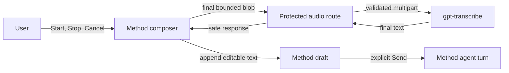
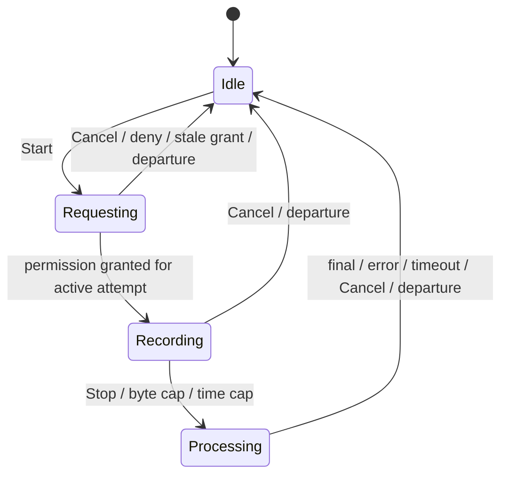
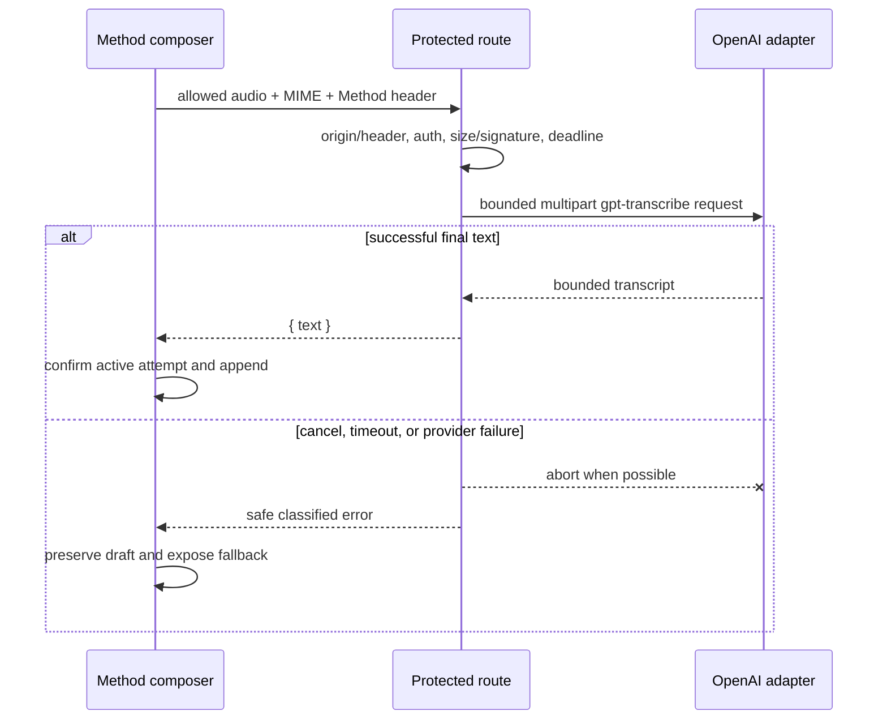

# OpenAI Transcription Track - Plan

## Goal Capsule

**Objective:** Revelio users can dictate Method messages in English, Spanish, or natural mixtures of both, edit the resulting text, and decide when to send it.

**Means:** Replace the authenticated Method composer's Groq call with completed-file transcription through OpenAI `gpt-transcribe`, then harden the shared recording lifecycle and Method composer around that fixed provider choice (KTD1, KTD5, KTD10-KTD12).

**Authority hierarchy:** Current code and tests define existing behavior. `docs/plans/2026-08-14-claude-feat-revelio-revamp-plan.md` governs revamp integration, and `docs/thesis.md` governs the Method agent. This plan governs only the authenticated voice-transcription track.

**Stop conditions:** Do not introduce realtime transport, partial transcripts, automatic transcript submission, or provider-selection infrastructure. Stop and re-plan if `gpt-transcribe` cannot serve the existing completed-file boundary, if the synthetic model-access smoke fails, if the English Chrome dogfood check fails, or if implementation would persist captured audio, raw provider responses, or pre-Send transcription artifacts outside the in-memory composer draft. After explicit Send, the user-edited draft follows the unchanged Method conversation-persistence contract.

**Execution profile:** Four dependency-ordered units replace the authenticated provider, make recording attempts cancel-safe, reconcile transcript results into the Method draft, and verify the resulting browser flow. The legacy questionnaire and `/api/transcribe` remain on Groq.

---

## Product Contract

### Summary

The authenticated Method composer sends complete browser recordings to OpenAI `gpt-transcribe`. Stop finalizes a recording, Cancel discards it, the returned transcript becomes editable draft text, and only explicit Send starts an agent turn.

### Problem Frame

The current Method path hard-codes Groq Whisper and an English language hint. Its shared client hook cannot cancel permission or provider work, can upload during unmount, and can apply late results to a newer Method draft. This track fixes those races for the Method consumer through opt-in hook behavior. The questionnaire keeps its current endpoint, language, controls, and accepted lifecycle limitations; broader questionnaire lifecycle hardening is deferred.

### Key Decisions

- **Use OpenAI `gpt-transcribe` for authenticated Method transcription.** (session-settled: user-directed — chosen over Groq retention and `gpt-4o-mini-transcribe`: observed OpenAI quality is already sufficient, and `gpt-transcribe` best fits multilingual and domain-vocabulary dictation.) Governs R24, R26.
- **Keep voice as composer input, not an agent turn.** Voice may alter only the editable draft; Send remains the sole turn boundary. Governs R5, R6, R8.
- **Keep realtime outside this implementation.** The existing Stop-to-final interaction remains the product boundary. Governs R9.
- **Preserve the legacy questionnaire.** The shared hook may gain opt-in capabilities, but the questionnaire keeps its current controls, language query, Groq endpoint, and 5 MiB server contract. Governs R25.

### Requirements

#### Composer lifecycle

- R5. The Method voice lifecycle must distinguish requesting permission, recording, processing, and idle, with one active attempt identity fencing every asynchronous callback.
- R6. Stop must finalize and transcribe; Cancel must release media, abort in-flight client work where possible, perform no draft write, and prevent every late result from changing the draft.
- R7. Method recording must retain the existing 120-second cap and use a 1,835,008-byte (1.75 MiB) client upload budget below the protected endpoint's 2 MiB limit. The recorder requests Stop when accumulated emitted chunks reach 1,572,864 bytes (1.5 MiB), reserving 262,144 bytes for a delayed final chunk, then validates the complete final Blob without truncating any chunk. A valid complete Blob within the upload budget may be transcribed with an incomplete warning; any Blob above the upload budget is not uploaded and instead exposes the size-limit fallback. The incomplete warning remains until the affected draft is sent or the user edits that draft to an empty value.
- R8. Click, Enter, and direct submission must refuse while a Method voice attempt is unresolved; successful final text is appended once as editable draft text and is never auto-sent.
- R9. The Method composer shows final transcripts only. Streaming, realtime transport, voice activity detection, and partial-text reconciliation require separate planning.
- R10. Permission denial, unsupported recording, timeout, provider failure, and empty transcription must preserve the draft, release resources, return to a recoverable state, and announce a typed or re-record fallback.
- R11. Voice state and outcomes must be keyboard-operable and perceivable without color through explicit labels, associated status text, polite progress/result announcements, and alert semantics for failures.
- R21. Unmount, Chat-to-Map navigation, and sign-out must discard the active attempt before hiding or leaving the composer, without uploading or applying late text.

#### Server and privacy

- R12. `/api/agent/audio/transcribe` must apply the Method exact-origin and `X-Revelio-Request: 1` guard before authentication, body parsing, request logging, or provider work; after that boundary it accepts only bounded WebM/Opus, WebM, or MP4 whose container signature matches the normalized media type.
- R13. Missing local OpenAI configuration or an upstream OpenAI 401/403 credential rejection must produce a safe transcription-unavailable response without crashing application startup or changing the typed Method path.
- R14. Audio-path logs may contain only the existing safe request envelope plus provider, model alias, normalized MIME family, byte bucket, and terminal error class; audio, transcript text, prompts, filenames, provider bodies, raw errors, and user-entered content are forbidden.
- R15. Before explicit Send, the application must not persist captured audio, raw provider responses, or transcription artifacts outside the in-memory composer draft, and it must not retry a paid transcription automatically. After Send, the user-edited draft is an ordinary Method message governed by the existing conversation-persistence contract.
- R16. Before committing, send a temporary synthetic English spoken-audio file through the production `gpt-transcribe` adapter with the configured server-side `OPENAI_API_KEY`. The returned text must closely match the harmless phrase, proving model access, request construction, and response parsing. Do not use microphone or user audio, print the key, or retain the temporary audio.
- R20. The browser timeout remains 30 seconds starting immediately before its upload `fetch`. The server provider deadline is 20 seconds starting immediately before the OpenAI `fetch`, leaving a nominal 10-second end-to-end margin for upload, validation, and response delivery. A slow upload may exhaust the browser budget first; either abort must cancel local reading/provider work where possible, fence late completion, and prevent a second response or draft mutation.
- R22. The authenticated route must use the fixed server-side `gpt-transcribe` alias with automatic multilingual recognition and a bounded Revelio vocabulary prompt; the Method client must not send an English language query. The transcript must preserve the language or languages actually spoken, including within code-switched utterances; the prompt must request transcription without translation or forcing a single output language.
- R24. Authenticated Method transcription uses OpenAI `gpt-transcribe` directly, without a provider enum, Groq fallback branch, model-selection harness, or runtime model choice.
- R25. The legacy questionnaire and anonymous `/api/transcribe` route retain their current Groq-backed language behavior and UI.
- R26. After R16 passes and the implementation reaches dogfooding, Andrés performs one human acceptance check in Chrome: record an English sentence with the microphone, press Stop, confirm editable transcript text appears without automatic Send, then send it normally. A failure blocks further dogfooding and triggers investigation. Safari/MP4, Spanish, code-switching, silence, and near-limit real recordings are deferred coverage, not dogfooding blockers.

### Actors

- A1. **Founder/user:** records, stops or cancels, edits the transcript, and explicitly sends.
- A2. **Browser composer:** owns capture, attempt identity, local media lifetime, draft reconciliation, and accessible status.
- A3. **Protected transcription route:** validates the request, calls fixed-model OpenAI transcription, enforces the deadline, and returns final text without retaining payloads.

### Key Flows

- F1. **Record, edit, send:** permission request → recording → Stop → final-only processing → append to the in-memory current draft → user edits → explicit Send → persist as an ordinary Method message under the unchanged conversation contract. Covers R5, R8, R11, R15.
- F2. **Discard or leave:** Cancel, unmount, Chat-to-Map navigation, or sign-out invalidates the attempt, stops tracks, aborts client work, uploads nothing when capture has not been finalized, performs no draft write, and ignores late callbacks. Covers R6, R21.
- F3. **Recover from failure:** unsupported media, timeout, empty result, or provider error preserves the draft and exposes typed or re-record fallback without automatic replay. Covers R10, R13, R15.
- F4. **Automatic limit:** the time cap or 1.5 MiB rolling threshold requests a normal recorder Stop and waits for the final chunk. If the complete Blob is at most 1.75 MiB, it is transcribed once and leaves a persistent incomplete-transcript warning until the affected draft is sent or the user edits it to empty. If the complete Blob exceeds 1.75 MiB, it is discarded without upload and the size-limit fallback appears. Starting, canceling, or completing another recording does not by itself resolve an existing warning. Covers R7, R11.

### Acceptance Examples

- AE1. With an existing typed paragraph, the user records a code-switched sentence and stops. Final text is appended once, remains editable, and no `/api/agent` request occurs until Send. Covers R5, R8, R22.
- AE2. The user cancels while browser permission is pending. A later permission resolution immediately stops its tracks, uploads nothing, and leaves the draft unchanged. Covers R5, R6, R10.
- AE3. The user attempts Send by click or Enter while transcription is processing. Submission is refused with an accessible reason, and any successful result updates only the same unresolved draft. Covers R5, R8, R11.
- AE4. Recording reaches the byte or time ceiling. Stop preserves the recorder's complete container, the client uploads only when the final Blob is at most 1.75 MiB, and an uploaded partial recording carries the incomplete warning until the affected draft is sent or edited to empty. An oversized final Blob is not truncated or uploaded. Covers R7, R11.
- AE5. OpenAI returns 429, 503, a timeout, malformed JSON, oversized text, or an empty transcript. The attempt ends without automatic retry, payloads are absent from logs, and the user can type or record again. Covers R10, R13-R15, R20.
- AE6. Safari supplies MP4 while Chrome supplies WebM. Each allowed input receives a matching multipart filename and is transcribed; any other media type or mismatched signature is rejected before provider cost. Automated coverage satisfies R12; attended Safari verification is deferred under R26.
- AE7. Sign-out or Chat-to-Map navigation begins while permission, recording, or processing is active. The attempt is discarded before the transition continues, existing typed text remains, and every late callback is ignored. Covers R6, R21.
- AE8. The questionnaire records in Spanish after the Method changes. Its request still uses `/api/transcribe?language=es`, no Method header is added, and its existing controls behave as before. Covers R25.
- AE9. With existing typed text in the Method draft, the user records silence. No text is appended, the existing draft remains unchanged, and the no-speech fallback is announced. Automated coverage satisfies R10; attended silence verification is deferred under R26.

### Success Criteria

- Focused automated tests prove that no canceled, departed, timed-out, or superseded attempt can change the draft or start an agent turn.
- Route tests prove fixed `gpt-transcribe` requests, bounded media validation, safe failures, and payload-free logging.
- The synthetic R16 smoke proves live `gpt-transcribe` access and the adapter's request and response path. The English Chrome R26 dogfood check yields editable text without automatic Send and permits normal explicit Send. Other language, silence, Safari/MP4, and near-limit behavior retains automated coverage and can receive attended follow-up coverage.
- Legacy questionnaire tests prove its endpoint, language query, controls, and transcript insertion remain unchanged.

### Scope Boundaries

#### In scope

- The authenticated Method composer and `/api/agent/audio/transcribe`.
- Fixed-model completed-file transcription through OpenAI `gpt-transcribe`.
- Attempt-scoped cancellation, Send interlock, accessible status, media bounds, privacy-safe errors, and focused browser acceptance.

#### Deferred to Follow-Up Work

- Streaming or realtime transcription, partial-text reconciliation, VAD/manual-commit tuning, and realtime connection observability.
- A broader provider abstraction or provider/model benchmark if future requirements create a real selection decision.
- Automated cross-browser microphone infrastructure and population-level transcription quality measurement.
- Attended Safari/MP4, Spanish, code-switching, silence, and near-limit recordings. Their automated safety and route coverage remains in scope.
- Broader questionnaire lifecycle hardening beyond its current endpoint, language, controls, and transcript-insertion regression contract.
- Aggregate or per-identity admission control for the authenticated paid route. A future design must use shared durable coordination rather than claiming a process-local limiter is global protection.

#### Out of scope

- Changes to the Method agent prompt, tools, reasoning, turn model, Career Map, or conversation persistence.
- Removal or migration of the legacy `/api/transcribe` route.
- A Groq fallback branch, provider allowlist, model-selection corpus, WER engine, timing framework, or rollout evidence system.
- Persisting captured audio or automatically retrying failed paid transcription requests.

### Dependencies

- Implementation starts from `codex/revelio-revamp-integration` at commit `21d585c` or its descendant; shared-file drift must be rechecked before editing.
- The deployed server needs `OPENAI_API_KEY` access to `gpt-transcribe`; the existing optional configuration remains server-only.
- The one human microphone acceptance check requires Chrome access during dogfooding. Synthetic R16 verification requires a configured `OPENAI_API_KEY` with `gpt-transcribe` access.

**Identifier preservation:** R1-R4, R17-R19, R23, U1-U2, KTD2-KTD4, and KTD8 belonged to the superseded provider-evaluation and dual-provider rollout plan. R24-R26 carry the replacement contract, and surviving requirement, unit, and KTD identifiers remain intentionally stable for traceability.

---

## Planning Contract

### Key Technical Decisions

- KTD1. **Keep completed-file transcription.** The product boundary begins after Stop and requires only final editable text; realtime would add a session lifecycle without solving a demonstrated problem. Implements R5, R8, R9.
- KTD5. **Model capture as an attempt-scoped state machine.** A monotonically increasing attempt ID, retained abort handle, and separate finish-versus-discard paths close permission, navigation, sign-out, unmount, Send, and late-result races. Implements R5-R11, R21.
- KTD6. **Escalate transport only in a separate plan.** Any future realtime work must justify its additional session, partial-result, privacy, cost, and recovery behavior. Implements R9.
- KTD7. **Do not automatically retry audio uploads.** A classified recoverable failure avoids duplicate paid work when provider-side cancellation or idempotency is uncertain. Implements R10, R13-R15.
- KTD9. **Keep HTTP and telemetry policy in the route.** The adapter returns final text or a typed internal failure; the route owns validation, response mapping, deadlines, and the closed log projection. Implements R12-R15, R20.
- KTD10. **Use a fixed direct `gpt-transcribe` adapter.** (session-settled: user-directed — chosen over Groq retention and `gpt-4o-mini-transcribe`: transcription quality matters more than the small price difference.) The locked `@ai-sdk/openai` 4.0.42 transcription surface accepts arbitrary model identifiers plus one optional `language` string and `prompt`; R22 needs only an omitted language and a fixed prompt, so request-field support does not force a custom adapter. Use a narrow server-only multipart adapter because this boundary must stream-read and cap the raw provider response before JSON parsing, cancel the response body on overflow, and map upstream failures without exposing provider payloads; the installed SDK's transcription path does not expose that raw bounded-read contract. Implements R22, R24.
- KTD11. **Make Method recording behavior opt-in on the shared hook.** Method supplies its header, omits the language query, sets the R7 byte thresholds, and exposes discard. Questionnaire endpoint, language query, controls, and transcript insertion remain unchanged; this plan does not promise to fix its existing unmount or late-result lifecycle. Implements R5-R8, R21, R25.
- KTD12. **Use automatic multilingual recognition with bounded server context.** The client sends no language choice. The adapter supplies only a short fixed prompt for English, Spanish, code-switching, and Revelio terms that explicitly requests verbatim-language transcription without translation or a forced output language, avoiding a user-controlled prompt surface. Implements R14, R22.

### High-Level Technical Design

#### Component flow

The legacy questionnaire continues to call `/api/transcribe` and does not enter this path.

#### Attempt lifecycle

Every transition that leaves an attempt releases its tracks and request handle. Only a successful result from the active Processing attempt may append text.

#### Protected request sequence

### Stable Route Contract

- Success remains `{ "text": string }`.
- Missing application authentication remains `401`; a missing local OpenAI key or upstream OpenAI 401/403 credential rejection returns `503`.
- Invalid media returns `400`, an oversized raw body returns `413`, and safe provider, timeout, empty, or malformed-output failures return `502`.
- Exact-origin or Method-header failures occur before authentication, parsing, logging, or provider work.

### System-Wide Impact

- **Authentication:** the audio route joins the existing custom Method POST boundary with a media-aware content-type policy.
- **Privacy:** captured audio and raw provider output remain request-scoped and are excluded from storage and logs; only the user-edited draft enters normal Method persistence after explicit Send.
- **Shared UI:** the hook gains opt-in Method behavior while preserving questionnaire defaults.
- **Operations:** `OPENAI_API_KEY` now serves both the Method agent and authenticated transcription; no new provider flag, project dashboard, or runtime model selector is introduced.

### Risks and Mitigations

| Risk | Mitigation |
|---|---|
| A late permission or provider result changes a newer draft | Fence every callback with the active attempt ID and invalidate before departure or cancellation. |
| A Method-only hook option changes the questionnaire | Preserve current defaults and add a questionnaire-level regression test. |
| Safari produces MP4 while other browsers produce WebM | Normalize the MIME declaration, validate the matching container signature, and generate a matching provider filename. |
| A delayed final MediaRecorder chunk crosses the server cap | Request Stop at 1.5 MiB, reserve 256 KiB for finalization, validate the complete Blob against the 1.75 MiB upload budget, and never truncate a container or upload an oversized result. |
| Provider errors leak payloads | Stream-read at most 65,536 response bytes before JSON parsing, cancel the provider response body on overflow, map upstream failures to typed internal causes, and assert sentinel values never reach logs or responses. |
| The moving `gpt-transcribe` alias changes behavior | Keep the model name fixed in one adapter constant and repeat the short acceptance smoke after dependency or provider changes. |
| Authenticated callers can create parallel paid requests | Accept this at founder-dogfood scope and defer shared admission control; do not present an instance-local counter as cross-instance protection. |

### Alternatives Considered

- **Retain Groq or run a paired provider evaluation:** rejected by the user because OpenAI quality is already established through use; the comparison would delay a settled choice.
- **Use `gpt-4o-mini-transcribe`:** rejected because its small cost saving is not material at founder-dogfood volume and `gpt-transcribe` is the quality-focused model.
- **Build a reusable evaluation harness:** rejected because a corpus, WER engine, timing protocol, and evidence schema would outlive the one decision they were created to make.
- **Keep a dual-provider runtime switch:** rejected because there is no remaining provider-selection requirement; deployment rollback can use the previous application revision.
- **Use realtime transcription:** rejected because final-only Stop-to-text behavior already matches the product interaction.

### Integration and Sequencing

1. Create the implementation branch from current `codex/revelio-revamp-integration` and recheck its shared-file delta.
2. Implement U3 first so the fixed server contract exists before Method client integration changes.
3. Implement U4 and its questionnaire characterization before changing the Method controls in U5.
4. Run U6 after U3-U5 pass focused tests; real-device acceptance remains a deployment prerequisite rather than new test infrastructure.

---

## Implementation Units

### U3. Implement fixed OpenAI transcription and protect the route

**Goal:** Replace Groq only on the authenticated Method route with a bounded `gpt-transcribe` request and safe response contract.

**Requirements:** R12-R16, R20, R22, R24.

**Dependencies:** Current revamp integration baseline.

**Files:** `server/ai/transcription.ts` (new), `server/ai/transcription.test.ts` (new), `server/routes/agent.ts`, `server/routes/agent.test.ts`, `server/app.ts`, `server/app.agent-privacy.test.ts`.

**Approach:** Follow KTD9, KTD10, and KTD12. Add a small fetch-injected multipart adapter using `server/ai/history.ts` only for its direct-fetch injection and safe error-mapping shape. The adapter must enforce `MAX_TRANSCRIPTION_RESPONSE_BYTES = 65_536` while consuming `response.body` through a bounded reader before JSON parsing: reject an oversized `Content-Length` immediately, stop and cancel the body as soon as streamed bytes cross the cap even when the header is absent or false, and never call an unbounded `response.json()`, `response.text()`, or `arrayBuffer()` first. A route abort or deadline must interrupt the fetch and reader, and reader cleanup must run on success, overflow, parse failure, and abort. Accept a JSON object only when `text` is a string, ignore but never log other provider fields, and bound accepted transcript text to 32,000 UTF-16 code units.

Export one pure audio metadata guard from `server/routes/agent.ts`. Mount it in `server/app.ts` with `app.all('/api/agent/audio/transcribe', ...)` before `express.json()`, `express.urlencoded()`, and the API request logger, then reuse it inside the agent router so direct router mounts retain the same defense. The early guard rejects OPTIONS and invalid Method origin/header/content-type metadata without reading the request stream. Only requests that pass it reach authentication, `express.raw`, signature validation, Method logging, or provider work. The route forwards normalized media type and abort/deadline state through its existing injectable test seam. The legacy route is untouched.

**Execution note:** Start with failing route and adapter contract tests, then replace the production provider call.

**Patterns to follow:** `server/ai/history.ts` for fetch injection and safe error mapping only, not response-body parsing; `server/routes/agent.ts` for authenticated route injection and abort handling; `server/app.ts` for pre-parser middleware order; `server/app.agent-privacy.test.ts` for application-order and payload-leak sentinels.

**Test scenarios:**

- WebM/Opus, WebM, and MP4 create multipart files with matching extensions, fixed `model=gpt-transcribe`, JSON output, and the bounded server prompt.
- The adapter accepts a provider response of exactly 65,536 bytes, rejects a larger declared `Content-Length` without reading the body, and cancels a headerless, falsely small, or chunk-split stream immediately when cumulative bytes exceed 65,536. A route abort during streaming cancels the reader and surfaces the typed abort. Oversized-body errors, malformed JSON, missing or wrongly typed `text`, empty text, and text above 32,000 code units become safe typed failures without exposing provider bytes; unrelated provider fields are ignored and never logged.
- Missing, malformed, sibling-origin, cross-origin, headerless, unsupported-content-type, or OPTIONS requests fail in an application-level test before global JSON/form parsing, authentication, raw parsing, API or Method request logging, or provider dispatch; direct-router tests prove the shared guard retains the same behavior when the router is mounted alone.
- Empty audio, unsupported MIME, mismatched WebM/MP4 signature, and bodies above 2 MiB fail before provider dispatch.
- A valid authenticated request returns `{ text }`, forwards media type and abort state once, and records only allowlisted OpenAI metadata.
- Missing `OPENAI_API_KEY` and upstream OpenAI 401/403 responses return a safe unavailable response; other upstream non-2xx responses remain safe provider failures, and neither changes application startup or non-audio route behavior.
- Every non-2xx, timeout, abort, malformed-output, empty-output, and oversized-output case dispatches exactly one provider request and never retries the paid upload.
- The 20-second provider timer starts immediately before the OpenAI fetch; expiry aborts fetch and bounded response reading. A client disconnect or earlier browser abort preempts provider work where possible, and no late completion emits a second response.
- Disconnect or timeout prevents a late response, and every event/log assertion remains free of audio, transcript, prompt, filename, raw error, and provider-body sentinels.

**Verification:** Adapter, protected-route, and application-level tests prove the multipart request, 65,536-byte response cap, pre-parser guard order, failure mapping, single-dispatch behavior, deadline behavior, and privacy boundary.

### U4. Harden the shared browser capture lifecycle

**Goal:** Give Method an attempt-scoped finish/discard lifecycle while preserving the questionnaire's current behavior.

**Requirements:** R5-R7, R10, R20, R21, R25.

**Dependencies:** U3's request contract.

**Files:** `client/src/hooks/use-speech-to-text.ts`, `client/src/hooks/use-speech-to-text.test.ts`, `client/src/components/questionnaire/single-page-questionnaire.test.tsx` (new).

**Approach:** Follow KTD5 and KTD11. Retain permission, recorder, stream, timeout, and fetch-abort handles for the active Method attempt. Method opts into custom headers, no language query, short timeslices, a 1.5 MiB rolling Stop threshold, a 1.75 MiB final-Blob upload budget, explicit discard, and automatic-limit reasons. Never trim or drop MediaRecorder chunks to manufacture a smaller container: wait for the final chunk, construct the complete Blob, and upload only if it remains within budget. Defaults retain the questionnaire's current endpoint, language query, controls, and effective upload policy; regression coverage observes that public contract without locking new Method-only lifecycle internals into the questionnaire.

**Execution note:** Characterize the questionnaire defaults before changing the hook.

**Patterns to follow:** Existing `client/src/hooks/use-speech-to-text.test.ts` MediaRecorder and `getUserMedia` mocks; current questionnaire transcript append behavior.

**Test scenarios:**

- Permission success transitions `requesting → recording`; denial or stale permission returns to idle and stops every acquired track.
- Stop uploads once, while Cancel during requesting, recording, or processing uploads nothing further, aborts active work, and ignores late events.
- Starting or completing a later attempt prevents every callback from an earlier attempt from changing state or text.
- Unmount discards without invoking the recorder's upload path and releases tracks, timers, listeners, and request handles.
- Method sends the custom header without a language query and stops below its configured byte ceiling; time-cap and byte-cap completion report an incomplete reason.
- The 30-second client timer starts immediately before upload fetch, includes upload time, aborts a slow or stalled request, and ignores any later result even when the server's 20-second provider timer has not yet fired.
- A single chunk above 1.75 MiB is never uploaded; cumulative chunks that reach 1.5 MiB request one normal Stop; and a delayed final chunk that pushes the complete Blob above 1.75 MiB causes no upload, no container truncation, and a recoverable size-limit message.
- Questionnaire regression tests observe only its public contract: `/api/transcribe?language=<en|es>`, no Method header, existing Start/Stop controls, and transcript insertion. They do not assert Method-only attempt fencing, byte thresholds, or private hook state.

**Verification:** Hook tests prove attempt fencing and cleanup; the questionnaire component regression proves the opt-in policy did not change the legacy consumer.

### U5. Wire Method Stop, Cancel, draft reconciliation, and accessible Send gating

**Goal:** Expose the safe recording lifecycle in the Method composer without allowing voice work to submit or mutate the wrong draft.

**Requirements:** R5-R11, R21-R22, R26; covers AE1-AE4 and AE7.

**Dependencies:** U4.

**Files:** `client/src/pages/explore.tsx`, `client/src/pages/explore.test.tsx`.

**Approach:** Adopt the hook's Method policy and keep draft ownership in `Explore`. Requesting exposes Cancel; recording exposes separate Stop and Cancel; processing exposes Cancel. Preserve focus on a stable primary voice control while those states replace one another; return focus to Start after Cancel, denial, empty output, or failure; move focus to the draft after a successful transcript append; and restore no focus during navigation, sign-out, or unmount. Chat-to-Map navigation and sign-out discard before continuing. Send remains focusable with `aria-disabled` when voice is the only blocker, and click, Enter, and direct submission announce the associated reason without stealing focus. Automatic-limit warnings persist until the affected draft is sent or the user edits it to an empty value, including across later recording attempts.

**Execution note:** Add component tests for every transition before changing the controls.

**Patterns to follow:** Existing `requestHeaders`, `submitMessage`, focus scheduler, and `Explore` MediaRecorder tests.

**Test scenarios:**

- Final text appends once to the latest existing draft, remains editable, restores focus only when appropriate, and does not call `/api/agent` before Send.
- Cancel in requesting, recording, and processing preserves typed text and prevents stale completion from appending.
- Click, Enter, and direct submission are blocked in every non-idle voice state with focusable `aria-disabled` semantics and an announced recovery instruction.
- Chat-to-Map navigation and sign-out discard before hiding or leaving; a later callback cannot change the draft.
- Permission, unsupported-media, timeout, provider, and empty-result failures preserve typed text and expose a recoverable message.
- Byte-cap and time-cap completion append any successful captured transcript with a persistent incomplete warning. Starting, canceling, or completing another recording does not clear it; only sending the affected draft or editing that draft to an empty value does (R7, F4).
- Stop and Cancel have distinct accessible names, keyboard behavior, live-region announcements, and non-color state cues.

**Verification:** Component tests prove draft ownership, no auto-send, departure fencing, accessible controls, and every submission path's interlock.

### U6. Verify the focused transcription slice

**Goal:** Prove the fixed provider path and recording lifecycle without creating a permanent evaluation platform.

**Requirements:** R15-R16, R25-R26.

**Dependencies:** U3-U5.

**Files:** Existing test files from U3-U5; no evaluation corpus, report schema, or rollout artifact is added.

**Approach:** Run the synthetic R16 model-access smoke through the production adapter before committing, then complete focused automated checks and the repository's normal verification. After integration, Andrés performs the R26 English Chrome microphone check during dogfooding. Record the results in the implementation handoff rather than introducing a new evidence subsystem. A failed R16 or R26 check blocks further dogfooding and triggers investigation without a runtime provider fallback.

**Test scenarios:**

- Automated route, adapter, hook, questionnaire, and Method composer suites pass together without payload-bearing snapshots or logs.
- Type checking, the full unit suite, the existing desktop-Chrome journey suite, and the production build pass.
- Before committing, synthesize a harmless English phrase as temporary audio, call the real production adapter with the configured key, confirm a close transcript match, and delete the audio.
- During dogfooding, Andrés records one English sentence in Chrome, presses Stop, confirms editable text appears without automatic Send, and sends it normally.
- Safari/MP4, Spanish, code-switching, silence, and near-limit real recordings remain deferred attended coverage; deterministic tests continue to cover their applicable media, fallback, and byte-bound behavior.

**Verification:** The synthetic R16 smoke and automated checks are required before the implementation commit. The single human R26 check belongs to dogfooding after integration.

---

## Verification Contract

### Automated verification

- `npm test -- server/ai/transcription.test.ts server/routes/agent.test.ts server/app.agent-privacy.test.ts --run`
- `npm test -- client/src/hooks/use-speech-to-text.test.ts client/src/components/questionnaire/single-page-questionnaire.test.tsx client/src/pages/explore.test.tsx --run`
- `npm run check`
- `npm test -- --run`
- `npm run test:e2e`
- `npm run build`

### Behavioral and operational verification

- Inspect test logs and serialized errors for audio, transcript, prompt, filename, raw-error, and provider-body sentinels.
- Confirm the legacy questionnaire still uses Groq through `/api/transcribe` and that no Method header or model behavior leaks into it.
- Confirm configured `OPENAI_API_KEY` access and the production adapter's request and response behavior with synthetic English audio before committing; delete the temporary file afterward.
- After integration, leave the one English Chrome microphone and explicit Send check for Andrés during dogfooding. Safari/MP4, Spanish, code-switching, silence, and near-limit recordings are deferred coverage.

### Quality gates

- No test or build failure remains.
- No canceled, departed, timed-out, or stale attempt mutates the draft or sends an agent turn.
- No protected audio route accepts invalid metadata or mismatched media before provider dispatch.
- No persistence path contains captured audio, raw provider responses, or pre-Send transcription artifacts outside the in-memory composer draft; after explicit Send, only the user-edited draft follows normal Method message persistence. No log contains audio, transcript text, prompts, filenames, raw provider errors, or provider bodies.
- No failure path issues a second paid provider request for the same attempt.
- Automated silence coverage shows no fabricated draft text. The human English Chrome dogfood sample yields editable, usable text and does not auto-send; failure triggers investigation rather than runtime fallback.
- No provider-selection, benchmark, or evaluation artifact is introduced.

---

## Definition of Done

- U3: The authenticated route uses fixed `gpt-transcribe`, rejects invalid metadata before global body parsing, validates and bounds media, caps raw provider responses at 65,536 bytes before parsing, maps failures safely, never retries a paid upload, respects abort/deadline behavior, and leaves the legacy route unchanged.
- U4: Method recording has deterministic requesting, recording, processing, finish, discard, final-chunk byte validation, timeout, and unmount behavior; the questionnaire's public endpoint/language/control/transcript-insertion contract remains unchanged without claiming Method lifecycle hardening for it.
- U5: Method controls distinguish Stop and Cancel, gate every Send path, append only active-attempt final text, define incomplete-warning resolution, and discard before navigation or sign-out.
- U6: The synthetic model-access smoke and focused automated verification pass before the implementation commit; the English Chrome human check is handed to dogfooding after integration. Deferred attended coverage is named without blocking dogfooding.
- The diff contains no abandoned provider-selection, evaluation-harness, or alternate-adapter code.

---

## Appendix

### Repository evidence

- `server/routes/agent.ts` contains the current injected authenticated transcription seam, Groq implementation, Method origin guard, request logger integration, and 2 MiB raw-body route.
- `server/ai/history.ts` provides the existing direct OpenAI fetch-injection and safe error-mapping shape; its use of unbounded `response.json()` is explicitly not the transcription adapter's response-reading pattern.
- `client/src/hooks/use-speech-to-text.ts` is shared by the Method composer and questionnaire and currently owns recording plus upload.
- `client/src/pages/explore.tsx` owns Method draft reconciliation, tab navigation, sign-out, Send behavior, and accessible composer status.
- `client/src/components/questionnaire/single-page-questionnaire.tsx` is the legacy hook consumer whose behavior must remain stable.
- `package.json` declares caret ranges `ai` `^7.0.66` and `@ai-sdk/openai` `^4.0.42`, while `package-lock.json` currently resolves them to 7.0.66 and 4.0.42. The resolved OpenAI provider accepts arbitrary transcription model IDs and exposes one optional `language` string plus `prompt`; this plan intentionally omits `language` and uses only the fixed bounded prompt. The direct adapter is retained for the explicit raw-response cap and closed error boundary, not for unsupported request fields.

### Official OpenAI sources

- [`gpt-transcribe` model](https://developers.openai.com/api/docs/models/gpt-transcribe) — fixed model capabilities, current list price, multilingual context, and keyword hints.
- [Create transcription](https://developers.openai.com/api/reference/resources/audio/subresources/transcriptions/methods/create) — accepted media, multipart fields, language and keyword controls, and response contract.
- [File transcription guide](https://developers.openai.com/api/docs/guides/speech-to-text) — completed-file API guidance.
- [Your data](https://developers.openai.com/api/docs/guides/your-data) — deployment-time data-control verification.
