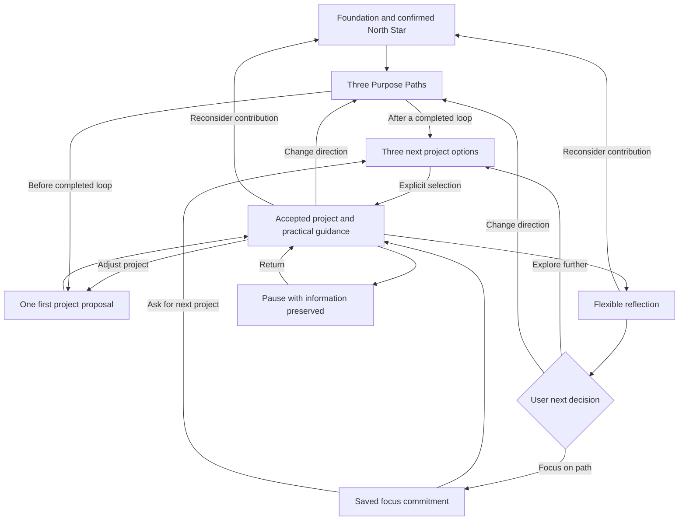
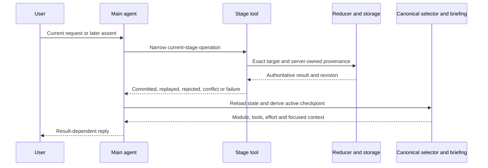
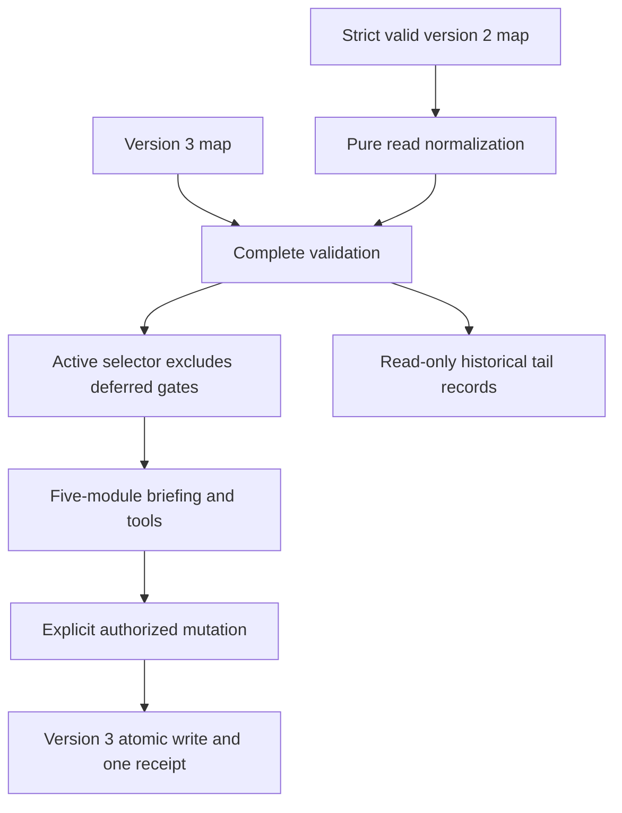

# Repeating Learning MVP - Plan

## Goal Capsule

- **Objective:** Users can keep learning through projects, reflect on their experience, choose what to try next, and change or pause their direction without losing their work.
- **Means:** Extend the existing canonical Method loop and adopt the committed project-development, guidance and reflection drafts (KTD1–KTD8).
- **Authority:** `docs/thesis.md` owns Method philosophy. The founder's current MVP brief supersedes the active plans' mandatory peer and career-entry delivery requirements. `docs/plans/2026-08-14-claude-feat-revelio-revamp-plan.md` remains the implementation authority; U1 below reconciles it and the incorporated Method contract before code changes.
- **Baseline:** `de6dcd884d081c0c6905b173182a1a81675b32fa`, including the manually edited draft bundle and preserved prototype. Production remains Foundation 1.1.13, Paths 1.1.7, project development 1.2.1 and shared voice 1.1.8 until adoption.
- **Execution boundary:** Coordinator approval of this entire plan is required before `ce-work`. Implementation produces scoped local commits; no push, PR, deployment, live-account turn or paid experiment is authorized here. The coordinator owns incorporation into the serving integration checkout.
- **Human acceptance:** Existing attended U7 acceptance and founder actual-app dogfood remain human gates. Offline verification establishes implementation correctness, not founder acceptance or model quality.

---

## Product Contract

### Summary

Deliver an operational, repeating learning loop through five active Method modules. Provisional commitment records a wish to focus on a path and preserves the user's ability to receive guidance, reflect, try more projects and reconsider their direction. Formal Peers, proof inventories and Side Doors are completely deferred from the MVP.

### Problem Frame

The current agent registers only Foundation, Paths and first-project development. The shared kernel can represent later learning, but the agent stops after acceptance and cannot guide or interpret the next cycle. Existing selector and reducer rules then send commitment into unloaded peer and career-entry stages. Those rules also prevent some early path changes and can let an older reflection take precedence over a new project.

The committed drafts already express the founder's simpler project presentation and respect for informed unrelated projects. Their runtime schema, acceptance delivery contract, tools and briefings still enforce the older shape. Adopting files alone would leave the product incomplete.

### Key Decisions

- **Continue learning after commitment.** (session-settled: user-directed — chosen over a career-entry tail: the MVP helps users repeatedly choose what work to pursue.) Governs R1–R4.
- **Preserve user freedom with honest guidance.** (session-settled: user-approved — chosen over enforcing alignment or silently changing direction: explain trade-offs, offer adaptations and respect an informed choice.) Governs R5, R6.
- **One initial proposal; exactly three later options.** (session-settled: user-directed — chosen over three onboarding projects or one proposal forever: the first choice is collaborative, later learning supports comparison.) Governs R3, R7.
- **Use the selected simple presentation and natural responses.** (session-settled: user-directed — chosen over prescriptive project plans and required reply buttons: show enough to begin and develop further guidance together.) Governs R8, R9.
- **Preserve the latest skill drafts.** (session-settled: user-directed — chosen over redrafting the coherent bundle: only peer and postcommitment dependencies need reconciliation.) Governs R10.

### Requirements

**Repeating learning and user choices**

- R1. The active MVP supports Foundation, three Purpose Paths, project development, practical guidance, flexible reflection and user-owned next decisions across repeated sessions and projects.
- R2. Provisional commitment means “I want to focus on this path”; it neither requires formal peer exposure nor triggers proof or Side Doors.
- R3. After commitment, guidance, project revision, reflection, further projects, other paths, new possibilities and Foundation reconsideration remain reachable.
- R4. Pausing and returning preserve accepted content, reported work, pending decisions, reflection evidence and direction history; inactivity never creates a decision or work-status update.
- R5. Users can change their project or direction without completing an artifact, meeting a quota or proving the current path wrong.
- R6. An informed unrelated project remains a legal saved project without manufactured alignment or a silent North Star change; its evidence cannot automatically decide the old path.
- R7. The first project uses one proposal. After any completed learning loop, every next project decision offers exactly three distinct, equal options, including after a path change; the user explicitly selects one.

**Presentation and skills**

- R8. New project briefs contain a title, What you'll learn, What you'll make and Suggested starting point, with ordinary heading/paragraph support copy and natural text-box responses.
- R9. Acceptance applies only to the exact current proposal already delivered in a completed prior turn; natural clear assent is sufficient and path selection alone never accepts the project.
- R10. Preserve the committed design draft verbatim and the founder-edited decision guidance from “Decide what to change” through “Do not rewrite the North Star within reflection.”; change only affected peer/postcommitment passages and companion README boundaries.
- R11. Reflection uses actual experience, energy drivers/drainers and uncertainty without scores; work status, reflection closure and the desire to continue remain separate facts.

**State and boundaries**

- R12. Existing peer, commitment, proof, route and outcome records remain readable with their identities, lineage and historical meaning; none creates an active deferred-stage dependency.
- R13. Keep the single main agent, canonical per-step module/tools/briefing refresh, semantic intent and existing confirmation, provenance, isolation, cancellation, auth, privacy, compaction, erasure and legacy protections.
- R14. Practical guidance can include research, conversation and learning from people when useful; formal-workflow deferral is not a ban on those activities.
- R15. Preserve approved integration evidence and 5173 main/5174 lab settings when incorporating changes; do not overwrite unrelated WIP or restart the existing serving checkout.

### Acceptance Examples

- AE1. **Covers R1, R7–R11.** A user selects a path, sees one expanded proposal, accepts naturally in a later turn, receives useful guidance, revises the project, reflects before completion, chooses explore-further and selects one of three projects. Guidance resumes the selected project; a second reflection and third-project decision remain possible.
- AE2. **Covers R2, R3, R12.** A user chooses focus commitment with no peer records. The choice saves, guidance remains available, and a request for another project yields three options. No proof proposal, peer requirement or deferred module appears.
- AE3. **Covers R3–R5, R7.** A user changes to a parked, revised or new path before finishing the current project. The old work survives. Before the first completed loop, one replacement project is developed; after a completed loop, three next options are offered without fabricated reflection evidence.
- AE4. **Covers R6, R11.** The user knowingly chooses unrelated work. Its saved relationship and reflection remain honest. They can adjust it, explore more such work, return to paths or separately reconsider their direction; its evidence never records a commitment to the old path.
- AE5. **Covers R4, R12.** Reloading during proposal acceptance, project revision, three-option selection, reflection, path/Foundation revision or focused work restores the correct decision and all prior information. Legacy pending-peer and committed/proof/route maps resume through an active module without deleting historical records.
- AE6. **Covers R13.** Same-turn, stale, wrong-owner, cancelled and forged-presentation writes fail at the existing boundary. A successful write refreshes state before dependent prose, and an interrupted reply preserves any already committed write.
- AE7. **Covers R3, R12, R13.** A North Star revision discloses the exact downstream impact and requires later acknowledgment. Active dependent bases are reviewed coherently; preserved deferred invalidations do not become an unresolved MVP stage.

### Scope Boundaries

**Included:** R1–R15 and AE1–AE7, including both first and repeated loops. This is operational adoption, not a prompt-only cleanup.

**Deferred for later:** Formal Peers, proof inventories and Side Doors, including optional formal stages and all associated release gates. Preserve purpose, intended approach, connections and detailed references in `docs/method/deferred-features.md` before removing their active obligations. Revisit from actual user needs without a date or user-count trigger. Proactive reminders remain deferred.

**Outside the product's identity:** Fit scores, permanent calling claims, manufactured evidence, prestige ranking, compulsory project completion and autonomous external actions.

**Considered and not built:** A replacement workflow engine, generic archive service, classifier, second model router, new evaluation platform, pause subsystem and broad historical-document cleanup. Existing canonical records and bounded additions cover the demonstrated gaps; reconsider a larger mechanism only if a concrete required journey cannot fit them. Runnable code-block rendering is not added under this scope; existing safe prose rules remain, and any later need for richer developer-project output requires its own rendering decision.

### Deferred Feature Overview

This overview defines what U1 preserves in the durable deferred reference; it is not active runtime scope.

| Feature | Purpose and intended approach | Connections and retained detailed references |
|---|---|---|
| Formal Peers | Find a small researched set of real people, communities or first-person sources; help users learn about work and environments; capture confirmed insights with human-controlled contact. | Can enrich projects and decisions. Method R34–R35, F4, AE10 and KTD9 retain their deferred detail. The previous mandatory exposure-before-commitment rule is historical and superseded. |
| Proof inventory | Help users describe existing artifacts, problems solved, people helped and useful demonstrated qualities; confirm the inventory before relying on it. | Connects accumulated project work to future entry routes. Method R36, F5, AE11 and U9 retain the intended specification. |
| Side Doors | Compare three researched contribution-first entry routes, choose one, prepare an approach and separate route outcomes from path evidence. | Builds on proof and relevant relationships; external actions remain user-controlled. Method R37–R40, F5, AE11–AE12, deferred U9 and `docs/research/2026-08-28-side-doors-career-entry.md`. |

`docs/thesis.md` keeps the wider philosophical ambition. A short release-scope note may distinguish this MVP; the founder's story, philosophy and historical research are not rewritten.

---

## Planning Contract

### Proposed Technical Choices for Coordinator Approval

These are concrete recommendations, not claims of prior founder settlement: KTD2's separate focus records, KTD3's unrelated continuation scope, KTD4's direct direction-choice basis and KTD5's versioned compatibility adapter. Approval of this plan authorizes these bounded choices. No alternative architecture remains to be chosen by the implementer.

### Key Technical Decisions

- KTD1. **Extend the existing kernel and five-module loader.** Use the existing reducer, selector, strict operation envelopes, tool executor, lower-priority briefing and `ToolLoopAgent`. Register only Foundation, Paths, Design, Guide and Interpret. Paths uses HIGH, Design MEDIUM and other active modules LOW, recalculated each step. No provider, SDK or auth architecture change is needed. Implements R1, R10, R13.
- KTD2. **Separate current path focus from the legacy commitment snapshot.** Add a small append-only `pathFocusCommitments` collection carrying identity, exact path basis, explicit user action and optional existing Next Move or legacy-intent basis. New commit Next Moves create a focus record atomically. Keep `provisionalCommitment` and its required historical peer basis unchanged because historical proof records reference that singleton. Focus is effective only on its still-valid current path basis and uninterrupted selection tenure; changing/revising that path ends its current effect, and returning to an old path does not silently recommit it. A new explicit focus action can choose that path again. Implements R2, R3, R12.
- KTD3. **Record relationship and continuation scope honestly.** New projects/options state linked or intentionally unrelated; old records retain legacy linked semantics. Keep `basisPath` as historical selection context, not a claim of alignment. A continue choice states path scope for genuinely linked reflection and project scope for unrelated work. Project-scoped explore-further can create another three-option set; project-scoped return-to-paths opens direction discussion, and project-scoped commitment to the old path is illegal. An independently explicit path-focus action remains legal, without attributing it to unrelated evidence. Implements R6, R7, R11.
- KTD4. **Give direct direction changes an auditable decision basis.** Permit selecting a previously presented parked path from path-revision focus without requiring a fabricated return-to-paths reflection. Extend project-option decision basis to accept either an existing Next Move or the explicit canonical project/direction-selection action/receipt. A completed loop means supported closed reflection plus an explicit next decision; acceptance, work status and direct direction/focus actions alone do not count. Before the first completed loop, develop one new-path replacement proposal with the next project number and ordinary acceptance; afterward use three options. Accepting the new project parks the preceding current project, preserving work and reflection history. Implements R3, R5, R7, R9.
- KTD5. **Use bounded JSON-document compatibility, not a SQL migration.** Introduce schema version 3 for the new brief, relationship, decision scope and focus records. Retain a strict version-2 reader and pure normalization into version 3; validate old relational records before conversion. Reads never persist the conversion or manufacture actions. The first authorized mutation saves version 3 with its normal receipt/revision. Unsupported versions and invalid data retain repair-required behavior. Implements R8, R12, R13.
- KTD6. **Scope checkpoints to relevant project and active dependencies.** Preserve precedence of active basis review, user-opened active focus and current pending decision. Shared selector and reducer use one active-review predicate. Deferred focus, pending records and invalidations remain history but cannot select a tail module or block active review resolution. Current project/reflection/choice/move lookups use exact project/path basis rather than the global last record. Pending assent, option selection and empty/uncertain reflection cannot block help or direction changes: expose bounded close/open focus and direction operations without manufacturing acceptance, evidence or a continue answer. Leaving a pending proposal parks it through an explicit user-directed transition so it cannot regain precedence on reload. Preserve an empty reflection as unfinished history; do not close it as supported reflection. Implements R1–R4, R12.
- KTD7. **Make natural presentation auditable without mandatory boilerplate.** New project input contains title, learningGoal, firstVersion and firstStep under an explicit brief format; learningGoal carries the personal question and observation cue, and firstVersion carries the wanted outcome/stopping point. Legacy fields remain readable. Track the actual completed presentation and exact target without enforcing the old magic phrase, exact whole reply or compulsory acceptance question. Older delivered framing still supplies valid provenance. Implements R8, R9, R12.
- KTD8. **Expose only narrow loop operations and relevant context.** Add the missing domain adapters, server-owned provenance and pending-target support; keep tail tools unavailable. Brief project stages with refreshed Foundation evidence/constraints, saved learningGoal, accepted revision/work updates, complete pending options and relevant reflection/decision evidence. Preserve result barriers and existing canonical attachment/citation protections. Implements R1, R11, R13.

### High-Level Technical Design

The active lifecycle has two continuing branches after reflection, neither of which leaves the loop.

The same runtime owns every state-changing conversation step.

### State and Resume Mapping

| Saved state | Active behavior | Preservation rule |
|---|---|---|
| Pending initial proposal or revision | Design owns presentation/refinement/acceptance | Exact delivered prior-turn target remains required. |
| Accepted project | Guide owns work support | Resume relevant project and reported work, not an older global reflection. |
| Open reflection / closed reflection with unresolved choice | Interpret owns evidence/current decision | Do not infer completion, desire or a choice from model output. |
| Explore-further or direct path-selection decision | Design offers three options after a completed loop | Option set consumes its exact decision basis once; revisions replace it without a second independent set. |
| New focus commitment | Guide resumes current project; explicit new-project request can open options | Commit Next Move is a legal option-set basis; no extra reflection is required just to continue after commitment. A later explicit new-project request creates a fresh action-backed decision basis if the former basis already has selected options, without rewriting the prior Next Move. |
| Legacy pending/deferred/ready peer intent | Resume the relevant learning checkpoint | Do not convert intent on load. Expose a narrow explicit focus-confirmation operation against the exact legacy intent if the user wants to finish that choice. |
| Legacy confirmed commitment, proof or route state | Resume current valid project or offer next-project/direction discussion through active modules | Preserve the singleton, all tail arrays, receipts and historical peer links. No new tail writes. |
| Historical deferred focus or invalidation | Ignore for active routing and active-review ordering | Keep original records visible as history; active basis changes still retain their exact impact disclosure. |
| Foundation/path revision | Earliest relevant active basis review remains first | No dependent write during pending Foundation revision; no silent transfer of focus across bases. |
| Intentionally unrelated project | Project-scoped reflection and next decision | Do not infer old-path rejection/commitment or rewrite Foundation. |
| Paused session / stopped project | Reload exact active checkpoint and information | Only a new reported action changes work status; pausing during pending focus leaves that focus preserved. |

KTD2's collection is the smallest addition that preserves proof-backed maps while allowing later commitments to another path. Reusing or overwriting the singleton is unsafe. Deriving all commitments from old Next Moves would falsely treat historical pending peer intent as completed focus; a new explicit record separates those meanings. No bake-off is needed because repository references establish the rejected mechanisms' compatibility failure without prototype development.

### Authority Reconciliation Map

Identifiers below belong to the existing plans; R/U IDs elsewhere in this document are plan-local. Preserve each existing identifier and landed history when changing normative text.

| Authority area | Existing identifiers / sections | Required amendment |
|---|---|---|
| MVP binding and lifecycle | Revamp authority/summary/sequence, R2–R4, R6, R9, F1; Method Goal/Summary/lifecycle and R44/R47 | Active F1–F3 and five modules; full tail becomes explicitly deferred. Remove live all-seven delivery and commitment-tail instructions. |
| Project development and freedom | Method R18–R25/R48, F2, AE5–AE6/AE14; Revamp R9/F2/U7 | Adopt simple brief and natural acceptance; preserve three follow-ons and informed unrelated choices. |
| Reflection and focus commitment | Method R26–R33, F3, AE7–AE9, KTD2/KTD7–KTD9; Revamp R9/R12 | Retain linked-path English questions where applicable, flexible reflection and exact draft decision section. Commitment remains inside the loop. |
| Deferred detail | Method R34–R40, F4–F5, AE10–AE12, KTD9, both U9s, appendices | Label deferred/historical and link the durable overview. External-action control remains an active invariant independently of these IDs. |
| Canonical state and presentation | Method R41–R46, KTD1–KTD8/KTD10–KTD12, ownership tables, checkpoint/dependency diagrams; Revamp R13/R17/R18/R22–R26 | Preserve safety/lineage and historical record validation; update active checkpoints, five modules and simple projects. Preserve approved five-band Paths. |
| Units and prerequisites | Both unit indexes/U1–U3/U5/U8/U9/U10 | U8 owns repeating learning with Guide/Interpret; U9 deferred and removed from launch dependencies; U10 verifies active scope plus historical compatibility. |
| Verification and release | Both verification contracts/DoD/risks; Revamp R3 and old time-bound framing | Remove deferred-feature deployment gates and retired exact R22 boilerplate checks. Keep auth/privacy/cancel/compaction/erasure/integrity/legacy and human gates. Historical dates are not renewed deadlines. |
| Philosophy and pilot evidence | Thesis solution bullets; Revamp R12–R16 and accepted experiment/dogfood appendices | Keep philosophical ambition and founder review evidence; no date/count triggers for restoring deferred work. |

U1 searches all live normative passages for peer-before-commitment, proof/SideDoor consequences, six/seven bundle gates and U9 dependencies. A precedence note alone is insufficient; update contradictory R/F/AE/KTD/U text, diagrams, tables and DoD in place. Historical experiment receipts remain dated evidence.

### Exact Draft Deltas

| File | Proposed scope delta | Preserved content |
|---|---|---|
| `docs/drafts/2026-10-13-project-learning-loop/design-path-project/SKILL.md` | None | Entire file byte-for-byte, including manual natural acceptance. |
| `docs/drafts/2026-10-13-project-learning-loop/guide-path-project/SKILL.md` | Replace “Useful peer feedback or exposure can be discussed through the peer stage when relevant. Do not make outreach a routine prerequisite for starting or continuing.” with “When useful, help the user learn from other people's experience or feedback as part of ordinary practical guidance. Contacting someone remains their choice.” | Every other passage verbatim. |
| `docs/drafts/2026-10-13-project-learning-loop/interpret-path-project/SKILL.md` | Replace only the paragraph beginning “An explore-further choice returns” with the same three-option handoff followed by: “Provisional commitment records the user's wish to focus on this path. Guidance, further projects, reflection and changes of direction remain available; commitment does not begin another required stage.” | Exact founder-edited decision guidance through “Do not rewrite the North Star within reflection.”, energy lens, flexible reflection and unrelated-project section. |
| `docs/drafts/2026-10-13-project-learning-loop/README.md` | Remove Interpret's peer handoff responsibility; state five active modules and planned code/schema adoption; replace boundary 7 with exactly-three preservation and formal-tail deferral; update boundaries 1–6 only to describe actual implementation/adoption evidence when it exists. | Shared principles, founder presentation choices, official guidance citations and proposal/adopted distinction. |

Keep `docs/drafts/2026-10-12-design-path-project-SKILL.proposed.md` and the original prototype HTML unchanged as historical evidence. Runtime copies may receive necessary frontmatter/version changes; record those separately from content edits. Update any instruction referenced by a draft only where the canonical operation contract requires it, without rewriting the skill to describe internal schemas.

### Integration Preservation

The clean baseline omits six known uncommitted integration paths: `AGENTS.md`, both active plans, `server/auth.test.ts`, `server/auth.ts`, `server/index.ts`. Read-only inspection established that AGENTS/server deltas set main 5173 and lab 5174; the plan deltas preserve five-band Paths, first-offer introduction, approved replay/interface history and existing adoption evidence.

Implementation amends clean authority paragraphs against those reviewed doc deltas deliberately. Incorporation must use three-way reconciliation, retain the integration-only appended history and manual additions, and resolve overlapping normative sections by meaning; replacing either whole plan is prohibited. AGENTS and the three port files stay outside this task's commits unless the coordinator explicitly assigns a prerequisite port change. Offline work does not depend on importing them. Serving this clean checkout later requires those exact approved runtime changes first, and allowlist confirmation before browser use. No source-account or serving-process work is authorized.

### System-Wide Impact and Risks

New JSON records affect storage validation, briefings, UI and erasure tests; the existing document remains the sole store. Preserve private history outside Git and use synthetic fixtures. Version-3 writes require the new reader throughout server/tool/route/UI tests; rollback uses the existing writer-disable contract and must not deploy an old version-2-only writer over upgraded maps.

The new modules change agent capability, not permission. Model-written observations cannot substitute for firsthand evidence or authorize external actions. First-project acceptance and follow-on selection retain completed-presentation identity. Reflection correction must be reachable for both open and closed evidence under narrow existing revision operations, with prior choice snapshots unchanged.

### Assumptions and Deferred Implementation Details

Coordinator approval is the decision point for the proposed bounded technical choices. This plan assumes that a small versioned JSON extension and synthetic offline verification are acceptable within the authorized MVP scope. Exact helper names, content-version numbers, version-2 adapter placement and fixture construction are implementation details; their behavior is fixed by KTD2–KTD8. No external research materially shaped these choices, and no new provider contract or service is introduced.

---

## Implementation Units

The units below supplement existing revamp U7/U8/U10 without renumbering those authorities.

### U1. Reconcile active authority and preserve deferred specifications

**Goal:** Make the existing active plans describe one coherent MVP before code adoption.

**Requirements:** R1–R15; authority reconciliation map; existing Method F1–F3/AE1–AE9/AE13–AE14 active and F4–F5/AE10–AE12 deferred.

**Dependencies:** Coordinator plan approval.

**Files:** Both active plans named above; `docs/method/deferred-features.md` (new); the three draft skills and companion README; `docs/thesis.md` only for a short MVP distinction if needed; `CONCEPTS.md` for missing domain vocabulary.

**Approach:**

1. Write the deferred overview with retained detail links before removing active obligations.
2. Apply the authority reconciliation map in place, preserving IDs/history and reviewed integration-only evidence.
3. Apply the exact draft deltas, with a byte comparison for all unaffected passages and the manually edited decision section.

**Patterns:** Existing plan R/F/AE/KTD/U numbering and historical experiment receipts.

**Test expectation:** No runtime tests for prose-only changes; document coherence review and targeted normative-reference audit are required.

**Verification:** No live active requirement still demands formal Peers, proof, Side Doors or seven modules. No wider thesis/history rewrite or unrelated WIP import occurred.

### U2. Add compatible project and focus state

**Goal:** Save simple, unrelated and repeating project decisions without damaging existing records.

**Requirements:** R2, R3, R6–R9, R12, R13; KTD2–KTD5; AE2–AE5.

**Dependencies:** U1.

**Files:** `shared/career-map/projects.ts`, `learning.ts`, `model.ts`, `operations.ts`, `reducer.ts`, `common.ts`, `index.ts`; `shared/career-map/reducer.test.ts`, `state-machine.test.ts`; `server/storage.ts`, `storage.career-map.test.ts` and `storage.migration.test.ts` if the read boundary needs adaptation.

**Approach:**

1. Add the small versioned structures and strict version-2 reader/normalization per KTD2–KTD5/KTD7.
2. Implement atomic focus recording, explicit legacy-intent confirmation and project-scoped continuation without writing deferred tail records.
3. Adapt project proposal/revision/options/selection guards and direct path-choice basis while preserving receipt and relational validation.

**Execution note:** Characterize saved commitment/proof integrity before changing mutation behavior.

**Test scenarios:**

- Covers AE2. Commit without peers records current focus; later commitment on another path leaves an existing proof-backed singleton and all old references valid.
- Covers AE4. Unrelated project continuation creates project-scoped options; an attempt to commit the old path from that choice rejects.
- Covers AE3. Direct path change before any closed loop permits one N+1 proposal; after a closed loop it permits exactly three options and later explicit selection.
- A version-2 map reads without writes, preserving records/receipts; its first explicit mutation writes version 3 with exactly one new receipt.
- Invalid old data and unsupported versions remain repair-required; replay/conflict do not create duplicate conversions or focus records.
- A new simple brief needs no fabricated legacy fields; a historical detailed brief validates with its original fields.

**Verification:** Complete maps remain valid across both read formats and every new mutation; saved-history identities and exact operation cardinality survive.

### U3. Make repeating checkpoints and direction changes reachable

**Goal:** Resume the relevant learning decision after every project, commitment or direction change.

**Requirements:** R1–R7, R11–R13; KTD4/KTD6; AE1–AE5/AE7.

**Dependencies:** U2.

**Files:** `shared/career-map/selector.ts`, `reducer.ts`, `model.ts`, `common.ts`; `shared/career-map/selector.test.ts`, `reducer.test.ts`, `state-machine.test.ts`; `server/ai/briefing.ts`, `briefing.test.ts`.

**Approach:**

1. Scope pending learning/normal lifecycle to the current exact project and its valid choices.
2. Share active-review eligibility between selector and resolution; retained deferred focus/reviews never request an unloaded module.
3. Allow direct parked/new/revised path transitions and explicit new-project requests after focus commitment, with consumed-option-basis protection. Add only a narrow withdrawal/parking operation if current operations cannot leave a pending proposal while preserving its history.
4. Preserve Foundation impact disclosure and active basis review while supplying exact project context and constraints.

**Test scenarios:**

- Covers AE1. Selecting project 2 resumes guidance despite closed reflection/move from project 1; a second reflection produces a fresh project-3 basis.
- Covers AE2. Focused users receive guidance by default; explicit next-project request consumes the commitment decision once and permits replacement/selection without a fresh invented reflection.
- Covers AE5. Pending-peer focus, ready/deferred intent, committed/proof/route records and historical tail invalidations all derive a registered active checkpoint.
- Covers AE7. An active project review resolves even with older deferred reviews; a pending Foundation revision still rejects dependent writes and requires exact impact acknowledgment.
- Covers AE3. Parked-path selection from explicit focus preserves work, and opening then abandoning Foundation/path reconsideration restores the prior valid checkpoint.
- Pending project assent, suggested options and an empty reflection each permit an explicit path change with no fabricated acceptance/evidence; uncertain closed reflection permits practical help while its decision stays unanswered.
- Reflection evidence corrections in open and closed sessions are reachable while earlier decision evidence snapshots remain unchanged.
- Revisiting a formerly focused path after switching does not silently reactivate its historical focus; a stale legacy intent cannot confirm focus on a replacement path.

**Verification:** No active path dead-ends on an unavailable module, stale global learning record or historical tail dependency.

### U4. Adopt modules and operational tools

**Goal:** Deliver actual guidance, reflection and next-project choices through the production agent.

**Requirements:** R1–R3, R7, R9–R14; KTD1/KTD7/KTD8; AE1/AE2/AE6.

**Dependencies:** U3.

**Files:** `server/ai/method/base-instructions.ts`, `registry.ts`, `loader.ts`, `loader.test.ts`, `v6-adoption.test.ts`, `evaluation.ts`, `evaluation.test.ts`; `server/ai/method/skills/design-path-project/SKILL.md`; new Guide/Interpret runtime `SKILL.md` files; `server/ai/tools.ts`, `tools.test.ts`, `agent.ts`, `agent.test.ts`, `briefing.ts`, `briefing.test.ts`; `server/routes/agent.ts`, `server/routes/agent.test.ts`; `shared/career-map/authority.ts`; `scripts/eval-revelio-method.mjs` and existing replay tests where current contracts are duplicated.

**Approach:**

1. Copy the reconciled drafts into the loader, keeping unrelated Foundation/Paths/shared voice edits intact; add shared freedom principles once and record module versions/digests.
2. Add narrow adapters for project revision/work status/options, reflection open/evidence/correction/close, continue/Next Move, current path focus and direction choices; derive all provenance/presentation fields server-side.
3. Extend only required confirmation receipt kinds and presentation barriers; remove the U7 acceptance stop boundary now that Guide is registered.
4. Refresh effort, module, tool set and relevant briefing each step; remove retired exact boilerplate assumptions from active offline fixtures and scripts.

**Patterns:** Existing `operationTool` runtime, exact-target adapter selection and result-dependent narration barrier.

**Test scenarios:**

- Covers AE1. A fake-model chain accepts a prior presented project, refreshes to Guide, opens Interpret on request, records only supplied experience and offers exactly three next projects through Design.
- Covers AE6. Same-turn, ambiguous, stale or wrong-presented acceptance rejects; each result class refreshes state/tools/briefing before any dependent prose.
- A transition Paths→Design uses HIGH→MEDIUM; Design→Guide uses MEDIUM→LOW; no fixed-effort leak or extra classifier call appears.
- New loop tools omit user-provenance metadata from model input; hostile search content cannot supply authority or private-context leaks.
- Cancellation before/after a write preserves existing lease, receipt, stopped-display and retry behavior.
- Exactly five registered bundles load in production mode; no active operation advertises an unmapped tool or deferred module.

**Verification:** Offline agent/route/tool/module checks prove the full operational chain; production instruction adoption is evidenced separately from draft edits.

### U5. Align project and commitment presentation

**Goal:** Show the agreed simple project brief and current learning state without active career-entry prompts.

**Requirements:** R4, R8, R9, R12, R13; KTD7/KTD8; AE4–AE6.

**Dependencies:** U4.

**Files:** `client/src/components/explore/method-map.tsx`, `method-map.test.tsx`, `interaction-ownership.ts`, `interaction-ownership.test.ts`; `client/src/pages/explore.tsx`, `explore.test.tsx`; shared UI transports in `shared/career-map/authority.ts` and the existing route transport only if required by inspected current boundaries; focused styles in `client/src/index.css`.

**Approach:**

1. Render learning first, the first version and visible starting point for new briefs; show legacy details read-only without padding new records.
2. Replace active commitment/SideDoor copy with current path focus and continuing work; retain existing tail data as historical read-only inspection.
3. Keep acceptance and later choices conversational, Your Map read-only and existing Paths/citation/status rendering intact.

**Test scenarios:**

- Covers AE4. Unrelated work is shown honestly and does not claim North Star alignment.
- New and legacy projects render with learning-first hierarchy; no required project reply buttons, green support rule or magic acceptance phrase appears.
- Covers AE5. Historical proof/route data remains inspectable but shows no active tail instruction, required peer prompt or Map action.
- Covers AE6. Streaming, failed/cancelled presentation and hydration never create an actionable project target before prior-turn completion.
- Approved five-band Purpose Path cards, delayed Saving, silent success and safe citations retain current behavior.

**Verification:** Component and route transport evidence establishes current canonical content, historical preservation and acting-surface ownership.

### U6. Prove repeat-loop integrity and prepare the human gate

**Goal:** Establish offline evidence for the complete MVP and identify human release checks honestly.

**Requirements:** R1–R15; AE1–AE7; existing active revamp U10 safeguards.

**Dependencies:** U5.

**Files:** `shared/career-map/state-machine.test.ts`; `server/ai/agent.test.ts`; `server/routes/agent.test.ts`; `server/storage.career-map.test.ts`, `storage.performance.test.ts`; `client/src/pages/explore.test.tsx`; existing erasure tests; `docs/evidence/2026-10-13-repeating-learning-mvp.md` (new); companion draft README; both active-plan verification/DoD sections.

**Approach:**

1. Walk first, repeated, committed, changed-path, unrelated and paused/reloaded journeys through existing synthetic boundaries rather than a new eval platform.
2. Recheck schema integrity, ownership, cancellation, result refresh, safe compaction, erasure and legacy behavior on the final MVP structures.
3. Record exact code/module versions, commands, coverage and remaining human checks without personal data.

**Test scenarios:**

- Covers AE1–AE5. At least three project cycles, commitment followed by more work, same/parked/revised/new paths, unrelated continuation and every pending checkpoint survive reload.
- Covers AE7. Deepest retained historical proof/route map survives Foundation revision, proper impact disclosure and active-review recovery.
- Cross-user reads/writes and malformed origin/header/media type fail at the current boundary; agent/signup switches remain fail-closed.
- Compaction does not allow stale transcript choices to override canonical project, relationship, focus or current decision.
- Whole-account erasure removes new and historical state, conversation/history and failed/retried erasure residue under existing controls.
- Anonymous en/es `/legacy` journeys remain unchanged; Method coverage is reported separately from legacy-only Playwright tests.

**Verification:** Required offline gates pass; release evidence names any skipped disposable-DB, browser, live-model, actual-account and manual screen-reader checks. Founder acceptance is never inferred from tests.

---

## Verification Contract

No execution checks ran during planning. Commands below describe approved implementation verification; credential-dependent work must use existing isolated test facilities and report concrete missing prerequisites.

| Evidence | Existing command / boundary | Required outcome |
|---|---|---|
| Types | `npm run check` | Shared schemas, operation variants, agent tools and UI compile. |
| Deterministic suites | `npm test -- --run`, narrowed by affected files first | Relevant reducer/selector/state-machine, agent/tool/briefing/route, loader and component tests pass; widen once final changes settle. |
| Packaging | `npm run build`, `npm run test:method-bundle` | Exactly five active bundles load in production mode; legacy packages normally. |
| Persistence/integrity | `npm run test:storage`, only with an approved disposable test DB | Version-2 reads/version-3 writes, exact-once conflicts, historical proof references, erasure and repair behavior pass. Missing isolated DB is reported, not replaced by live DB tests. |
| Behavioral transport | Existing fake-model agent/route seams and synthetic fixtures | Full first/repeat/focus/unrelated/direction/pause chains prove operations and refresh; these do not measure live judgment quality. |
| Browser and accessibility | Existing `npm run test:e2e` plus established Method test boundaries | Legacy coverage remains explicit. Authenticated Method and manual screen-reader verification remain founder/release gates until specifically authorized and completed; approved origins are main 5173/lab 5174. |
| Model behavior | Existing `npm run eval:method` and attended founder dogfood | Adjust contracts offline but do not execute paid samples or new account turns here. Record this human/model gate as pending, not a passed release check. |
| Authority | Non-interactive local `ce-doc-review` and normative reference audit | Current plans agree on five-module repeating MVP, deferred scope, preserved history and actual adoption evidence. |

---

## Definition of Done

- U1 reconciles every affected active R/F/AE/KTD/U, diagram, verification and DoD clause in both existing plans while preserving IDs and integration evidence.
- The three-skill bundle preserves unaffected text and the exact founder-edited decision guidance; runtime adoption/version changes are documented separately.
- The operational MVP satisfies R1–R15 and AE1–AE7 through five registered modules and mapped strict tools, not prompt files alone.
- Simple and unrelated projects, repeat decisions, focus commitment, early path changes and Foundation reconsideration remain legal without manufactured evidence or alignment.
- Old pending-peer, commitment/proof/route, framing and deferred-invalidation records remain valid and inspectable, with no active formal-tail gate or destructive conversion.
- Required authorized offline checks pass and retained safety/privacy/auth/cancel/compaction/erasure/legacy protections remain evidenced.
- Abandoned implementation attempts, unused active tools, contradictory release assertions and temporary generated files are absent from the final diff.
- Local code completion is reported separately from release completion. Founder U7/actual-app acceptance, any separately authorized model evaluation, final integration and deployment remain explicit outstanding human/coordinator gates.
