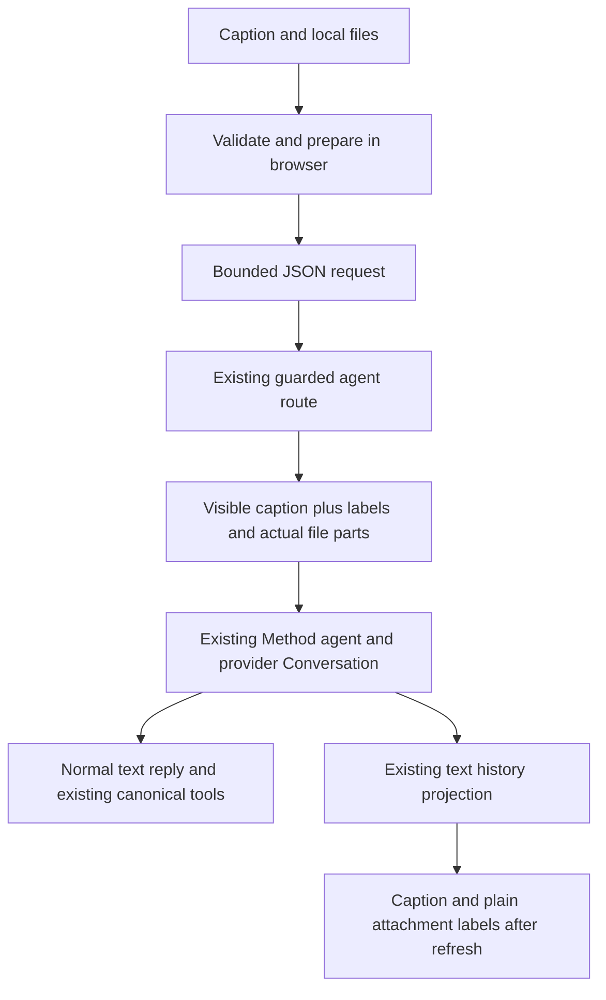

# feat: Add MVP chat attachments

## Goal Capsule

- **Objective:** Explorers can show Revelio screenshots and documents so it can help them understand feedback and progress their Path Project without manually transcribing the material.
- **Means:** Small attachments in the existing chat request; temporary composer previews; plain text attachment labels in conversation history.
- **Authority:** This plan adds the attachment capability to the active revamp plan's R7 input surface. `docs/plans/2026-08-14-claude-feat-revelio-revamp-plan.md` otherwise remains the revamp implementation authority; `docs/thesis.md` and existing Method rules remain authoritative for canonical state.
- **Execution profile:** MVP feature, one release containing images, PDF and Word. Three implementation units, no new storage or upload service.
- **Baseline and ownership:** Implement in a separate worktree branched from the current U7 integration branch `codex/revelio-revamp-integration` (inspected at `94415d1`), incorporating its committed recovery behavior. Preserve its unrelated working changes and the founder's account. This feature belongs to the attachment work, not the U7 coordinator chat.
- **Stop conditions:** Finish with verified local changes ready for coordinated integration. No PR, deployment or founder-account edits. Do not interrupt the live U7 process; actual-app verification requires a coordinated local testing window before switching the candidate onto the approved main origin. If a supported format requires app-owned originals, separate uploads or a new provider, report the incompatibility instead of building that infrastructure or dropping the format.

---

## Product Contract

### Summary

Add screenshot paste and a direct **+** file picker to the authenticated conversation, available from Foundation through project support. Files help the agent in the submitted turn; the product does not become an attachment archive.

### Problem Frame

Explaining feedback, visual work or an existing document by typing it out interrupts exploration. The useful outcome is that Revelio understands the supplied material and responds helpfully. Reopening old originals is unnecessary.

### Key Decisions

- **Processing with labels, not an archive** (session-settled: user-directed — chosen over persistent thumbnails and reopening originals: understanding the supplied material is enough). Governs R3, R7.
- **Bounded first release** (session-settled: user-approved — chosen over larger uploads and separate infrastructure: 3 MB total per message is sufficient for this MVP). Governs R1, R4.
- **Immediate, recoverable feedback** (session-settled: user-approved — chosen over discovering size errors after Send: preserve the draft and valid files while the user fixes a problem). Governs R5, R6.
- **Separate development** (session-settled: user-directed — chosen over assigning attachments to the U7 orchestrator: keep dogfooding coordination focused). Governs R9.

### Requirements

**Attach and discuss**

- R1. Support PNG, JPEG and WebP images, PDF, and Word `.doc`/`.docx` in the authenticated Foundation/project composer; all formats belong to the first release.
- R2. Pasting an image adds a removable preview; **+** opens the file picker directly. Documents get removable filename/type chips. Preserve ordinary text paste. A valid attachment may be sent without a caption.
- R3. The agent receives the actual file content and can discuss it in that turn. Useful observations belong naturally in its reply, without a compulsory transcription or separate summary. After refresh/paging, show plain labels such as `Image attached` or `brief.docx — Word document`; no thumbnail, download or original reopening is required.

**Limits and recovery**

- R4. Permit at most 3,000,000 combined file bytes per message after any image optimization. Display `3 MB total per message`; it is not an account quota. Also enforce the complete encoded request limit in KTD2.
- R5. Validate on selection/paste and again before sending. Optimize oversized images conservatively in the browser when readable, show the resulting preview with `Image optimized`, and reject with an actionable size/type error when they cannot fit. Do not silently remove a file, degrade a document or progressively crush image quality to meet the limit.
- R6. Preserve text and valid attachments while correcting selection errors. Preserve the in-flight submission's exact bytes in browser memory for existing failure/stop recovery, without automatically overwriting a newer draft. Keep U7's distinction between failed-before-save and saved-with-failed-reply. A refresh does not promise recovery of unsent originals; failed/unsent files may need reattachment.

**Trust and compatibility**

- R7. Store no app-owned original files, thumbnails or extracted text, including in database rows, browser persistence, logs or temporary filesystem archives. Browser draft/preview bytes and request-scoped server memory are transient. Provider conversation retention still applies; do not claim processing deletes the provider's copy immediately.
- R8. The actual user caption remains the source for existing authored-evidence checks. File contents, filenames and generated labels are context, not instructions or authorization. Preserve existing canonical confirmation/target/revision rules, text-only chat and microphone behavior.
- R9. Develop and verify separately from live U7 dogfooding using fixtures and isolated test identities/data. Leave `/legacy`, the live founder project, unrelated work and the U7 coordinator's assignment unchanged.

### Acceptance Examples

- AE1. **Covers R1–R3.** Paste a screenshot with a question, see a removable preview, send, and receive a reply based on image content. Refresh: the message includes `Image attached`, without fetching or displaying the original.
- AE2. **Covers R1, R3, R8.** Attach a PDF, `.doc` or `.docx`; the agent can discuss a distinctive fact in its contents. Explain near the document controls that Word reads text and PDF should be used when embedded visuals matter.
- AE3. **Covers R4–R6.** Add files whose combined size exceeds the limit: flag the offending addition before Send, keep the typed question and valid files, and explain Remove/Replace or sending separately. A provider failure preserves the in-memory submission under existing recovery behavior.
- AE4. **Covers R2, R3, R8.** Send only an image: the turn works and retains a label after refresh; it does not imply project acceptance or turn synthetic label text into canonical evidence.

### Scope Boundaries

Not built: app-owned originals or attachment metadata tables; OpenAI Files uploads; object storage; download/reopen endpoints; document libraries/search; OCR/extraction pipelines; RAG/embeddings; attachment-specific tools; automatic Career Map imports; separate summarization; background upload queues; new automatic retries; per-account quotas; drag/drop or folder upload; changes to the legacy questionnaire.

These mechanisms do not serve the agreed first-use case. Reconsider larger upload infrastructure only if ordinary pilot files repeatedly fail the limit; reconsider an archive only if users need original reopening. Existing Method memory, turn recovery, privacy logging and erasure continue to do their current jobs.

---

## Planning Contract

### Key Technical Decisions

- KTD1. **Extend the existing JSON message request.** Add an optional ordered attachment list carrying bounded names, allowed media type and base64 data. Decode and validate on the server before invoking the model. Preserve old text-only requests; require caption or files. No multipart library, extra upload endpoint or upload credentials: at this cap, they add a lifecycle the product does not need. This is the selected transport for this plan, not a claim that Vercel intrinsically limits raw files to 3 MB.
- KTD2. **Two byte checks, one product limit.** Put constants and the browser-safe formatting contract in `shared/chat-attachments.ts`. Use decoded bytes for R4 and UTF-8 bytes of the complete serialized JSON for a 4,250,000-byte transport ceiling. The composer checks UTF-8 bytes of the actual serialized request during preparation and before Send, rather than estimating from file size; an over-limit body gets the same inline correction guidance. Exempt only the exact agent submission path from the small global JSON parser, and parse it inside the agent router after existing enablement/origin/auth guards with that bounded ceiling. Preserve the global parser for other routes and the protected parser-error boundary. Return a plain actionable 413 for size rejection; never echo body/base64 in errors or logs.
- KTD3. **Labels use existing text history.** A shared pure formatter produces visible user text from the caption and ordered attachment labels. Send that exact text as one user text part alongside actual image/file parts, and use it for optimistic display, projection matching and every completion/failure/cancellation recovery digest. Keep `currentMessage` as the original caption, including empty for attachment-only sends. Ordinary history drops binary file parts and retains labels without a database or history-schema change. For text-only turns the formatter returns exactly the old message text. Validate the entire formatted text against the existing `NORMALIZED_HISTORY_MAX_TEXT_LENGTH` ceiling in both composer and server, so history never truncates it before digest matching; excessive labels get an inline instruction to remove files or send separately. No marker parser or special attachment history renderer.
- KTD4. **Use the same agent and provider.** Extend `server/ai/agent.ts`'s existing prompt entry to accept multimodal user content, retaining U7's `continueFromConversation` branch. Use inline image/PDF parts and enable the installed OpenAI adapter's non-PDF file passthrough for validated Word inputs. Set supported filename/MIME metadata; do not use provider File uploads. Keep attachments through normal same-turn tool steps without duplicating them in direct continuations. Add a short trust clarification to existing base instructions rather than changing tools or canonical provenance.
- KTD5. **One immutable submission.** Fingerprint the caption plus ordered server-validated filename/media type and content hashes; do not trust client hashes. Retain the exact optimized bytes for a retry; identical message IDs/bytes follow existing replay behavior and altered bytes must conflict. Do not store bytes or add another retry subsystem. Generated image labels omit filenames; document names are bounded basenames rendered as plain text, with separators, controls and line breaks removed.
- KTD6. **Small browser-only preparation.** Keep File/Blob state in the composer and object URLs in a small preview component; revoke URLs on removal/replacement/unmount. Leave fitting images unchanged. For an oversized image, make one conservative browser re-encoding attempt, preserving dimensions and transparency and avoiding a quality-reduction loop; use the result only when smaller, decodable and within the remaining budget. If a safe useful result cannot fit, keep an inline error and suggest cropping or a smaller copy. Do not re-encode PDF/Word or add a compression dependency. Preview rendering is separate from assistant Markdown; retain its existing remote-image/data-URL restrictions.

### High-Level Technical Design

The original caption separately supplies existing authored-evidence checks. The file parts are inference context; no new canonical storage path is introduced. The sequence is prepare → submit → existing turn handling → text-only history; limits and failure recovery apply at those existing boundaries.

### Grounding and Risks

The U7 baseline matters: it has failed-turn projection, canonical project reply synthesis and direct UI-operation continuation absent from main. Research confirmed the text-label approach works with its text-based projection/recovery; implement against that integrated behavior rather than porting main's obsolete guards.

`server/app.ts` currently applies the default global JSON parser before route registration. A larger parser mounted after it cannot admit attachment-sized requests. Existing auth/origin protection and `server/app.agent-privacy.test.ts` are the reference for the narrow parser change.

`server/ai/history.ts` projects only text parts. This is sufficient for R3 once labels are text; it is not evidence that provider originals can be reopened. `shared/streaming-schemas.ts` and `server/storage.ts` should not need attachment persistence changes.

External guidance already checked in this conversation shapes KTD1/2/4: [Vercel request limit](https://vercel.com/docs/functions/limitations#request-body-size), [base64 expansion](https://developer.mozilla.org/en-US/docs/Glossary/Base64#encoded_size_increase), [OpenAI file inputs and Word visual limitations](https://developers.openai.com/api/docs/guides/file-inputs), and [AI SDK OpenAI provider](https://ai-sdk.dev/providers/ai-sdk-providers/openai). The installed provider exposes `passThroughUnsupportedFiles`, off by default. No new provider choice or architecture comparison is needed.

### Deferred Implementation Details

No product blocker prevents implementation. Actual-app Browser acceptance remains pending until the dedicated account/session and coordinated main-origin testing window below are established. Verify actual inline `.doc`/`.docx` acceptance and image/PDF interpretation with a bounded synthetic provider smoke during U1; documentation supports the route, but this plan does not claim runtime proof. Final helper names and browser re-encoding parameters are implementation details within KTD6, not permission to add an image-processing framework.

---

## Implementation Units

### U1. Admit attachments into the existing agent turn

**Goal:** Send real image/PDF/Word content while preserving current turn identity and Method authority.

**Requirements:** R1, R3, R4, R7, R8; KTD1–KTD5. **Dependencies:** None.

**Files:** Create `shared/chat-attachments.ts`, `shared/chat-attachments.test.ts`, and a small `server/ai/chat-attachments.ts`/`.test.ts` for decoding, checks and provider parts if needed. Modify `server/app.ts`, `server/routes/agent.ts`, `server/ai/agent.ts`, `server/ai/method/base-instructions.ts`; extend `server/routes/agent.test.ts`, `server/ai/agent.test.ts`, `server/ai/tools.test.ts`, `server/app.agent-privacy.test.ts`.

**Approach:**

1. Define allowed file types and label formatting, strict base64/decoded-size validation, and basic extension/MIME/signature consistency; reject empty, malformed and unsupported files without parsing document contents locally.
2. Apply the narrow parser ordering change in KTD2 and extend request validation. Validate the actual body and decoded files before provider work.
3. Construct the multimodal message, keep caption-only `currentMessage`, and extend immutable retry fingerprints. Replace all route recovery/projection inputs with the shared visible text where appropriate; leave canonical authored-evidence inputs alone.
4. Confirm all formats through the selected provider path before building UI polish. Report incompatibility per the Goal Capsule rather than adding a fallback service.

**Patterns:** Existing protected Method route, agent model seams, owner/lease/fingerprint machinery and text-history digests.

**Test scenarios:**

- Covers AE2/AE4. Each allowed file produces a real provider part; attachment-only yields nonempty label text and empty authored caption. Word passthrough is explicit; text-only and direct continuation still work.
- A 3 MB decoded aggregate is allowed when the complete request fits; an over-limit aggregate or encoded body is rejected before the model. A request above the default small JSON limit reaches this route through the full application. Formatted-text admission at the existing history ceiling round-trips without truncation; excess labels are rejected before provider work.
- Identical ID/content replays once; changed file bytes with identical caption and labels conflicts. A malicious filename or document instruction is not added to authored evidence or treated as project acceptance.
- Unauthorized/bad-origin requests remain rejected, and malformed/oversized bodies and provider errors do not put filenames or file bytes into logs or error responses.

**Verification:** Focused route/agent/privacy regressions pass; a bounded synthetic provider smoke checks compatibility for an image, PDF, `.doc` and `.docx` without touching the founder account. This diagnostic does not satisfy the later Browser acceptance gate. No storage/schema migration or new service appears.

### U2. Add paste and direct file selection to the composer

**Goal:** Make attaching files fast and size errors easy to fix.

**Requirements:** R1, R2, R4–R6, R9; KTD2, KTD3, KTD5, KTD6. **Dependencies:** U1.

**Files:** Modify `client/src/pages/explore.tsx` and `client/src/pages/explore.test.tsx`; add `client/src/components/explore/attachment-draft.tsx` and focused tests, plus a small browser preparation helper/test if needed.

**Approach:** Keep local files next to existing draft state; render previews/chips above the text input, provide labeled Remove controls, and let **+** open a hidden multi-file picker. Apply the shared limits and visible-text formatter. Wire Send enablement to caption-or-files and existing turn-busy state; capture one immutable in-flight snapshot and follow existing conditional draft restoration. If a newer draft prevents automatic restoration after failure/Stop, retain the previous caption/files and expose one explicit restore action; its label must say it replaces the current draft, and no replacement happens without that choice. This is one retained submission, not a draft history or retry queue. Show a simple size hint and Word/PDF visual guidance near attachment controls. Do not change chat layout or introduce a menu system.

**Test scenarios:**

- Covers AE1/AE4. Image paste and picker selection show removable previews/chips; text-only paste is unchanged; attachment-only Send works and the payload contains bytes, not just labels.
- Covers AE3. An oversized/unsupported addition reports an immediate specific error while preserving prior valid files and text; removing/replacing it restores sendability. Optimization is visibly indicated and runs once, not on retry.
- Network/provider failure or Stop retains the submitted snapshot under current recovery behavior; a newer typed draft is not automatically overwritten, and the explicit restore action brings back the prior caption plus exact files only when selected. New attachments cannot mutate an already-submitted request.
- Keyboard/screen-reader users can select/remove files and hear errors; mobile composer remains usable; object URLs are released when no longer needed.

**Verification:** Composer and helper tests pass; fixtures demonstrate paste, picker, mixed documents, size correction and failed-send recovery on desktop and phone layouts.

### U3. Prove reload labels and integrate without disrupting dogfooding

**Goal:** Deliver the complete feature with U7 history and recovery intact.

**Requirements:** R1–R9; KTD3–KTD5. **Dependencies:** U1, U2.

**Files:** Extend `server/ai/history.test.ts`, `server/routes/agent.test.ts`, `client/src/pages/explore.test.tsx`; record actual-app Browser evidence in `docs/evidence/YYYY-MM-DD-chat-attachments-verification.md` using synthetic input files. Do not create a separate fixture app or automated browser harness for this MVP. Update `server/ai/history.ts` only if a proven integration gap needs a small fix; no new history renderer/schema. Make a narrow input-surface amendment to `docs/plans/2026-08-14-claude-feat-revelio-revamp-plan.md` R7 when implementation lands.

**Approach:** Verify normal, attachment-only, stopped and safe failed-turn projection using the exact visible text. Preserve U7 canonical reply synthesis, pagination and failed-after-save behavior. Keep the existing privacy/erasure paths: no attachment objects or tables exist to clean up. Run the actual Browser acceptance profile below against the candidate attachment checkout with a dedicated test identity and real app persistence/provider. Existing route/component fixtures remain narrower regression evidence. Coordinate the main-origin testing window and later live-app integration separately.

**Test scenarios:**

- Covers AE1/AE4. Refresh and older-page loading retain caption and labels, including attachment-only messages; browser history contains no file bytes, original URLs or previews.
- Existing stopped/failed/committed-but-reply-failed turns retain their current status and safe projection with labels; successful text-only turns and direct-operation follow-ups remain unchanged.
- Covers AE2. PDF and both Word formats work in the same release; document filenames render as plain text. A Word file containing embedded visuals does not falsely promise those visuals were read.
- Existing Method data erasure removes conversation-item labels through the current path; no app-owned file cleanup mechanism is introduced.

**Verification:** Relevant history/recovery checks, typecheck and production build pass on the actual integration baseline, and the named Browser acceptance profile completes with an evidence receipt. Founder project/account and unrelated WIP remain untouched. Finish with a reviewable local diff and coordinated integration instructions; do not claim U7 accepted.

---

## Verification Contract

No application tests, live provider calls or Browser acceptance have run during planning. Passing automated tests or a standalone provider smoke must never be reported as actual-app E2E verification.

### Existing Guidance and Coverage Limits

Read `docs/solutions/workflow-issues/find-and-choose-revelio-testing-setups.md` on the U7 integration baseline before choosing a test identity. It records the historical `revelio-qa` browser profile as founder state, not a synthetic account; current authentication is unverified. A separate browser profile alone does not isolate an account or its database/provider state.

The existing `tests/journey.spec.ts` covers `/legacy`. Its Playwright configuration still targets port 5001; neither is evidence for authenticated attachment support. Do not run that configuration unchanged or build an extra fixture app to substitute for actual acceptance. The synthetic Method evaluator and private replay harness omit browser/auth and persisted app transactions. Disposable storage tests isolate the storage connection only, not the full authenticated app.

The solution's 5001 auth/server note is historical: current U7 source uses main 5173, with relevant port/auth changes still uncommitted in that checkout. Preserve those changes when preparing the candidate; do not assume branching from its commit includes them.

### Minimal Acceptance Profile: Attachments MVP

This is a checklist over the existing app, not a new test framework, environment or seed service. The founder accepts coordinated use of the normal local app, reset to Foundation and occasional attended sign-in; do not add a second application origin, separate test database, checkpoint loader or unattended authentication system for this feature.

- **Identity:** Use one dedicated Google test account in a separate Browser session. Verify its app user identity differs from the founder and that its map, turn records and provider Conversation mapping belong to that test identity. The usual app database may be used with its existing owner-scoped records; a new Neon database is not required. Never assume the historical QA profile is safe, reuse founder cookies, reset the founder account or add a production auth bypass. Occasional attended Google sign-in is accepted. If a dedicated login is unavailable, request the necessary sign-in and leave this gate pending; do not build an authentication bypass or unattended-login mechanism.
- **App and origin:** Use the candidate attachment worktree, normal authenticated routes, real persistence and the current application provider/model settings. Coordinate a short testing window on approved main origin `http://localhost:5173` before switching processes; preserve the U7 checkout/startup configuration and restore its availability afterward. Port 5174 remains a complementary/lab origin, not an assumed second Google-authenticated app. Do not interrupt active dogfooding without coordination.
- **State:** Begin with the dedicated test account in Foundation, then use its own synthetic first Path Project for the project check. Prepare that state through the existing app flow if necessary; do not add a canonical-state seeding platform or replay founder history. Reuse this test account for later attachment checks. Reset its journey through the existing `method:reset` procedure in `docs/dogfood/method-reset.md` when needed: preview and verify the exact test account/database, then explicitly execute. Preserve the Google identity; never substitute the founder account. Save useful evidence before reset. Starting again at Foundation is accepted, so no checkpoint fixtures are needed.
- **Files:** Use small synthetic PNG/JPEG/WebP, PDF, genuine binary `.doc` and `.docx` fixtures, plus an over-3-MB file and a mixed-file aggregate exceeding the limit. Put a distinctive readable fact inside each supported fixture that does not occur in its filename or caption. No private screenshots or personal documents.
- **Tool:** Use the user-requested **Browser** plugin for actual interactions. Test native paste and file selection through supported Browser controls; a dispatched JavaScript clipboard event or mocked response is only fixture evidence. If Browser cannot perform an interaction, record that limitation and arrange an attended action rather than marking it passed.

| Evidence layer | Required checks | What it proves |
|---|---|---|
| Focused regression tests | `npm test -- ... --run` for named shared/route/agent/privacy/history/composer files | Deterministic size, identity, authority and failure-path behavior |
| Type/build checks | `npm run check` and `npm run build` | Type contracts and production packaging |
| Early provider diagnostic | Bounded synthetic image/PDF/Word calls during U1 | Selected inline provider route accepts and understands each format; not Browser E2E |
| Actual Browser acceptance | Checklist below, normal app and real provider/persistence | User interaction reaches the real agent and survives actual reload |
| Evidence receipt | Tested commit plus preserved local config, tool, opaque test identity, fixtures, actions, observed outcomes and limitations | Exact scope of verified behavior; no unsupported completion claim |

### Actual Browser Checklist

1. **Foundation and paste:** Paste a screenshot, observe its removable preview, add a question and Send. Confirm the real reply references the distinctive fact inside the image, not merely the attachment label. Reload and confirm the caption and `Image attached` survive without fetching/displaying an original.
2. **Picker and formats:** Use **+** to select each allowed image type, PDF, `.doc` and `.docx`; verify preview/chips and a real reply grounded in each fixture's internal fact. Check the Word-versus-PDF visual guidance. The early provider diagnostic cannot replace these normal request-path checks.
3. **Project and image-only:** In the same test account's synthetic Path Project, send a screenshot without a caption. Confirm useful contextual handling or a natural clarification, a persistent label after reload, and no implicit project acceptance or unrelated canonical change.
4. **Errors and correction:** Add an oversized file and an over-limit aggregate; verify errors occur before Send, Remove/Replace works, and valid files/text survive. Remove a preview and confirm that file is not sent. Confirm a fitting image remains unchanged and any available oversized-image optimization is labeled and readable.
5. **Stop/recovery and presentation:** Start a real attachment send, Stop it, and verify the visible status, retained in-memory submission and reload behavior without duplicate committed operations. Check one newer-draft recovery interaction, keyboard access and a narrow viewport. Keep forced provider/network-error cases in deterministic regressions unless they occur naturally; do not add fault-injection infrastructure just for this checklist.

Check relevant browser console/network failures as part of the pass. Record any observed failure and fix/retest it before marking that scenario complete. Do not infer all scenarios passed from one successful upload or screenshot of the composer.

Before any Browser access, confirm enterprise allowlisting for the approved origin/port; stop if blocked. Do not work around restrictions.

### Receipt and Completion Language

Keep the receipt concise and nonpersonal: candidate commit, any required uncommitted runtime configuration, Browser tool/session, opaque test-account marker, synthetic fixture names, per-scenario pass/fail/not-tested, provider calls used, and screenshot/evidence pointers. Keep credentials, cookies and account identifiers private; private diagnostic artifacts remain Git-ignored per `docs/dogfood/README.md`.

If identity, origin access, tool capability or a testing window is missing, report **implementation checks passed; actual Browser verification pending**, with the exact missing prerequisite. U3 and final acceptance remain incomplete. Do not substitute a founder-account action, a mocked browser journey, replay output or an HTTP 200 for this gate.

---

## Definition of Done

All three units and AE1–AE4 are satisfied, all formats are included, and both required implementation checks and the actual Browser acceptance profile pass with the evidence receipt. A missing test login or coordinated testing window leaves final acceptance pending. The agent receives actual content; attachment labels survive refresh using existing text history. No new store, provider File objects, database migration, upload service or automatic canonical import is introduced. Failure/stop handling preserves the current U7 guarantees. The local diff is ready for integration without modifying the live founder journey; integration, deployment and U7 acceptance remain separate actions.
