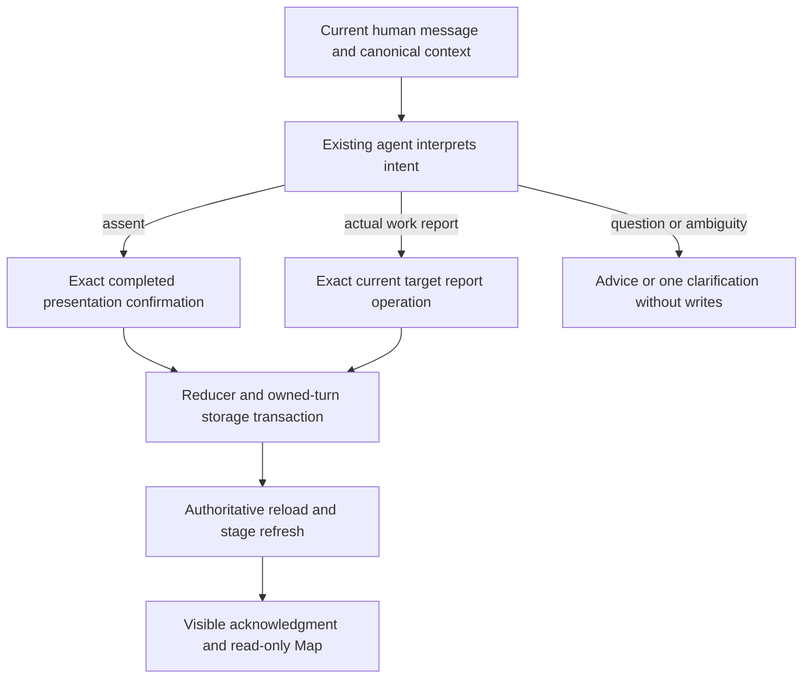
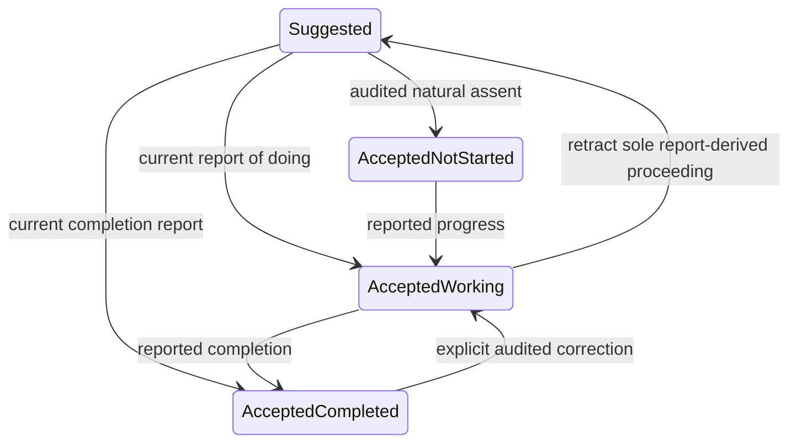

# Conversational project state - Plan

## Goal Capsule

- **Objective:** Explorers can ask for help, start a suggested project, and return with experience in ordinary conversation, with an accurate durable record and no retrospective acceptance ritual.
- **Means:** Extend the existing project operations and provenance, preserve the assent route, and verify reply and saved state together (KTD1–KTD6).
- **Authority:** `docs/thesis.md` governs Method philosophy. `docs/plans/2026-08-14-claude-feat-revelio-revamp-plan.md` governs implementation; its incorporated Method contract is `docs/plans/2026-08-29-1133-feat-revelio-method-plan.md`. This bounded amendment requires coordinator approval before implementation. It preserves the immutable repeating-learning plan and existing IDs.
- **Baseline:** `5cf1c85806facb53547daf63fd1edac48eb6e54f`, integration branch `codex/revelio-revamp-integration`. Preserve unrelated uncommitted `AGENTS.md`, `server/auth.test.ts`, `server/auth.ts`, and `server/index.ts` byte-for-byte.
- **Execution boundary:** Planning only until coordinator approval. No model generations, implementation, account writes, deployment, push or PR are authorized by writing this document. The coordinator owns approval; founder U7 and release acceptance remain human gates.
- **Stop conditions:** Report inaccessible test login or denied approved local origin. Do not bypass access controls, change founder state, or expand into unrelated production redesign. Exceeding an effort estimate alone is not a stop condition.

---

## Product Contract

### Summary

Give explicit work reports their own auditable route into the existing learning loop. Keep acceptance, actual work, reflection and decisions about direction distinct. Validate the state policy first, then exercise the remaining dogfood routes from isolated checkpoints.

### Problem Frame

A user may do a suggested project without first sending an acceptance message. Today a suggested project leaves the agent in Design, where progress and reflection tools are unavailable. Useful reflective prose can therefore coexist with a saved suggested/not-started project. Advice can also become unnecessarily dependent on agreement.

Current code already separates agreement and work fields. The missing capability is a truthful transition from a current work report, rather than invented historical consent. The older Language Model Builder discrepancy motivates this change; it grants no authority to repair that account.

### Requirements

**Conversation and state**

- R1. The existing agent judges intent from the complete current human message. Do not add classifiers, agents, phrase lists or magic acceptance words.
- R2. Natural assent accepts only the exact current proposal delivered in a completed prior presentation. Acceptance alone leaves work not-started. Path selection alone does not accept a project.
- R3. An unambiguous report of actually undertaking an identifiable current project establishes proceeding now and saves only the progress reported. A completion report can enter reflection without requiring earlier acceptance. Record the current report as the source; never fabricate earlier consent or presentation.
- R4. Hypothetical/practical questions receive useful help before acceptance without saving agreement, started status or reflection evidence. Requested proposal changes leave it unaccepted.
- R5. Ambiguous project references require one obvious clarifying question before writing. Reports about an older or different version cannot silently attach to the current version, replace an accepted project, activate a path, or revise the North Star.
- R6. The explorer can correct a mistaken work status, including completed. Preserve the prior report and correction provenance; a correction does not silently rewrite learning or decisions about direction.
- R7. Briefly acknowledge meaningful committed changes and make conversational correction available. Use natural text without repeated bold boilerplate. Only claim a saved change after an authoritative committed/replayed result.

**Preserved Method and verification**

- R8. Preserve Paths V6, the V4 voice, energy drivers/drainers, informed unrelated projects, exactly three follow-on options, and continued freedom after provisional focus. Peers, proof and Side Doors remain deferred.
- R9. Verify the six Phase 1 cases below independently, using the actual agent/tools/reducer and a fresh candidate from the approved instructions. Judge saved state as well as reply.
- R10. After Phase 1 passes, validate the remaining six dogfood routes in Phase 2. New findings receive separate diagnoses and bounded recommendations; they do not automatically expand implementation scope.
- R11. Use the dedicated `konfidenzclothing@gmail.com` account in an isolated bundled @Browser session for actual-app evidence. Preserve its history. Never send messages, sign out, reset, or repair the founder's account.
- R12. Retain first outputs and failures. Effort estimates are soft diagnostic guardrails, not call ceilings. Continue useful transitions, diagnosis and specific-fix verification within scope without asking solely because an estimate was exceeded. Do not rerun for a favorable-looking answer.

### Acceptance Examples

All six begin from the same suitable presented-but-unaccepted checkpoint, except AE6's disclosed ambiguity fixture.

| ID | Message | Expected reply and saved outcome |
|---|---|---|
| AE1 | “Let's do it.” | Accept that exact presented project; work remains not-started. Covers R2. |
| AE2 | “I've arranged the first interview.” | Recognize proceeding and save in-progress with the reported activity on that project. No separate acceptance demand. Covers R3. |
| AE3 | “How would I approach the first interview?” | Give practical advice; agreement and work unchanged. Covers R4. |
| AE4 | “Can we remove tracking?” | Revise the proposal; replacement remains suggested/not-started. Covers R4. |
| AE5 | “I finished the interviews. Here's what happened…” plus disclosed synthetic experience | Save completed work and supported learning on the correct project; no fit, continue or commitment assumption. Covers R3, R8. |
| AE6 | “I started it.” with multiple plausible projects | Ask which project; no canonical write. Covers R5. |

### Scope Boundaries

No new evaluation platform, generic Undo/state framework, proactive reminders, scheduling, broad persona/model/effort matrix, new production dependency, unrelated prompt work or backlog cleanup. No migration/backfill inventing missing acceptance. No founder-account repair. No changes to approved Ports 5173/5174 or enterprise access workarounds.

Considered and not built: a separate suggested-project execution lifecycle would duplicate existing current-project selectors and reflection guards. An additive provenance route reuses those boundaries (KTD1). A lexical authorization layer would contradict R1. A generic historical-project reflection system is outside this change; historical identity must remain honest (KTD4).

---

## Planning Contract

### Grounding

This is a source-based single-pass trace, not a runtime test result. No external research is needed: the change concerns existing domain operations, not adoption of a new API or library. There is no configured CE pack; the resolver returned no roots, warnings or errors.

- `shared/career-map/projects.ts`: independent agreement/work fields; work updates currently store status and action only.
- `shared/career-map/model.ts`: accepted projects require confirmation, and work status must equal the latest work update.
- `shared/career-map/reducer.ts`: acceptance requires delivered framing and audited confirmation; work updates and reflection require accepted projects; completed cannot silently reverse.
- `shared/career-map/selector.ts`: first-project pending decision exposes replacement/framing/acceptance, not work reports; normal Guide follows acceptance.
- `server/ai/tools.ts`: exact pending target/current-message checks, authored-value association, per-operation refresh and authoritative envelopes already exist.
- `server/storage.ts`: canonical operation transaction binds actions to the current owned turn and checks terminal completed presentation for confirmation operations.
- `server/ai/briefing.ts`: exact project state and work provenance are available, but activity text and report-derived proceeding are absent.
- `server/ai/method/skills/design-path-project/SKILL.md` and Guide instructions make support follow acceptance. The active Method R22/F2/KTD6 and implementation U8 currently describe only prior-presentation acceptance.
- `docs/dogfood/2026-10-27-learning-loop-lab-preparation.md`: existing actual-agent replay isolates provider Conversations and reducer state; it excludes authentication, PostgreSQL transactions, leases and browser persistence. Its old frozen candidate is not a pass for this amendment.
- `docs/solutions/workflow-issues/find-and-choose-revelio-testing-setups.md` and `diagnose-purpose-path-revision-save-anomalies.md`: distinguish synthetic state, storage and rendered evidence, and retain failed-operation diagnostics. Their historical ports/model descriptions are not current configuration authority.

### Key Technical Decisions

- KTD1. **Keep accepted as the current-project lifecycle status, with two distinguishable sources.** Add an optional report-derived proceeding record to the project rather than fabricating `confirmation` or introducing another lifecycle. Existing confirmations remain unchanged. An accepted project must have either valid assent confirmation or valid current-report proceeding tied to its exact revision and operation receipt. The report source must remain identifiable in context and Map. This is a proposed technical choice for coordinator review, not founder-approved schema.
- KTD2. **Use an atomic report operation for suggested-to-proceeding plus progress.** For the one eligible current suggested first project, a strict operation records proceeding and a work update in the same reducer/storage transaction. Save a short exact current-message excerpt for reported activity using existing authored-value association. Already accepted projects reuse the existing work-status operation, extended only as needed for activity. Separate assent then progress operations remain legal in one human turn after authoritative refresh when that message contains both. Implements R2–R3.
- KTD3. **Preserve two different provenance contracts.** Assent still needs exact delivered framing, a completed prior presentation, current pending target and source-message association. The new report operation needs exact persisted target/revision, current human authored report and legal eligibility; it does not assert prior presentation or reuse confirmation provenance. A report may establish proceeding even when framing was never delivered. It cannot adopt a pending replacement of an accepted project or choose among three follow-on options implicitly. Those decisions retain their exact confirmation/selection flow. Implements R2–R5.
- KTD4. **Resolve old and changed versions explicitly.** Initially expose current accepted and eligible suggested target identities plus concise alternative/history references needed to disambiguate. Do not map an old report onto a newer brief or select a path from a work report. For an explicitly historical target, discuss it accurately and clarify any requested current adoption; automatic historical activation/reflection is not added. A clearly requested accepted-project replacement still follows revision confirmation. Advice remains available while identity is resolved. Implements R4–R5.
- KTD5. **Add a narrow work-status correction operation.** Bind correction to the exact latest work-update action and current human correction, retaining original status/activity and the superseding correction. The ordinary update operation keeps its completed-reversal guard. Correcting completed to in-progress/stopped retains proceeding. Correcting the sole report-derived basis to not-started retracts that derived proceeding and restores suggested status; independently recorded assent remains valid. Use existing review/invalidation records for dependent learning when the user retracts the underlying experience, preserving historical evidence rather than deleting it. A status-only correction does not automatically invalidate otherwise real reflection. Implements R6.
- KTD6. **Let Design give practical help without a module detour.** Add the concise pre-acceptance support rule to Design/shared instructions rather than a new focus or routing mode. A supported report transition refreshes naturally into Guide; opening reflection refreshes into Interpret. Update briefing and read-only Map labels so “proceeding from your report” is distinguishable from prior assent. Existing canonical project attachments remain; no acceptance buttons or new cards. Implements R4, R7–R8.
- KTD7. **Keep one agent and the existing stage policy.** Paths HIGH, Design MEDIUM, Guide/Interpret LOW, Foundation LOW. Freeze all five modules and base instructions into a new candidate after changes, with exact versions/hashes and policy receipts. Preserve Paths bytes and V4 voice. (session-settled: user-directed — chosen over an extra classifier or agent: semantic understanding stays with the existing context-rich agent.) Implements R1, R8–R10.

### High-Level Technical Design

The diagram's labels combine existing agreement/work fields, not new enum values. Reflection is independent and can open at any work status after proceeding. Stopped uses the existing work status. KTD5 governs correction consequences.

### Assumptions and Execution Discoveries

Additive optional fields and operation schemas should suffice within the current document representation; verify compatibility with strict V2/V3 readers, operation replay and stored receipt validation before choosing final field names. Do not default historical documents into invented proceeding. No SQL data migration or production backfill is proposed.

Test-account login availability is unverified. That is an execution prerequisite for browser evidence, not permission to inspect credentials. The source checkpoint must genuinely contain the target interview project and completed presentation; otherwise use a labeled synthetic fixture and disclose bypassed setup. No historical capture is to be rewritten.

The no-model-calls-before-approval instruction prevents delegated research, elevation and multi-model document review at this checkpoint. This plan has an inline coherence/feasibility review only; coordinator review and any required independent document review remain explicit gates before execution claims.

---

## Implementation Units

### U1. Reconcile the active behavior contract

**Goal:** Make the report route explicit without weakening assent or the learning method.

**Requirements:** R1–R8; KTD1–KTD7. **Dependencies:** Coordinator approval.

**Files:** `docs/plans/2026-08-29-1133-feat-revelio-method-plan.md`, `docs/plans/2026-08-14-claude-feat-revelio-revamp-plan.md`, `CONCEPTS.md`, `server/ai/method/base-instructions.ts`, Design/Guide/Interpret `SKILL.md`, `server/ai/method/registry.ts`, `server/ai/method/loader.test.ts`, `server/ai/method/evaluation.test.ts`.

**Approach:** Amend affected Method R22–R26, F2, examples and KTD6–KTD7 and the corresponding active implementation descriptions in place, preserving IDs and history. Implement KTD6 instruction ownership and bump only changed instruction versions. Do not alter the immutable October 13 plan or unrelated Paths/Foundation behavior.

**Test scenarios:**

- Instruction/registry versions agree after affected changes, with five active modules and unchanged per-stage effort.
- Design permits useful hypothetical help while requiring semantic report evidence for status writes.
- Contract audit finds no remaining active rule demanding retrospective acceptance for R3 or permitting assent to imply started.

**Verification:** Focused loader/evaluation checks and contract/byte audit agree. No new runtime test merely mirrors prose.

### U2. Persist proceeding reports and correct mistaken status

**Goal:** Implement the atomic, auditable transitions in KTD1–KTD5.

**Requirements:** R2–R6. **Dependencies:** U1.

**Files:** `shared/career-map/projects.ts`, `operations.ts`, `model.ts`, `reducer.ts`, `selector.ts` and their tests, `model.compatibility.test.ts`, `repeating-learning.test.ts`, `server/storage.ts`, `server/storage.career-map.test.ts` and replay/storage fixtures if affected.

**Approach:** Extend existing strict schemas, invariants, receipts and persistence validation. Reuse accepted-project selection and reflection operations after report-derived proceeding. Preserve current confirmation transaction checks and existing revision/cancellation/idempotency fences. Start with meaningful failing boundary tests, then implement only the changed contracts.

**Test scenarios:**

- AE1 accepts but leaves work not-started; a same-turn valid accept plus progress sequence refreshes and records each truthful event.
- AE2 atomically records report-derived proceeding plus in-progress/activity; AE5 records completed without an invented confirmation.
- Wrong revision, superseded/parked target, pending accepted-project replacement and implicit follow-on selection cannot use the first-project report activation route.
- Unseen/pending/failed presentation blocks assent but does not falsely become a prerequisite for an identifiable actual-work report; no framing receipt is fabricated.
- Forged current action/report excerpt, wrong owner, stale expected revision, cancellation before commit and reused source ID with changed payload fail without partial mutation; exact replay is idempotent.
- An explicit correction reverses completed through KTD5 only; stale correction targets fail, original reports remain, and assent-backed agreement survives a not-started correction.
- Retracting the sole proceeding report restores suggested status; actual dependent learning is preserved and flagged appropriately if its experience is retracted.
- Existing V2/V3 records retain their exact history and no new consent/default report is invented.

**Verification:** Reducer/selector/compatibility and disposable-database transaction assertions prove atomic state and provenance. Never run storage tests against the application database.

### U3. Expose the right tools, context and truthful presentation

**Goal:** Connect natural reports and help to the canonical transitions.

**Requirements:** R1–R8; KTD2–KTD7. **Dependencies:** U2.

**Files:** `server/ai/tools.ts`, `briefing.ts` and tests, `server/ai/agent.test.ts`, `production-effort.test.ts`, `replay-production.test.ts`, `server/routes/agent.test.ts`, `client/src/components/explore/method-map.tsx` and tests, `client/src/pages/explore.test.tsx`; production agent/history or Chat attachment code only if a traced defect requires it.

**Approach:** Add checkpoint-eligible strict report/correction tools and expose exact identities. Reuse current authored evidence checks, authoritative envelopes and per-step refresh. Explain report-derived proceeding in refreshed context and Map without claiming old acceptance. Keep canonical Chat attachments tied to their actual completed host turns.

**Test scenarios:**

- Suggested-project Design exposes report and advice capability; AE3 final advice makes no write and does not strand the user behind acceptance.
- A mocked real loop executes report → refresh → reflection and saves the correct source, project and learning; it does not ask for retrospective assent.
- AE4 replaces only the suggested proposal; AE6 clarifies with no write.
- A rejected/conflicted tool result cannot produce a false “saved” acknowledgment; a committed result is acknowledged briefly.
- Correction tools remain reachable from Guide/Interpret and pending Design as appropriate, including after a mistaken completion.
- Map and reload hydration distinguish report-derived proceeding, ordinary assent and independent work status; historical attachments remain honest.
- Production request evidence retains HIGH Paths / MEDIUM Design / LOW Guide+Interpret across same-turn transitions.

**Verification:** Focused actual-loop, tool, briefing, route and rendered Map/Chat tests pass without provider calls.

### U4. Verify Phase 1 conversational state and actual persistence

**Goal:** Establish R9 before using the state policy as a foundation for broader routes.

**Requirements:** R9, R11–R12. **Dependencies:** U3.

**Files:** Existing `scripts/replay-lab/` candidate/checkpoint facilities, `server/ai/replay-production.test.ts` only if compatibility needs coverage, ignored `.context/revelio/conversational-state-20261029/`, and a new sanitized `docs/dogfood/` receipt linked from `findings.md`.

**Approach:** Prepare one fresh frozen candidate from approved current instructions. Run AE1–AE6 as independent siblings from one canonical presented/unaccepted parent; disclose the ambiguity fixture. Preserve the parent, first replies, step traces, tool outcomes and canonical before/after state. Reuse existing lab mechanics instead of extending a generic evaluation system.

**Test scenarios:** AE1–AE6 in the Product Contract, then actual app advice → reported start → completion return using labeled synthetic content. Inspect Chat acknowledgment, read-only Map and server canonical state, then reload and isolated test-account sign-out/sign-in.

**Verification:** Every Phase 1 row has an explicit reply/state verdict. A failed hard state/provenance condition blocks Phase 2. A browser login blocker is reported as not-run evidence, never a pass or an excuse to use the founder session.

### U5. Verify the remaining dogfood routes

**Goal:** Test the remaining learning decisions without conflating them with the Phase 1 fix.

**Requirements:** R8, R10–R12. **Dependencies:** U4 passes.

**Files:** Same private evidence directory and sanitized dogfood receipt; existing lab/test-account setup. New production fixes are not implied by this verification unit.

**Approach:** Use the Phase 2 table below. Share compatible sequential transitions; use sibling checkpoints for alternatives. Prepare these checkpoints alongside U4, but do not run them while Phase 1 state policy fails. Preserve actual recorded learning in branches rather than fabricating historical acceptance or experience.

**Test scenarios:** One meaningful case per Phase 2 row. Follow-up turns complete the relevant transition, without polishing answers or rerunning already-passed simple path switching/scope narrowing.

**Verification:** Separate Phase 2 coverage/evidence table and bounded recommendations for any new failures. Browser checks cover selected persistence/context restoration, not every branch or a claim of a full founder journey.

---

## Verification Contract

### Deterministic checks and review

Use Node 24. Run focused Vitest files named in U1–U3, including actual-loop and replay parity checks; run storage tests only through `server/storage.test-database-safety.ts`'s disposable local database guard. Run `npm run check`, the replay-script typecheck when its types change, and `npm run build`. No lint script is configured.

The prior full-suite receipt reported an unrelated `server/app.auth.test.ts` parser-name assertion failure; this is historical, not a freshly established result. Disclose any baseline failure if encountered. Do not expand this task into fixing it or claim a green full suite from focused checks. Use one scoped `ce-code-review` after implementation, reusing the normal ce-work review receipt rather than duplicating it. Include fixed and open findings honestly.

### Phase 1 lab and app evidence

Use the actual current agent, tools, reducer, five-module loader and production effort policy. The October 27 frozen instructions remain historical. Record candidate/commit/module hashes and outgoing effort evidence. Lab evidence excludes auth, PostgreSQL, leases and browser behavior; the app checks fill specific persistence gaps.

Before any browser use confirm the approved local origin/port against the enterprise allowlist. Use bundled @Browser, main app `http://localhost:5173` and lab `http://localhost:5174`. Use a genuinely isolated test-account session. If that cannot be established, stop browser work and report the access blocker; never sign the founder out, read/disclose credentials, use agent-browser, or bypass an enterprise denial.

Prefer an existing suitable test project. Otherwise seed a clearly labeled fixture only in the dedicated test account, preserving all existing history and using supported canonical operations/transaction integrity. Disclose the exact setup bypass and exclude it from claimed coverage. No resets or destructive cleanup.

For AE5 provide enough synthetic firsthand detail to judge useful saved learning, not merely completion status. The app sequence must verify advice without agreement, start without prior acceptance, and a completion return. Show the correct project and source in canonical state as well as Chat/Map. Recheck the same durable records after reload and sign-out/sign-in; those UI actions need no model generation.

### Phase 2 route coverage

| Route | Checkpoint and input | Required evidence |
|---|---|---|
| 1. Reflect before choosing | Phase 1 completion branch; natural completed-experience report with energy/interest detail | Useful persisted reflection on the right project; completion/success does not decide fit or continuation. |
| 2. Continue same path | Continue route 1 naturally into further exploration, then select an option | Closed recorded reflection, explicit continuation/Next Move, exactly three distinct learning-informed equal options, and canonical selected project. |
| 3. Obstacle while interested | Sibling from working project; report an obstacle but retain interest | Useful support or appropriate project adjustment, with no unnecessary path/North Star change. Do not repeat passed scope-narrowing alone. |
| 4. Change work, retain learning | Sibling with genuinely recorded learning; request different work | Previous learning preserved and retrievable across the change. Do not rerun the already-passed simple AI→Revelio switch as new coverage. |
| 5. Change contribution | Sibling with learning; explicitly reconsider desired impact | Foundation reconsideration and understandable downstream consequences, history preserved. An exploratory question does not silently revise the North Star. |
| 6. Focus, pause and return | Sibling from a reflection/choice basis; provisional focus, then return for help or another project | Durable path focus without formal tail gates, useful restored context and freedom to continue. Check app reload/sign-in where applicable; no fake wait or scheduling feature. |

Use the shared route 1→2 branch and focus→return continuation where compatible. Alternative routes begin from independent sibling checkpoints. A completed child used as a checkpoint must retain its actual provenance. Fixture-derived checkpoints remain labeled and do not prove their bypassed setup transitions.

### Effort estimates and diagnostic guardrails

Expected first pass: six Phase 1 lab submissions; roughly 10–16 Phase 2 lab turns across the six routes; roughly 3–8 actual-app turns for the selected state/persistence/return checks. Reuse useful Phase 1 reflection evidence in Phase 2 instead of generating duplicates. These are estimates of human-message turns, not provider-request limits: the existing agent may make several model/tool steps per turn. Keep the existing 50-step agent guard; do not add production quotas or harness ceilings for this task.

The founder's latest correction supersedes all earlier strict call/retest-ceiling requests. Continue justified follow-ups and specific-fix retests autonomously within the approved scope. Stop a branch for diagnosis if it repeats the same tool/error without new evidence, loops on the same demand, or shows a serious isolation/provenance failure. An estimate being exceeded is not itself a reason to stop or request approval. Record consumed turns/provider requests and why additional diagnostic turns were useful. No broad matrix or favorable-output retries.

### Evidence and verdicts

Keep raw first outputs, transcripts, before/after maps, step/tool outcomes, hashes and screenshots private under the ignored repo-local evidence directory. Commit only sanitized receipts. Use a compact Phase 1 table: **message → expected behavior → actual reply → actual saved state → verdict**, and a Phase 2 table: **route → checkpoint/input → reply/state/persistence → verdict**. State PASS, FAIL, QUALIFIED, GAP or NOT RUN with a concrete reason. A good reply without correct saved state cannot pass a state-changing case. Preserve first failures alongside any fixed retest.

---

## Definition of Done

- Active affected Method/implementation descriptions and changed instructions agree with R1–R8, preserving existing IDs and the immutable historical plan.
- Meaningful deterministic and disposable-storage evidence proves legal transitions, truthful provenance, correction, cancellation and idempotency; relevant typechecks/build pass or a specific baseline blocker is disclosed.
- Phase 1 six siblings and dedicated-account actual-app checks establish both conversation and saved state, including persistence. Any gap remains explicit.
- Phase 2 runs only after the Phase 1 gate and produces its separate coverage table and findings. New route failures are not silently turned into a broad implementation program.
- One scoped implementation review is resolved and reported; retained first outputs and sanitized receipts make the conclusion reviewable.
- The founder session, four unrelated WIP files and old checkpoint/candidate originals remain intact. No claim of U7/full-MVP/founder acceptance, push, PR or deployment follows from synthetic checks.
