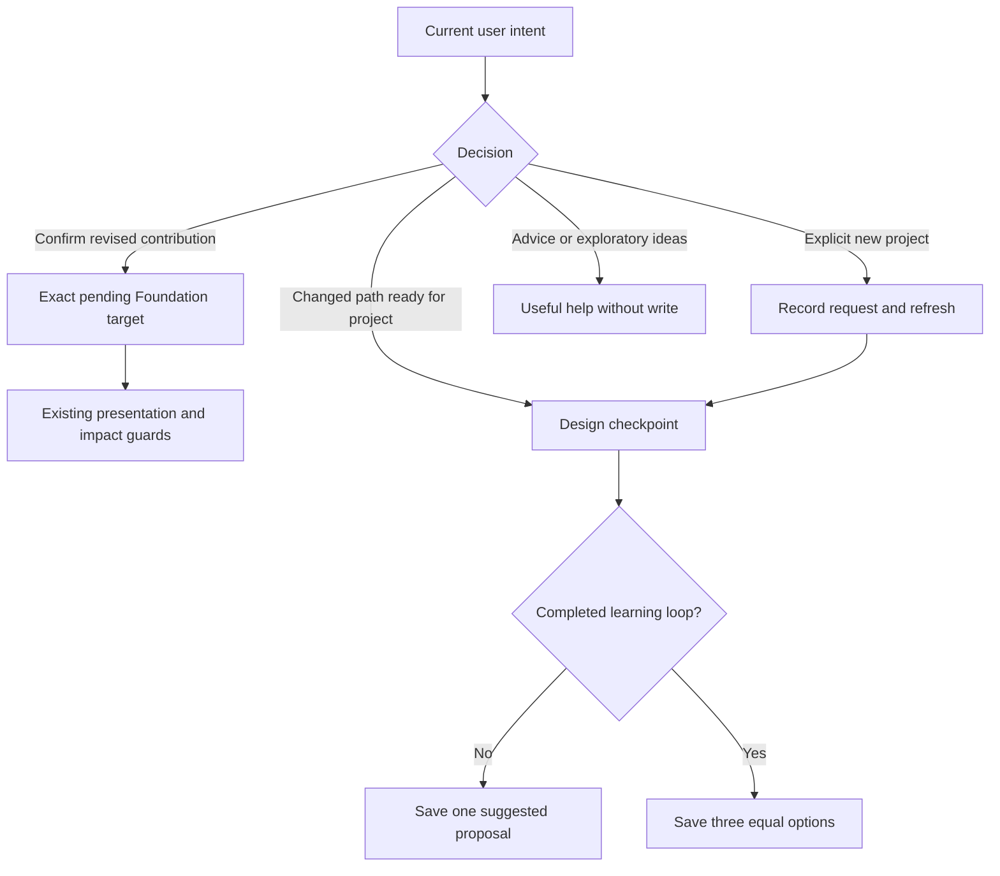

# Learning Workflow Follow-ups - Plan

## Goal Capsule

- **Objective:** Explorers can confirm a revised contribution and receive saved projects when they change work or return asking for another project.
- **Means:** Restore matching confirmation context and guide the agent through existing project-decision operations (KTD1–KTD3).
- **Authority:** `docs/thesis.md`, active August 14 implementation plan and incorporated August 29 Method contract; the founder's follow-up authorization governs this bounded batch. The prior conversational-state plan remains unchanged.
- **Execution:** One production owner, test-first fixes, coordinator approval before implementation, local commits only. Coordinator supervises and reviews; heartbeat remains off.
- **Stop conditions:** Preserve R6–R8. A material Method conflict, unexplained repeat failure or missing account isolation returns to the coordinator. Auth diagnosis may remain blocked without stopping independent workflow work.

---

## Product Contract

### Summary

Repair the three retained Phase 2 workflow blockers using the existing lifecycle. Separately establish why Google sign-in stalls and fix only a confirmed application defect within the approved boundary.

### Problem Frame

The retained route-5 acknowledgment reaches an exposed confirmation tool with no pending target, so confirmation rejects. Routes 4 and 6 instead contain no attempted project write: useful-looking alternatives remain only in Chat. The explorer cannot rely on those choices as saved work.

The isolated login page also remains busy without opening Google. A new normal initiation probe returned HTTP 200, `redirect:true`, a Google authorization origin and a cookie header in 2.2 seconds. That proves this server initiation succeeded; it does not establish the same browser response or the cause of failed navigation.

### Requirements

**Workflow behavior**

- R1. Foundation revision focus exposes the exact current pending North Star confirmation without weakening current-message, completed-presentation, revision or disclosed-impact acknowledgment guards.
- R2. Before any completed learning loop, an authorized project decision saves one learning-informed proposal; after a completed loop it saves exactly three distinct equal follow-on options for explicit selection, including after a path change.
- R3. A clear request for another project enters the eligible project flow and persists the proposal/options without accepting or starting the new work automatically.
- R4. Practical help, exploratory brainstorming, quoted wishes and ambiguous intent remain noncommitting; substantive refinement of the current project retains its revision flow.
- R5. Path changes and new project requests preserve previous learning, project history and provisional focus freedom without artificially closing reflection or adding formal tail gates.

**Auth and integrity**

- R6. Diagnose sign-in through observable server/client/browser boundaries; preserve current auth ownership/privacy protections and leave an unconfirmed cause explicitly unresolved.
- R7. Preserve the founder session/data and four existing WIP files byte-for-byte. No stash, reset, backfill, automatic account repair, credentials/token inspection or security/browser workaround.
- R8. Reuse retained failures and current five-stage effort policy. Verify replies and saved state separately, retaining first outputs and reporting remaining gaps honestly.

### Scope Boundaries

No new lifecycle, schema, operation family, lexical intent detector, generic routing engine or agent-step quota. No reflection-quality, source-pill or unrelated UI cleanup. Existing baseline full-suite failures are evidence to retain, not a mandate to create legacy schema. OAuth consent remains human-controlled.

Considered and not built: guessed navigation timeouts, automatic redirect fallbacks and OS/browser setting changes. None has an established cause or necessity here. An indefinitely busy page is an observed recovery problem, separate from the unknown navigation cause; no recovery mechanism is selected in this plan.

### Acceptance Examples

- AE1. Covers R1: after a completed revised North Star presentation under Foundation focus, a later exact impact acknowledgment confirms that revision and proceeds through genuine basis reviews; cancellation or stale/undelivered targets cannot confirm.
- AE2. Covers R2, R5: changing to library-sign work with an open recorded reflection saves one proposal and retains the original authored learning. A comparable branch with a genuinely completed loop saves three options instead.
- AE3. Covers R3–R5: after focus/pause, “I want a different small project” records the request and produces the proper saved design result; subsequent natural selection/assent activates only that choice, leaving work not started.
- AE4. Covers R4: “How could I make this step easier?” or hypothetical alternatives give useful advice without creating a new-project request.

---

## Planning Contract

### Diagnosed Causes and Evidence

- **DF-12, confirmed:** `deriveMethodCheckpoint` forwards pending decisions only for Paths revision focus. Foundation still exposes `confirm-why`; `confirmationPayload` requires its missing exact target. Retained job `8de361d3` rejects with `ConfirmationTargetMismatchError`, then re-proposes. Fix the selector/context mismatch, not confirmation safeguards.
- **DF-11, observed omitted save:** job `c01d9d00` confirms the changed path and resolves basis reviews, then emits three prose options while `propose_first_project` is available. The original reflection remains open. Method R18/R48 and `hasCompletedLearningLoop` agree: this branch warrants one saved proposal. The precise internal reason the model skipped the call is unknowable; context/guidance is the bounded repair to verify.
- **DF-13, observed omitted request:** job `55e3c2b1` offers alternatives without operations despite `request_new_project` eligibility. Guide instructions cover current-project revision but omit explicit different-project routing; the first-project tool description also emphasizes only immediate path selection. Existing reducer paths already support the requested transition.
- **DF-15, partial diagnosis:** `Login` clears its busy state only on error/throw; the installed SDK catches navigation exceptions. The human-observed stall is real, but neither code alone nor the successful server probe identifies the failed browser boundary.

### Key Technical Decisions

- KTD1. **Match pending decision to the active focus module.** Reuse the existing pending record and operation family for Foundation and Paths. Reflection and legacy peers retain their existing focus semantics. Governs implementation of R1.
- KTD2. **Make the existing design contract explicit in context.** Derive single-proposal versus follow-on eligibility from the authoritative checkpoint, clarify Design instructions and align the tool description with path selection and explicit new-project requests. Preserve historical project context while identifying its actual path basis. Governs R2, R5; no new stored mode.
- KTD3. **Keep semantic request recognition in the agent.** Give Guide the existing explicit-request operation and same-turn refresh route to Design; do not add a word/phrase classifier or force every discussion to save. Governs R3, R4.
- KTD4. **Keep auth diagnosis independent.** Collect only status, boolean decisions, origin and navigation/error outcomes. A production auth fix requires a demonstrated causal chain and coordinator-approved concrete scope; U1–U3 can proceed while that evidence is unavailable. Governs R6, R7.

### Design Flow

### Assumptions and Prerequisites

The context/instruction clarifications are a testable technical hypothesis for the two model omissions, not a promise that one wording change succeeds. Actual same-shape model retests decide the outcome. No upstream Product Contract is being amended: current Method cardinality remains authoritative.

The documented browser API can currently inventory IAB browser `3`, tab `2` at `/login`, but `cua.getTab` and direct documented browser/tab binding fail with `browser.user is unavailable`. Thus the required client trace and isolated-account sign-in are presently a tooling GAP. Do not replace them with founder Chrome, CLI/CDP or another profile.

Evidence that distinguishes causes: the actual isolated browser's initiation response status/redirect flag/origin; whether the SDK success branch and navigation attempt execute; whether navigation throws or the host reports a denied destination; and whether a Google page is reached. No actual browser response versus the separate server probe must be conflated. A host restriction requires an explicit host/policy observation, not inference from a stationary page.

Existing WIP changes set `server/auth.ts` local auth URL and `server/index.ts` port from 5001 to 5173, with corresponding auth-test expectations. They match the current approved origin and are preserved. No planned workflow change overlaps them. If a proven auth correction needs any WIP file, return the exact minimal overlap for approval before editing or committing it.

### Sources

`docs/dogfood/2026-10-29-conversational-project-state.md` and DF-11–DF-15 retain outcomes. `shared/career-map/selector.ts`, reducer, tool confirmation/request/proposal implementations and Design/Guide modules own current behavior. `docs/solutions/workflow-issues/diagnose-purpose-path-revision-save-anomalies.md` distinguishes omitted operations from rejected writes; `find-and-choose-revelio-testing-setups.md` limits each test surface's claims. Historical ports/effort in those learnings are not current authority.

---

## Implementation Units

### U1. Confirm North Star revisions through open Foundation focus

**Requirements:** R1, R5, R7; KTD1. **Dependencies:** coordinator approval.

**Files:** `shared/career-map/selector.ts`, `shared/career-map/selector.test.ts`, `server/ai/tools.test.ts`, `server/ai/agent.test.ts`, `server/storage.career-map.test.ts` only where existing storage guards need exercised coverage.

**Approach:** Restore the matching pending target and reuse the established Paths regression pattern. Check analogous focus families without changing their lifecycle. Start with the exact failing tool-boundary regression.

**Test scenarios:**

1. Covers AE1: open Foundation focus, revise, complete presentation, later exact acknowledgment confirms without re-proposal.
2. Deterministic selector/tool/storage regressions reject wrong/stale targets, foreign modules, same-turn or failed/cancelled presentations and wrong provenance through existing guards.
3. An actual semantic negative case with missing or uncertain acknowledgment of disclosed impact leaves the revision unconfirmed. The agent judges that meaning; no new lexical or boolean acknowledgment predicate is added.
4. Cancellation withdraws only the unconfirmed revision; retry is idempotent; basis review preserves old project/reflection and resolves in order.
5. Paths confirmation remains available; reflection/legacy peers do not inherit another module's pending decision.

**Verification:** Selector/tool and actual mocked-agent refresh checks prove the legal transition; live retained route-5 retest proves natural acknowledgment reaches it.

### U2. Save the project shape allowed by the current lifecycle

**Requirements:** R2, R4, R5, R8; KTD2. **Dependencies:** coordinator approval; U1 need not gate deterministic work.

**Files:** `server/ai/briefing.ts`, `server/ai/briefing.test.ts`, `server/ai/tools.ts`, `server/ai/tools.test.ts`, `server/ai/method/skills/design-path-project/SKILL.md`, `server/ai/method/registry.ts`, `server/ai/method/loader.test.ts`, `server/ai/agent.test.ts`; relevant `shared/career-map/selector.test.ts`, `shared/career-map/repeating-learning.test.ts` and `shared/career-map/reducer.test.ts`.

**Approach:** Expose a concise derived design contract and clarify the existing save/presentation flow. No reducer eligibility expansion or invented reflection closure. Increment only changed instruction versions.

**Test scenarios:**

1. Covers AE2: changed path plus open reflection exposes and saves one new proposal; exact old learning/status/history survive.
2. A genuinely completed-loop sibling still produces exactly three saved distinct equal options; explicit selection activates only one.
3. Project number or completed work alone cannot substitute for a completed learning loop; same-path pending proposal uses refinement rather than duplicate creation.
4. Actual mocked agent sequence carries refreshed authoritative design context into persistence and completed Chat attachment; ordinary advice remains write-free.

**Verification:** Deterministic context/transition tests pass; same retained route-4 shape now ends in a saved proposal, understandable Chat presentation and later natural assent, without closing old reflection.

### U3. Honor an explicit request for a different project after return

**Requirements:** R3–R5, R8; KTD2, KTD3. **Dependencies:** U2's design contract.

**Files:** `server/ai/method/skills/guide-path-project/SKILL.md`, `server/ai/method/registry.ts`, `server/ai/method/loader.test.ts`, `server/ai/briefing.ts`, `server/ai/tools.test.ts`, `server/ai/agent.test.ts`, `server/ai/production-effort.test.ts`, `shared/career-map/repeating-learning.test.ts` as needed.

**Approach:** Route the clear request through `request-new-project`, then refreshed Design and the eligible save operation. Preserve existing accepted work and path-focus history. Support substantive current-project revisions separately.

**Test scenarios:**

1. Covers AE3: focus/pause → explicit different-project request → request receipt → Design → saved options/proposal → later selection/assent; new work remains not started.
2. Before any completed loop use one proposal; after one use exactly three, retaining real learning and current request provenance.
3. Covers AE4: practical help, hypothetical/quoted request, ambiguous desire and scope refinement do not manufacture a new-project request.
4. Per-step effort stays Guide LOW → Design MEDIUM, with original history and provisional focus intact.

**Verification:** Mocked-loop tests prove request/refresh/persistence; actual original route-6 retest proves semantic routing and a completed saved transition.

### U4. Establish the auth failure boundary and apply only a justified fix

**Requirements:** R6–R8; KTD4. **Dependencies:** restored documented IAB binding for client diagnosis; independent of workflow fixes.

**Files:** ignored sanitized task diagnostics first. Any future proven application correction and its existing test home, such as `client/src/pages/login.tsx` and `client/src/pages/login.test.tsx`, require a concrete reviewed scope. WIP files remain excluded.

**Approach:** Obtain the missing actual-browser observations in the prerequisite section. Trace backward from the stationary page. If tools remain unavailable, record the exact GAP and stop this unit's browser work. Distinguish recovery UX from the navigation cause; return any proposed recovery mechanism to the coordinator before choosing it.

**Test scenarios:**

1. Demonstrate the actual initiation result and client navigation/host outcome without secret-bearing logs.
2. For a confirmed defect, reproduce at its existing test seam before the minimal change and rerun the original normal flow afterward.
3. Once normal sign-in is restored, independently confirm the dedicated account, inspect retained Chat/Map, reload, and perform isolated sign-out/sign-in persistence checks without modifying founder data.

**Verification:** A specific causal diagnosis and tested fix, or an evidence-bounded environment/tooling GAP. A successful server probe or retryable button alone does not count as restored sign-in.

---

## Verification Contract

Use Node 24, relevant existing Vitest files with ignored snapshots excluded, `npm run check` and `npm run build`. Run storage cases only through the existing loopback disposable-database guard. Reuse the established 32-failure baseline comparison; assess any new failure against its actual cause without rebuilding legacy schema or repeatedly re-triaging baseline.

After changed instructions, restart the existing lab to final code and create one fresh frozen candidate. Keep Foundation/Paths/voice unchanged unless a traced defect requires approved scope; retain Paths HIGH / Design MEDIUM / Foundation, Guide, Interpret LOW. Reuse the exact failing job parents/messages for routes 5, 4 and 6, complete their confirmation/project transitions and retain first failures beside results. Compare reply, tool outcomes, provenance and canonical before/after state. Add only contrasting negative cases needed for the changed semantic boundary. Estimates remain advisory; no favorable-output retry matrix.

Run one scoped implementation review of this batch, reuse earlier review evidence for unchanged code and resolve introduced findings. Update the single findings tracker and sanitized receipt with separate workflow and auth verdicts. Actual Browser verification requires the isolated dedicated account and approved origins 5173/5174; unavailable sign-in leaves app/mobile/re-auth checks GAP while independent lab work proceeds.

---

## Definition of Done

- U1–U3 pass meaningful deterministic regressions and same-shape real-agent retests, including the saved proposal/options and subsequent explicit selection/assent.
- Auth has a confirmed, verified fix or a precise unresolved diagnosis/verification boundary, never an inferred success.
- Check/build and one scoped review are complete; residual failures and baseline limitations are explicit.
- Founder rows, dedicated-account history, immutable prior plan and four WIP hashes remain intact; abandoned diagnostic implementation is removed.
- Evidence/tracker and scoped local commits identify remaining blockers and the founder's next useful action. No push, PR, deployment, heartbeat or claim of U7/full-MVP/founder acceptance.
