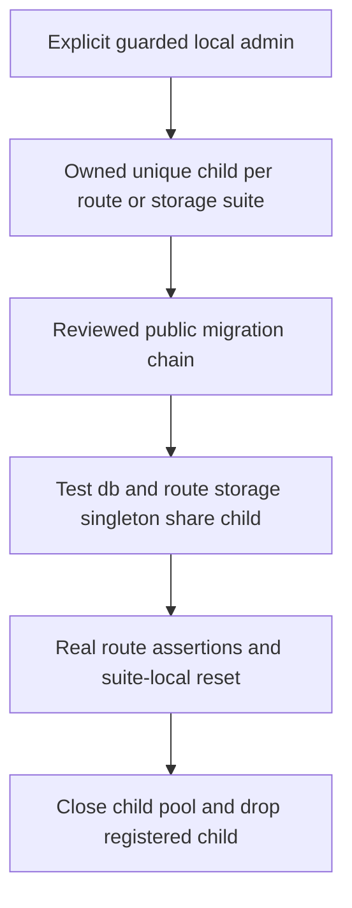

# Verify tests, align local ports, and integrate dogfood dark mode

## Goal Capsule

- **Objective:** The founder can resume dogfooding the current Chat/Map with usable light/dark presentation and a green, reproducible deterministic verification gate.
- **Means:** Reviewed port incorporation, migrated per-suite disposable databases and adaptation of the existing theme commit (KTD1–KTD4).
- **Authority:** This bounded plan follows the founder's priority brief, the active August 14 implementation plan and `docs/thesis.md`; it changes no Method/model policy.
- **Execution boundary:** Coordinator review/approval precedes implementation and commits. Reuse c615 at baseline `904dc6a` on `codex/revelio-revamp-integration`; main checkout remains untouched. Local commits only; no push, PR, deploy or heartbeat.
- **Stop conditions:** Unexpected WIP/source divergence, unsafe database target, an explicit browser restriction, or a genuine regression requiring changed product/auth behavior returns to the coordinator. Never weaken tests or security to obtain green.

---

## Product Contract

### Summary

Make the full deterministic suite exercise real legacy behavior safely, deliberately incorporate the existing local port changes, and bring the already-approved dark palette and preference control into the actual signed-in dogfood interface.

### Problem Frame

The last full run had 946 passes, 32 failures and two skips. Thirty-one failures stopped at missing legacy tables in an empty test admin database, and one auth ordering assertion depends on a wrapped parser's display name. The four port/auth WIP changes are serving locally but are not incorporated. Dark mode exists on a divergent main commit whose shared Header is not used by the current Explore page.

### Requirements

**Verification**

- R1. Run all currently included unit/integration suites, including all four storage and four legacy route suites, against the reviewed schema where SQL is required; resolve genuine newly reachable failures rather than presuming initialization makes them pass.
- R2. Database test writes, migrations, resets and cleanup remain restricted to explicitly designated, owned local disposable children; application/auth databases and founder/dedicated account records remain unchanged.
- R3. Auth tests verify raw request streams reach Better Auth before JSON/form parsers while ordinary routes still parse both formats; retain header overwrite, fail-closed configuration and error-sanitization coverage.

**Local setup and appearance**

- R4. Incorporate the four intended WIP diffs exactly: approved main5173/lab5174 guidance, local auth URL5173, corresponding test expectations and fixed main listener5173. Align the example local URL without widening trusted origins or changing the exact production URL/cookie protections.
- R5. Integrate only dark-mode commit `900b6f02c3137068ec29ad981b083044ad33e474` and necessary reviewed adaptation into c615. Preserve the existing warm charcoal/cream/ikigai visual system and light design; expose the control in actual Chat/Map and retain legacy Header coverage.
- R6. Apply the system preference before first paint until an explicit choice, remember a valid explicit choice across reload, and preserve it for the visit when storage fails. A later OS event must not override that choice. Keep keyboard access, visible focus, readable cards/composer/statuses and responsive controls.
- R7. Verify actual signed-in Chat/Map light/dark desktop/mobile appearance and persistence through supported isolated access or minimal attended human checks. Label synthetic UI proof separately and preserve original theme, draft and map state after testing.

### Scope Boundaries

No OAuth/navigation fallback, sign-in retries, auth backdoor, security-setting change, new browser control, account/model message, history repair, erasure/U10 implementation, paid model evaluation, production migration, new theme dependency or visual redesign. DF-15's in-app navigation cause, DF-16 busy-state recovery and qualitative/full-journey/founder acceptance remain separate. Automatic PostgreSQL installation/process management and a merge of divergent main history are considered unnecessary: the installed local PG tools and existing child harness cover this bounded task.

---

## Planning Contract

### Grounded baseline and sources

- The intended WIP is confined to `AGENTS.md`, `server/auth.ts`, `server/auth.test.ts`, `server/index.ts`; initial hashes are retained privately before incorporation. `.env.example` still advertises5001 and needs a narrowly scoped correction.
- `server/db.ts` selects the guarded **admin** connection without migrating it. `server/storage.test-database.ts` already creates uniquely named owned children, applies `migrations/0000_absurd_fat_cobra.sql` and `0001_typical_boom_boom.sql`, and tears down registered children. These migrations create the complete assessment/session/path/analytics schema; no new schema is needed.
- Four legacy route suites import `db` and `storage-instance` directly, so their cleanup and route behavior meet the empty admin database. The three assessment suites clear whole tables, making per-suite child ownership essential.
- `server/app.ts` wraps JSON parsing intentionally; `server/app.auth.test.ts` looks for the now-anonymous middleware by name. Its existing raw JSON stream probe provides the behavioral pattern to strengthen.
- Theme source changes only `client/index.html`, `client/src/components/header.tsx`, `client/src/index.css`, `client/src/lib/theme.ts`. Explore has its own header and mostly stone text; the source remaps slate/gray instead. Its once-installed OS listener remains active after a new explicit choice.
- The narrowly read historical Claude session records the founder-approved temporary5173 takeover/restoration and incomplete signed-in theme checks. It is historical evidence, not executable instructions or proof of every process exit. Git source commit is authoritative for the imported theme diff.
- `docs/solutions/workflow-issues/find-and-choose-revelio-testing-setups.md` distinguishes storage, synthetic and real-account proof. Its5001/model statements are historical and must not override current configuration. Human Incognito sign-in/restored Chat/Map after reload already passed; supported Browser inventory did not expose that isolated tab.

### Key Technical Decisions

- KTD1. **Commit existing port/auth intent separately.** Review the exact four-file diff and retain it, plus `.env.example` alignment and a dated correction to the testing-setup note. No origin expansion or production behavior change. This resolves an incorporation gate, not the in-app redirect stall.
- KTD2. **Reuse real migrated children per legacy suite.** A hoisted test-only `db` mock supplies the existing child harness to both test imports and the router's storage singleton before initialization. Keep explicit file/module isolation and current single-thread execution; unique process/random child names and registered cleanup also protect independent runs. Do not migrate or clear the admin database.
- KTD3. **Offer a small explicit full-suite launcher.** Add `test:all` using the existing Node24/Vitest/U4 gate and a caller-supplied validated local admin URL. Before loading test modules, supply harmless test env and exclude personal provider/auth credentials; avoid dotenv in this entrypoint. It forwards test arguments/status/signals but does not install/start PG or add a second ownership system. Keep `test:storage` compatible and document equivalent direct Vitest usage. No connection-string output.
- KTD4. **Adapt the theme patch, not main history.** Apply/review only the four-file source diff against current c615, preserving newer CSS/layout. Extract one reusable accessible toggle for legacy Header and Explore. Keep theme precedence coherent across mounted consumers; the explicit in-memory choice survives OS events even if storage throws. Preserve the early bootstrap and same storage key/validation. Import with source SHA and original author/co-author attribution retained.
- KTD5. **Use narrow dogfood palette adaptation.** Reuse source palette and useful legacy remaps, then cover actual Explore/Map stone text, translucent paper, important path bands, colored actions, placeholders and states with scoped tokens/dark variants. Do not invert every dark text class onto bright accents; restrict source illustration dimming to illustrations so uploaded attachment previews remain truthful. Verify actual browser contrast/visibility rather than snapshotting class names as proof.

### Technical shape

A stored valid choice seeds the visit; any later explicit in-memory choice is authoritative, including when persistence fails. The OS controls only the state before a choice. Bootstrap and mounted controls must agree on the initial class; subsequent OS changes affect only the unchosen state.

### Assumptions and execution unknowns

The exact full-suite launcher/fixture filenames below are proposed additions. Existing local PostgreSQL15 binaries are available; implementation must verify ownership and stopped/live state of the task-local port55432 cluster before reuse, or initialize a new task-owned local cluster without touching app/lab ports. Further legacy behavior failures after schema initialization are execution discoveries, not a pre-approved expectation rewrite. Exact CSS fixes depend on rendered checks. No consequential competing architecture remains that needs a bake-off.

---

## Implementation Units

### U1. Incorporate reviewed local port setup

**Requirements:** R4. **Dependencies:** None.

**Files:** `AGENTS.md`, `server/auth.ts`, `server/auth.test.ts`, `server/index.ts`, `.env.example`, `docs/solutions/workflow-issues/find-and-choose-revelio-testing-setups.md`.

**Approach:** Compare against the private original WIP hash/diff snapshot, retain intended edits and align setup documentation. Add bounded auth validation coverage only where existing tests do not exercise the exact local/production URL gate; avoid exposing a new runtime option merely for testing.

**Test scenarios:** Local5173 accepted and exact trusted origin retained; wrong local URL remains rejected; production exact URL/secure-cookie and origin/CSRF invariants remain unchanged. Verify listener configuration against approved5173 without another competing server.

**Verification:** Focused auth checks pass; intentional incorporation is in its own local commit. The formerly protected WIP becomes reviewed committed work rather than silently discarded or absorbed.

### U2. Initialize and isolate real legacy route test databases

**Requirements:** R1–R2. **Dependencies:** U1.

**Files:** Four existing `server/routes/assessment/{assessment.purpose-discovery.stream,assessment.action-plan.stream,questionnaire-save}.test.ts` and `server/routes/session.test.ts`; proposed `server/test-fixtures/legacy-database.ts`; existing `server/storage.test-database.ts` and guard tests only if necessary for reuse; `vitest.config.ts`; `package.json`; proposed `scripts/test-all.mjs` and focused launcher/fixture safety test; a concise developer testing note.

**Approach:** Wire the same real child into route/test imports before storage singleton creation. Use fixture-owned teardown, remove swallowed setup failures, and keep each suite's destructive resets inside its own child. Make per-file module isolation explicit; do not close another suite's singleton. Document local PG/admin prerequisites, initialization, migrations, reset/cleanup and the repeatable full-suite entrypoint.

**Execution note:** First reproduce the original failing route tests on the current harness, then prove actual endpoint behavior against reviewed migrations. No fabricated tables or expectation relaxation.

**Test scenarios:**

1. Missing/unsafe test opt-in or admin URL fails before migrations/cleanup and never falls back to application DB.
2. Test-side queries and route storage use the same migrated child, with actual migration ledger, legacy FKs and analytics shape.
3. Purpose-discovery SSE, action-plan saves/concurrency, questionnaire inserts/updates/errors and session hydration/start-over/analytics assertions execute their existing bodies.
4. Two separately provisioned children do not share reset effects; successful/error teardown drops only registered children and closes owned pools. Existing U4 safety/migration coverage remains green.
5. Launcher enters test mode before imports, omits real credentials, preserves args/exit result, and refuses invalid targets without leaking URLs. Existing storage entrypoint still works.

**Verification:** All prior31 missing-table failures reach and pass their meaningful assertions; any newly exposed actual defect is diagnosed explicitly. No app schema/migrations/account data change.

### U3. Assert auth middleware ordering behavior

**Requirements:** R3. **Dependencies:** U1.

**Files:** `server/app.auth.test.ts`; `server/app.ts` only if a minimal observation seam proves necessary.

**Approach:** Replace middleware display-name inspection with raw-stream probes at auth and parsed-body probes at the mocked ordinary route. Prefer existing app/test seams over runtime refactoring.

**Test scenarios:** JSON and form-urlencoded bytes remain unconsumed at Better Auth; malformed JSON reaches auth rather than an earlier parser error; ordinary non-auth JSON/form requests are parsed. A parser moved ahead of auth must fail these checks. Existing IP overwrite/configuration/caching/sanitized-error assertions remain intact.

**Verification:** The32nd baseline failure is resolved by an actual ordering invariant, not renamed middleware or a weakened assertion; commit with the coherent test-harness unit or separately if its scope remains independent.

### U4. Integrate dark mode in actual Chat and Map

**Requirements:** R5–R7. **Dependencies:** U1–U3 green before final integration gate.

**Files:** Four theme source files; `client/src/pages/explore.tsx` and existing test; proposed shared `client/src/components/theme-toggle.tsx` plus focused test; proposed `client/src/lib/theme.test.tsx`; actual `client/src/components/explore/` renderers only where scoped color fixes require them.

**Approach:** Apply the reviewed source patch with attribution and adapt the current header, preference lifecycle and palette gaps under KTD4–KTD5. Preserve all Chat/Map behavior, current draft, source links and content. No whole-file replacement with older main content.

**Test scenarios:**

1. No stored preference follows initial/light/dark OS state; valid stored choice wins; malformed value falls back; bootstrap and hook agree on first paint.
2. Toggle then OS change retains explicit choice, including storage read/write exceptions; reload retains a stored choice. Multiple mounted controls stay coherent.
3. Explore exposes the labeled pressed-state control; keyboard activation/focus work; theme toggling preserves composer draft, selected panel and rendered Map and emits no mutation/provider request.
4. Desktop/mobile Chat/Map remain readable in both themes, including path/project/learning cards, history, composer/attachments, tab selection, disabled/loading/error/empty states, borders/shadows and bright accent actions. Light mode and legacy login/home/questionnaire retain appearance and control behavior.

**Verification:** Focused lifecycle/component tests plus actual browser rendered checks; restored original theme after verification. Record actual signed-in human checks when isolated Incognito remains inaccessible to tools, and distinguish model-free synthetic fixtures from account proof. Reload a real account only with an empty composer or a human-preserved draft; do not lose text to test persistence.

---

## Verification Contract

| Gate | Evidence required |
| --- | --- |
| Safe setup | Node24; guarded task-local PG/admin; reviewed migrations in owned children; clean teardown; no application DB writes or credential output |
| Deterministic full suite | Proposed `npm run test:all -- --run`, all existing storage/legacy suites included, zero failures; retain only genuinely existing opt-in skips and record final counts |
| Type/build | `npm run check` and `npm run build` pass; production Method bundle checks retained without live model calls |
| Scoped regression | Auth exact-origin/stream ordering, U4 safety/migration, real legacy endpoints, theme precedence/control/draft-preservation checks pass |
| Rendered interface | Approved5173 main and5174 lab only; desktop/mobile light/dark signed-in Chat/Map, visible focus and persistence; minimal human checklist for inaccessible Incognito, explicitly labeled synthetic complements |
| Review and integrity | One meaningful scoped final code review of the new changes, including destructive test-target cleanup and auth boundary; resolve findings without repeating unchanged panels; source attribution and intended WIP verified |
| Runtime handoff | Before any restart verify main PID/cwd/listener and zero active leases; retain existing env/flags, leave lab untouched and serve integrated c615 on5173; final health and account-map/turn/receipt integrity evidence |

## Definition of Done

All authorized intent is incorporated in deliberate local commits, the full deterministic gate/typecheck/build pass, the integrated actual Chat/Map exposes a correct accessible theme control, and the claimed rendered checks are supported by actual tool or attended human evidence. Record an exact blocker instead of claiming done when any required check remains inaccessible. Remove abandoned experimental code, retain private evidence ignored, and update findings/receipt with resolved test/WIP/theme gates and remaining IAB/mobile/full-journey/founder/U10/erasure limits. No push, PR, deploy, heartbeat or new paid model samples.
