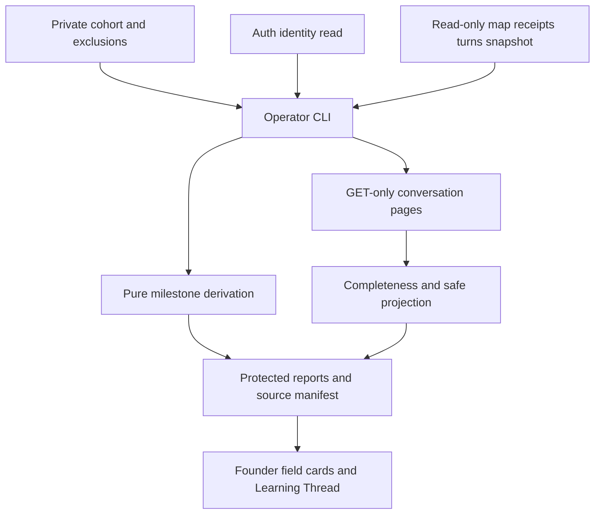
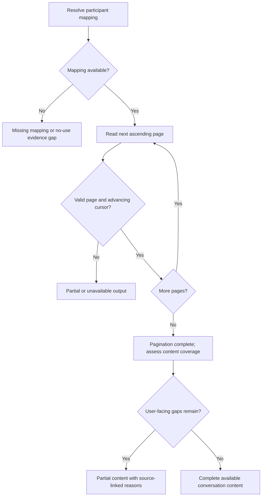

# Early Access Reporting and Conversation Review - Plan

## Goal Capsule

- **Objective:** The founder can understand each early participant's attempts, distinguish useful progress from missing evidence or technical friction, and decide what product change to investigate next.
- **Means:** A private operator CLI and source-linked manual learning workflow (KTD1–KTD5).
- **Authority:** Current code/tests; `docs/plans/2026-08-14-claude-feat-revelio-revamp-plan.md`; `docs/thesis.md`; `docs/plans/2026-08-29-1133-feat-revelio-method-plan.md` and active amendments. This bounded plan adds measurement; it does not reopen accepted U7 or deferred Method work.
- **Execution profile:** Local scoped commits after coordinator approval. No PR, push, deployment, outreach, shared-document writes or scheduling. Implementer owns verification and final review. Coordinator owns plan approval and any restart window affecting founder use.
- **Stop conditions:** Do not implement until coordinator explicitly approves this actual plan. Stop on unsafe identity uncertainty, blocked approved local origins, live test-database selection, or evidence invalidating settled product scope.

---
## Product Contract

### Summary

Provide a cohort-complete progress report, full conversation retrieval for founder review, a small field-card/Learning Thread workflow, and minimum production diagnostics needed to interpret failures.

### Problem Frame

Legacy scripts measure questionnaire sessions rather than Revelio's repeating learning loop. Current map state alone can hide previous attainment and corrections. A return or silence cannot establish whether someone received value. The founder needs inspectable evidence before widening access, including people who have not started.

### Key Decisions

- **Measure attempts and independent milestones** (session-settled: user-directed — chosen over accepted-only eligibility and completed-loop-only success: value can precede a completed loop). Governs R2–R5.
- **Disclose founder and assisting-AI review before agreement** (session-settled: user-directed — chosen over per-review confirmations: early-access participants know the arrangement when agreeing). Governs R7–R8.
- **Keep the workflow small and private** (session-settled: user-directed — chosen over analytics vendors, dashboards and automated scoring: founder investigation is the present need). Governs R6, R9–R11.

### Requirements

**Cohort and progress**

- R1. Report every private roster entry, including invited, agreed, enabled, unlinked and no-activity participants. Keep recruitment stage independent of app activity; distinguish unknown/unavailable from checked-empty. Explicit founder/QA identities are excluded from aggregate pilot counts and visibly classified.
- R2. Show North Star presented and confirmed separately; path sets presented and path chosen separately; project proposal, formal acceptance, reported work, reported completion, saved reflection and experience-backed Next Move separately. Acceptance requires confirmation provenance, not merely agreementStatus. Eligible use includes valid proceedingReport without formal assent.
- R3. Show first recorded attainment, retained historical evidence and current validity separately. Preserve repeated projects, path/set revisions, pauses, supersession, corrections and retractions without double-counting retries or copied work history. Do not invent arbitrary historical map snapshots.
- R4. Attach stable source references and counts/dates/statuses to facts. Distinguish recorded/committed/presented time from claimed off-app occurrence. Work start/finish is self-reported. Missing old timestamps stay unknown.
- R5. Surface later conversation/turn activity for source-linked review of meaningful reuse of earlier context. Founder judges meaning; mark observed, self-reported, inferred or unknown. Do not equate return with love, inactivity with abandonment, a guidance-only turn with failure, or lack of completion with lack of value.

**Conversation access and privacy**

- R6. Founder/operator retrieves all available user-facing conversation content through server-owned mappings, with complete pagination and failed/cancelled turn context. Retrieval distinguishes complete, partial, unavailable, missing mapping and checked-empty evidence. No participant sign-in, public admin endpoint or client-supplied owner spoofing.
- R7. Before participants agree, notice says the founder and AI tools assisting him may read full Revelio conversations to improve the product. Align scoped invitation/privacy documentation without claiming legal compliance or delivery of an unsent notice. No per-review ceremony.
- R8. Keep R12's minimal payload-free gate artifact separate. Store private roster, transcripts, reports and derived notes only under an ignored repo-local private root; avoid unnecessary raw copies. Include all derived participant material in deletion handling without claiming completion of remaining I3 cross-store erasure.

**Learning and operational evidence**

- R9. Provide a repeatable field card: Job; current way; first try; where it broke; our response; next time what they chose. Each claim has evidence type and source. Record assistance and invited/spontaneous returns only where known; full conversations are primary, interviews/messages complementary.
- R10. Provide one Learning Thread with date/product version, belief, observation, decision/owner and next outcome to check. AI may propose source-linked flags for rephrasing, corrections, unmet requests or useful moments; founder judges meaning. No automatic model calls are required to produce the deterministic report.
- R11. Distinguish observed product friction from server reply/history failures using existing durable turns/request logs and minimal missing production timing/version evidence. Server completion/response finish never proves browser delivery.

### Scope Boundaries

No vendor, event warehouse, in-app admin dashboard, CRM, automated scoring/evals, outreach or tracking chores. No changes to Method behavior, model choice or founder conversation. No automatic abandonment or PMF score. Browser-delivery telemetry is considered and not built: available server evidence plus source-linked reproduction suffices for this initial workflow; revisit only if real incidents cannot be diagnosed. Broad historical backfills and all remaining I3 erasure/release gates remain follow-up work.

### Acceptance Examples

- AE1. Covers R1: invited participant without an auth identity remains visible as unlinked; checked-empty linked participant differs from a failed database read.
- AE2. Covers R2–R4: proceeding report starts a project without confirmation; later correction retracts it. Report retains the original recorded report and correction, current status is corrected, formal acceptance remains absent.
- AE3. Covers R3: revised project inherits workUpdates; report counts one work episode with multiple revision references, not two starts.
- AE4. Covers R6: second provider page fails after page one. Output retains source-linked partial content, says partial, and never claims no use or complete history.
- AE5. Covers R5, R9: a later guidance exchange without map writes is a review candidate, not a failed interaction or automatic meaningful return.

---
## Planning Contract

### Current Evidence

Baseline `f024191a80ce91b8935a3c66934111ac0b39a046`, clean `codex/revelio-revamp-integration` at intake. `shared/schema.ts` stores current career_maps, receipt-only career_map_history, agent_turns and server-owned conversation mappings. History receipts are not operation payloads or map snapshots. `shared/career-map/projects.ts`, `reducer.ts` and `model.ts` retain workUpdates, confirmation, proceedingReport and correction links. `report-project-work` sets agreementStatus accepted without confirmation. Project revisions copy work history. `CONCEPTS.md` explicitly separates acceptance from work.

`server/ai/history.ts` has exhaustive ascending listConversationItems and bounded UI history projection. The UI loader may backfill projections, so is unsuitable as a read-only CLI entrypoint with full storage access. Exhaustive list helper throws without returning partial progress. Provider and map clocks cannot form a single atomic snapshot.

`server/routes/agent.ts` logs production method_request status/duration/requestId on finish. `agent-latency.ts` detailed phases are development-only. `scripts/analytics-report.ts` and `extract-user-data.ts` cover legacy questionnaire data. `.context/` is ignored. Pilot invitation/erasure documents named by I3 are missing at baseline.

### Key Technical Decisions

- KTD1. **Standalone operator CLI, no app route.** Add `scripts/early-access.ts` backed by modules under `server/reporting/`. Operator OS access plus possession of existing server credentials is the boundary; roster membership is not authorization to a public endpoint. Require explicit environment/target selection, parameterized read queries and PostgreSQL read-only repeatable-read transactions for app snapshots. Do not import runtime storage initialization, mutate missing maps, run migrations or backfill projections. Resolve auth identities with the existing direct auth-database connection conventions. This avoids an impersonation surface and reuses server mapping ownership. PostgreSQL [transaction documentation](https://www.postgresql.org/docs/current/sql-set-transaction.html) supports snapshot consistency/read-only restrictions; no DB-role provisioning project is needed.
- KTD2. **Private cohort manifest joined to verified immutable auth identity.** Use `.context/early-access/` with a versioned validated roster and explicit exclusions. Entries have opaque participant key, recruitment stage/date, source, optional verified auth userId and notice/agreement reference. Resolve a supplied exact email only through read-only auth lookup, require unambiguous result, and record that binding locally through explicit roster editing. Email is not an ongoing join key. Unlinked entries remain reportable; excluded roster identities remain individually visible with excluded classification and never enter pilot aggregates. Duplicate bindings, ambiguous mappings and contradictory eligibility/exclusion declarations are errors. QA reconciliation may explicitly target the configured QA identity individually; it cannot target founder content. No real roster is checked into Git. Example files contain fictional data only.
- KTD3. **Pure derivation over retained entities and receipts.** Emit versioned JSON and readable Markdown using one derivation result. Facts retain entity/revision, operation source and turn/action references. Correlate provenance to receipts for committed dates; never infer payloads from fingerprints. Use work action/source identity across revisions, correction chains and supersedes references for deduplication. Retain original attainment as historical reported evidence and separately expose currently supported attainment after corrections. Missing provenance creates an explicit evidence gap, not guessed dates. Label presentation as recorded model presentation; persisted proposal provenance does not prove browser delivery, especially on failed/cancelled turns. Deduplicate copied path-set presentation provenance as well as inherited project work. Reports need no provider fetch; semantic findings remain manual.
- KTD4. **GET-only conversation iterator with explicit completeness.** Use the existing provider list client and safe internal-context exclusion rules without backfills. Build an operator review projection that preserves all available user/assistant text independently of browser text-part, text-length and display-binding limits; label safely identified unbound and failed-turn content separately. Extend a shared reader only if safe for current callers. Follow ascending pages until exhaustion; detect repeated/nonadvancing/missing cursors. Preserve partial progress on failure and exit nonzero for incomplete retrieval. Never call create/delete/provider generation methods. Combine user-facing projection with safe failed/cancelled/pending turn summaries; do not dump raw provider reasoning, tool payloads, system context, credentials or provider IDs. Only genuinely unavailable or unsafe-to-classify content may be omitted, with counts and reasons. Any such user-facing gap makes conversation-content coverage partial even when provider pagination completed. Successful pagination is reported separately from content coverage. Source IDs use participant-scoped deterministic opaque aliases for provider items; DB turn/revision references remain usable. Internal provider IDs/cursors never appear in exported output. Provider pagination is confirmed by [List items reference](https://developers.openai.com/api/reference/resources/conversations/subresources/items/methods/list).
- KTD5. **Explicit private outputs and small manual workflow.** Default report shows non-content facts; conversation review writes only to explicit protected output under `.context/early-access/`, directories 0700/files 0600, rejecting symlink/path escapes and unsafe overwrite. Source manifests associate generated artifacts with participant keys. Deletion tooling is a separate explicit local purge action with preview, never a side effect of reporting. It removes/regenerates participant-bearing report/transcript/field-card/Learning Thread material, including aggregate-derived copies, and retires roster identity bindings according to the runbook. It does not erase provider/app stores; pending cross-store erasure remains visible. AI review is an optional manual reading workflow, not another model service or app tool.
- KTD6. **Small production diagnostic summary.** Keep existing method_request logging and add validated build/source version, safe turn correlation, finish versus premature close outcome and a small allowlisted timing summary (provider start, first safe server text, terminal persistence where available). Emit once per request; no text/tool args/provider IDs. Existing DB terminal elapsed remains server elapsed. History-read failures use existing route/error classifications. Historical missing fields stay unknown; deployment build version injection is documented, never faked from report-time HEAD. No provider generation limit changes.

### High-Level Technical Design

### Assumptions and Deferred Implementation Details

There is no real early-access roster yet; deliver a fictional example and validated empty-cohort behavior, never invent enrollment. Exact query/helper names are implementation details. Production credential availability and deployed log retention are operator prerequisites to production use, not grounds to inspect founder content. No bake-off is needed: the settled small internal tool plus existing mappings makes CLI a reversible choice; a web admin surface adds risk without necessary capability.

### System-Wide Impact

The CLI spans auth, app data, provider reads and local private artifacts. Only diagnostic logging and scoped notice/docs affect runtime; no schema migration or model prompt change is planned. Changes to shared history helpers must preserve normal browser hydration/erasure semantics. The reporting contract records independent database/provider observation times and cannot promise a cross-store snapshot.

---
## Implementation Units

### U1. Cohort and read-only operator boundary

**Goal:** Establish complete participant coverage without app mutation.
**Requirements:** R1, R6, R8; KTD1–KTD2.
**Dependencies:** None.
**Files:** `scripts/early-access.ts`; `server/reporting/cohort.ts`; `server/reporting/source.ts`; `server/reporting/cohort.test.ts`; `server/reporting/source.test.ts`; `server/reporting/private-output.ts`; `server/reporting/private-output.test.ts`; `package.json`.
**Approach:** Add validated private roster/exclusion input, explicit target selection, auth binding checks and narrow read-only source adapters. Preserve existing environment and auth connection conventions. CLI bootstrap must not initialize storage or migrations. Create the protected private-output writer here so all later exports use it from their first implementation.
**Test scenarios:**
- Unlinked invited entry appears alongside linked checked-empty participant.
- Duplicate identity, ambiguous email, contradictory exclusion or missing target fails before extraction.
- Disposable DB read transaction refuses a write; report leaves map/history/turn row counts unchanged.
- A roster containing the actual configured QA exclusion remains individually reportable for reconciliation and excluded from aggregate counts; founder retrieval is not a QA target.
- Symlink/parent traversal/unsafe output outside private root is rejected; generated files have restrictive permissions.
**Verification:** Safe empty/fictional cohort output and enforced read-only DB boundary.

### U2. Milestone and history derivation

**Goal:** Produce inspectable independent progress facts.
**Requirements:** R2–R5; AE2–AE3; KTD3.
**Dependencies:** U1.
**Files:** `server/reporting/progress.ts`; `server/reporting/render.ts`; `server/reporting/progress.test.ts`; `server/reporting/fixtures.ts`.
**Approach:** Derive facts from canonical retained entities/provenance and history receipts; render both formats from identical result. Include source coverage/gaps and report/schema/source versions.
**Execution note:** Establish fictional correction/revision cases before implementing derivation.
**Test scenarios:**
- Presentation alone does not count confirmation, path selection or acceptance.
- Proceeding without assent counts reported work and never invents confirmation.
- Completed-to-in-progress and not-started corrections retain history while changing current attainment.
- Repeated projects and revised projects with copied workUpdates avoid duplicate work episodes.
- Superseded path/project proposals remain historical, not current offers.
- Choosing a parked path copies earlier presentation provenance without counting a fresh presentation.
- A persisted proposal followed by a failed/cancelled reply retains recorded attainment but flags unknown delivery and never claims the participant saw or confirmed it.
- Duplicate operation retries and replay receipts do not inflate counts.
- Missing timestamps/provenance and repairRequired state show uncertainty.
- Reflection before completion and experience-backed decisions count independently.
**Verification:** Exact expected facts, statuses and timestamps from deterministic fixtures and disposable DB source integration.

### U3. Complete safe conversation retrieval

**Goal:** Founder can review full available conversation with honest gaps.
**Requirements:** R6, R8; AE4; KTD4–KTD5.
**Dependencies:** U1.
**Files:** `server/reporting/conversations.ts`; `server/reporting/conversations.test.ts`; `server/ai/history.ts` and `history.test.ts` only if shared reader/projection changes are necessary; `scripts/early-access.ts`.
**Approach:** Paginate GET-only provider data and project content with stable opaque references. Join safe turn summaries and distinguish retrieval coverage from browser-visible delivery. Write protected explicit private output only.
**Test scenarios:**
- Several pages, empty pages with hasMore, final empty page and duplicate boundary items preserve chronological coverage.
- Page two timeout, missing/repeating cursor, malformed page and cancellation preserve partial evidence and nonzero incomplete outcome.
- Missing mapping with existing turns differs from verified no app use; provider unavailable differs from empty history.
- A failed turn without display recovery retains safely attributable user/assistant text in separate review context; unsafe-to-classify content makes conversation coverage partial with source-linked reasons even when all provider pages were read.
- Spy fails on every create/delete/backfill method; unknown owner and forged cursor cannot select another mapping.
- Provider IDs, reasoning/tool context and secrets never appear in output; alias references remain stable on repeat retrieval.
- Messages exceeding browser text-part/text-length limits survive export exactly, and safely identified unbound user/assistant content remains available in a labeled section.
**Verification:** Full fixture conversation matches expected user-facing content and explicit omission/completeness accounting.

### U4. Private learning workflow, notice and local erasure

**Goal:** Make review repeatable without storing private material in Git.
**Requirements:** R7–R10; KTD5.
**Dependencies:** U1–U3.
**Files:** `docs/pilots/invitation.md`; `docs/pilots/erasure.md`; `docs/pilots/reporting-review.md`; fictional templates under `docs/pilots/templates/`; `server/reporting/private-output.ts`; `server/reporting/private-output.test.ts`; `scripts/early-access.ts`.
**Approach:** Reuse U1’s protected writer and add explicit local purge support to that module. Adapt the playbook's Working Bet and Learning Thread with the R9 field card. Add before-agreement notice and separate R12 artifact instructions. Add private-output inventory and explicit local purge preview/apply; document remaining cross-store erasure ownership. Check any current public privacy copy discovered during implementation for contradiction and make only scoped alignment edits.
**Test scenarios:**
- Fictional participant purge removes or regenerates all manifest-listed individual/shared-derived material and retires bindings without touching another participant or app/provider stores.
- Read-only commands cannot invoke purge; partial erasure remains pending in operator notes.
**Verification:** Founder can follow a fictional worked field card and Learning Thread; private artifacts are ignored and discoverable for deletion. Notice is drafted, not claimed sent.

### U5. Production failure and latency evidence

**Goal:** Technical failure can be separated from product interpretation.
**Requirements:** R11; KTD6.
**Dependencies:** None.
**Files:** `server/routes/agent.ts`; `server/routes/agent-latency.ts`; `server/routes/agent-logging.ts`; focused route/logging tests; `docs/pilots/reporting-review.md`.
**Approach:** Add only KTD6's fixed-label production summary, preserving the existing detailed dev trace. Reuse existing terminal/request references and error classes.
**Test scenarios:**
- Successful finish and early response close emit one classified record each.
- Provider/history failure and cancelled turn remain distinct with safe version/correlation data.
- Production diagnostic fields reject arbitrary payload/error text and do not expose conversation/provider IDs.
- Server terminal completion is labeled server evidence even if browser disconnects.
**Verification:** Route fixtures demonstrate useful production-safe records without changing turn completion behavior.

### U6. QA reconciliation and delivery verification

**Goal:** Prove tools match the actual app and leave founder state untouched.
**Requirements:** R1–R11.
**Dependencies:** U1–U5.
**Files:** Focused reporting tests; `docs/evidence/` sanitized verification receipt; reporting runbook corrections if needed.
**Approach:** Use the established disposable DB guard and existing QA account. Browser testing uses bundled @Browser via mcp__cua_repl, after verifying approved HTTP localhost:5173/127.0.0.1:5173 (lab 5174), current profile and signed-in `konfidenz.clothing@gmail.com`. Confirm a safe server restart window with coordinator before disturbing founder use. Read/reconcile QA state before any test mutation; preserve it. Use one normal positive-path exchange only if needed, with cost-conscious soft runaway safeguards rather than arbitrary limits.
**Test scenarios:**
- Actual QA map/history facts match CLI source references and independently displayed milestones.
- Paginated retrieved QA conversation matches known visible history; reload persists the same state/content.
- Unauthenticated history/workspace request fails; a client-supplied QA owner cannot redirect another authenticated/unauthenticated request.
- Founder/QA remain excluded in a fictional pilot aggregate and no founder conversation is fetched.
**Verification:** Sanitized receipt records origin/profile/identity verification, fixture and browser outcomes, version, evidence gaps and privacy review without transcript content.

---
## Verification Contract

| Gate | Evidence | Done signal |
|---|---|---|
| Derivation | Focused Vitest reporting fixtures | R2–R5 expected dates, corrections, deduplication and provenance pass |
| Database | Existing `server/storage.test-database-safety.ts` guard and disposable local harness | NODE_ENV=test, U4_STORAGE_TEST_DATABASE=1 and designated U4_STORAGE_TEST_DATABASE_URL only; no live tables |
| Retrieval/security | Focused provider/CLI/route tests | Complete/partial/unknown distinctions; no mutations, spoofing or sensitive raw exports |
| Runtime diagnostics | Route fixtures in production mode | Safe finish/close/error timing/version record, no delivery claim |
| Actual app | U6 QA browser-to-tool comparison and reload | Report and transcript reconcile; appropriate negative access check passes |
| Regression | `npm run check`, `npm run build`, focused tests, `npm run test:all` with disposable DB configuration where required | Relevant checks green; unrelated pre-existing failure explicitly evidenced |
| Final review | ce-simplify-code and ce-code-review scoped to implementation | Findings resolved, no private artifacts staged, abandoned approaches removed |

No paid model matrix is required for deterministic reports. Existing fictional replay/golden traces can seed cases. Live provider behavior is verified only when a changed boundary needs it. `docs/solutions/workflow-issues/find-and-choose-revelio-testing-setups.md` and `diagnose-purpose-path-revision-save-anomalies.md` govern interpretation of QA and persistence evidence under the current browser-route override.

---
## Definition of Done

- Each requirement has passing deterministic evidence and the U6 reconciliation receipt.
- Cohort includes unknown/no-start participants and explicit QA/founder exclusions; report remains useful before meaningful use.
- Full available conversation retrieval is read-only, paginated, source-linked and explicit about gaps.
- Private-output deletion handling covers transcripts and derived notes/reports; outstanding I3 work is not represented as complete.
- Scoped pre-agreement notice and practical review templates are usable without new apps or model services.
- Production diagnostics expose the minimum gap and preserve unknown browser delivery.
- Required checks and final review complete; dead-end code removed; only intended local changes committed after implementation approval.

---
## Sources

- [Hiten Shah, Early Access Playbook v2.0](https://docs.google.com/document/d/1bo9n52j_M4Nx094TObZQVAq1htlB6h9XlySLgFsH710/edit), read with gws documents.get including tabs on 2026-10-30. Adaptations are R9–R10, not a new recruitment system.
- `docs/research/michael_seibel_building_product_transcript.txt`: measurement belongs in first-release planning and should support direct user investigation.
- `docs/research/first_users_transcript.txt`: study early users' real need and attempts; do not import a retention/love score.
- Current code and authorities named in Current Evidence and Goal Capsule; no private transcripts were read for planning.
