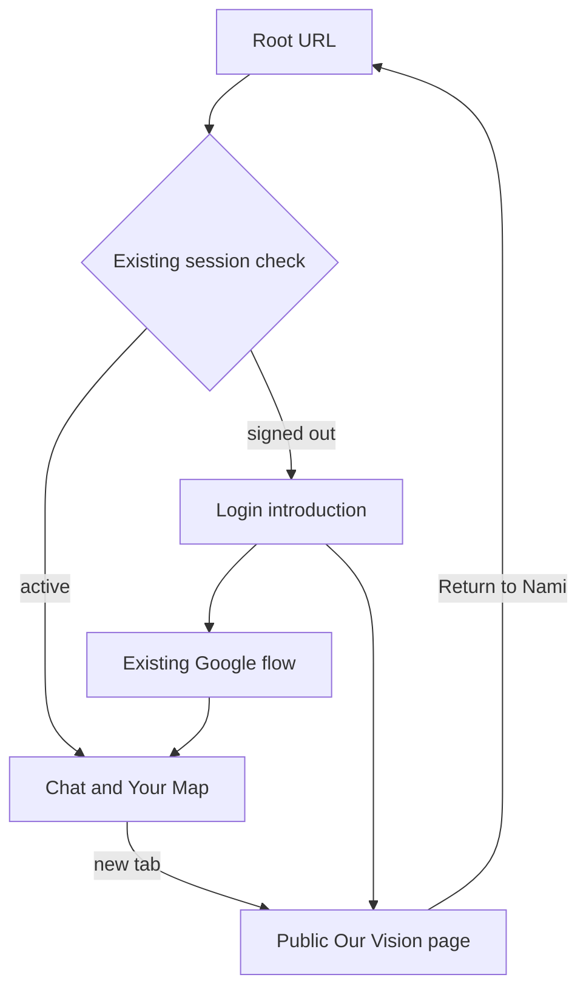
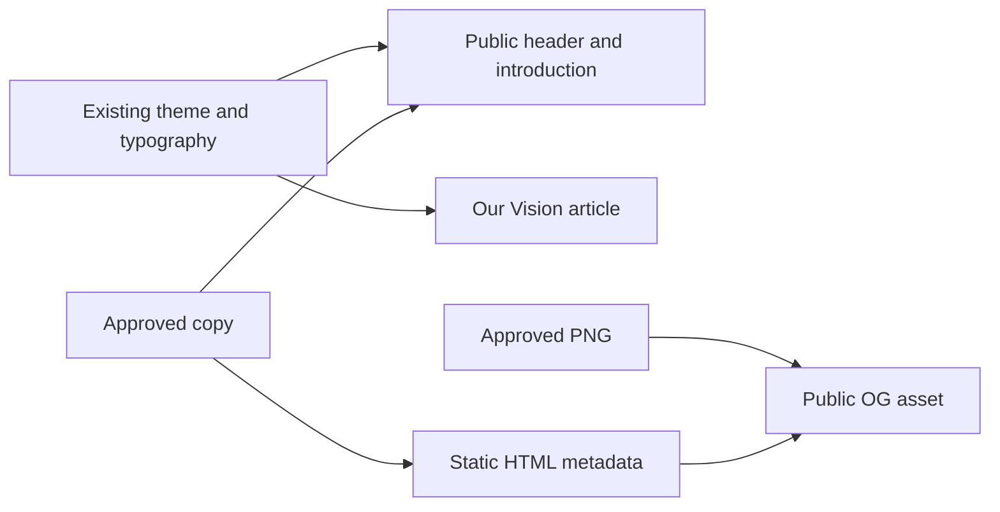

# Nami Public Entry - Plan

## Goal Capsule

- **Objective:** Invited early-access visitors understand what Nami offers and enter their conversation through a coherent, welcoming experience.
- **Product authority:** The founder confirmed this complete scope on 2026-10-31 after approving the landing and share-image directions. This contract governs public-entry work; `docs/thesis.md` remains Method authority and `docs/plans/2026-08-14-claude-feat-revelio-revamp-plan.md` remains the revamp implementation authority.
- **Means:** Extend the existing login route and app navigation, add a public essay route, and reuse the selected share asset (KTD1–KTD4).
- **Execution profile:** One bounded local changeset across U1–U3; no PR under the solo-project workflow. Implementation requires a subsequent execution handoff, and production release remains separately authorized.
- **Stop conditions:** Surface a conflict that requires changing Method behavior, identity policy, private-data exposure, or the approved copy/design.
- **Ownership:** An implementing agent completes local code and verification; the founder owns later release authorization.
- **Open blockers:** None for local implementation. Live release gates remain separately owned by `docs/runbooks/nami-rename-release.md`.

---

## Product Contract

### Summary

Replace the bare login presentation with a compact introduction that shares the app design and leads directly into Google sign-in. Add a public Our Vision essay, retain its link in the signed-in app, and update share imagery and metadata using the approved Nami direction.

### Problem Frame

Invited visitors currently arrive at a bare Google login with little explanation of Nami, and its presentation differs from the working app. Curious readers have no public route to the founder's existing essay, while the current metadata still describes the legacy questionnaire.

### Key Decisions

- **Compact introduction for invited users.** Governs R1–R3 (session-settled: user-directed — chosen over a larger marketing page: first users arrive through an invitation and need concise context).
- **Identity before conversation.** Governs R4–R5 (session-settled: user-approved — chosen over anonymous conversation followed by account handover: a direct integrated sign-in is sufficient for early access).
- **Existing essay as optional reading.** Governs R6–R8 (session-settled: user-directed — chosen over developing a new vision narrative: the founder already wrote the essay for curious visitors).
- **Illustrated share card.** Governs R9–R10 (session-settled: user-directed — chosen over the plain typographic card and decorative teal line: the anime Log Pose gives the image character).
- **Retain current Google login.** Governs R11 (session-settled: user-directed — chosen over further auth changes: the founder tested logout and login in a regular browser and found the experience smooth).

### Requirements

**Introduction and entry**

- R1. Present a compact landing introduction using the current app's design language, including its compass identity, typography, colours, borders, controls and supported themes; the approved layout reference is `docs/evidence/nami-public-entry/landing-approved-direction.png`.
- R2. Use the exact headline “Figure out what to work on next.” and subtitle “Explore possible paths, try small projects, and learn what actually fulfills you.”
- R3. Place “Continue with Google” directly beneath the introduction, with brief explanatory save/resume copy as shown in the approved sketch.
- R4. Successful Google sign-in takes a new explorer directly into the actual conversation, using the app's existing first-run behavior.
- R5. Returning explorers with an active session go directly to their saved app experience; signed-out explorers use the same Google entry.

**Our Vision**

- R6. Provide a public reading page titled “How To Figure Out What To Work On”, displaying the essay captured in `docs/evidence/nami-public-entry/vision-essay-source.md`.
- R7. Provide a visible “Our Vision” navigation link on the landing page and within the actual signed-in app header, accessible across its Chat and Your Map views.
- R8. Preserve the essay's voice and content, update its remaining Revelio reference to Nami, and use a readable layout consistent with the app; surrounding source notes must never be published.

**Share preview**

- R9. Use `docs/evidence/nami-public-entry/share-approved-direction.png` as the accepted share-image composition: anime Log Pose with three teal glass domes, no gold ring, no decorative line, the agreed headline and a two-line subtitle, with the illustration horizontally centered in the region between the headline's right edge and the image's right edge.
- R10. Update the applicable page title, description, Open Graph and Twitter/share metadata to Nami with the agreed message and selected imagery, using the configured public origin.

**Access and scope**

- R11. Preserve current Google identity access and session behavior; this work introduces no consent-prompt or notification suppression changes.
- R12. The introduction, Google entry and Our Vision navigation remain usable on mobile and desktop, including keyboard access and readable contrast in supported themes.

### Key Flows

- F1. **New explorer:** an invited visitor reads R1–R3, signs in, and enters the conversation per R4.
- F2. **Returning explorer:** an active session resumes per R5; a signed-out visitor uses the Google entry and returns to their saved experience.
- F3. **Curious reader:** a visitor or signed-in explorer opens Our Vision per R6–R8 without a required essay-reading step in the entry journey.

### Acceptance Examples

- AE1. **Covers R1–R5, R12.** An invited signed-out visitor sees the agreed introduction and Google button in a design consistent with the app, then reaches its existing first conversation after successful sign-in.
- AE2. **Covers R5.** A returning explorer with an active session reaches their saved workspace without completing the introduction or Google flow again.
- AE3. **Covers R6–R8, R12.** A signed-out visitor can read only the intended essay, and a signed-in explorer can reach it from the app header in either workspace view.
- AE4. **Covers R9–R10.** The share preview uses the accepted composition and Nami message, with no former-brand metadata or incorrectly based image URLs.
- AE5. **Covers R11.** Existing identity scopes and the working regular-browser sign-in experience are preserved.

### Success Criteria

The founder can recognize the approved landing and share directions in the finished result, an invited explorer has enough context to begin through R1–R5, and optional essay reading works through R6–R8. Acceptance examples AE1–AE5 define the observable completion signals; no new analytics platform is required.

### Scope Boundaries

This is one public-entry work unit. Anonymous agent sessions, extra auth providers, pricing, payments, CRM, analytics infrastructure, new onboarding stages and Method changes are outside it. Implementation, deployment, domain changes, Google callback configuration, push, merge and PR creation have not been authorized by this brainstorm.

### Evidence and Planning Notes

- Current entry and session routing were inspected in `client/src/pages/login.tsx` and `client/src/App.tsx`; identity configuration was inspected in `server/auth.ts`. No credentials or founder conversation history were inspected.
- The founder reported successful logout/login in a regular browser after suspecting repeated incognito tests caused the earlier friction. Incognito is the likely explanation, not a proven diagnosis of every former prompt or email; no live production auth health claim follows.
- The selected preview sources and imagegen prompt set are recorded in `docs/evidence/nami-public-entry/README.md`.
- The sketch's substitute fonts, theme icon and Google glyph are not production asset specifications; KTD1–KTD4 resolve route, rendering and export choices.
- This founder-confirmed optional essay page is a narrow amendment to the older public-thesis sequencing, not a broader essay campaign. U2 records that amendment explicitly without changing `docs/thesis.md` or Method authority.

---

## Planning Contract

Product Contract unchanged in meaning; R1–R12, F1–F3 and AE1–AE5 retain their IDs. Problem Frame and authority reconciliation clarify the existing request without expanding it.

### Key Technical Decisions

- KTD1. **Keep the established route split.** Restyle `/login`; keep `/` session-gated with the existing redirect, pending-session presentation, sign-out behavior and callback URLs. This avoids changing the working identity lifecycle while satisfying R1–R5 and R11.
- KTD2. **Public reading route at `/our-vision`.** Register it outside the authenticated root, render a checked-in copy of the intended essay through the installed `react-markdown` dependency, and give it a public header with a return-to-Nami link. Use a native anchor opening a new tab from the signed-in workspace so navigation does not unmount its draft or active stream; retain a clear accessible new-tab indication. Governs implementation of R6–R8 and R12. Source: `client/src/pages/explore.tsx` aborts controllers on unmount.
- KTD3. **Share small presentation elements, preserve workspace ownership.** Add a public header and a reusable Our Vision link; use the existing `ThemeToggle`, DM Sans/Manrope typography, theme tokens and compass SVG geometry. The workspace keeps its current Chat/Your Map and account controls; add the navigation link without a wider header refactor. Governs R1, R7 and R12.
- KTD4. **Use the approved raster directly.** Copy the selected image to `client/public/assets/og-image.png`, preserving the approved composition and text rather than regenerating it. Update the title to “Nami — Figure out what to work on next.” and descriptions to R2's subtitle in `client/index.html`. Keep the existing `__NAMI_APP_ORIGIN__` substitution and OG/Twitter asset path, which `scripts/check-vercel-function.mjs` already verifies. Governs R9–R10.

### High-Level Technical Design

### Implementation Constraints

No new production dependencies or environment keys are needed. Keep essay rendering separate from the restricted agent-message renderer; do not relax `SafeMessage` to publish prose. The source Markdown is authored local content, rendered without raw HTML execution or a remote file fetch.

Retain the existing generic login error and paused-signup messages. Use the current real Google icon from the installed icon set, not the sketch's letter placeholder. Use natural wrapping for landing copy on narrow screens; the two-line subtitle constraint applies to the share image.

External research is unnecessary for this bounded presentation change: the routing, theme, Markdown rendering and static-origin patterns already exist locally, and no OAuth API or provider settings change. Browser evidence must use the approved HTTP origin on port 5173 and the designated QA identity, following `docs/solutions/workflow-issues/find-and-choose-revelio-testing-setups.md` and the current runbook; historical profiles are not proof of present identity.

### Risks and Dependencies

- The essay snapshot contains a final Revelio reference; publication must change that reference only, excluding all surrounding original notes per R8.
- Header space is limited on mobile; R12 requires a visible link without displacing account or theme actions.
- Local checks cannot establish production login or share-crawler cache state. Production verification remains under `docs/runbooks/nami-rename-release.md`.

---

## Implementation Units

### U1. Integrate the landing introduction with the app design

**Goal:** Present the approved compact introduction while retaining the working sign-in lifecycle.

**Requirements:** R1–R5, R11–R12; F1–F2; AE1–AE2 and AE5.

**Dependencies:** None.

**Files:** Modify `client/src/pages/login.tsx`, `client/src/pages/login.test.tsx` and, only for focused presentation rules, `client/src/index.css`; create `client/src/components/public-header.tsx` and `client/src/components/our-vision-link.tsx`.

**Approach:** Apply KTD1 and KTD3 using the saved landing reference. The public header owns brand, Our Vision navigation and the existing theme toggle; U2 supplies its destination. Preserve the existing login handler, pending button state, retry behavior and error feedback.

**Patterns:** `client/src/components/theme-toggle.tsx`, `client/src/lib/theme.ts`, `client/src/pages/explore.tsx` header and `client/src/components/header.tsx` compass identity.

**Test scenarios:**

1. Covers AE1. Render the signed-out introduction and confirm the approved heading, subtitle and accessible Google action are present.
2. Preserve existing `login.test.tsx` scenarios for pending-click exclusion, explicit retry, paused signup and safe provider errors.
3. Covers AE2 and AE5. Run the existing `App.auth.test.tsx` cases for pending sessions, direct active-session access and sign-out recovery without changing their semantics.

**Verification:** Signed-out presentation matches the approved layout in light and dark themes at mobile and desktop sizes; focus remains visible and error copy remains readable.

### U2. Publish the optional essay and retain navigation in the app

**Goal:** Make the founder's essay accessible to visitors and explorers without interrupting their workspace.

**Requirements:** R6–R8, R12; F3; AE3.

**Dependencies:** U1 for shared public presentation and link component.

**Files:** Create `client/src/content/our-vision.md`, `client/src/pages/our-vision.tsx` and `client/src/pages/our-vision.test.tsx`; modify `client/src/App.tsx`, `client/src/App.auth.test.tsx`, `client/src/pages/explore.tsx`, `client/src/pages/explore.test.tsx`, `client/src/components/our-vision-link.tsx` and `docs/plans/2026-08-14-claude-feat-revelio-revamp-plan.md`.

**Approach:**

1. Copy only `docs/evidence/nami-public-entry/vision-essay-source.md` into the authored client content, replacing its product reference per R8; import it as a Vite raw asset and render it through a dedicated article using the existing Markdown dependency and theme.
2. Register the route outside auth resolution, then wire landing and workspace links per KTD2. Keep the public page free from workspace/history requests. Its return link targets `/`, letting the existing route/session behavior choose the destination.
3. Add a dated narrow amendment beside the active revamp plan's R14/public-thesis sequencing: the founder authorizes the existing essay as optional Our Vision reading before early access. Keep the wider pilot-evidence publication/outreach program and Method authority intact.

**Patterns:** Existing Wouter route ownership in `client/src/App.tsx`, existing `react-markdown` usage in `client/src/components/explore/safe-message.tsx` as a dependency precedent only, and public theme initialization in `client/index.html`.

**Test scenarios:**

1. Covers AE3. Directly render `/our-vision` signed out and verify the essay loads without calling `useSession` or workspace/history APIs.
2. Compare the normalized article text against the captured essay with only the agreed product-name replacement; verify the title, final paragraph, headings, emphasis and lists render.
3. Covers AE3. Confirm the Our Vision link remains in the actual workspace header across Chat and Your Map and opens the public route in a new tab with safe link attributes.
4. Verify the return-to-Nami link resolves through the existing root routing; keep legacy route isolation and existing active-session redirect coverage passing.

**Verification:** Read the full essay at mobile and desktop widths in both themes; inspect link focus and header wrapping. From a designated QA workspace, verify opening the essay leaves the original tab and draft intact without sending a model turn. Direct refresh on the public route must resolve through the existing SPA fallback.

### U3. Install the approved share image and matching metadata

**Goal:** Make link previews use the accepted Nami message and illustration.

**Requirements:** R9–R10; AE4.

**Dependencies:** None; final verification follows U1–U2.

**Files:** Replace `client/public/assets/og-image.png`; modify `client/index.html`; create `shared/public-entry-metadata.test.ts` for the static document contract.

**Approach:** Apply KTD4 and preserve the approved source PNG in evidence. Verify actual image dimensions before adding optional width/height tags. Keep production files in Vite's source public directory; never hand-edit the generated root `public/` output. The metadata test checks actual source HTML for matching Nami title, descriptions and OG/Twitter asset references; the build check proves configured-origin substitution.

**Test scenarios:**

1. Covers AE4. Source title, description and OG/Twitter variants contain the approved message, with no legacy “8 questions” promise.
2. Covers AE4. Built HTML has absolute configured-origin image URLs, the image file exists in build output, and no `__NAMI_APP_ORIGIN__` placeholder remains.

**Verification:** Visually compare the emitted image to the selected evidence file, checking ring removal, two subtitle lines and right-side balance; inspect it at thumbnail size. No further imagegen pass is required.

---

## Verification Contract

No tests or builds run during planning. Implementation uses Node 24 and records actual results.

| Gate | Applies to | Required evidence |
|---|---|---|
| `npm run check` | U1–U3 | Type checking passes. |
| `npm test -- client/src/pages/login.test.tsx client/src/App.auth.test.tsx client/src/pages/our-vision.test.tsx client/src/pages/explore.test.tsx client/src/lib/theme.test.tsx shared/public-entry-metadata.test.ts shared/vite-origin.test.ts --run` | U1–U3 | Focused behavior and existing theme/origin coverage pass. |
| `BETTER_AUTH_URL=https://heynami.vercel.app npm run build` | U1–U3 | Process-scoped fixture build succeeds; inspect emitted HTML and image in generated `public/`. This does not configure or deploy production. |
| Browser inspection on approved HTTP `localhost:5173` or `127.0.0.1:5173` | U1–U2 | Desktop/mobile and light/dark views meet R12; essay refresh and navigation work; designated QA identity verified before app inspection. Coordinate with the owner of the existing server before changing its process. |
| Existing auth regression tests | R11 | Existing client cases remain green; if implementation accidentally reaches auth server code, stop for scope review rather than changing consent/session policy. |

No `release:validate` command exists in the inspected package scripts. No live model evaluation or storage-suite expansion is needed for this presentation change. Before a separately authorized deployment, retain the whole-output packaging and release checks from `docs/runbooks/vercel-function-packaging.md` and `docs/runbooks/nami-rename-release.md`.

---

## Definition of Done

- U1–U3 satisfy AE1–AE5 with the approved copy and composition preserved.
- Our Vision is public, uses only the intended essay, and remains accessible from both workspace views without interrupting the original tab.
- Required verification results and material limitations are recorded, with no claim of live production health from local evidence.
- The active revamp plan contains the narrow essay-publication amendment, and Method authority remains intact.
- Temporary scaffolding, dead approaches and unused assets from implementation are removed; approved evidence remains available.
- Completion is a locally reviewable changeset. No deployment, domain/config mutation, push, merge or PR is included.
