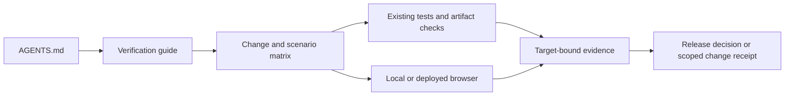
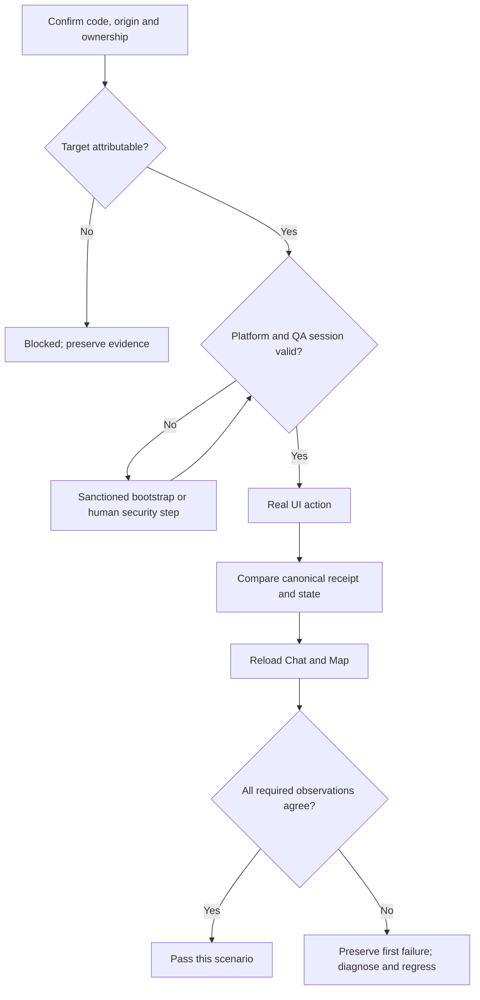
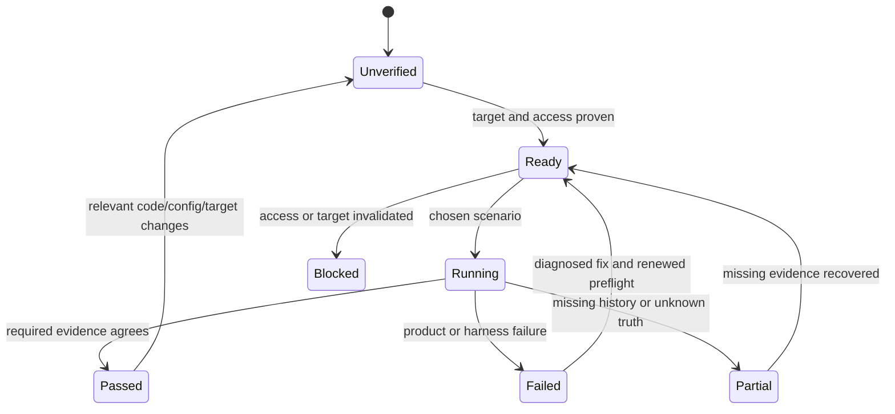

# Nami Release and Ongoing Verification Kit - Plan

## Goal Capsule

**Objective:** Agents can establish whether Nami's final MVP release and later changes work, with evidence the founder can trust without becoming the regression runner.

**Means:** A project verification guide, a bounded scenario/evidence matrix, and correction of the legacy browser entrypoint, reusing the incumbent tools (KTD1–KTD4).

**Authority:** Current code/tests define existing behavior. The active revamp plan's 2026-10-31 release-scope amendment governs release obligations; `docs/thesis.md` governs the Method. This plan implements a verification kit, not a new Method or product scope. Preserve the coordinator's existing amendment and all requirement/unit IDs.

**Execution profile:** Four ordered units, suitable for small local commits on the integration branch. Solo project: no PR, merge, push, deployment or remote configuration change unless separately requested. Finish the kit's local proof first; founder authorization gates the deployed release exercise in U4. An unexercised remote lane remains unverified.

**Stop conditions:** Wrong target/account, unapproved origin, unexpected WIP, inaccessible credentials, or missing required access stops dependent actions with the precise blocker. Preserve evidence and task-owned edits. Do not reset/stash, switch ports, weaken protection, or claim a skipped gate passed.

---

## Product Contract

### Summary

Make normal agent entry through `AGENTS.md` lead to a small, current verification runbook. The kit separates mechanical, artifact and rendered deployed evidence, and explains when each is required. Its final-release lane proves a real user action through the UI, canonical saved state and reload.

### Problem Frame

Nami has strong deterministic and packaging coverage, but release instructions are spread across dated plans and receipts. The default Playwright configuration still targets port 5001 and its only journey is the paid legacy questionnaire. Fixture Vercel startup cannot establish real Google authentication, usable provider configuration or saved Method behavior. Future agents need to find the right checks without relying on this conversation.

### Key Decisions

- **Agents own mechanical verification.** (session-settled: user-directed — chosen over founder-operated regression runs: founder time is reserved for judgment, release authorization and encountered security steps.) Governs R1, R6.
- **Keep the MVP release scope bounded.** (session-settled: user-directed — chosen over additional launch prerequisites: outreach preparation and additional whole-account erasure operations wait for their actual triggers; manual spoken-navigation verification is removed.) Governs R7.
- **Deliberate live testing is required.** (session-settled: user-directed — chosen over treating all paid requests as accidental execution: real integrations need real requests; safeguards target runaway behavior and significant accidental spend.) Governs R5, R9.
- **Reuse existing tools.** (session-settled: user-approved — chosen over adopting pstack or building a control framework: this MVP needs repeatable evidence with little maintenance.) Governs R2, R8.

### Requirements

#### Discovery and maintenance

- R1. A cold agent starting at `AGENTS.md` finds the canonical guide, chooses checks by change, runs authorized mechanical work and records its evidence.
- R2. Reuse existing deterministic suites, guarded disposable PostgreSQL testing, origin builds, Vercel artifact checks and browser tools; keep guide upkeep tied to relevant changes.
- R3. Classify the existing Playwright journey explicitly as legacy paid coverage and remove obsolete port/current-Method claims without losing active requirement coverage.

#### Release truth and access

- R4. Bind every result to the code/configuration/target actually checked, with explicit failure, partial, blocked, historical and not-run outcomes.
- R5. The final-release lane proves public entry, real Google callback/returning session, a meaningful streamed Method response and saved change, Chat/Map/reload agreement, repeating continuation and cancellation/recovery through actual requests; fixtures and mocks prove components, not live end-to-end integration.
- R6. Use only a separate designated QA account, owned safe actions/data and sanctioned credential/access mechanisms; do not access founder records, reset QA history or promise unattended login where security steps intervene.

#### Preserved scope

- R7. Honor the founder's 2026-10-31 amendment while retaining security, ownership, cancellation, private-output, semantic accessibility and existing deletion regression coverage.
- R8. Keep this kit small: no unplanned paid matrix, cloud testing platform, new auth provider, permanent staging requirement, daily automation, feature catalogue, global plugin rewrite or general browser-control wrapper.

#### Deliberate live verification

- R9. Implementation verification deliberately sends real network/provider/model/QA requests where needed for the selected scenario; safeguards retain existing runtime limits and prevent runaway loops, blind retries, lack of progress and significant accidental spend without arbitrary tight request caps or a new hard spending approval threshold.

### Success Criteria

A fresh agent can select and explain the correct lane for UI, persistence, auth/origin, prompt/model, packaging and docs changes. A release receipt distinguishes what worked in the deployed app from what only passed locally, and lets another agent find the first failure and its eventual fix.

### Scope Boundaries

**Included:** U1–U4, actual source-backed gate reconciliation, and a documented path from access bootstrap to a separately authorized final-domain QA exercise before invitations.

**Deferred to Follow-Up Work:** Participant invitation/contact/data-review notice preparation at outreach; additional whole-account erasure tooling, runbook completion and operational dry run when a deletion request arises. Existing protections/tests remain active. Formal Peers, proof inventories and Side Doors remain deferred under the Method authority.

**Considered and not built:** A readiness endpoint or custom probe script is unnecessary because process ownership, existing read-only app state, Vercel metadata and logs cover the needed facts. Revisit only if a real run cannot attribute its target. A new repo skill or CE pack would duplicate the guide; reconsider only if the cold-entry proof shows `AGENTS.md` discovery failing. No new Playwright Method suite or third browser framework: existing focused tests plus real browser proof cover this kit's gap. No periodic maintenance job: update when routes, auth, tools, deployment or contracts change. These choices implement R8.

---

## Planning Contract

### Current grounding

Baseline: integration HEAD `8ed30d5b2968a1eb490b11aba966a0adb690cc1f`, plus the offered revamp-plan amendment. Existing October receipts remain historical, not fresh release passes.

- `package.json` requires Node 24 and already provides `check`, `test:all`, `build`, `verify:vercel-preview`, `verify:vercel-production`, Method evaluation and reporting commands. There is no lint script.
- `scripts/test-all.mjs` scrubs real provider/auth settings and requires the explicit disposable storage boundary; `server/storage.test-database-safety.ts` validates local `ikigai_u4_test_admin_*` databases. Use those protections rather than direct full Vitest with application credentials.
- `scripts/check-vercel-function.mjs` checks the actual copied function outside the checkout, five canonical skills, whole output privacy and share origin. Its fixture-only startup/503 is intentionally limited.
- `tests/journey.spec.ts` starts at `/legacy`, spends real model calls and writes legacy state; `playwright.config.ts` still uses 5001. `tests/explore.spec.ts`, named in the revamp plan, does not exist. Current Method coverage lives in `client/src/pages/explore.test.tsx`, component, agent-route, history, reducer and storage suites.
- `shared/app-origin.ts` fixes development auth to `http://localhost:5173`; approved `127.0.0.1` browser access does not imply interchangeable callbacks. `NAMI_BUILD_VERSION` is diagnostic metadata, not an HTTP build identity endpoint.
- `scripts/early-access.ts` and `server/reporting/` already handle private exports, canonical/provider history and partial-history failure. Provider history is not the canonical state oracle.
- `server/ai/agent.ts` already stops through `stepCountIs(NAMI_MAX_AGENT_STEPS)` and reports token usage with an explicit `usageReported` distinction. `scripts/eval-nami-method.mjs` has its existing scenario step guard and retry policy. Retain these limits; available token counts are not a promise of exact monetary cost.

### Key Technical Decisions

- KTD1. **One normal entrypoint.** Add a short `AGENTS.md` directive pointing to `docs/runbooks/nami-verification.md`, which links `docs/runbooks/nami-verification-scenarios.md`. Keep the scenario matrix in one place. This implements R1–R2/R8 using the agreed docs-first approach. CE 3.34.0 work/debug already read project instructions; supported packs exist but are unnecessary here.
- KTD2. **Use Launch / Doctor / Drive / Evidence / Cleanup.** (session-settled: user-approved — chosen over installing pstack or wrapping all browser actions: borrow its proof discipline while keeping incumbent tooling.) The guide owns target preflight, serial driving, receipts and teardown. Implements R2/R4/R6/R8.
- KTD3. **Separate tool responsibilities.** (session-settled: user-approved — chosen over a new test platform: bundled `@Browser` handles approved local origins, agent-browser handles actual deployed rendered UI, and Vercel CLI handles artifact/status/log facts.) Read installed skill/help during execution preflight; availability is not composed-workflow proof. Implements R2/R5/R6.
- KTD4. **Prefer controlled final-origin QA before invitations.** Use the intended `https://heynami.vercel.app` origin, subject to read-only confirmation and later approval, with a dedicated QA account and existing canonical history. This avoids making permanent staging infrastructure a prerequisite. If the approved final-origin route cannot safely authenticate or confine writes, stop and present the smallest auth-enabled stable-preview alternative with its exact callback/configuration changes for approval. No auth-disabled fixture result substitutes for R5.
- KTD5. **Require three observations for a saved-action pass.** Match the visible action/result, authoritative persisted receipt/revision/entity and reloaded Chat/Map. Capture disagreements as defects even when one layer succeeds. Implements R4–R5; follow `diagnose-purpose-path-revision-save-anomalies.md`.
- KTD6. **Make the legacy browser run explicit.** Correct its configuration to 5173, label it as paid `/legacy` coverage, and require an explicit legacy-run opt-in before server startup. Refuse silent reuse of an unknown server. The default command must explain the missing opt-in rather than pass with all tests skipped. The explicit opt-in protects default discovery/build/harness use from unexpected paid execution; it permits deliberate paid legacy/full-journey verification once its target, account, data and provider scope are checked. This implements R3/R6/R9 without constructing a new E2E suite.

- KTD7. **Select a purpose, then observe progress and usage.** (session-settled: user-directed — chosen over blanket live-request restrictions or a new quota system: allow intentional test cost while catching runaway or unexpectedly expensive execution.) Before a live scenario, record its purpose and target/account/data/provider scope. Track scenario progress and available request/token/usage/cost information without claiming unavailable cost precision. Preserve the first failure, diagnose before a purposeful retry, and stop/notify on nonprogressing repetition, runaway behavior or anomalous/unexpected cost; never repeat a test merely until one run passes. Reaching the selected outcome may require multiple deliberate calls. Implements R5/R6/R9 using existing guards and evidence, not new budget tooling or per-call consent.

### Assumptions and execution-time prerequisites

The exact final deployment ID, runtime configuration fingerprint, QA checkpoint and current session validity can only be established during authorized execution. They are not product decisions. The named QA account `konfidenz.clothing@gmail.com` has useful history; a dedicated account is not a separate database. Preserve it, inspect only its authorized state, and choose the smallest additive mutation supported by its actual checkpoint. Do not reset it to manufacture a convenient journey.

Tool facts supplied or inspected for this plan: agent-browser 0.37.1, Vercel 65.2.0, 1Password CLI 2.41.1. Recheck during execution; planning did not access vaults/items, authenticate, drive a browser, run application tests or deploy.

### High-Level Technical Design

### Access and secret handling

Vercel platform protection and app Google authentication are separate checks. The installed agent-browser protected-deployment skill uses short-lived Vercel OIDC for the named project/origin; current Vercel meets its documented minimum. Production may need a human Trusted Sources rule. Do not disable protection, publish a private preview, change access policy automatically, or assume Vercel access grants an app session.

Use a new dedicated named session and persistent QA profile such as `nami-release-qa`, stored outside Git with private permissions. Never reuse historical `revelio-qa`, founder cookies, personal browser/CDP auto-connect or exported sessions. Verify actual app identity before every write and after renewed authentication. Do not combine persistent profiles with agent-browser's incompatible `--allowed-domains` mode; enterprise restrictions still apply. Confirm local allowlist access before any browser use and stop on denial.

1Password is an optional bootstrap aid, not proof of access. During later authorized execution, request only the exact QA item/field references needed from the owner; do not enumerate vaults or browse personal items. Use `op run` process-scoped injection with a supported non-logging consumer that reads the secret internally, never secret interpolation into command arguments. Keep default masking, disable shell tracing and avoid secret-bearing debug logs, screenshots, HARs, URLs, Git or resolved environment files. Masking is not screenshot/network protection. If the browser's supported login consumer cannot keep the value out of commands/tool traces, stop secret automation and use human entry in the dedicated profile. Desktop biometric approval, Google consent/challenge or 2FA may still require the founder. Do not add a service account or change 1Password permissions for this kit.

### Release evidence and recovery

Each receipt records time, scenario, code revision and dirty diff identity, build/runtime origin and nonsecret configuration facts, local PID/cwd or immutable Vercel deployment/project identity, browser/tool versions, QA identity, relevant module/provider/model versions, actions, visible outcome, canonical IDs/revisions, reload result, diagnostics and limitations. Keep config fingerprints free of secrets and their hashes. For prebuilt releases, record the checked artifact's identity and its upload/deployment linkage; deployment metadata alone may not identify uncommitted source. If linkage is unavailable, mark source attribution unverified and stop the release claim.

Preserve the first failure before repair. Record committed-save truth separately from reply-delivery failure and unknown refetch truth. Re-run the affected scenario after a causal fix with its focused regression; do not treat unexplained later green runs as resolution. Retain dated evidence unchanged and add a superseding result.

Use existing ignored `.context/revelio/` for ordinary raw QA logs, transcripts and screenshots; protect persistent profiles as credentials. Reporting exports, rosters and manifests remain under the enforced `.context/early-access/` root. Use the existing reporting command's relative output argument and preserve artifact registration. Commit only sanitized summaries under `docs/evidence/`. Cleanup stops owned processes and removes disposable state it created, never existing QA history or retained proof. Do not collect raw provider transcripts or database exports merely to prove a revision.

A broken old production deployment is not a rollback candidate. On a bad release stop invitations, preserve evidence, then seek authorization to disable agent/signup via existing switches and redeploy a known verified prebuilt artifact/configuration. If no such artifact exists, report that recovery needs a newly verified candidate. Signups-off alone does not stop existing accounts' model calls. No data rollback or account deletion is part of this kit.

---

## Implementation Units

### U1. Publish the discoverable verification entrypoint

**Goal:** Give any agent the correct starting point and change-specific checks.

**Requirements:** R1–R2/R6–R8; KTD1–KTD3.

**Dependencies:** None.

**Files:** `AGENTS.md`; new `docs/runbooks/nami-verification.md`.

**Approach:** Write the five-section guide, with exact existing command entrypoints, Node 24/disposable-DB requirements and local 5173/lab 5174 boundaries. Include the access/bootstrap, deliberate live-verification (R9/KTD7), first-failure, evidence and cleanup contracts above. State that planning inspects/designs, while implementation proof deliberately exercises real integrations within the selected scope; discovery/build safety is not a blanket ban on real requests. Link the scenario matrix and existing packaging, rename and reporting references rather than copying their recipes. State that `ce-work`/`ce-debug` select project checks through this entry; `ce-test-browser` supports local affected-UI coverage but its pipeline OAuth skip is not release proof. `ce-dogfood` is optional manual diff-scoped local QA with small fixes/commits; do not replay the entire integration diff. `ce-polish` is founder-directed UX refinement, not an automatic gate; no voice/riffrec installation for verification. Project ports override generic free-port fallbacks.

**Test scenarios:**

- After U2 supplies the integrated matrix, a fresh read-only agent given only the repo entrypoint and six representative change descriptions finds the guide and selects its checks without chat context.
- A docs-only change selects link/fact review; it does not launch paid model calls or a full release matrix.
- A request to use generic CE local QA keeps deployed Google authentication and persisted-state proof explicitly outstanding where required.

**Verification:** Cold-entry findings and link/source review show no invented CE hooks, missing entrypoint or duplicated authority. No prose-mirroring automated tests are needed.

### U2. Reconcile gates and write the release/scenario matrix

**Goal:** Establish one truthful current coverage and evidence contract.

**Requirements:** R3–R7/R9; KTD4–KTD5/KTD7.

**Dependencies:** U1.

**Files:** New `docs/runbooks/nami-verification-scenarios.md`; `docs/plans/2026-08-14-claude-feat-revelio-revamp-plan.md`; `docs/runbooks/nami-rename-release.md`; `docs/runbooks/vercel-function-packaging.md`. Amend `docs/plans/2026-08-29-1133-feat-revelio-method-plan.md` only where its currently normative U10 text contradicts the release amendment, using an explicit scoped amendment with stable IDs.

**Approach:** Implement the two matrices below. Add a compact active/deferred requirement-to-check roll-up using the Method/revamp IDs and repeating-learning authority, with exact current test/evidence paths and fresh-rerun triggers. Distinguish inherited accepted U7 evidence, fresh deterministic release checks and the small new deployed lane. Replace nonexistent `tests/explore.spec.ts`/generic E2E claims with actual coverage. Reconcile conflicting live U10 wording, including erasure-completeness operational prerequisites, without deleting security/deletion regression checks or changing historical dated receipts. Keep fixture packaging instructions explicitly startup-only and label their fixture deploy recipe so it cannot be mistaken for the auth-enabled release recipe. Keep live integration rows pending until actually exercised. When cohort reports supply release evidence, confirm the designated QA account is excluded by the existing selected cohort configuration; add no exclusion tool.

**Test scenarios:**

- Every active Method R/F/AE has a current check or retained accepted evidence with relevance and freshness explained; deferred R34–R40/F4–F5/AE10–AE12 never become gates. External-action control remains active independently of deferred stages.
- The founder's screenreader removal is recorded as removed, not passed; outreach/erasure preparation is deferred at its trigger while deletion/security regression coverage stays required.
- A fixture503, partial export or old deployment receipt cannot satisfy the real-auth/Method rows.

**Verification:** A source-backed audit finds no active requirement orphaned and no stale manual/deferred prerequisite blocking release. Existing amendment content survives.

### U3. Bound and correct the legacy browser entrypoint

**Goal:** Prevent default E2E invocation from misrepresenting current Method coverage or accidentally spending/writing.

**Requirements:** R2–R3/R6/R9; KTD6–KTD7.

**Dependencies:** U1–U2.

**Files:** `playwright.config.ts`; `tests/journey.spec.ts`; the guide's legacy invocation section. Change `package.json` only if an explicit legacy script label is needed for discoverability.

**Approach:** Keep the existing legacy assertions, rename misleading suite/documentation labels, use 5173 for both baseURL/readiness and refuse silent existing-server reuse. Require an explicit legacy opt-in before launching. Document that opt-in does not authorize a live production database: the operator must prove the chosen disposable local data boundary and explicitly authorized provider credentials before this optional paid run. Do not import real `.env` secrets for default discovery or add current Method assertions to this old suite. The active release matrix uses existing deterministic legacy regressions plus a focused rendered `/legacy` smoke. Deliberate paid questionnaire/full-journey replay is permitted when expressly selected for relevant regression or integration proof under R9/KTD7; default discovery and configuration checks do not silently launch it.

**Test scenarios:**

- Invoking without legacy opt-in fails clearly before starting a server/browser/provider request; it cannot report a green skipped suite.
- With explicit opt-in, configuration discovery lists only the labelled legacy journey and inspects its 5173 binding without executing it.
- A distinct runtime startup preflight against a known safe occupied 5173 refuses server reuse before tests/provider calls; do not disturb the existing listener or use a free-port fallback. Listing alone does not prove this refusal.
- Express selection of a paid legacy/full journey, after its safe target/account/data/provider scope checks, permits real requests and records useful progress/available usage rather than treating intentional cost as accidental execution.
- Review of the resulting gate shows no unsupported claim of Google auth or Method Chat/Map coverage.

**Verification:** Use safe configuration discovery and the separate startup-conflict preflight for this configuration change. Those checks need no paid journey; when a live journey is selected, its real requests are expected verification under R9/KTD7. No new broad browser suite or new framework tests.

### U4. Prove the kit and prepare the final-release receipt

**Goal:** Show that the new instructions work and that failures cannot turn into false release passes.

**Requirements:** R1–R9; KTD1–KTD7.

**Dependencies:** U1–U3.

**Files:** New sanitized `docs/evidence/2026-10-31-nami-verification-kit.md` or execution-date equivalent; private raw evidence in existing ignored namespace. Product fixes, if discovered, require the normal focused regression in the existing relevant test file.

**Execution note:** Prove the written instructions, preserve first failure, then fix the failing layer under KTD7. Planning and this amendment remain inspection/design; ce-work and its execution requests start only after coordinator approval. Once authorized, selected live tests deliberately send real requests, including paid requests where needed. Production deployment, remote configuration/domain/access-permission changes and production write scope retain their separate explicit authorization.

**Approach:** After implementation is authorized, have a cold agent follow the guide. Prove local Launch/Doctor/public Drive/Evidence/Cleanup on 5173 and confirm proof survives cleanup. Selected auth-enabled local Method integration must use actual provider/model requests and verify streamed output, owned persisted state and reload; fixtures alone cannot pass that claim. If safe local auth/data prerequisites are unavailable, record that lane pending and identify the smallest required bootstrap. Check the negative cases below with existing deterministic fixtures and synthetic receipt examples, not by corrupting QA data or revoking real access. Prepare a concrete final-target/configuration/write-scope/recovery preflight for founder deployment authorization. After that approval and access bootstrap, drive the deployed release rows serially in the designated profile/account. Record all pending remote rows if approval/access has not arrived; kit-local completion must not be described as a final release pass.

**Test scenarios:**

- Wrong checkout/PID, stale deployment/artifact linkage or unexpected origin stops before login/write; correct identity permits the selected lane.
- Invalid/expired app session or wrong QA identity stops mutation; platform OIDC success alone never passes app auth.
- Partial provider history keeps its partial status and diagnostic, even when canonical map retrieval succeeds; select narrower evidence only when the row's claim needs no missing history.
- A saved canonical revision with failed UI narration records saved-success plus delivery-failure; an attractive UI with no matching persisted revision fails. Unknown refetch truth cannot be called cancelled/unsaved.
- A controlled local failure still leaves first-failure evidence after cleanup; unrelated existing 5173 process and QA history survive.
- A selected live scenario makes purposeful real requests and records progress/available usage. Nonprogressing repeated failures or anomalous/unexpected cost stop with evidence and notification; multiple progressing calls do not fail an arbitrary request-count gate. Exercise the reporting rule through synthetic receipt/source review, not by intentionally incurring runaway cost.
- On the later authorized deployed run, one real saved action and repeating continuation agree through Chat/Map/reload, with cancellation/recovery and no duplicate write. Synthetic cancellation race coverage remains attached where safe live interruption cannot prove every timing branch.

**Verification:** The final evidence report separates guide proof, deterministic results, artifact checks and actual remote rows, and lists only real remaining access/authorization blockers. No failing row is silently removed.

---

## Verification Contract

### Choose checks by change

Focused relevant checks apply to every behavior change. Broaden only when the affected boundary or release candidate requires it; document why omitted rows are irrelevant.

| Change | Required evidence |
|---|---|
| UI/routes/theme/public content | Existing focused React tests; rendered affected local path on desktop/mobile/light-dark as relevant; keyboard/focus/status/tree/contrast/responsive inspection for affected controls; build for shipped assets/origin. |
| State/history/persistence/cancellation | Relevant reducer/tool/route/history/UI suites; guarded disposable storage tests for storage/schema changes; real action + canonical state + reload in affected flow. |
| Auth/origin/cookies/signup | Existing auth/origin/ownership/protocol regressions; exact-origin build/artifact checks; real callback and returning-session on intended remote origin before release. |
| Prompt/model/tools/modules | Existing Method loader/evaluation/contract tests and focused fake-model scenarios; purpose-selected real provider/model evaluation under R9/KTD7, alongside component fixtures; preserve first failures, available usage, active tool/module versions and state-write truth. |
| Packaging/runtime/dependencies/deployment | Node 24 check/build and both relevant Vercel artifact targets; real function import, five skills, whole-output privacy/origin checks; deployed UI/runtime smoke after authorized upload. |
| Docs-only | Link, identifier, source-fact and gate-coherence review plus cold-entry checks when instructions change; no automatic paid/full release replay. |
| Final candidate | `npm run check`, guarded `npm run test:all` on disposable PostgreSQL, origin-scoped `npm run build`, `verify:vercel-preview` and `verify:vercel-production`; active requirement roll-up and deployed rows below. |

For live local or deployed integration, select actual requests under R9/KTD7. A fixture/mock pass or auth-disabled503 startup leaves live coverage pending. Deliberate paid legacy/full-journey requests are permitted after scope checks; they are distinct from accidental discovery/build execution.

Exact executable recipes belong in the implemented guide and owning existing runbooks. Do not invent `release:validate` or a lint command. Preserve existing runaway guards. Node 22 on an agent host is insufficient for the application's Node 24 validation.

### Final deployed release scenarios

| ID | Action and proof | Boundary / rerun trigger |
|---|---|---|
| S1 Public entry | Signed-out landing and `/our-vision`, same-tab return, Google entry, share asset bytes/tags and exact absolute origin; mobile light/dark, no overflow and relevant keyboard/semantic checks. | Real approved deployment; repeat when routes/assets/theme/origin change and at final release. |
| S2 Authentication | Real Google callback at exact target origin; visible designated QA identity, authenticated workspace ownership, logout/login and returning session/reload. Capture no credential/consent values. | Auth-enabled remote target; repeat on auth/origin/config changes and final release. |
| S3 Useful saved turn | From the actual QA checkpoint, submit a meaningful request producing a streamed reply and small additive saved change. Match operation/receipt/revision/entity, visible attachment, Map and reloaded Chat/Map. | Real model/DB; preserve existing history; repeat on relevant agent/state changes and final release. |
| S4 Repeating continuation | From an appropriate existing QA checkpoint, continue the next legitimate Guide/Interpret/Design choice through saved next state and reload. Founder U7 remains accepted; do not restart Foundation or replay every lab branch. | Smallest continuation selected after read-only inspection; broader first/repeated-loop invariants retain deterministic/accepted evidence. |
| S5 Stop and recovery | Interrupt a useful turn safely, inspect committed truth, status and reload, then resume without duplicate mutation. Confirm preserved committed state if interruption occurs after save. | Existing deterministic tests cover precise races and failure-after-commit; real deployed Stop/recovery smoke supplements them. |
| S6 Runtime and release linkage | Match immutable deployment/project, checked prebuilt artifact/source/configuration, function status/assets and correlated allowlisted logs; verify legacy public route and signup/agent switch policy. | Artifact503 is only startup; intended active state must support S2–S5. A stale broken production artifact cannot be labelled fallback. |

These rows are a compact deployed addition, not a replacement for the active-ID roll-up. Reuse accepted U7 and repeating-learning receipts only with explicit scope/version relevance. Do not demand a full multilingual/provider/lab matrix for every later change.

### Evidence outcomes

Use Pass / Fail / Blocked / Partial / Not run for each claim, with historical receipts explicitly dated. A release candidate passes only when all applicable active gates have adequate, attributable evidence. Relevant code, origin, configuration, deployment or session changes invalidate dependent results; unrelated docs changes do not invalidate behavioral evidence automatically.

---

## Definition of Done

- U1: `AGENTS.md` leads a fresh agent to the guide and correct change-specific checks.
- U2: Active/deferred requirement coverage and current U10 gates agree with founder steering, actual files and scoped evidence.
- U3: The legacy entrypoint uses 5173, blocks unexpected paid discovery/startup and unknown server reuse, and permits an expressly selected live legacy/full journey after scope checks.
- U4 local kit proof: The written local lane and cleanup work, negative cases preserve truthful outcomes, and the sanitized receipt points to surviving private evidence. Any claimed auth-enabled local Method integration includes real provider/model requests and streaming/persistence/reload proof; otherwise that coverage remains pending.
- R9 proof: The guide and receipts distinguish intentional test cost from accidental execution, record progress/available usage and first failures, and explain runaway/nonprogress/unexpected-cost stop/notify behavior without new arbitrary caps, spending thresholds or budget tooling.
- U4 final-release proof: S1–S6 complete on the separately authorized intended target with exact artifact/configuration linkage. Until then state “kit locally proven; deployed release verification pending,” naming outstanding rows/access, rather than “release ready.”
- Existing security, ownership, cancellation, privacy/output handling, semantic accessibility and deletion regression coverage remain active. Removed/deferred checks are never marked passed.
- No abandoned helper/framework/config experiments remain. No unexpected WIP, QA history or personal profile was discarded; no PR/push/deployment/configuration mutation occurred without its separate authorization.

---

## Risks and Dependencies

Access to the target, Google callbacks, actual runtime secrets and browser/CLI composition are execution prerequisites. Installation/version facts do not resolve them. Resolve observable facts autonomously; ask only for missing named secret references, actual security interaction or authorization to change/deploy the exact reviewed configuration.

Public final-origin QA writes to a shared production database. Dedicated QA ownership and additive scoped actions are the boundary, not assumed database isolation. A mismatch or insufficient checkpoint stops writes and produces a concrete alternative; it does not trigger reset, personal-account browsing or an automatic staging build.

Guide drift is handled when routes/auth/deployment/contracts change. Any fix to a product defect found during proof belongs in its normal code/test home, with causal evidence; the kit must not relax its documented outcome to accommodate the defect.

## Sources

- Current authority: `docs/plans/2026-08-14-claude-feat-revelio-revamp-plan.md` (2026-10-31 amendment/U10); `docs/plans/2026-08-29-1133-feat-revelio-method-plan.md`; `docs/plans/2026-10-13-1220-feat-repeating-learning-mvp-plan.md`; `docs/thesis.md`; `CONCEPTS.md`.
- Existing release/report evidence: `docs/runbooks/vercel-function-packaging.md`; `docs/runbooks/nami-rename-release.md`; `docs/evidence/nami-public-entry/verification.md`; `docs/evidence/2026-10-30-early-access-reporting-verification.md`; `docs/evidence/2026-10-13-repeating-learning-mvp.md`.
- Reusable lessons: `docs/solutions/workflow-issues/find-and-choose-revelio-testing-setups.md`; `docs/solutions/workflow-issues/diagnose-purpose-path-revision-save-anomalies.md`. Apply current5173/5174, Nami naming and tool versions over dated examples.
- Installed CE 3.34.0 `ce-work`, `ce-debug`, `ce-dogfood`, `ce-test-browser`, `ce-polish` skills/references and `docs/guides/packs.md`; agent-browser 0.37.1 bundled `core` and `protected-vercel-deployments` skills. These capabilities were inspected; no global plugin change is needed.
- Primary external inputs consulted 2026-10-31: [pstack creation](https://raw.githubusercontent.com/cursor/plugins/main/pstack/skills/create-verification-skill/SKILL.md) for its five verification stages and side-effect proof; [maintenance](https://raw.githubusercontent.com/cursor/plugins/main/pstack/skills/maintain-verification-skill/SKILL.md) for drift/evidence preservation, without adopting its feature-map framework; [Vercel agent access](https://vercel.com/docs/deployment-protection/automated-agent-access) for protected browser access; [1Password secret references](https://www.1password.dev/cli/secret-references) and [app integration](https://www.1password.dev/cli/app-integration) for process injection and human authorization boundaries. Current official Vercel and 1Password documentation was also queried through Context7.
