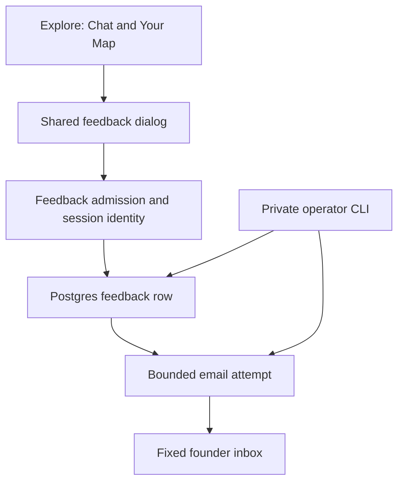
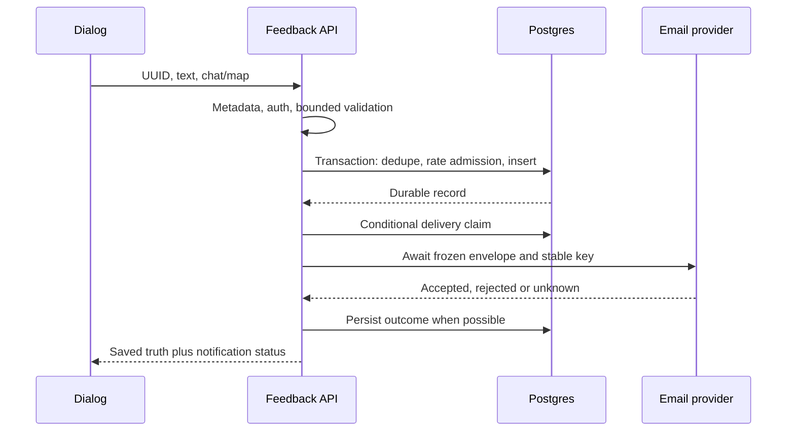
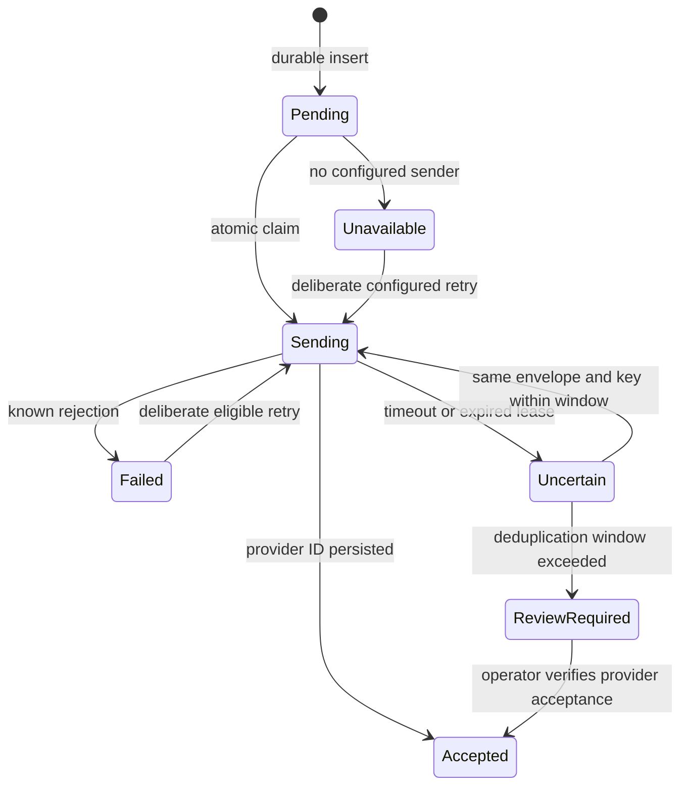

# Signed-in User Feedback - Plan

## Goal Capsule

- **Objective:** Signed-in explorers can report a problem or suggest an improvement, and the founder can read it and reply to them.
- **Means:** A shared feedback dialog, durable database record and bounded email notification (KTD1–KTD5).
- **Authority:** Approved founder brief carried by the coordinator on 2026-11-02; current code/tests; AGENTS.md; active revamp plan `docs/plans/2026-08-14-claude-feat-revelio-revamp-plan.md`; Method authority `docs/thesis.md`; verification runbooks.
- **Execution profile:** One serial feature branch in the current suitable checkout, canonical unit commits, no PR. Implementation returns locally verified changes to the coordinator, who owns final simplification, review and integration.
- **Stop conditions:** Conflicting/unrelated edits, a needed new production package, unavailable required review, or a change to the approved product behavior. Provider provisioning, sender/domain decisions, new Google scopes, remote settings, production migrations, deployment and real email need separate owner authorization.
- **Completion boundary:** Local code can be completed with delivery unconfigured and mocked faults; actual founder notification remains pending until sender configuration and a separately authorized real test succeed.

---
## Product Contract

### Summary

Add a clearly labelled Send feedback control available from Chat and Your Map. A small dialog accepts one freeform text response, saves it to the app database and attempts to notify the founder. The founder receives the submitter's reply contact and minimal context.

### Problem Frame

Early explorers need a direct way to tell the founder where Nami failed or could improve while their experience is fresh. A durable record keeps that feedback available even when email is unavailable.

### Requirements

**Interaction**

- R1. Signed-in Chat and Your Map expose a prominent, clearly labelled Send feedback button that fits desktop and 320/359/390px layouts in light/dark themes without crowding existing header controls.
- R2. One small modal has a labelled freeform text area prompting what happened or what could improve, Send, Close and clear saved confirmation; opening, closing or sending preserves chat draft, current view and saved Method state.
- R3. Preserve feedback text while closing/reopening in the same mounted workspace and after failures; clear only a confirmed saved submission. Explain that the text and signed-in email go to the founder; never capture conversations automatically.

**Submission and delivery**

- R4. Only authenticated users may submit; the server establishes user ID and reply email from the Nami session, alongside Chat/Map context, server time and known build version or honest unknown.
- R5. Save text durably in the existing application database before notification. Double clicks, concurrent requests and retries after an uncertain network outcome must not create duplicate records or duplicate email attempts for the same submission.
- R6. Notify the fixed destination `andresmongeliano@gmail.com` with submitted text, reply contact and R4 context; use an approved sender and safe Reply-To so the founder can reply directly.
- R7. Confirm saved feedback only after a durable write. Distinguish notification accepted, unavailable and uncertain without claiming inbox delivery from provider acceptance; notification failure cannot discard saved feedback.
- R8. Provide a minimal operator review/retry path for saved feedback without an in-app admin dashboard, preserving uncertain outcomes for deliberate reconciliation.

**Trust boundaries**

- R9. Apply exact-origin/custom-header, auth, strict bounded body and per-user rate admission before durable insert or email. Prevent forged identity, arbitrary recipients/senders/URLs, email-header injection, transcript/log disclosure and cross-user lookup.
- R10. This is text-only feedback, outside the Method agent: no AI processing, automatic code changes, surveys, attachments, screenshots or transcript collection; existing auth, Method and retired legacy boundaries remain unchanged.

### Key Decisions

- **Text with email notification and database copy:** Governed by R3, R5–R8. Founder approved this direction over a form/survey or AI workflow in the coordinator brief; the distilled brief does not supply a full examined-alternative provenance entry, so no stronger session-settled label is inferred.
- **Fixed founder destination:** Governs R6 and R9. Already explicitly approved; it is not an open planning question.

### Acceptance Examples

- AE1. Covers R1–R3: With a chat draft and Map selected, open feedback, type, close, reopen and submit; the feedback survives until saved, Map stays selected and the chat draft and canonical revision remain unchanged.
- AE2. Covers R5–R7: The database commits but the provider times out; the user sees feedback saved without a false notified claim, and a retry with the same submission ID finds the same record.
- AE3. Covers R4, R6, R9: A fictional attacker adds recipient/user/email fields or supplies CRLF in a forged Reply-To; admission rejects it and no email is addressed using those fields.
- AE4. Covers R5, R8: Two simultaneous submissions with the same key produce one row and at most one concurrent delivery claim; an operator can inspect its safe status and reconcile uncertainty before any later resend.

### Scope Boundaries

No shared email platform, queue service, worker fleet, cron, delivery webhook, in-app dashboard, attachments, feedback analytics or Method tool is built. Provider acceptance is sufficient to record notification acceptance; inbox delivery requires the real verification step. Automated retries beyond the provider's deduplication window are deliberately excluded because they risk duplicate email; operator review handles that rare case.

### Open Questions

**Delivery activation only:** The founder must choose/approve a sender setup before real sending. Recommended: Resend with a verified domain/subdomain they control and a sending-only credential; Gmail is an alternative requiring separately consented outbound credentials. No evidence yet establishes an authorized email runtime, owned verified sending domain or provider account. This blocks production email activation, not implementation or mocked local proof.

---
## Planning Contract

### Grounding

At planning preflight the current checkout was clean `main` at `4e42971b42dfda5cce82eab7dbc8262bb696e176`. No CE config exists, so the artifact root is `docs`. Node24, Express4, React/Vite, Better Auth, Drizzle/Postgres/Neon and Vercel are the existing stack. No email delivery package/plumbing was found in the application manifest or server code. `server/auth.ts` uses only openid/email/profile, not Gmail sending permission.

`client/src/pages/explore.tsx` owns both Chat and Your Map panels and the composer. Both stay mounted while selection changes. Its top header already contains vision, theme, email and signout controls. `server/app.ts` owns parser ordering; `server/routes.ts` mounts protected Method APIs. `server/auth-middleware.ts` establishes immutable session identity. `server/routes/agent.ts` demonstrates exact Origin plus `x-nami-request: 1` and injected auth/storage seams. Reuse patterns without coupling feedback to AGENT_ENABLED or importing the entire agent router for validation.

### Key Technical Decisions

- KTD1. **Shared workspace dialog:** Add a labelled control in the workspace navigation area below the existing header, using a separate full-width row on narrow mobile screens. Keep state in a dedicated component mounted once within Explore, outside Chat/Map panel conditionals. Reuse `client/src/components/ui/dialog.tsx` for focus trapping, Escape and trigger-focus restoration. This satisfies R1–R3 without remounting the composer.
- KTD2. **Dedicated feedback boundary:** Mount `/api/feedback` before the global parsers in `server/app.ts`, using the same Express route matching for its metadata checks and handlers. Apply no-store, method/origin/custom-header/media/encoding checks, requireAuth, then a route-local 16KiB JSON parser and strict shared schema. Accept only a UUID submission ID, trimmed text of 1–4000 characters and page enum chat/map; reject unknown keys. Server supplies all R4 fields. Require a simple validated bare email without CR/LF for Reply-To, never a display name. Rejected input never reaches storage or provider; 405/403/401/415/413/400 responses are generic and logs contain only safe request/status categories. This route is independent of Method enablement (R9–R10).
- KTD3. **One durable table and transactional admission:** Add `user_feedback` in `shared/schema.ts` and reviewed migration `migrations/0002_user_feedback.sql` with matching journal/snapshot metadata. Store UUID, user ID, session-derived reply email snapshot, immutable text/page/time/build, notification state and bounded attempt/claim metadata. A unique `(user_id, submission_id)` plus stored immutable-payload comparison returns the existing row for a matching retry and 409 for changed text/page. Serialize admission per user with a transaction advisory lock, allowing at most 5 new submissions per rolling hour; matching duplicates are resolved before rate counting so retries remain usable. No in-memory-only limiter. Preserve historical migrations and test both fresh setup and actual 0001 predecessor upgrade. This is the smallest durable solution to R5/R9, not a generic outbox platform.
- KTD4. **Commit first, await delivery:** Commit a saved pending record, then atomically claim it and await one email request with a 5s timeout before responding. Never hold a DB transaction over network IO and never fire-and-forget after a Vercel response. A short persisted lease prevents concurrent delivery attempts and allows crash recovery. A duplicate caller with an active claim receives saved/pending truth. Provider acceptance with an ID becomes accepted; known rejection becomes failed; missing configuration becomes unavailable; timeout, crash or failed acceptance-status write remains uncertain. The UI's primary success copy is “Feedback saved. Thank you.” A short secondary status can state notification unavailable/uncertain; do not show “Sent” as a substitute for durability (R5–R8).
- KTD5. **Resend-specific small adapter, disabled without configuration:** Recommend a direct Node24 fetch to fixed `https://api.resend.com/emails` with server-only optional `RESEND_API_KEY` and `FEEDBACK_FROM_EMAIL`. No new runtime dependency or configurable transport/recipient URL. Send plain text, fixed subject structure, exact R6 recipient and validated Reply-To; user text is body data, never headers/HTML. Use a stable provider idempotency key derived from feedback UUID. Persist immutable envelope inputs before the first attempt, including sender, so retries cannot change payload after a config change. Freeze them once claimed. Resend's 24h deduplication window requires uncertain retries to stay within a conservative 23h window from first attempt; beyond that, refuse automatic resend and require operator reconciliation. Accepted records are never resent. These decisions serve R6–R9.
- KTD6. **Minimal operator CLI:** Add `scripts/feedback.ts` with explicit target and commands to list safe status metadata, inspect one record privately, retry one eligible ID, and mark a reconciled accepted provider ID. Default is read-only; sending needs an explicit command and approved runtime credential setup. Do not print bodies/emails in bulk, expose an admin HTTP endpoint or accept recipient/sender overrides. Private record output must stay in an ignored `.context/revelio/feedback/` path with restrictive permissions. Tests use disposable DB and an injected fake transport (R8–R9).
- KTD7. **Uncertain browser retry:** Keep a submission UUID and frozen payload while a send is outstanding or its outcome is unknown; disable double submit and edits until resolution. A retry resubmits that same payload/key, including after closing/reopening the dialog. Keep pending/failed text in memory only, not URL/localStorage or chat history. A confirmed save clears text/key for the next distinct report. Reload persistence of an unsaved feedback draft is not promised; existing chat draft behavior is preserved (R2–R5).

### High-Level Technical Design

Component/data flow:

Request sequence:

Notification lifecycle:

Persisted claim expiry and guarded transitions are the crash-recovery mechanism; “ReviewRequired” may be computed from timestamps rather than another stored enum. Provider acceptance is not delivery evidence.

### Alternatives and Dependencies

Resend supplies simple HTTP sending, plain text, Reply-To and 24h idempotency. It requires an owned verified sending domain; the public resend.dev testing sender only reaches the provider account email and is not a production sender plan. Gmail's API uses MIME/base64url messages and requires a separate gmail.send authorization/refresh-token lifecycle; existing Nami login and assistant GWS access cannot authorize it. Gmail's broader credential/consent work and weaker built-in retry dedupe make it the less suitable default here. Other transactional providers offer no demonstrated repository advantage, so a broad provider bake-off would not resolve the actual owner decision: which sender/account may be provisioned.

Vercel waitUntil extends invocation lifetime but does not replace durable state. Awaiting this small bounded attempt keeps the behavior identical locally and on Vercel and avoids a new background integration.

Primary sources consulted 2026-11-02:

- [Resend send API](https://resend.com/docs/api-reference/emails/send-email)
- [Resend idempotency](https://resend.com/docs/dashboard/emails/idempotency-keys)
- [Resend verified domains](https://resend.com/docs/dashboard/domains/introduction)
- [Resend testing sender restriction](https://resend.com/docs/knowledge-base/403-error-resend-dev-domain)
- [Gmail sending](https://developers.google.com/workspace/gmail/api/guides/sending) and [scopes](https://developers.google.com/workspace/gmail/api/auth/scopes)
- [Vercel waitUntil](https://vercel.com/docs/functions/functions-api-reference/vercel-functions-package#waituntil)

### Assumptions and System-Wide Impact

The API returns only a submission ID, saved state and coarse notification status, never another user's record, email body, credentials or raw provider errors. Feedback is not a Method record and must stay out of prompts, conversations, career-map revision/history and Method reset. Document it as a separate data store for future whole-account deletion requests; no new whole-account erasure project is included, per the revamp amendment. The existing operational logger already omits request bodies; keep this true for parser failures and transport exceptions.

Email API configuration remains optional so an unavailable provider cannot break startup or feedback durability. The scrubbed full-suite environment already allowlists inherited variables; explicitly cover the new credential names in launcher tests and `.env.example` documentation. Build version uses the current sanitization convention in `server/routes/agent-logging.ts`, with unknown rather than an invented Git identity.

---
## Implementation Units

### U1. Durable feedback record and safe admission

**Goal:** Establish the database/API contract for saved feedback independent of delivery.

**Requirements:** R4–R5, R7, R9–R10; AE2–AE4. **Dependencies:** None.

**Files:** `shared/feedback.ts` (new), `shared/schema.ts`, `migrations/0002_user_feedback.sql` and matching `migrations/meta/` artifacts, `server/feedback/storage.ts` (new), `server/routes/feedback.ts` (new), `server/app.ts`, `server/storage.feedback.test.ts` (new), `server/routes/feedback.test.ts` (new), `server/app.feedback-privacy.test.ts` (new), `server/storage.migration.test.ts`.

**Approach:** Implement KTD2–KTD3 with injected clock/auth/storage seams and a saved/unavailable result before U2. Follow current route guards, reviewed migration ledger and disposable DB harness. Start with meaningful failing admission and concurrent-storage tests.

**Test scenarios:**

1. Missing/invalid Origin or custom header, unsupported method/media/encoding, signed-out identity, oversized/malformed JSON and unknown/forged fields never insert or invoke delivery.
2. Fictional users cannot overwrite/retrieve one another's reports; authenticated session email replaces any attempted client identity source.
3. Concurrent same-key/same-body calls create one row; changed body conflicts; a retry after a committed write with lost response finds that row.
4. Five new reports within an hour are admitted, the sixth is rejected across separate storage instances, and matching retries still return saved truth.
5. Fresh migration and 0001 upgrade preserve old data and exact ledger; insert failure never claims saved success.
6. Parser/storage errors emit only safe metadata, with no request body, email, URL query or secrets.

**Verification:** Focused route/app suites plus real disposable PostgreSQL prove the invariants. Mock routes alone cannot establish transaction/rate correctness.

### U2. Bounded email notification and private recovery

**Goal:** Notify the fixed founder address when configured and retain honest recoverable states when not.

**Requirements:** R5–R9; AE2, AE4. **Dependencies:** U1.

**Files:** `server/feedback/delivery.ts` (new), `server/feedback/delivery.test.ts` (new), `server/feedback/storage.ts`, `server/routes/feedback.ts`, `server/routes/feedback.test.ts`, `server/storage.feedback.test.ts`, `scripts/feedback.ts` (new), `server/feedback/cli.test.ts` (new), `server/env.ts`, `.env.example`, `scripts/test-all.mjs` and its existing tests as applicable, `package.json` (CLI script only).

**Approach:** Implement KTD4–KTD6 with a fake fetch seam; preserve durability when any post-save step fails. Add no provider SDK. The CLI shares claim/envelope logic rather than a second send path.

**Test scenarios:**

1. Fake provider acceptance persists its ID and no later duplicate submission or retry sends again.
2. Missing configuration, 4xx/429/5xx, timeout, disconnect after provider acceptance and status-write failure all retain the row and yield the correct coarse status.
3. Two processes cannot claim delivery concurrently; expired claims recover using the same frozen envelope/key within 23h and block unsafe resend after the window.
4. Fixed URL/recipient/sender, body-only user text, safe Reply-To and immutable envelope survive malicious text and configuration changes during retries.
5. CLI list is redacted, private inspection enforces destination rules, read-only commands never send, explicit fake retry targets only one eligible row and raw provider errors/secrets never enter output.
6. New credentials never leak into the scrubbed full suite; unconfigured email does not prevent app initialization or durable saves.

**Verification:** Adapter, route and real disposable-DB concurrency/fault tests prove local behavior. No external email is sent and no inbox-delivery claim is made.

### U3. Feedback dialog across both workspace views

**Goal:** Make reporting accessible without disturbing an explorer's work.

**Requirements:** R1–R3, R5, R7, R10; AE1–AE2. **Dependencies:** U1, U2.

**Files:** `client/src/components/explore/feedback-dialog.tsx` (new), `client/src/components/explore/feedback-dialog.test.tsx` (new), `client/src/pages/explore.tsx`, `client/src/pages/explore.test.tsx`, `client/src/index.css` only if needed for current theme conventions.

**Approach:** Implement KTD1/KTD7 using the existing dialog and request patterns; no page navigation or workspace reinitialization. Keep feedback submission separate from chat streaming/Stop/composer state.

**Test scenarios:**

1. Covers AE1: Chat and Map expose the control; open/close/send leaves selected tab, chat text, attachments and canonical map revision unchanged.
2. Blank/too-long text is rejected accessibly; valid submission disables repeat sends and shows saved confirmation only after saved response.
3. Network uncertainty preserves frozen payload/key; closing/reopening and retry use the same submission; confirmed save permits a new distinct report.
4. DB failure/401/rate limit retain text with useful error; saved with unavailable/uncertain email never becomes false failed-save or false delivered copy.
5. Dialog has visible label/description, keyboard focus containment, Escape/Close and focus return; errors/status are announced.

**Verification:** Component/integration assertions catch state preservation; local rendered checks cover narrow layouts, keyboard and light/dark contrast.

### U4. Verification receipt and delivery activation runbook

**Goal:** Leave reviewable local evidence and an exact path to separately authorized real delivery.

**Requirements:** R1–R10. **Dependencies:** U1–U3.

**Files:** `docs/runbooks/nami-feedback.md` (new), `docs/runbooks/nami-verification.md`, `docs/runbooks/nami-verification-scenarios.md`, `docs/evidence/2026-11-02-feedback-local-verification.md` (new).

**Approach:** Document sender/credential setup, migration review/order, private review and retry, status meanings and the separate feedback data lifecycle. Record current evidence with no personal text or credentials. No prose-mirroring tests.

**Test scenarios:**

1. Local rendered fictional authenticated fixture on approved localhost5173 proves Chat/Map, 320/359/390px and desktop, light/dark, keyboard/focus and draft/state preservation with fake transport; fixture identity is explicitly labelled.
2. Full guarded suite, typecheck and exact-origin build pass against disposable DB; existing auth, Method, erasure and retired-route regression families remain green.
3. A cold reader can identify the pending production gates and execute the documented single synthetic real-email scenario only after approval, with designated QA identity and preserved checkpoint.

**Verification:** The receipt states what ran, first failures/fixes, owned process/DB cleanup, and all remaining deployed/delivery limitations.

---
## Verification Contract

Follow `docs/runbooks/nami-verification.md` and `nami-verification-scenarios.md`. Use Node24 and the guarded `U4_STORAGE_TEST_DATABASE=1` / `U4_STORAGE_TEST_DATABASE_URL` launcher with an owned disposable `ikigai_u4_test_admin_*` PostgreSQL database. Start with focused new suites, then run `npm run check`, the full `npm run test:all -- --run`, and `BETTER_AUTH_URL=<approved-exact-origin> npm run build`. Do not run legacy paid E2E, live Method evals or real email for this feature's local proof.

Confirm allowed loopback origin and listener PID/cwd before UI QA; one browser owner drives serially. Reuse no founder cookies/profile/transcripts. Local fixture rendering proves layout and interactions, not deployed Google auth or production storage. Record a precise blocker if safe local browser identity cannot be established; do not silently claim rendered proof from component tests.

Production completion remains separate: reviewed migration on the approved target, sender/domain/provider authorization and configuration, exact checked prebuilt candidate linkage, real app QA identity, then a separately authorized single synthetic feedback email to the exact R6 inbox. Verify the durable record, safe provider acceptance ID and actual inbox receipt/Reply-To, preserving existing QA chat/map state. Deployment settings, signups and Method switches remain under the coordinator's release process.

## Definition of Done

- U1–U4 have canonical unit commits and local evidence meeting their verification outcomes; no abandoned experiment code remains.
- R1–R10 and AE1–AE4 are traced to tests/rendered checks with honest Pass/Fail/Blocked/Partial/Not run labels.
- No production writes, real email, provisioning, new scopes, DNS or remote settings occur during local implementation.
- The coordinator receives implementation summary, commit IDs, checks, first-failure disposition, review limitations and unresolved sender activation decision.
- The product outcome is not described as live/delivering until the separate production completion checks above pass.
