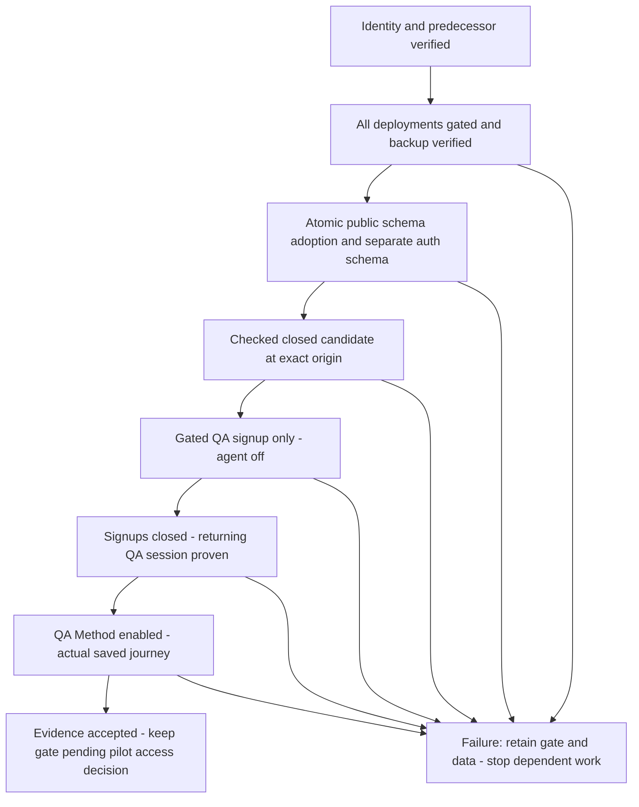

# Nami production rollout - Plan

## Goal Capsule

- **Objective:** The designated QA user can sign in and complete a saved, recoverable Nami learning journey on `https://heynami.vercel.app`, with existing production records preserved.
- **Means:** Prepare the existing production backend and deploy the checked prebuilt candidate in gated stages (KTD1–KTD5).
- **Authority:** The founder's rollout request, active revamp plan and `docs/thesis.md`; behavior remains defined by current code/tests. Product Contract unchanged by this operational plan.
- **Execution profile:** Four ordered operational units, local documentation commits only; no PR, push, main merge or new infrastructure. Coordinator reviews this recipe before any production change. The current request authorizes planning and read-only inspection only.
- **Stop:** Wrong/unknown backend, schema drift, missing recovery snapshot, failed access gate, unknown QA identity, unresolved canonical truth or unexpected spending prevents the dependent action. Preserve the first failure and report it.

---

## Product Contract

### Summary and Problem Frame

Release Nami through the existing Vercel project and Neon production branch. The current alias serves an older deployment; production has the legacy schema without a migration ledger, Method tables or configured auth. A successful package build alone cannot establish a working release.

### Requirements

**Production data and access**

- R1. Preserve legacy production records and sequences; identify actual Neon project/branch bindings before migration. Never copy development data or repoint production to QA.
- R2. Apply only the reviewed missing schema and truthful migration bookkeeping, with a private recovery snapshot and checks of legacy continuity.
- R3. Use the existing production infrastructure and selected Google client; preserve minimal identity scopes, ownership boundaries and secret privacy.
- R4. Create only the designated fresh QA account through real Google OAuth behind a verified platform access gate, then close signups before Method verification.

**Release and proof**

- R5. Bind each deployment to checked prebuilt bytes, source, runtime configuration, immutable deployment ID and exact public origin.
- R6. Prove actual deployed Google/returning session, meaningful saved state, legitimate repeating continuation and Stop recovery with canonical receipts plus Chat/Map reload.
- R7. Permit deliberate progressing paid verification; stop runaway/nonprogress, blind retries and significant accidental spending. No new call quota or budget-approval system.
- R8. Stop access and new provider requests safely on failure across aliases and immutable URLs while retaining data and committed saves.

### Scope Boundaries

No new Neon project, auth service, QA allowlist product feature, deployment framework, recurring backup system or automatic spending controller. Existing scoped access controls and a one-time recovery snapshot suffice; a demonstrated gap returns for review rather than silently adding infrastructure. No outreach or notices now; notice preparation waits for outreach. Extra whole-account erasure preparation waits for a deletion request. Manual screenreader release gate remains removed, not passed. Existing security, deletion, cancellation and semantic UI checks remain active. Founder history, the historical `revelio-qa` browser profile, and development records are excluded from QA.

---

## Planning Contract

### Verified target and source

| Binding | Verified value |
|---|---|
| Vercel project / team | `ikigai` / `prj_sVqqIBKF1Q2lViOpvlUlFGmkvMT6` / `team_p9wpR2jCRajYNipAD0qho4ex` |
| Domain | `heynami.vercel.app`, verified, no redirect or branch assignment |
| Neon organization / project | `org-super-mountain-37663332` / `wandering-mouse-00188148` (`ikigai`) |
| Production branch / endpoint | `br-sparkling-dust-adiobqet` (`production`, primary/default) / `ep-spring-sun-adfk3oqc`, read-write |
| Development branch / endpoint | `br-fragrant-lab-ad5zsa61` (`development`, child of production) / `ep-mute-salad-adbctg32`, read-write |
| Database / role | `neondb` / `neondb_owner` on both branches; project/branch bindings, not names, prove separation |
| Production server / history | PostgreSQL 17.11; project history retention 21,600 seconds (6 hours), observed at inspection, recheck before changes |
| Candidate source | `17d57de77d3b618087fed46b77c297f316580799`; later documentation-only commits do not change candidate bytes |
| Production artifact SHA-256 | `c212c7304d59ed69099af239e50d2e12ea6a6461c6386eaf8ee2f70a8b218bc5`, 2,706 files |

Neon login was completed by the founder. Authenticated read-only project/endpoint/branch responses matched the known production and development connection hosts separately. The direct production host came from that exact endpoint's management metadata; the existing production credential successfully connected to it. No credential values appear here. Private evidence is `.context/revelio/rollout-planning-20261031/`; artifact details are in [the preflight receipt](../evidence/2026-10-31-nami-release-preflight.md).

Read-only catalog inspection found no migration ledger columns in visible schemas. Production's 20 legacy columns, five constraints, four indexes, `language_enum` values `en/es`, ordinary persistent table properties and absence of user triggers/rules match the checked baseline. The unchanged analytics audit extracted from `0001` passed inside `BEGIN READ ONLY`; no DDL or user rows were executed/read. All seven Method and five auth tables are absent. Recheck absence of all conflicting enum/table/schema objects before the write transaction. Metadata receipts: `production-migration-metadata.json`, `production-predecessor-audit.json`.

### Key Technical Decisions

- KTD1. **Retain the verified existing production branch.** App uses its existing pooled connection; auth uses the confirmed direct endpoint to the same branch/database with dedicated `auth` search path (`server/auth-database.ts`, `drizzle.config.ts`). Separate schemas do not require another database. Do not infer branch identity by removing `-pooler` or fetch a development password as a shortcut. Governs R1–R3.
- KTD2. **Adopt the verified ledgerless baseline, then apply the complete additive Method migration atomically.** `0000` would collide with existing tables. `0001` does not alter/delete legacy rows and contains the strict analytics predecessor audit. Drizzle normally trusts latest timestamps without validating old hashes, so register only verified state and compare every hash/timestamp before later migrator use. Governs R1–R2.
- KTD3. **Gate all deployments before opening QA signup.** Use existing Vercel Authentication with All Deployments scope, verify denied anonymous access and legitimate browser access on the exact origin, and keep every bootstrap/enabled immutable URL protected. Current [Vercel protection documentation](https://vercel.com/docs/deployment-protection) lists this scope on all plans; actual project permission/effectiveness is still an execution prerequisite. Standard scope leaves production public. No paid upgrade or bypass exception is authorized. Governs R3–R4, R8.
- KTD4. **Use real, gated Google signup rather than database seeding.** `server/auth.ts` disables linking and new signup when closed; a precreated email-only user cannot log in. A short signup-on/agent-off deployment behind KTD3 permits the fresh QA identity, then a signup-off deployment precedes Method enable. No development auth rows are copied. Governs R4.
- KTD5. **Reuse the production-target prebuilt output for each configuration stage.** Stage with `--prod --prebuilt --skip-domain`, inspect immutable startup, then promote the exact ID to the gated public origin. CLI65.2 help confirms these flags and `promote`; generated-URL startup is not exact-origin OAuth proof. Environment changes require new deployments; older URLs retain prior flags. Governs R5, R8.
- KTD6. **Prefer access containment and forward repair over data rollback.** A private PostgreSQL17-compatible custom-format dump plus archive-list/hash verification is proportionate; record Neon restore availability/timestamp without relying solely on its six-hour window. Flags stop Method/signup but not anonymous legacy provider routes or already-running functions. Platform gate/explicit retirement of temporary enabled deployments supplies the perimeter. No automatic DB restore or secret rotation. Governs R2, R8.

### Rollout states

### Configuration and credential provenance

All changes below target **production only** on the linked Vercel project. Keep private snapshots of old values/references and new setting names/source references; committed receipts contain no secrets. Do not overwrite development settings.

| Setting | Exact intended change / source |
|---|---|
| `DATABASE_URL` | Retain current production pooled connection, mapped to the branch above. |
| `BETTER_AUTH_DATABASE_URL` | Add confirmed direct connection to the same production endpoint/database using the existing authorized production role credential; inject privately. |
| `BETTER_AUTH_SECRET` | Generate a cryptographically random production secret (at least 32 characters), save through the approved secret manager/runtime channel and retain it across all stages/recovery. No generated value in commands, logs or evidence. |
| `BETTER_AUTH_URL` | Change `https://revelio-me.vercel.app` to `https://heynami.vercel.app`. |
| `GOOGLE_CLIENT_ID`, `GOOGLE_CLIENT_SECRET` | Retain existing Vercel Secret references if valid. Identify selected existing Google Cloud Web client/project privately and inspect its registration; do not substitute local QA credentials. |
| `OPENAI_API_KEY` | Retain existing Vercel Secret reference; actual scoped deployed Method requests establish model access later. Masked pull is not validation. |
| `AUTH_SIGNUPS_ENABLED` | Explicit false initially; literal true only in gated bootstrap stage; false again before Method enable. |
| `AGENT_ENABLED` | Explicit false through schema/auth/bootstrap; true only in gated Method QA stage; false recovery candidate retained. |
| Gemini/Groq/YouTube settings | Retain existing production values; do not call legacy providers solely to validate unchanged keys. `/legacy` render is selected proof. |

Google registration must include exact authorized origin `https://heynami.vercel.app` and redirect `https://heynami.vercel.app/api/auth/callback/google`. Preserve existing valid registrations, including development callbacks; add no new OAuth scopes beyond `openid email profile`. Fresh isolated console inspection reached Google sign-in, so no Google client registration was inspected. The precise handoff is owner Google Cloud login/2FA to the selected client's project, not a new grant. If an existing secret must be recovered, request only its owner-supplied exact 1Password item/field reference and unlock if encountered; no broad vault enumeration. Prefer process-scoped `op run` or human secret entry into a supported nonlogging consumer. Do not rotate the Google secret unless recovery is impossible and separately authorized.

### Blocking prerequisites and assumptions

- B1. Google Cloud selected production client/project and origin/callback registration remain unverified behind console sign-in. Owner login/2FA plus selected-client identification closes this; masked Vercel Secret values cannot.
- B2. All Deployments protection is currently unconfigured. Subsequent approval must authorize enabling it and establishing the legitimate QA browser access method; verify the permitted access set is acceptable during signup. If restricted access cannot be established, stop bootstrap rather than opening signup publicly.
- B3. No PostgreSQL17+ dump client is installed in the inspected Homebrew paths (14 and15 only). Obtain a compatible client tool without starting another DB service, then take/list/hash the private backup before schema writes. No backup was taken during planning.
- Assumption: the founder accepts a gated QA release first; opening pilot access/signups and sending invitations remain outside this approval. If the platform gate must be lifted for pilot use, review every old enabled immutable URL first.

---

## Implementation Units

### U1. Preserve and prepare the existing production database

**Goal / requirements:** R1–R3; KTD1, KTD2, KTD6. **Dependencies:** coordinator approval and effective KTD3 perimeter before production writes. **Files:** `migrations/0000_absurd_fat_cobra.sql`, `migrations/0001_typical_boom_boom.sql`, `migrations/meta/_journal.json`, `migrations/auth/0000_better_auth_1_6_29.sql`, existing `server/storage.migration.test.ts`; private execution receipt and snapshot.

**Approach:**

1. Reconfirm project/branch/endpoint/database/role from Neon management metadata and exact direct connection. Re-read ledger/schema/conflicting objects, permissions and server major. Any drift from the verified ledgerless predecessor stops this recipe for reconciliation; do not coerce it into the expected shape.
2. Record current Neon history/restore eligibility and a UTC recovery point. With a compatible PostgreSQL client, take a consistent custom-format dump of the production database over the direct connection into owner-private storage; record hash, size and `pg_restore --list` success without exposing payloads. Obtain baseline legacy row counts, privacy-preserving aggregate content fingerprints and sequence positions privately while writers are gated/drained. A dump failure blocks migration.
3. Rehearse the **ledgerless adoption** on an owned disposable local PostgreSQL fixture built from reviewed legacy schema plus fictional rows (no production/dev payload copy). Existing migration tests cover a registered baseline, not this adoption branch; verify all three legacy families/sequence positions survive and an analytics-audit error rolls back ledger and Method DDL together. This is future execution proof, not a planning-time test pass.
4. Run the exact transaction sequence below against only the verified production target. Use stop-on-error and a bounded lock/statement timeout; a lock timeout aborts and is diagnosed, not blindly retried. No external provider or live app write runs during schema preparation.
5. Apply the separate checked-in auth SQL through the verified direct connection only when its `auth` schema is empty/absent and no conflicting objects exist. It owns its BEGIN/COMMIT. If it fails, public additions can remain safely gated; inspect and repair forward rather than deleting legacy tables or rerunning blindly.
6. Read back ledger, exact Method/auth constraints/indexes/enums and legacy continuity. No data rollback or reset is part of this unit.

**Exact SQL application order for the inspected predecessor (future execution only):** one transaction takes bounded write/schema-conflicting locks on the three legacy tables, rechecks the baseline/analytics catalog under those locks, creates standard `drizzle` schema and `__drizzle_migrations` table (`id SERIAL PRIMARY KEY`, `hash text NOT NULL`, `created_at bigint`), inserts the **baseline hash/timestamp below without executing 0000**, executes the **entire unchanged 0001 file including analytics audit**, inserts its hash/timestamp and commits. Then execute the complete auth SQL file separately. No general `db:migrate:prod` before baseline adoption; no `db:push`, baseline replay, dropped ledger rows or higher timestamps to skip SQL. Do not edit the checked-in migration files for this target.

| SQL identity | SHA-256 | Ledger `created_at` |
|---|---|---|
| Adopt existing `0000_absurd_fat_cobra` | `939a8a6da437ee5da6500a4fb909d66106a94b8392acb59da5c64fdd1bec3bed` | `1755793383946` |
| Apply `0001_typical_boom_boom` | `1441b2896c1fc76c7622902ce71559da503ea9756e76dbf6df9af7e8c36fc95a` | `1788216590551` |
| Separate auth SQL `0000_better_auth_1_6_29` | `c9b2edd3ae805582ed8ed86d7499d9f5115d1af32cf9072a49588d5e4223dc1c` | Not a Drizzle migration |

**Verification:** rehearsal demonstrates atomic failure and legacy continuity; production receipt shows the two exact ledger records, seven Method/five auth tables and preserved legacy content/counts/sequences. Do not print legacy payloads. Keep recovery snapshot outside deployment output.

### U2. Establish gated auth configuration and the closed release

**Goal / requirements:** R3–R5, R8; KTD3, KTD5. **Dependencies:** approval; B1/B2 resolved; U1 complete before auth-enabled promotion. **Files:** `.vercel/output` and retained production manifest (ignored), `server/auth.ts`, `server/auth-database.ts`, `server/env.ts`, `scripts/check-vercel-function.mjs`, `docs/runbooks/vercel-function-packaging.md`, private deployment/config receipts.

**Approach:**

1. Enable Vercel Authentication **All Deployments** through the existing project controls and verify anonymous denial at both public alias and representative immutable URLs, including the current old production URL. Establish the owner's sanctioned browser access at the exact public origin. Inspect authorized access and automation exceptions privately; do not broaden bypasses. No schema writes or signup-on deployment before this perimeter works.
2. Prepare the tabled production settings with both flags false. Verify direct auth configuration and Google registration; retain secret provenance references. Existing encrypted Vercel Google/OpenAI references can stay in place without reading their raw values.
3. Verify the retained 2,706-file production manifest/source linkage, whole-output privacy/origin audit, Node24 function and five skills immediately before upload. Use the existing packaging guide's fixture-only process environment for the local audit; no fixture overrides in deployed runtime. Changed runtime code or client origin requires a newly built, audited and reidentified artifact, not relabeling the old hash.
4. Stage the production prebuilt output with automatic domain promotion disabled. Inspect immutable deployment/project/runtime/logs and rendered static entry without invoking a provider. Promote that exact closed deployment ID to gated `heynami.vercel.app`; record alias and effective config. No OAuth proof on the generated hostname.
5. On the exact origin verify signed-out public pages and `/legacy` render, share asset/tags, relevant mobile/light/dark/keyboard/status layout. Verify absent app session cannot access private Method routes and both flags are effective. A provider/DB/OAuth failure stays a failure; fixture503 cannot pass auth.

**Test expectation:** no new product unit tests for configuration-only operations; existing auth/origin/privacy/packaging suites remain the deterministic evidence. **Verification:** actual remote closed-stage linkage and perimeter outcomes, not merely READY platform status. Retain this verified closed candidate as recovery artifact/configuration.

### U3. Bootstrap fresh QA through real Google and close signups

**Goal / requirements:** R3–R5; KTD3–KTD5. **Dependencies:** U1/U2; verified owner/QA browser access and acceptable platform access set. **Files:** `server/auth.ts`, existing `server/auth.test.ts`, `server/reporting/source.ts`; private auth/deployment receipts.

**Approach:**

1. In a clean dedicated QA browser or the separately connected approved Chrome QA profile, verify the chosen Google identity is `konfidenz.clothing@gmail.com`; never the historical `revelio-qa` profile or founder account. Do not preinsert auth rows or reuse local cookies/dev records.
2. Keep the platform gate on and agent off. Deploy/promote the same checked prebuilt artifact with signups true solely for first real Google creation. Complete exact-origin OAuth, confirm visible QA email and Google-linked account, and record only sanitized identity/status evidence. A Google challenge, biometric or 2FA step is a precise human handoff; no new scopes or consent grants.
3. Immediately deploy/promote the same checked artifact with both flags false. Verify QA logout/login and returning session/reload still work while fresh signup is disabled. Privately audit newly created auth identities within the controlled window; any unexpected identity stops Method enable and is reported without automatic deletion.
4. Preserve evidence and retain the signup-on immutable deployment behind the All Deployments gate. Do not weaken protection later until every signup-on/agent-on immutable URL has been reviewed/quarantined or its exact temporary deployment separately retired. No broad project removal.

**Verification:** fresh real callback, exact visible identity, provider linkage and closed-stage returning session are proven on `heynami`; platform protection is separately proven and cannot substitute for app auth. Failure leaves the gate on, closes signup through a new deployment where possible, and blocks U4.

### U4. Prove the actual deployed Method journey and contain failures

**Goal / requirements:** R5–R8; KTD5–KTD6. **Dependencies:** U3. **Files:** `docs/runbooks/nami-verification-scenarios.md`, `server/reporting/source.ts`, existing Method/storage/route/client suites referenced there; private QA artifacts and sanitized release receipt.

**Approach:**

1. Deploy/promote the same checked artifact with signups false and agent true, retaining the platform gate. Match immutable ID/config/alias, exact QA identity and fresh canonical checkpoint before each scoped write. Use current model `gpt-6.1-sol` and shipped skill versions; no prompt/model experiment or founder-session replay.
2. A fresh production QA account legitimately starts Foundation. Use fictional self-contained QA inputs to complete enough Foundation, choose from actual three Paths, accept/design and report work on a small Path Project, reflect, and choose a legitimate Next Move/continuation as prompted. These real turns establish an appropriate repeating checkpoint; do not import development revision33, fabricate canonical records or treat a saved reply as completed reflection. Accepted founder coverage remains accepted.
3. For the meaningful save and repeating continuation, correlate actual turn/request ID, model/module version, operation acceptance, base/result revision, entity and terminal status with streamed reply, attached Chat cards, Map and reload. Existing read-only reporting source performs QA-scoped canonical inspection; reporting CLI output stays under enforced `.context/early-access/`, normal screenshots/logs under `.context/revelio/`. No cohort/founder export.
4. From a suitable real QA turn use Stop safely, wait for terminal/canonical truth and reload. If already committed, retain the save even if narration failed. Resume from observed truth without duplicate mutation; unresolved status blocks retry and release. Verify returning app session again after reload/login.
5. Record real request usage and first failures. Multiple progressing calls are permitted under R7. Stop/diagnose nonprogress, blind retries or unexpected significant spend; no artificial call cap. If correction changes runtime behavior, prepare/review/rebuild a new candidate and refresh affected proof rather than silently patching production.
6. On failure retain/restrict the All Deployments gate over all aliases and immutable enabled URLs, stop invitations and new test requests, and promote the verified closed candidate/configuration when safe. Closing flags alone does not stop legacy anonymous model routes or already executing functions. Inspect correlated request/provider terminal state and allow in-flight work to settle; unknown completion is not zero spend. Preserve data, canonical saves and first-failure logs. If the platform gate is ineffective, return the exact access-control blocker for immediate owner action rather than claiming containment.

**Verification:** all six deployed scenario rows pass on the bound target with evidence; no unknown first failure or duplicate save; signed-out/ownership checks pass; legacy records remain. Keep the gated QA release pending coordinator review. Opening pilot access/signups or outreach requires a separate decision.

---

## Verification Contract

The [scenario matrix](nami-verification-scenarios.md) owns check selection and coverage. Use the [verification guide](nami-verification.md) and [packaging checks](vercel-function-packaging.md). This operational rollout requires the U1 adoption rehearsal and actual U2–U4 remote proof, not a gratuitous repeat of the already accepted full suite. Runtime changes trigger affected tests and refreshed candidate checks. No `release:validate` script exists.

| Stage | Required evidence |
|---|---|
| Before production writes | Confirmed Neon IDs + schema/ledger/permissions, effective All Deployments perimeter, listed/hashed PostgreSQL17-compatible backup, approved SQL/file hashes and successful fictional adoption rehearsal |
| Before OAuth | Closed deployment artifact/source/config/alias linkage, Google client registration, auth schema/direct connection, exact-origin legitimate platform access |
| Before Method | Fresh QA creation and Google linkage, signups closed, returning login/reload, no unexpected bootstrap accounts |
| After Method | Real saved-turn + repeating continuation + Stop/canonical recovery and reload, available usage/version/log correlation, all applicable public/runtime/access rows |
| Cleanup | Preserve private proofs/backup, stop only owned local tooling, close only owned inspection tabs, no temporary enabled URL exposed, no secrets in committed evidence or package |

---

## Definition of Done

Rollout is complete only when U1–U4 outcomes are evidenced on the approved target and the coordinator accepts the gated release. Production data and development branch remain intact. Every deployed URL with enabled capabilities remains protected; a verified closed recovery artifact/configuration exists. Unknown access, credential, provider, schema or saved-state results are reported as blockers. Planning completion and package checks do not mark these rollout outcomes passed.

## Single Approval Bundle

After coordinator review, authorize **only**: existing-project All Deployments Vercel Authentication and legitimate owner/QA access; local compatible PostgreSQL client tooling plus private production snapshot; verified ledgerless baseline adoption + whole checked `0001` and separate checked auth SQL on `br-sparkling-dust-adiobqet`; tabled production config/managed secret provisioning and necessary exact selected-client Google origin/callback additions; checked prebuilt closed/bootstrap/closed/Method configuration stages and domain promotion at `heynami.vercel.app`; controlled fresh QA OAuth and fictional real Method journey; failure containment/closed redeploy while retaining the gate/data. No new infra, public signup window, development copy, PR/push/merge, automatic DB restore, secret rotation, broad deployment deletion or outreach. B1–B3 must be resolved and recorded before their dependent steps; any target/schema/artifact drift returns for review.

---

## Historical Local Evidence

The following is retained evidence from the earlier rename work, not a current server or production health claim. [The later verification-kit receipt](../evidence/2026-10-31-nami-verification-kit.md) and [artifact preflight](../evidence/2026-10-31-nami-release-preflight.md) carry subsequent local facts.

## Local integration evidence (2026-10-31)

- Node 24 `npm run check`, `BETTER_AUTH_URL=https://heynami.vercel.app npm run build`, and `npm run test:all` passed. The full suite used a disposable PostgreSQL database with `U4_STORAGE_TEST_DATABASE=1`; 1,118 tests passed and one was skipped. The fixture origin is process-scoped for the build; a production build without an explicit origin correctly fails.
- Signed-out `http://localhost:5173/login` renders the Nami title, wordmark, and Google login copy; signed-out `/api/agent/workspace` returns 401. The current 5173 process uses the integration worktree, Node 24, and a local development origin.
- Local `verify:vercel-preview` and `verify:vercel-production` passed against linked project `prj_sVqqIBKF1Q2lViOpvlUlFGmkvMT6`, with process-scoped `BETTER_AUTH_URL=https://heynami.vercel.app` and safe fixture runtime variables. Each check built the function, imported it outside the checkout, loaded five Method skills, checked the signed-out 503 boundary, audited the whole output for private paths and selected secrets, and matched OG/Twitter URLs to the fixture origin. Neither check deployed.
- Authenticated browser QA used the separately connected Chrome `QA` profile and verified the visible `konfidenz.clothing@gmail.com` identity before inspecting state. The Nami header, saved Chat history, current Map and project, session/history after reload, and dark theme persistence all rendered. The theme was returned to its original light choice. No model turn, data edit, or founder-history access was made. The current request header and origin protocol are covered by integration tests rather than browser network-header inspection.
- `ce-code-review` completed with two confirmed P2 origin-policy findings; both were fixed and the affected tests rerun. Its unmodified review receipt is `docs/evidence/2026-10-31-nami-rename-code-review.json` (run `20261031-092804-183b8507`).

## Deliberately retained former names

- `revelio-theme` is a read fallback for existing browser preferences; new choices write `nami-theme`.
- `.context/revelio` is the existing ignored private artifact namespace. Existing records, replay captures, dated plans, historical findings, and old plan filenames retain their source identity.
- Former `x-revelio-*` headers appear only in negative protocol tests. Existing data fixtures may keep historical database or provider values; the rename does not rewrite user records.

## Sources and Research

Repository: `server/auth.ts`, `server/auth-database.ts`, `server/env.ts`, `server/routes.ts`, `server/routes/assessment/`, `server/reporting/source.ts`, migrations/journal and installed Drizzle migrator; `docs/solutions/workflow-issues/find-and-choose-revelio-testing-setups.md` and `diagnose-purpose-path-revision-save-anomalies.md` establish identity/evidence boundaries.

Primary guidance: [Neon endpoint bindings](https://neon.com/docs/reference/api/endpoints/list-project-endpoints), [pooling limits](https://neon.com/docs/connect/connection-pooling), [history window](https://neon.com/docs/postgres/backup-restore/history-window), [pg_dump](https://neon.com/docs/manage/backup-pg-dump), [PostgreSQL dump compatibility](https://www.postgresql.org/docs/current/app-pgdump.html), [Vercel production CLI staging](https://vercel.com/docs/cli/deploy), [promotion](https://vercel.com/docs/cli/promote), [environment deployment semantics](https://vercel.com/docs/environment-variables/managing-environment-variables), [Better Auth Google](https://better-auth.com/docs/authentication/google), [Google Web OAuth](https://developers.google.com/identity/protocols/oauth2/web-server). Installed Better Auth remains 1.6.29; no upgrade is planned.
